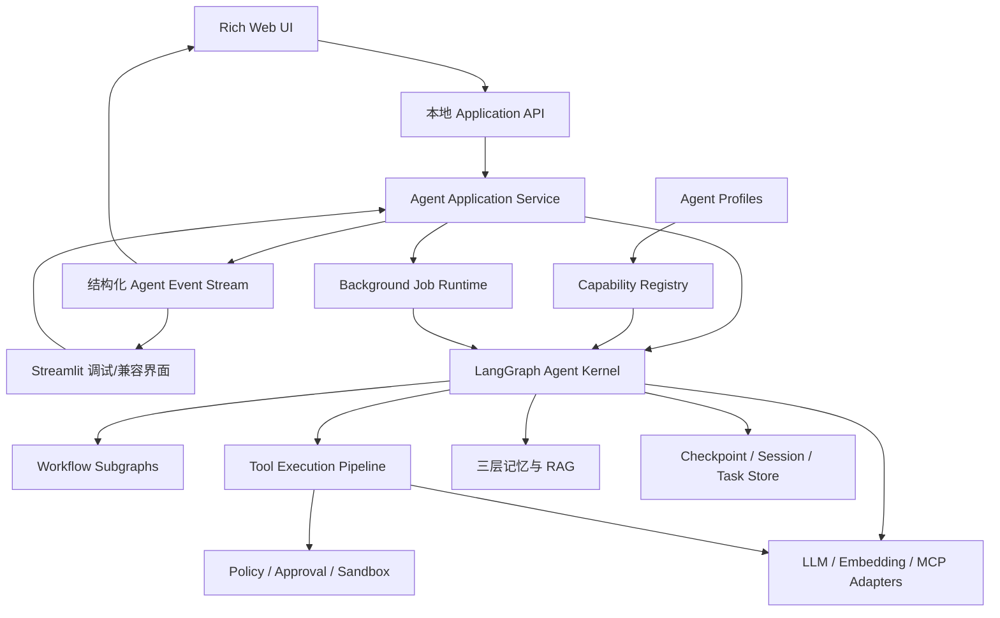
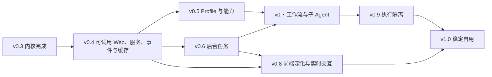

# Local Agent Web 后期产品演进路线图

> 状态：v0.3 已完成，进入 v0.4 规划与实施准备；未通过对应验收的后续能力仍不是当前实现承诺。
>
> 起点：v0.3 已完成。v0.4 优先解决“页面可试用、UI 与 Graph 解耦、模型调用成本可观察”三个直接影响真实使用的问题。
>
> 定位：在保留 Python + LangGraph 内核的前提下，把项目从“可学习、可自用的本地 Agent”演进为“能力丰富、可处理复杂任务、Web 交互完善的本地 Agent 产品”。
>
> 关系：`ARCHITECTURE.md` 与 `DEVELOPMENT_PLAN.md` 仍是 v0.1–v0.3 的权威文档；本文只规划 v0.4 之后。实施任何阶段前，必须先把该阶段涉及的稳定契约同步回架构文档，再形成具体开发任务。

---

## 1. 最终目标

最终产品应允许用户在本机浏览器中选择工作区和 Agent 类型，通过自然语言完成聊天、代码修改、命令执行、资料检索、长任务和复杂工作流，并能随时查看计划、工具调用、审批、证据、记忆和任务状态。

目标能力包括：

- 多种 Agent Profile，例如编码、研究、审查和通用助手。
- 文件、Shell、Git、代码检索、网页检索、MCP、Skill 等可组合能力。
- 多步骤规划、失败重试、动态重规划、暂停、继续和取消。
- 后台长任务、任务队列、进度展示和恢复。
- 必要时使用 LangGraph Subgraph 或子 Agent 隔离上下文和权限。
- 富 Web 交互：流式回答、计划面板、工具时间线、diff、终端、审批中心和任务历史。
- 本地优先、默认单用户、所有副作用可审计，危险操作必须经过代码级安全策略。

目标不是复刻 DeepSeek Harness 的 Cordis 插件运行时，而是在顶层实现同类用户能力，并保持整个 Agent 内核能够由个人读懂、调试和解释。

---

## 2. 明确不走的路线

以下内容不是默认方向，只有出现真实需求并单独立项后才考虑：

- 不采用“一切皆插件”，不把 State、Graph、数据库、UI 和 Agent Loop 全部动态装卸。
- 不为了扩展性提前拆成大量独立包或微服务。
- 不在没有评测证据前堆叠多个子 Agent。
- 不把 Streamlit 直接重写为复杂前端；先隔离应用边界，再替换展示层。
- 不默认支持公网、多租户、企业账号、集群调度和分布式执行。
- 不把 MCP Server、第三方工具或外部内容视为可信输入。
- 不用 Prompt 代替权限、路径、进程、资源和审批控制。

---

## 3. 长期设计原则

1. **LangGraph 继续是编排权威**：复杂任务、Subgraph、中断恢复和状态迁移继续由 LangGraph 表达，不另造 Agent 编排框架。
2. **内核与 UI 分离**：网页不直接拼装 Graph 参数或解释内部 State；所有交互通过稳定的应用服务入口和结构化事件完成。
3. **能力组合不等于动态插件**：先用显式注册和 Agent Profile 组合能力；只有第三方独立发布、安装和卸载成为真实需求时，才设计插件协议。
4. **确定性流程优先于模型自治**：能用规则、状态机或工作流确定的步骤，不交给模型自由决定。
5. **副作用必须可追溯**：模型看到的关键上下文、工具请求、安全判定、审批和执行结果都能从持久记录中解释。
6. **复杂度按证据增长**：每引入一种能力，都必须有固定评测、失败样例、资源上限和可关闭路径。
7. **本地优先且失败闭合**：网络、模型、MCP、浏览器或后台任务异常时，不得继续执行不确定副作用。
8. **模型请求可重建且缓存友好**：模型实际看到的系统提示、工具 Schema、消息前缀和动态上下文必须能从持久状态解释；稳定内容留在前缀，变化内容以可追溯快照追加，并记录供应商返回的实际 Token 与缓存命中数据。
9. **后续演进保持能力兼容**：v0.4 以现有 Python、LangGraph、Checkpoint、安全审批、三层记忆、上下文压缩、代码 RAG 和工具能力为基线做增量演进；在新路径通过行为等价与完整回归前，不删除、降级或静默关闭已经完成的功能。

---

## 4. 目标架构



职责边界：

- **LangGraph Agent Kernel**：任务状态、节点、边、循环、中断、恢复和 Subgraph。
- **Agent Application Service**：提交消息、恢复任务、审批、取消、读取状态；对 UI 隐藏 LangGraph 内部细节。
- **Agent Event Stream**：只负责 UI 增量展示和审计，不取代 Checkpoint，也不作为新的编排状态。
- **Capability Registry**：描述当前进程已经安装并允许使用的能力，不负责运行 Graph。
- **Agent Profiles**：选择某类 Agent 可见的工具、Prompt、模型、权限和工作流。
- **Background Job Runtime**：托管长任务生命周期，不把后台线程状态塞进浏览器会话。
- **Tool Execution Pipeline**：工具参数校验、安全分类、审批、执行、结果标准化和证据生成。
- **Security**：工作区权限、Shell 策略、资源上限、秘密保护和可选 OS 级隔离。
- **Checkpoint / Session / Task Store**：执行恢复、会话索引、任务索引和持久状态。

---

## 5. 能力模型：组合能力，不做万物插件

后期需要一个轻量能力注册层，但它只解决“某个 Agent 能使用什么”，不承担完整插件生命周期。

每项能力至少描述：

```text
Capability
├── stable_name
├── tools
├── prompt_sections
├── required_config
├── permission_policy
├── runtime_requirements
└── ui_presentation
```

概念示例：

```text
files       → list/read/edit/write/delete/search
shell       → run command / persistent terminal
git         → status/diff/log/branch/commit
web         → search/fetch
memory      → recall/write/forget
code_rag    → index/retrieve/symbol lookup
mcp         → discover and invoke external tools
skills      → load scoped instructions and resources
workflow    → run approved deterministic subgraphs
subagent    → delegate isolated tasks
```

Agent Profile 只引用能力名称，不复制工具实现：

```yaml
agent_profiles:
  coder:
    capabilities: [files, shell, git, code_rag, memory]
  researcher:
    capabilities: [web, memory, mcp]
  reviewer:
    capabilities: [files, git, code_rag]
```

以上只是目标配置形式，不是现有配置契约。真正实施前必须确定字段、迁移和校验规则；不得直接把示例加入当前 `config.yaml`。

---

## 6. Web 交互目标

### 6.1 v0.4 首个可试用页面

当前 Streamlit 页面不足以承担对外试用。独立 Web 页面不再等到后期统一重写，而是作为 v0.4 的首要用户成果；应用服务与事件边界围绕这个真实消费者同步建立，避免先做一套没有页面验证的抽象。

首个可试用版本以 DeepSeek Harness 当前 Web 页面为**明确的视觉与交互基准，进行高保真实现**，不是只借鉴页面组成后自由发挥。开工前必须保存经过确认的参考截图和状态清单，先提取设计 Token，再实现组件；布局比例、配色、字体层级、字号、间距、圆角、边框、阴影、信息密度、图标尺寸、悬停/选中/禁用状态和动画节奏都应尽量对齐。允许因本项目功能边界做删减，不允许以“功能已经存在”为理由交付明显粗糙、浏览器默认样式或视觉层级混乱的页面。

“高保真”不表示复制 DeepSeek Harness 的源码、Logo、鱼形标记、产品名称、专有图标资产、插件运行时、Slot 系统或 Monorepo 组织；本项目使用独立实现和自身标识。视觉参考范围包括：

- 常驻会话壳：工作区/会话侧栏、当前会话标题、对话主区域和始终可达的输入区。
- 空会话可直接选择工作区并开始对话；已有会话可切换、恢复和继续。
- 用户消息、模型回答、错误和上下文说明有稳定且可区分的展示层级。
- 工具调用在对话流中显示为可折叠状态行，至少呈现工具名、阶段、耗时、结果摘要和失败原因；文件修改提供 diff。
- 当前计划显示在输入区附近，默认紧凑，按需展开步骤与状态。
- 审批发生时由审批卡接管输入区，展示动作、参数、影响与风险，并提供一次性批准或拒绝；前端按钮不构成授权边界。
- 每个助手轮次底部用紧凑、低干扰的统计行展示本轮实际输入/输出 Token、缓存命中率和端到端耗时；一次用户提交包含多次模型调用或工具循环时默认展示整轮汇总，可展开查看各模型调用明细。供应商未返回缓存字段时显示“未知”，不能显示为 0%；只能使用估算量时必须标注“估算”。
- 输入区旁提供圆形上下文计量器，显示“当前已使用 / 模型最大上下文”，例如 `371k / 1000k`，圆环按占用比例变化并为接近上限提供清晰但不过度惊扰的状态；悬停或展开后说明系统提示、工具 Schema、消息与输出预留的统计口径。
- 页面提供与整体视觉一致的模型选择器和设置入口：可保存多个 OpenAI 兼容聊天模型连接，填写显示名称、端点、模型 ID、可选 API Key、上下文窗口、输出上限及必要的生成参数；无鉴权的本地兼容端点可明确选择“不需要 Key”。无本机配置文件或模型密钥时，Web 仍能启动到初始设置页；完成连接后无需重启即可开始对话。可主动测试连接、查看能力/错误、设置新会话默认模型，并在会话中选择下一轮使用的模型。保存和切换后无需重启 Python 服务或刷新页面。
- API Key 只在录入或更换时发送给本地服务；设置页仅显示“已配置/未配置”和掩码，不提供明文回读。删除连接需二次确认；旧会话和历史用量仍保留当时的模型标识。
- 页面刷新后恢复已经发生的消息、工具、计划和审批状态，不重新执行 Graph 或工具。

必须为下列状态建立成对参考截图或原型，不得只画一个理想静态首页：空会话、普通对话、流式生成、工具执行中、工具成功、工具失败、等待审批、文件 diff、长回答/长工具输出、错误提示和刷新恢复。首版以桌面端为主，至少覆盖常用 1440×900 与 1280×800 视口；更窄屏幕可以在 v0.4 明确标注限制，但关键审批和发送操作不能被遮挡。

### 6.2 最终页面组成

- 会话与工作区侧栏。
- 对话主区域，支持流式文本和中断状态。
- 当前目标、计划、步骤和完成度面板。
- 工具时间线：等待、执行、成功、失败、拒绝和取消。
- 文件修改 diff 视图，支持按文件查看与审批。
- Shell/终端输出视图，区分 stdout、stderr、退出码和超时。
- 审批中心：动作、参数、影响范围、风险、修改参数、批准和拒绝。
- 记忆面板：召回来源、作用域、写入候选、删除和失效状态。
- 后台任务中心：排队、运行、等待用户、完成、失败和取消。
- 模型、能力和权限设置页；v0.4 先交付可编辑的聊天模型连接设置，能力和权限编辑按后续阶段各自的安全契约开放。
- 任务轨迹与评测结果页。

### 6.3 UI 事件

UI 不应解析任意内部 State 差异。v0.4 先定义下列最小稳定类别，后续阶段只在真实消费者需要时扩展：

```text
session_snapshot
message_started / message_delta / message_completed
plan_updated / step_started / step_completed
tool_started / tool_output / tool_completed
approval_required / approval_resolved
memory_recalled / memory_written
model_call_started / model_usage_reported / model_call_completed
task_completed / task_failed
```

事件必须带稳定的事件与会话标识；任务级事件还必须带任务和运行标识。空会话的 `session_snapshot` 可以没有当前任务/运行标识，不能为满足字段而伪造。重复投递不能让 UI 重复显示或触发工具。具体字段不在本文提前定义，避免与未来 State 契约冲突。

`job_queued / job_progress / job_waiting / job_completed / task_cancelled` 属于 v0.6 后台任务契约，不是 v0.4 的占位实现。v0.4 不公开没有真实后端语义的取消按钮或取消事件。

v0.4 的 SSE 是进程内实时投影，不承诺持久游标续传。首次连接和重连都先取得权威 `session_snapshot`，再接收连接建立后的增量；最终消息、审批、工具结果和任务状态必须能从 Checkpoint 快照恢复。持久事件游标、长时间断线补发和分页留到 v0.8。

模型用量事件只携带展示与诊断所需的安全字段：供应商、模型、估算 Prompt Token、实际未缓存输入、缓存读取、缓存写入、输出、推理 Token，以及系统提示、工具 Schema 和历史前缀的不可逆指纹。不得写入 API Key、隐藏思维链或未经脱敏的完整 Prompt。缓存命中率统一按 `cache_read / (uncached_input + cache_read + cache_write)` 计算；字段缺失表示未知。

页面展示的是**可验证的执行过程**，不是模型隐藏思维链：可以流式展示最终回答、当前阶段、安全的决策摘要、计划、工具名称与状态、脱敏参数、输出摘要、记忆/RAG 的来源与命中状态、审批、错误证据和用量；不得展示供应商 `reasoning_content`、原始 Chain-of-Thought、系统/开发提示、完整 Prompt、密钥或未经脱敏的记忆正文。推理 Token 只作为数值指标展示。Web 搜索在 v0.5 实现后复用同一工具时间线，v0.4 不伪造联网过程。

### 6.4 独立 Web 与 Streamlit 的边界

v0.4 直接启动独立 Web 前端，技术栈冻结如下；具体依赖版本在开工时通过锁文件固定，不照抄 DeepSeek Harness 的版本号：

```text
Python 服务端     FastAPI + Uvicorn
前端              React + TypeScript + Vite
命令与查询        JSON HTTP API
流式文本与事件    SSE
服务端状态        TanStack Query
本地 UI 状态      Zustand
样式              CSS Modules + CSS Variables / Design Tokens
前端单元测试      Vitest + React Testing Library
端到端与视觉回归  Playwright
生产发布          Vite 静态产物由 FastAPI 同源托管
```

选择原则：Agent、LangGraph、Checkpoint、安全和审批继续留在 Python；React 只负责展示事件和提交命令。开发时 Vite 与 Uvicorn 分别运行并由 Vite 代理 `/api`；发布时前端先构建为静态文件，再由 FastAPI 在同一回环地址和端口提供页面与 API，因此朋友试用不需要单独启动 Node 服务，Node 只属于开发和构建环境。

样式不以 Ant Design、Material UI 等带完整视觉语言的组件库为基础，也不以 Tailwind 工具类临场拼接为主要实现方式。先从确认后的 DeepSeek Harness 参考截图提取颜色、字体、字号、行高、间距、尺寸、圆角、边框、阴影、透明度和动画时间等设计 Token，再用 CSS Modules 和项目自己的 React 组件实现。可以使用无样式基础组件或通用图标库，但不得让其默认外观覆盖高保真目标。

服务端单向增量使用 SSE：提交消息、审批和状态查询走普通 HTTP，请求成功后由事件流推送模型文本、工具、计划、错误和用量变化。v0.4 没有持久终端和真正双向实时控制需求，不引入 WebSocket；没有 SEO 和服务端渲染需求，不引入 Next.js。

v0.4 的受支持部署拓扑固定为单个 Python 进程、单个 Uvicorn worker（`workers=1`）。进程内事件广播、会话互斥和幂等保护都以此为边界；多 worker、跨进程广播和分布式锁只有在后续引入持久任务运行时后才评估。

- 独立 Web 是朋友试用和后续产品演进的主界面。
- Streamlit 在过渡期只保留为内核调试、故障定位和回归对照入口，不再作为新交互能力的首选实现。
- 两个界面必须调用同一应用服务，不得各自解释 Graph State 或复制审批、错误和恢复逻辑。
- 独立 Web 达到 v0.4 验收后，是否继续维护 Streamlit 由实际调试价值决定，不预先承诺长期双 UI 功能对等。

浏览器服务默认只监听回环地址。朋友试用优先采用“在其本人机器上本地启动”的方式；公网部署、账号体系和远程工作区不属于 v0.4。

---

## 7. 分阶段路线图

### v0.4｜可试用 Web、应用服务、结构化事件与缓存优化

**目标**：先交付一个朋友能够实际使用的本地 Web 页面，同时把 UI 与 LangGraph 内部调用分开，并建立模型用量、缓存命中与请求稳定性的可观测基线。

主要工作（按实施顺序）：

- 先冻结 DeepSeek Harness 参考截图集、页面状态矩阵、设计 Token、关键交互、桌面端布局和高保真验收原型；优先完成常驻会话壳、对话流、输入区、工具状态行、计划条、diff 和审批卡。
- 按已冻结的 FastAPI/Uvicorn + React/TypeScript/Vite 技术栈建立最小启动骨架、开发代理和生产静态托管；默认本机回环访问，不建立公网服务。
- 交付可视化聊天模型设置：现有 `config.yaml`/环境变量中的单模型配置作为首次迁移来源，用户可以增加多个 OpenAI 兼容连接、保存密钥引用、主动测试连接、选择新会话默认模型和会话下一轮模型；修改立即用于后续新提交，无需重启。已开始或等待审批的运行固定原模型与参数，切换不改写其执行上下文。
- 建立应用服务入口：创建/选择会话、提交消息、继续任务、读取状态和审批；v0.4 不公开取消接口，也不渲染没有后端语义的停止按钮。
- 定义最小 UI 事件投影，覆盖消息、工具、计划、审批、错误、模型用量和最终状态。
- 同一会话的执行状态修改采用单飞语义：消息提交和审批恢复不能并发执行；不同 `client_request_id` 的第二个执行请求得到稳定的“会话忙”错误，同一请求 id 的重试返回原执行关联结果，不能再次调用模型或工具。模型选择只配置下一轮，不改变当前运行。幂等记录必须跨进程重启恢复，但不成为第二套任务执行真源。
- 独立 Web 只调用应用服务并渲染事件，不导入 Graph State、节点、LangChain 消息类或 LangGraph `Command`。
- Streamlit 改为调用同一应用服务并渲染同一事件，作为调试与回归对照入口。
- 统一错误分类：配置、模型、工具、安全、审批、恢复和系统错误。
- 保持现有 Checkpoint 为执行状态真源，不引入第二套可写状态。
- 采集每次模型调用的供应商实际 Token 用量；统一区分未缓存输入、缓存读取、缓存写入、输出与推理 Token，供应商未报告的字段保持未知。
- 为模型请求记录安全指纹，至少覆盖模型/端点、稳定系统提示、工具 Schema、历史前缀、动态上下文版本和压缩边界，用于解释缓存命中与失效。
- 把 Prompt 拆为稳定系统前缀和动态运行上下文快照；记忆、RAG、摘要、任务、计划、模式理由和当前目录等变化内容不得继续改写第一条系统消息。
- 动态快照使用固定顺序和确定性序列化，作为与聊天消息分离的 `RuntimeContextSnapshot` 持久记录；请求组装器只把最新快照以带明确来源标记的上下文块注入当前真实用户输入之前。它不能直接拼入用户原文，不能显示成用户气泡、建立新轮次、触发记忆写入或被摘要器当作用户陈述。
- 在真实用量基线建立后，再把持续滑动窗口调整为缓存 epoch：普通轮次只追加，达到压缩边界时统一生成新快照并允许一次可解释的缓存失效。

不做：后台并发、持久任务队列、持久终端、WebSocket、Next.js、Electron/Tauri、Redis/Celery、微服务、MCP、子 Agent、Profile 扩展、远程访问、账号系统，也不复制 DeepSeek Harness 的插件运行时和包结构。v0.4 模型设置限于聊天模型的 OpenAI 兼容接口，不做任意供应商私有协议、Embedding 模型热切换或安全/权限的通用配置编辑器。

验收：

- 现有 v0.1–v0.3 回归全部通过。
- 新用户能够在本机完成“选择工作区 → 新建会话 → 发送消息 → 查看流式回答和工具进度 → 审批或拒绝 → 查看 diff/结果 → 刷新后继续”的逐项人工操作检查。
- 新用户从缺少 `config.yaml`/API Key 的干净环境启动 Web，进入初始设置页配置两个不同的兼容模型连接，在页面主动测试、保存、选择并连续对话；切换后下一轮使用新模型且不重启服务，刷新后选择仍在。正在运行或等待审批的任务继续使用原模型；端点无效、密钥错误、能力不支持时给出可执行提示，不能悄悄退回旧模型。
- 在固定 1440×900 与 1280×800 视口为关键状态生成本项目截图，并与已确认的 DeepSeek Harness 参考截图逐项对照；布局、尺寸、间距、颜色、字体层级、圆角、边框、阴影、图标和状态反馈的差异都必须有明确理由，不能用“主观上差不多”代替验收。
- 页面不得出现未经设计的浏览器默认控件、裸露原始 JSON、明显错位/跳动、文本溢出、低对比度状态或风格不一致的临时组件；关键状态的截图回归进入前端测试资产。
- 页面在常用桌面浏览器尺寸下没有遮挡关键操作、不可达审批或必须阅读原始 JSON 才能继续的问题。
- 每个已完成助手轮次都显示独立统计行；多模型调用汇总与明细加总一致，刷新后不串到相邻轮次。耗时口径为用户提交被接受到该轮最终状态确定的端到端时间，模型/工具分项只在明细中展示。
- 每次模型调用与轮次明细保留实际模型连接的稳定 ID/版本、模型 ID 和端点安全指纹；跨模型切换的统计分别归属，不能把旧模型 Token 或缓存命中算到新模型。
- 圆形上下文计量器显示已组装模型请求的估算输入 Token 与配置中的模型最大上下文；执行中显示最新一次即将发送/已经发送的模型请求，空闲时明确标记为“上一请求”，尚未组装或窗口未知时显示未知，不能把旧值伪装为当前草稿的实时精确值。数值、百分比、颜色状态和悬停说明一致，输出预留单独展示且不重复计入已用输入；达到压缩阈值或接近上限时有确定性视觉状态。
- 开发模式下 Vite 能稳定代理本地 API 与 SSE；生产构建后只启动 Python 服务即可访问页面、普通 API 和事件流，不要求朋友另开 Node 进程。
- 前端组件测试由 Vitest + React Testing Library 执行，关键用户路径与固定视口截图由 Playwright 执行；截图差异必须人工确认后才能更新基线。
- 同一任务经独立 Web、Streamlit 和直接应用服务调用得到等价业务结果。
- 页面刷新只读取权威 `session_snapshot` 并继续接收实时事件，不重放模型、Graph 或工具副作用。
- 两个 UI 都不导入 Graph 节点实现、State、LangChain 消息类或 LangGraph `Command`，也不根据节点名决定业务结果。
- 固定任务可导出无密钥、无隐藏思维链的事件轨迹。
- 实际 Token 与估算 Token 分开记录；DeepSeek 未返回缓存字段时显示未知，不得伪造零命中。
- 相同模型、端点、工具集和静态配置下，连续请求的系统提示与工具 Schema 字节一致；动态记忆、计划和任务变化不改变稳定系统提示指纹。
- DeepSeek 固定多轮任务在首轮之后至少一次报告 `cache_read_tokens > 0`；优化前后保存未缓存输入与缓存读取对照，不预设未经基线证明的命中率百分比。供应商或网络不可用时可以把真实验证标记为 `blocked-external` 并继续不依赖该结果的开发，但不能据此宣称缓存验收通过；正式发布若要豁免，必须由人工在验收记录中明确批准、写明证据、影响和补验条件。
- 摘要、模型切换、工具 Schema 变化或动态上下文重建造成的缓存下降能够由事件指纹解释。
- 缓存优化不得降低记忆召回、RAG、计划、审批和错误承诺修正的现有正确性。
- 新应用服务和独立 Web 不得删减 v0.1–v0.3 已完成能力；旧入口只有在等价测试通过后才能移除直接依赖，功能关闭必须继续由既有显式配置控制。

学习与简历证据：可试用 Agent Web UX、前后端边界、事件投影、幂等 UI、可恢复 Agent API、可重建模型请求、Token 与 KV Cache 可观测性。

### v0.5｜Agent Profile 与业务能力扩展

**目标**：让不同 Agent 拥有不同工具、Prompt 和权限，但仍采用静态注册，不实现动态插件安装。

主要工作：

- 建立 Capability Registry 和 Agent Profile 配置校验。
- 增加 Git 能力：状态、diff、日志和受控提交；高风险写操作继续审批。
- 增加 Web 搜索/读取能力；外部内容标记为不可信上下文。
- 增加 Skill 能力：按需加载指令和资源，复用 AGENTS 的作用域、安全和截断原则。
- 在页面展示当前 Profile、已启用能力及不可用原因。
- 每个 Profile 只把自身工具 Schema 注入模型，减少 Token 和误调用。

不做：第三方 Python 包动态加载、插件市场、运行期热卸载。

验收：

- `coder`、`researcher`、`reviewer` 至少三个 Profile 有固定任务集。
- Profile 之间不可见的工具不能被模型调用，也不能绕过注册表直接执行。
- 缺配置或依赖时在启动或选择 Profile 时明确失败。
- Web 内容中的提示注入不能修改系统安全策略或自动授权工具。
- 关闭新增能力后，原基础 Agent 行为不变。

学习与简历证据：能力注册、Profile 组合、最小权限工具集、Prompt Injection 防护。

### v0.6｜后台任务与长时间运行

**目标**：支持不占用一次页面请求的长任务，并允许查看进度、等待审批、取消和重启恢复。

主要工作：

- 建立持久任务索引，区分会话、任务和单次运行。
- 建立本机后台 Job Runtime；任务状态至少覆盖排队、运行、等待用户、完成、失败和取消。
- 把长任务进度转换为结构化事件。
- 支持协作式取消、超时、资源上限和进程树清理。
- 明确“副作用已发生但状态未提交”的恢复策略，不能自动假定恰好执行一次。
- 页面提供任务中心和恢复入口。

不做：分布式队列、远程 Worker、多机调度。

验收：

- 关闭浏览器后任务可按策略继续，重新打开可查看状态。
- 服务重启后能区分可恢复、失败和需要人工核对的任务。
- 取消后不会启动新的工具调用；已启动进程按平台策略终止并记录结果。
- 一个任务等待审批时不阻塞其他会话的只读操作。
- 任务状态变化有自动测试和页面演示。

学习与简历证据：持久任务状态机、协作式取消、后台执行、崩溃恢复。

### v0.7｜复杂工作流、Subgraph 与受控子 Agent

**目标**：在单 Agent 评测稳定后，用确定性工作流和隔离执行处理更复杂任务。

主要工作：

- 把常见复杂任务建成 LangGraph Subgraph，例如“理解代码→修改→测试→复盘”。
- 工作流显式声明输入、输出、资源上限、可调用能力和终止条件。
- 主 Agent 优先调用确定性工作流，而不是临时生成任意控制流。
- 仅对适合隔离或并行的任务增加子 Agent：独立上下文、权限、预算和结果报告。
- 子 Agent 只返回有界结构化结果和证据，主 Agent 负责验收，不直接继承隐藏推理。
- 加入并发上限、总 Token 上限、总工具调用上限和失败收敛。

不做：自治 Agent 社会、无上限递归委派、默认并行执行所有工具。

验收：

- 至少两个 Subgraph 在固定复杂任务上优于自由工具循环，并有对照指标。
- 子 Agent 失败、超时或返回无证据结果时，主任务不会伪装成功。
- 子 Agent 不能获得 Profile 未授予的工具和工作区。
- 重启后可恢复主任务，并正确识别已完成的子任务。
- 委派层级、并发数、Token 和循环次数都有硬上限。

学习与简历证据：LangGraph Subgraph、层次化规划、上下文隔离、并发与结果验收。

### v0.8｜前端深化与可恢复实时交互

**目标**：在 v0.4 可试用 Web 和 v0.6 后台任务已经稳定后，补齐多任务、断线恢复和高级实时交互，而不是重新建设另一套前端。

开工决策门：

- 复核 v0.4 的 API、SSE 和前端测试栈是否仍满足后台任务与多任务展示。
- 根据 v0.4 的实际调试价值决定 Streamlit 是保留为调试入口还是进入维护模式。
- 只有出现持久终端或真正双向实时控制需求时，才评估并批准 WebSocket。

主要工作：

- 深化会话、计划、工具时间线、diff、审批、记忆和任务中心，不重写 v0.4 已有页面壳。
- 支持后台任务、多会话并行状态和等待用户操作的集中展示。
- 完善断线重连、游标续传、长时间流式输出和大结果分页。
- 在需求成立并批准后增加持久终端等双向交互。
- 前端根据事件标识去重，断线重连后从游标恢复。
- 所有危险操作仍由 Python 安全层裁决，前端按钮不构成授权边界。

不做：默认公网监听、多人账号、云端同步。

验收：

- 前端断线重连不丢最终结果、不重复工具和审批。
- 流式关闭时可退化为完整结果。
- diff、Shell、审批和任务状态均能从事件恢复。
- 直接伪造前端请求不能绕过权限与审批。
- v0.4 页面与 v0.8 增强功能共享同一应用服务回归集；若 Streamlit 仍保留，也必须继续走这套契约。

学习与简历证据：前后端分离、SSE/WebSocket、事件恢复、Agent UX、安全边界。

### v0.9｜执行隔离与可靠性增强

**目标**：把应用层路径检查和审批扩展为更可靠的本机执行边界。

主要工作：

- 抽离文件系统和子进程执行适配器，保持工具 Schema 不随执行环境变化。
- 评估 Windows 受限令牌/ACL、Linux namespace/Landlock、容器或其他本机隔离方式。
- 限制环境变量、网络、CPU、内存、运行时间、进程树和磁盘范围。
- 对工具执行、审批和恢复增加故障注入测试。
- 建立数据库备份、迁移、损坏检测和恢复流程。
- 完善敏感信息审计和日志脱敏。

不做：未经验证就宣称“安全沙箱”或“完全隔离”。

验收：

- 每个平台只声明实际测试过的隔离能力。
- 子进程无法通过软链接、路径别名或环境变量越过允许范围。
- 超时和取消能终止完整进程树。
- 服务崩溃、数据库锁、磁盘满和部分写入均有明确恢复或停止策略。
- 无隔离后端时明确显示降级边界，不静默使用更高权限执行。

学习与简历证据：OS 级隔离、资源治理、故障注入、跨平台安全验证。

### v1.0｜稳定自用版本与公开演示

**目标**：形成可重复安装、可长期自用、可公开演示且能力声明真实的稳定版本。

主要工作：

- 冻结首个受支持的配置、数据库、事件和 API 版本。
- 提供迁移、备份、恢复、卸载和模型缓存管理说明。
- 建立完整固定评测集和版本基线。
- 提供一键本机启动和环境诊断。
- 完成威胁模型、已知限制和隐私说明。
- 准备演示任务、录屏脚本、架构图和简历证据。

验收：

- 新机器按 README 可完成安装、配置和首个任务。
- 升级不会静默丢失会话、记忆、任务或审批记录。
- 固定评测结果达到预先定义的成功率、错误宣称率和重复副作用上限。
- 离线能力、联网能力和需要 API Key 的能力在 UI 中明确区分。
- 所有简历与 README 能力都对应代码、测试和可复现演示。

---

## 8. 阶段依赖关系



说明：v0.4 先交付可试用 Web，并同时建立应用服务、事件与缓存观测边界；v0.5 与 v0.6 可以在 v0.4 后并行。v0.8 不再创建独立前端，只在 v0.4 页面基础上深化多任务与可恢复实时交互，因此依赖 v0.6 的后台任务边界；v0.9 可以针对已经稳定的工具管线独立推进。

---

## 9. 每阶段统一交付要求

每个阶段都必须交付：

- 对应的架构契约修订和迁移说明。
- 可逐个开工的开发任务清单。
- 单元测试、集成测试和至少一个真实可运行演示。
- 关闭新增能力时的基础功能回归。
- 失败路径、资源上限和安全边界。
- 用户可见的状态和可执行的错误提示。
- README 当前进度与已知限制更新。
- 不含密钥、隐藏思维链和私人数据的演示证据。

阶段退出前统一检查：

```text
功能是否真实可用
错误是否能被观察和恢复
副作用是否可追溯且不会重放
新增能力是否可以关闭
配置、文档、代码和 UI 是否一致
是否有固定任务证明效果优于前一阶段
```

---

## 10. 关键风险与停止条件

| 风险 | 停止条件 | 控制方向 |
|---|---|---|
| 能力越多，工具选择越差 | 基础任务成功率明显下降 | Profile 限定工具集、工具描述评测、分层路由 |
| UI 与 Graph 强耦合 | 修改节点导致大量 UI 回归 | 应用服务与稳定事件投影 |
| 为追求页面效果复制第二套业务逻辑 | 新页面与 Streamlit、Checkpoint 得出不同任务状态 | 先定义最小应用服务与事件契约，所有 UI 只做投影和命令提交 |
| 动态上下文破坏前缀缓存 | Token 成本随对话增长且缓存读取长期接近零 | 实际用量观测、请求指纹、稳定系统前缀、追加式动态快照、缓存 epoch |
| 只优化命中率而损害正确性 | 记忆、计划、审批或错误修正回归 | 固定评测与真实任务双门槛；正确性回归立即停止缓存改造 |
| 后台任务重复副作用 | 刷新、重启或重连重复执行写操作 | 幂等键、Checkpoint、执行前后证据、人工核对 |
| 子 Agent 成本失控 | 委派递归、并发或 Token 无上限 | 层级、并发、预算和总循环硬限制 |
| 外部内容提示注入 | 网页/MCP 内容改变安全策略 | 不可信内容标记、权限隔离、系统规则不可覆盖 |
| 本地 Web 被误开放 | 非回环地址无认证访问 | 默认回环、启动检查、远程访问另行设计 |
| “沙箱”名不副实 | 未隔离的命令被描述为安全沙箱 | 只声明实测能力，缺后端时明确降级 |
| 事件与 State 双写漂移 | UI 和恢复看到不同事实 | State 负责执行，事件负责投影；单向生成、禁止双向修改 |
| 过度平台化 | 大量基础设施没有用户场景 | 每个抽象必须由两个以上真实消费者证明 |

---

## 11. 从 DeepSeek Harness 借鉴与不复制的内容

值得借鉴：

- 模型可见的关键输入必须能够追溯。
- 模型请求的稳定头部、工具 Schema 和历史前缀可重建；变化的运行上下文以有来源的完整快照追加，避免重写首条系统消息。
- 供应商实际 Token 与缓存读取数据进入统一用量模型，并在页面显示可解释的命中率。
- 工具注册、执行、安全策略和 UI 展示职责分离。
- 会话、轮次、步骤、工具和取消有明确生命周期。
- 能力提供方与使用方分离，便于替换执行环境。
- 固定场景回放、快照和故障路径测试。
- 前端以其当前 Web 页为高保真视觉与交互基准，对齐常驻会话壳、输入区、紧凑工具行、计划条、审批接管和统计状态行的布局、层级、密度与状态反馈，用最少层级让用户看清“正在做什么、是否需要我、花费多少”。

不直接复制：

- Cordis 运行时和“一切皆插件”。
- 前端 Slot/插件注册体系及其大量细粒度 UI 包；当前项目使用普通组件和显式页面结构即可。
- 数百包粒度的 Monorepo。
- 当前项目没有消费者的动态安装、热卸载和插件市场。
- 为平台兼容性而引入的完整 SDK、协议和多进程组合层。

判断标准：如果一个顶层能力能通过 LangGraph 节点、Subgraph、普通 Python 服务和显式注册清楚实现，就不引入更重的插件生命周期。

---

## 12. 可展示的最终成果

完成本文路线后，可以真实展示：

- 一个基于 LangGraph、支持复杂任务恢复的本地 Agent 内核。
- 可组合 Agent Profile 和最小权限能力集。
- 本地三层记忆、代码 RAG、Web/MCP 工具和受控子 Agent。
- 后台长任务、取消、审批、失败恢复和事件轨迹。
- 独立富 Web 前端与可恢复流式交互。
- 跨平台工具策略和经过实测的本地执行隔离。
- 固定评测集、错误宣称控制和重复副作用验证。

简历表述必须以实际完成阶段为准。本文中的能力在对应验收完成前只能描述为“规划中”，不能描述为已实现。

---

## 13. v0.4 当前规划入口

v0.3 已完成，v0.4 按以下顺序形成独立开发计划：

具体施工、依赖、逐任务测试与退出门槛见 [V0_4_DEVELOPMENT_PLAN.md](V0_4_DEVELOPMENT_PLAN.md)。路线图继续负责产品方向，该计划负责 v0.4 的实施顺序；两者冲突时必须先修订文档，不能由代码自行选择一种解释。

1. 先冻结首个可试用 Web 的页面范围、DeepSeek Harness 参考截图集、页面状态矩阵、设计 Token、高保真原型和逐项视觉/操作验收清单；模型选择器与设置页包含在参考状态内。视觉与交互高度还原，但不复制其源码、品牌资产和运行时架构。
2. 根据页面真实需要定义最小应用服务、模型连接设置和 UI 事件；模型设置先支持多个 OpenAI 兼容聊天连接及下一轮免重启切换，不提前建设后台任务、并发调度、取消或通用插件协议。
3. 建立模型实际 Token、缓存命中和请求指纹观测，跑固定多轮 DeepSeek 场景，保存优化前基线。
4. 拆分稳定系统前缀与动态上下文快照，再根据观测结果处理滑动窗口、压缩边界和回答投影；每一步都用固定评测保护正确性。
5. 用一个纵向切片接通“工作区/会话 → 对话 → 工具 → 审批 → diff/结果 → 刷新恢复”，通过后再补齐 v0.4 页面细节。
6. 只把 v0.4 转换为可逐个开工、可独立验收的开发任务；不要一次性把 v0.5–v1.0 落成代码任务。

v0.4 的停止条件：页面原型不能覆盖一次完整安全任务、应用服务需要复制 Graph 真源、快照/事件投影会触发副作用、缓存优化降低现有正确性，或为了页面效果需要引入当前没有真实消费者的平台化抽象。命中任一条件时先修订架构契约，不继续堆功能。
