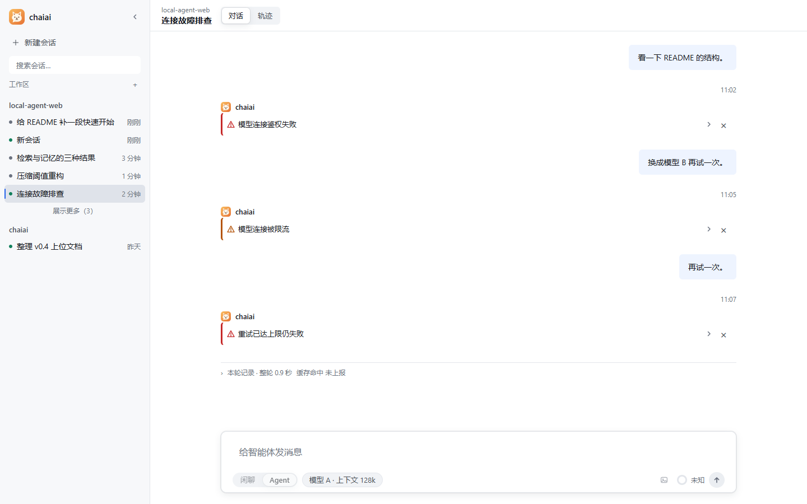

# chaiai

**跑在你自己电脑上的 AI Agent。** 会话、记忆、文件、工具执行全在本机，模型端点由你自己填。

*chaiai is a local-first AI agent for Windows: conversations, memory and files never leave your machine — you bring your own model endpoint.*


> **状态：v0.1.0 早期版本。** 契约与接口仍在变动，不建议作为生产依赖。
> 现在开源是为了先听意见——结构、契约、安全边界上的问题，欢迎直接开 issue。


*界面截图使用仓库内的夹具场景渲染（演示数据，非真实会话）。*

## 它解决的问题

大多数 agent 项目是"云端服务 + 网页外壳"：你的文件要上传、密钥交给别人、执行发生在看不见的机器上。
chaiai 反过来——**它就是一个装在你电脑上的程序**：

- 文件读写、命令执行、浏览器操作，都在你本机发生，你能在页面上看到每一步
- 会话、记忆、设置、密钥存在本地 SQLite，卸载都不删
- 模型只在你配的那一个端点上跑，没有中转、没有遥测

## 快速开始

### 方式一：安装包（推荐，Windows 10/11）

1. 到 [Releases](https://github.com/LaoTouAiLe/chaiai/releases) 下载 `chaiai-setup-<版本>.exe`
2. 双击安装（可以改安装位置；默认装到用户目录，不需要管理员权限）
3. 启动后是一个**程序窗口**（不是浏览器标签页），在「设置 → 模型连接」里填你自己的端点与密钥

安装、卸载、数据位置、降级说明见 [使用说明](packaging/使用说明.txt)。

### 方式二：从源码跑

前置：**Python 3.10+**、**Node 22.20+**、[uv](https://docs.astral.sh/uv/)。

```powershell
cd local-agent-web
uv sync                 # 需要中期记忆/本地向量时：uv sync --extra memory
cd frontend
npm ci
npm run build
cd ..
uv run python -m local_agent.api
```

打开 http://127.0.0.1:8000 。开发时在 `frontend/` 跑 `npm run dev`（5173，代理到 8000）。
想要桌面窗口而不是浏览器：`uv run python -m local_agent.api --window`。

配置：首次可以不建 `config.yaml`，直接在网页设置里添加模型连接；需要改文件时从
`config.yaml.example` / `.env.example` 复制，**不要覆盖已有的 `config.yaml`**。

## 功能

### 对话与工具循环

- 一轮任务由模型自己决定调用哪些工具、调几次；过程、思考、参数、输出、耗时都在页面上
- **审批卡**是关键动作的闸门：写文件、跑命令、启动终端都要你点「允许一次」，批准只对那一次生效
- 只读工具可以并行；改动会在对话里内联成 diff，不用切页签


- 运行中可随时停止；停止只中断这一轮，**不撤销已经发生的副作用**，页面会明确告诉你哪些已执行
- 失败如实报告，不伪装成成功：



### 文件与命令

| 能力 | 说明 |
| --- | --- |
| 读 | 定点读行区间、大文件分段续读（带版本校验，防止把改过的内容拼在一起） |
| 写 | 精确串替换（默认只允许一处匹配）、整文件写入；冲突会明确拒绝而不是猜 |
| 找 | 目录列举、全文搜索、grep / glob；结果分页，有游标可以接着翻 |
| 跑 | 命令执行、后台任务、可交互的持久终端；超时与输出上限可配 |
| 边界 | Windows 写侧沙箱按权限档位派生；外部目录要显式授权，撤销后仍可读 |

### 浏览器

独立的 Edge/Chrome 实例（不借用你个人浏览器的登录态），13 个动作：打开、切标签、导航、
快照、点击、填表、按键、滚动、等待、截图、改窗口大小、下载、关闭。

### 三层记忆

| 层 | 存什么 | 怎么用 |
| --- | --- | --- |
| 短期 | 当前对话 | 超过上下文阈值自动压缩，保留最近 N 轮与关键工具结果 |
| 长期 | 事实、偏好、结论 | 跨会话自动注入；有权重、置信度与老化策略 |
| 中期 | 对话摘要的向量 | 语义召回（可选依赖：Chroma + Embedding），阈值可调 |

记忆不是黑盒：数据中台能看到写入了什么、召回了什么、每次调用的 token 与缓存命中。

### 联网检索

- 后端可选：**Tavily**、**DeepSeek 搜索 API**、Bing / DuckDuckGo 网页版（不需要密钥）
- 抓取正文可选**本机抓取**（默认）或交给 DeepSeek 抓取（会把网址发给对方，按次计费）
- 支持时间范围与站点筛选；`408/429/5xx` 按官方要求重试，其它 4xx 一次即失败
- 空结果是"没搜到"，不是错误——不会骗模型换后端

### 工作台

右侧面板：文件树、工作区搜索、Git 状态与 diff、浏览器、终端、任务中心。
「会话地图」把一次会话的分支与追问关系画成卡片树，可以回看任一分支并继续追问。

### 设置

模型连接（多连接、可测连通性）、权限档位、外观、任务与预算、联网检索、长期/中期记忆与
Embedding、MCP 服务器、技能开关。密钥只能写不能读回，接口里只暴露"是否已配置"。

## 安全边界（请先读）

- **只监听回环地址**，没有账号体系，也没有登录页。想跨机器访问必须先自己做认证——现在把端口暴露到局域网等于把终端交给同网段所有人。
- **模型要自己配**：项目不提供 API Key，也不代购。
- **审批不是可选项**：写文件、跑命令走人工批准；Windows 上有写侧沙箱，但它只约束**写**，不隔离读和网络。
- **命令可以自行联网**，当前没有 CPU/内存上限与网络隔离。
- **安装包没有代码签名**，SmartScreen 会提示"未知发布者"，需要点「更多信息 → 仍要运行」。
- 只面向 **Windows**：写侧沙箱、桌面窗口、系统查询都依赖 Windows 能力。

## 数据放在哪

| 内容 | 位置 |
| --- | --- |
| 程序 | `%LOCALAPPDATA%\Programs\chaiai` |
| 设置库（含密钥）、会话、记忆 | `%LOCALAPPDATA%\chaiai` |
| 运行日志 | 同目录下 `启动错误.log`、`模型调用失败.log` |

**卸载不会删数据**。升级＝用新安装包覆盖安装，数据目录不受影响。

## 技术栈

| 层 | 用了什么 |
| --- | --- |
| 内核 | Python 3.10+、LangGraph（工具循环与检查点）、Pydantic |
| 服务 | FastAPI + Uvicorn（单进程单 worker），SSE 推送流式事件 |
| 存储 | SQLite（会话、设置、记忆元数据）、Chroma（可选，中期记忆） |
| 界面 | React 19 + Vite 8 + TypeScript，TanStack Query、Zustand |
| 打包 | PyInstaller（onedir）+ Inno Setup；桌面窗口用 WebView2（pywebview） |

## 项目结构

```
chaiai/
├─ local-agent-web/     主程序：Python 后端（src/）+ 前端（frontend/）+ 测试（tests/）
├─ docs/                设计与记录：plans / audits / lessons / benchmarks / archive
├─ packaging/           发布物料：Inno Setup 脚本、使用说明、随包二进制
├─ skills/              随包技能
├─ website/             静态文档站
└─ ARCHITECTURE.md      契约与边界（改行为前先读这个）
```

## 常见问题

**能多用户 / 部署到服务器吗？**
不能。当前设计是本机单用户单进程，没有账号体系。要做多人必须先补认证与按会话的权限隔离。

**为什么只支持 Windows？**
写侧沙箱（受限令牌 + ACL）、桌面窗口、系统信息查询都依赖 Windows 原生能力。非 Windows 平台缺少那层写保护。

**支持哪些模型？**
任何 OpenAI 兼容端点（`base_url` + `model`）。上下文窗口要按模型文档如实填，填错会在压缩阶段算错预算。

**数据会被上传吗？**
不会主动上传。但模型调用、联网检索、DeepSeek 抓取都会把对应内容发给**你配置的那个端点**——这是功能本身，不是副作用。

**怎么提意见 / 报 bug？**
见 [CONTRIBUTING.md](CONTRIBUTING.md)。报 bug 时附上 `chaiai.exe --diagnose` 的输出（它不读密钥）。

## 文档

| 你想了解 | 去哪看 |
| --- | --- |
| 启动、配置、页面怎么用 | [使用与开发指南](docs/DEVELOPING.md) |
| 契约、职责边界、安全模型 | [ARCHITECTURE.md](ARCHITECTURE.md) |
| 提交代码的规矩 | [CONTRIBUTING.md](CONTRIBUTING.md) |
| 当前阶段与下一步 | [v1.0 计划](docs/plans/V1_0_DEVELOPMENT_PLAN.md) |
| 后续方向（不承诺排期） | [后续规划](docs/planning/FUTURE_WORK.md) |
| 源码教程 | [教程目录](docs/lessons/README.md)（旧行号需对照当前代码） |
| 历史交付记录 | [交付日志](docs/archive/delivery-log.md) |

> 文档以中文为主。代码注释也是中文——这不影响阅读代码，但确实抬高了外部贡献的门槛，欢迎 PR 逐步改进。

## 许可

[MIT](LICENSE)
