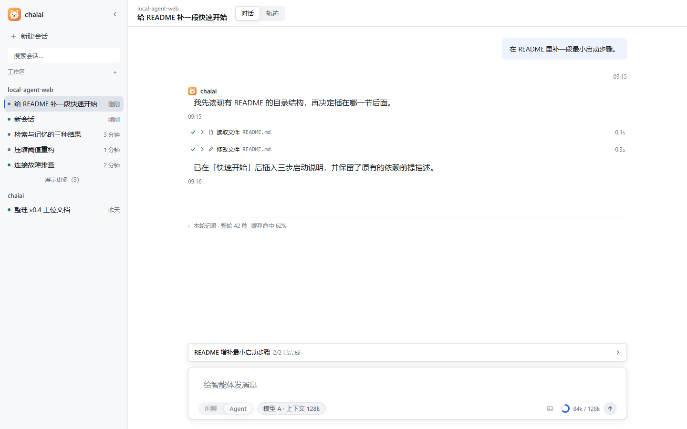
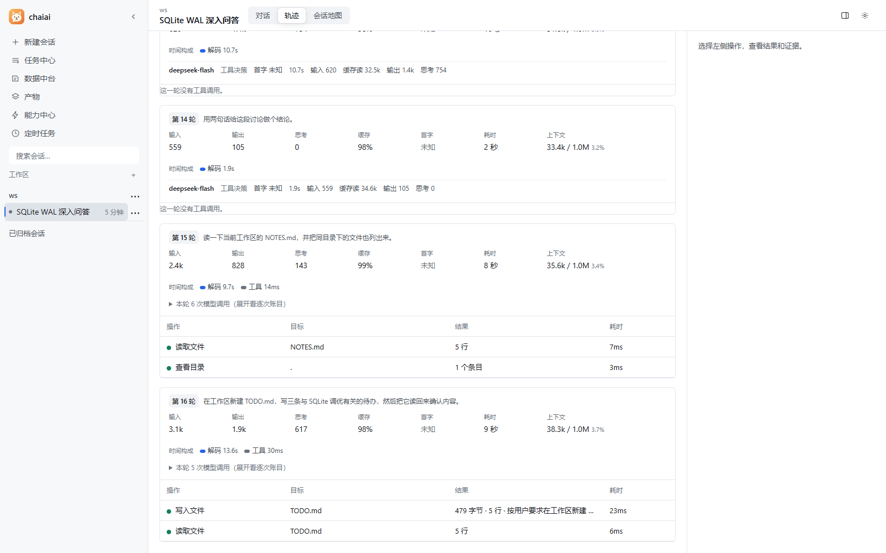
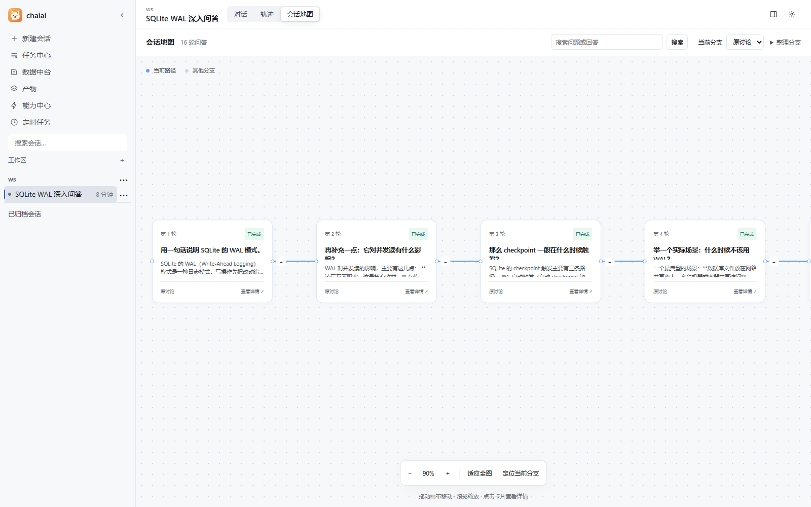
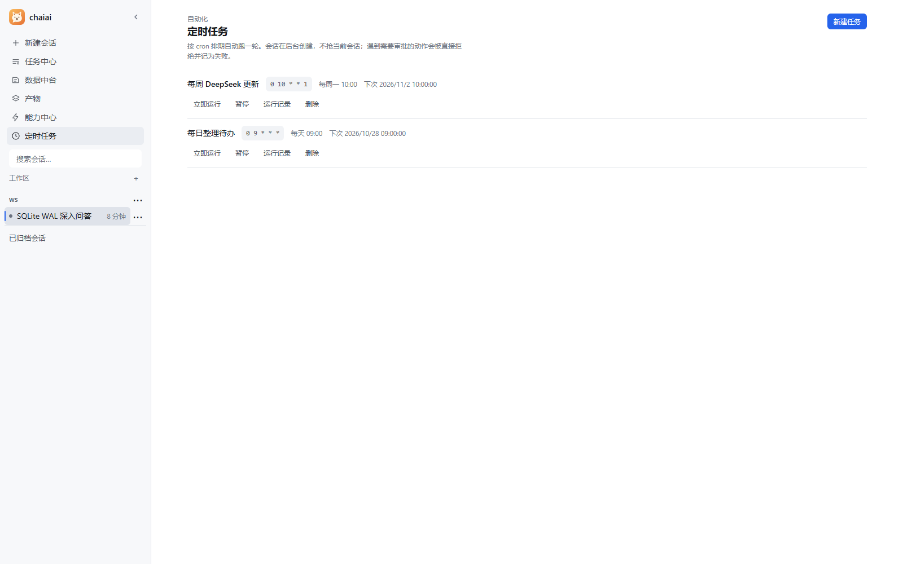
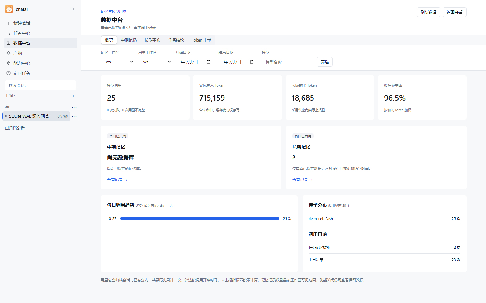
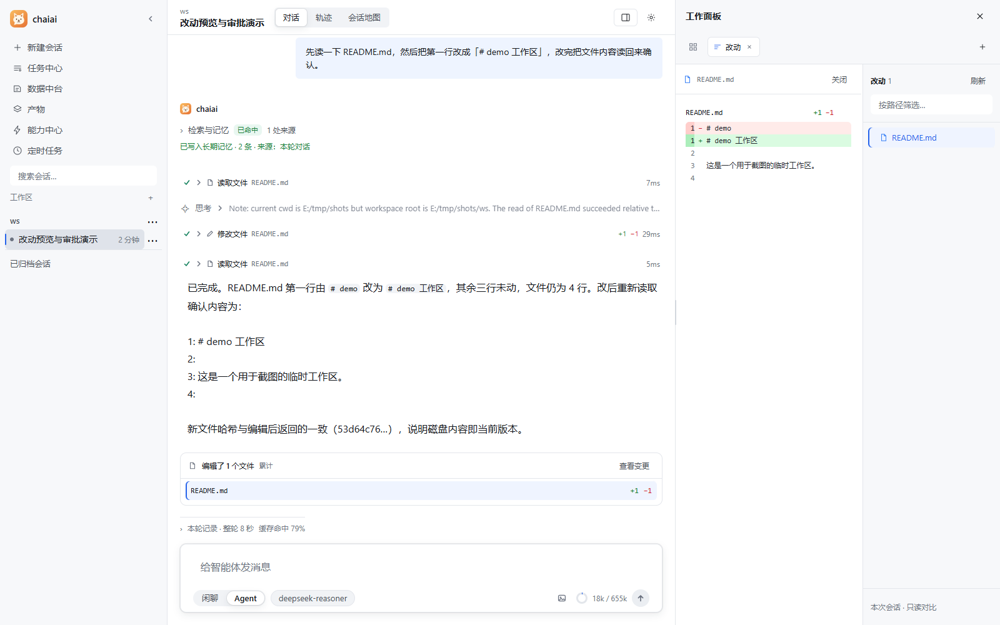

# chaiai

[English](README.md) | **简体中文**

**跑在你自己电脑上的 AI Agent。** 会话、记忆、文件、工具执行全在本机，模型端点由你自己填。


> **这是一个学习项目。** 我在学 agent 开发，边学边写：工具循环、审批卡、Windows 写沙箱、三层记忆、
> 检索、权限边界，都按"自己实现一遍才算真懂"的标准做。所以它的**文档与测试密度明显高于功能完备度**——
> v0.1.1 还是早期版本，契约与接口仍会变，**不建议作为生产依赖**。
>
> **非常欢迎你的意见，尤其是反对意见。** 架构哪里想错了、哪些抽象是多余的、安全边界漏了什么，
> 直接开 issue 或 PR 都行，不需要客气。

**技术栈**：Python 3.13 · FastAPI + SSE · LangGraph（工具循环与检查点）· SQLite / Chroma ·
React 19 + Vite 8 + TypeScript · PyInstaller onedir + Inno Setup + WebView2 ·
**3068 个后端测试、634 个前端测试**



*截图为真实界面：在一个临时演示工作区里跑的一轮任务，包含工具调用、记忆写入与改动账本。*

## 它解决的问题

大多数 agent 项目是"云端服务 + 网页外壳"：你的文件要上传、密钥交给别人、执行发生在看不见的机器上。
chaiai 反过来——**它就是一个装在你电脑上的程序**：

- 文件读写、命令执行、浏览器操作，都在你本机发生，你能在页面上看到每一步
- 会话、记忆、设置、密钥存在本地 SQLite，卸载都不删
- 模型只在你配的那一个端点上跑，没有中转、没有遥测

## 快速开始

### 方式一：安装包（推荐，Windows 10/11）

1. 到 [Releases](https://github.com/LaoTouAiLe/chaiai/releases) 下载 `chaiai-setup-<版本>.exe`
2. 双击安装（可以改安装位置；默认装到用户目录，不需要管理员权限）
3. 启动后是一个**程序窗口**（不是浏览器标签页），在「设置 → 模型连接」里填你自己的端点与密钥

安装、卸载、数据位置、降级说明见 [使用说明](packaging/使用说明.txt)。

### 方式二：从源码跑

前置：**Python 3.10+**、**Node 22.20+**、[uv](https://docs.astral.sh/uv/)。

```powershell
cd local-agent-web
uv sync                 # 需要中期记忆/本地向量时：uv sync --extra memory
cd frontend
npm ci
npm run build
cd ..
uv run python -m local_agent.api
```

打开 http://127.0.0.1:8000 。开发时在 `frontend/` 跑 `npm run dev`（5173，代理到 8000）。
想要桌面窗口而不是浏览器：`uv run python -m local_agent.api --window`。

配置：首次可以不建 `config.yaml`，直接在网页设置里添加模型连接；需要改文件时从
`config.yaml.example` / `.env.example` 复制，**不要覆盖已有的 `config.yaml`**。

## 功能

先看全景：

| 能力 | 一句话 |
| --- | --- |
| 对话与工具循环 | 模型自己决定调哪些工具、调几次；过程与耗时逐条可见 |
| 审批与权限 | 写文件、跑命令一次性批准；高危操作两阶段确认 |
| 文件与命令 | 定点读写、全文检索、命令执行、后台任务、持久终端 |
| 浏览器 | 独立 Edge/Chrome，13 个动作，可截图给模型看 |
| 三层记忆 | 短期压缩、长期事实、中期向量召回，全部可查 |
| 联网检索 | Tavily / DeepSeek 搜索 API / 网页版，抓取可本机可远端 |
| 右侧栏与工作台 | 文件树、搜索、Git diff、改动账本、终端、任务中心、会话地图 |
| 扩展与自动化 | MCP 服务器、技能包、定时任务 |

### 对话与工具循环

- 一轮任务由模型自己决定调用哪些工具、调几次；**过程、思考、参数、输出、耗时**分开显示，逐条可展开
- 只读工具可以并行，同一批里几个文件同时读；写操作串行，避免互相覆盖
- 每轮结束给出「本轮记录」：总耗时、缓存命中率、token 用量
- 运行中可随时停止；停止只中断这一轮，**不撤销已经发生的副作用**，页面会明确告诉你哪些已执行
- 失败如实报告，不伪装成成功——鉴权失败、被限流、重试达上限各有独立提示

### 轨迹与回看

- **轨迹页**：把一轮任务摊成时间线——每次工具调用、参数、输出、耗时、失败原因按顺序排开，
  只读、不参与对话
- **Think**：只显示供应商真实返回的思考内容，不合成、不补写
- **会话地图**：把一次会话的分支与追问关系画成卡片树，可以回看任一分支、从那里继续追问

轨迹页把每一轮的输入、输出、思考、**缓存命中**、耗时与上下文占用都摆在同一行，
工具调用自己再列一张小表（操作 / 目标 / 结果 / 耗时）：



同样的会话在「会话地图」里是一条可回看的卡片链，可以从任意一轮追问出新分支：



### 审批与权限

| 动作 | 处理方式 |
| --- | --- |
| 读工作区内的文件、列目录、搜索 | 免审 |
| 写文件、跑命令、启动终端 | 出审批卡，点「允许一次」才执行，**只对那一次生效** |
| 写工作区之外的目录 | 先授权该目录；授权可撤销，撤销后仍可读 |
| 高风险的删除类操作 | 二次确认（两阶段批准），第一次点允许还会再问一次 |

审批卡会写清"要做什么、目标是什么"；轨迹页可以回看这一轮批准过什么。

### 文件与命令

| 能力 | 说明 |
| --- | --- |
| 读 | 定点读行区间；大文件分段续读，带内容版本校验，防止把改过的内容拼在同一份里 |
| 写 | 精确串替换（默认只允许匹配一处，多处要显式声明）、整文件写入；前后文变了就拒绝而不是猜 |
| 找 | 目录列举、按文件名搜索、全文检索、grep / glob；结果分页，带游标可以接着翻 |
| 跑 | 命令执行、转后台任务、可交互的持久终端（能连续输入输出，不是一次性执行） |
| 约束 | 命令超时、输出上限、并发数都可配；Windows 写侧沙箱按权限档位派生 |

### 浏览器

独立的 Edge/Chrome 实例，**不借用你个人浏览器的登录态**，13 个动作：打开、切标签、导航、
快照、点击、填表、按键、滚动、等待、截图、改窗口大小、下载、关闭。
截图直接落盘到工作区，模型可以接着看图。

### 三层记忆与上下文预算

| 层 | 存什么 | 怎么用 |
| --- | --- | --- |
| 短期 | 当前对话 | 接近上下文阈值时自动压缩；保留最近 8 轮（可调）与关键工具结果 |
| 长期 | 事实、偏好、结论 | 跨会话自动注入；有权重、置信度与老化策略，可逐条查看与删除 |
| 中期 | 对话摘要的向量 | 语义召回（可选依赖：Chroma + Embedding），阈值与 top-k 可调 |

压缩不是简单截断：工具结果有单独的字符预算（默认 8k），窗口小时保留轮数会自动收紧。

### 联网检索

- 后端可选：**Tavily**、**DeepSeek 搜索 API**、Bing / DuckDuckGo 网页版（不需要密钥）
- 抓取正文可选**本机抓取**（默认）或交给 DeepSeek 抓取（会把网址发给对方，按次计费）
- 支持时间范围与站点筛选；网页版后端不保证站内筛选，检测到就直接报错而不是假装生效
- `408/429/5xx` 按官方要求重试（带 `Retry-After` 但有上限），其它 4xx 一次即失败
- 空结果是"没搜到"，不是错误——不会骗模型去换后端

### 与 DeepSeek 的适配

本项目**不绑定** DeepSeek——任何 OpenAI 兼容端点都能用。但 DeepSeek 这条线踩过的坑都补在了代码里：

| 问题 | 处理 |
| --- | --- |
| 思考模式下 `reasoning_content` 必须原样回传，否则**第二次请求直接 HTTP 400**，工具循环跑不完一轮 | 用一个最小的 `ChatOpenAI` 子类做请求/响应往返，并**随 Checkpoint 保存**，恢复历史后仍拼得回原请求 |
| DeepSeek 会返回 `reasoning_content: ""`（尤其"直接给工具调用"的响应） | 判据是"字段**存在**"而不是"内容非空"，空串照传（按非空处理会再次 400） |
| SDK 发 `max_completion_tokens`，供应商只认 `max_tokens` | 请求侧转回，并保留逐调用覆盖 |
| 摘要任务被思考内容吃满预算、没有摘要正文 | 摘要用途对 DeepSeek 官方端点关闭 thinking；主决策不受影响 |
| 缓存命中率各家字段不同 | 先读 `prompt_tokens_details.cached_tokens`，再退回供应商原始字段（DeepSeek 的 `prompt_cache_hit_tokens`），统一算成一个比率 |
| 搜索与抓取 | 直接接 DeepSeek 的 `/v1/tools/search` 与 `/v1/tools/fetch`（见下一节） |

### 右侧栏与工作台

对话右侧是一块独立面板，不切页签也能边看边改：

| 页签 | 内容 |
| --- | --- |
| 文件 | 工作区文件树，点开即读，支持按路径筛选 |
| 改动 | 本次会话改过哪些文件、每行 `+N −M`、点开看红绿 diff |
| 浏览器 | 受控浏览器的画面与地址栏 |
| 终端 | 持久终端的输入输出，命令要审批 |
| 任务 | 跨会话的任务状态与断点 |


### 任务与自动化

- **任务中心**：列出跨会话的后台任务，能看到进度、断点、失败原因；需要人工核对的终局由人写
- **断点恢复**：进程重启后能接回未完成的任务，不会静默重跑
- **定时任务**：按 cron 表达式跑一个固定 prompt（例如每天整理某个目录、定时检索一个话题），
  支持立即运行一次、查看历史运行记录、启用/停用；跑起来仍走同一套审批与权限边界



### 扩展：MCP 与技能

- **MCP**：以 stdio 接入本机 MCP 服务器，支持增删改、工具白黑名单、连接生命周期管理
- **技能**：`SKILL.md` 形式的技能包，可启用/禁用；除随包技能外还能添加自己的技能目录（只引用不复制）

### 附件与多模态

图片可以直接拖进输入框上传（单图上限 4 MB，超出会如实拒绝而不是截断），
模型能否读图由**每条连接自己声明**——没声明就按"不支持"处理，失败闭合。

### 设置

模型连接（多连接、可测连通性、按连接声明是否支持图像与上下文窗口）、权限档位、外观、
任务与预算、联网检索、长期/中期记忆与 Embedding、MCP 服务器、技能开关。
密钥只能写不能读回，接口里只暴露"是否已配置"。

### 可观测与诊断

- **数据中台**：调用次数、输入/输出 token、**缓存命中率**、记忆条数、每日趋势、模型分布。
  命中率按供应商返回的缓存字段统计——下图是同一会话连续 25 次调用的实测：**96.5%**；
  单轮在轨迹页能看到 98–99%。缓存是供应商侧的前缀缓存，短会话或每次换工具集会明显下降，
  因此**不做稳定承诺**，只看自己这台机器的真实数字
- **日志**：`启动错误.log`、`模型调用失败.log`（只记摘要，不记密钥与上下文正文）
- **自检**：`chaiai.exe --diagnose` 输出一段 JSON，检查配置、前端产物、三个数据库与依赖，不读密钥



右栏工作面板可以一边看对话、一边对照改动：



## 安全边界（请先读）

- **只监听回环地址**，没有账号体系，也没有登录页。想跨机器访问必须先自己做认证——现在把端口暴露到局域网等于把终端交给同网段所有人。
- **模型要自己配**：项目不提供 API Key，也不代购。
- **审批不是可选项**：写文件、跑命令走人工批准；Windows 上有写侧沙箱，但它只约束**写**，不隔离读和网络。
- **命令可以自行联网**，当前没有 CPU/内存上限与网络隔离。
- **安装包没有代码签名**，SmartScreen 会提示"未知发布者"，需要点「更多信息 → 仍要运行」。
- 只面向 **Windows**：写侧沙箱、桌面窗口、系统查询都依赖 Windows 能力。

## 数据放在哪

| 内容 | 位置 |
| --- | --- |
| 程序 | `%LOCALAPPDATA%\Programs\chaiai` |
| 设置库、会话、记忆、附件 | `%LOCALAPPDATA%\chaiai`（**源码形态也用这里**，不再放在代码目录） |
| 运行日志 | 同目录下 `启动错误.log`、`模型调用失败.log` |

数据根可用 `data_root`（config.yaml）或环境变量 `CHAIAI_HOME` 改到任意绝对路径；
换根后旧数据不会自动搬，启动横幅会打印两处位置。**卸载不会删数据**。升级＝用新安装包覆盖安装，数据目录不受影响。

## 技术栈

| 层 | 用了什么 |
| --- | --- |
| 内核 | Python 3.10+、LangGraph（工具循环与检查点）、Pydantic |
| 服务 | FastAPI + Uvicorn（单进程单 worker），SSE 推送流式事件 |
| 存储 | SQLite（会话、设置、记忆元数据）、Chroma（可选，中期记忆） |
| 界面 | React 19 + Vite 8 + TypeScript，TanStack Query、Zustand |
| 打包 | PyInstaller（onedir）+ Inno Setup；桌面窗口用 WebView2（pywebview） |

## 项目结构

```
chaiai/
├─ local-agent-web/     主程序：Python 后端（src/）+ 前端（frontend/）+ 测试（tests/）
├─ docs/                设计与记录：plans / audits / lessons / benchmarks / archive
├─ packaging/           发布物料：Inno Setup 脚本、使用说明、随包二进制
├─ skills/              随包技能
├─ website/             静态文档站
└─ ARCHITECTURE.md      契约与边界（改行为前先读这个）
```

## 常见问题

**能多用户 / 部署到服务器吗？**
不能。当前设计是本机单用户单进程，没有账号体系。要做多人必须先补认证与按会话的权限隔离。

**为什么只支持 Windows？**
写侧沙箱（受限令牌 + ACL）、桌面窗口、系统信息查询都依赖 Windows 原生能力。非 Windows 平台缺少那层写保护。

**支持哪些模型？**
任何 OpenAI 兼容端点（`base_url` + `model`）。上下文窗口要按模型文档如实填，填错会在压缩阶段算错预算。
DeepSeek 的思考模式已做往返兼容（见「与 DeepSeek 的适配」），工具循环不会因为缺 `reasoning_content` 中断。

**缓存命中率为什么不是一直 90%？**
命中率由**供应商侧**前缀缓存决定：同一段系统提示与工具定义被反复复用时才高。长会话、连续追问时
常见 70–90% 以上，短会话或每次都换工具集时会明显下降。数据中台只如实展示本机的结果，不做承诺。

**数据会被上传吗？**
不会主动上传。但模型调用、联网检索、DeepSeek 抓取都会把对应内容发给**你配置的那个端点**——这是功能本身，不是副作用。

**怎么提意见 / 报 bug？**
见 [CONTRIBUTING.md](CONTRIBUTING.md)。报 bug 时附上 `chaiai.exe --diagnose` 的输出（它不读密钥）。

## 文档

| 你想了解 | 去哪看 |
| --- | --- |
| 启动、配置、页面怎么用 | [使用与开发指南](docs/DEVELOPING.md) |
| 契约、职责边界、安全模型 | [ARCHITECTURE.md](ARCHITECTURE.md) |
| 提交代码的规矩 | [CONTRIBUTING.md](CONTRIBUTING.md) |
| 当前阶段与下一步 | [v1.0 计划](docs/plans/V1_0_DEVELOPMENT_PLAN.md) |
| 后续方向（不承诺排期） | [后续规划](docs/planning/FUTURE_WORK.md) |
| 源码教程 | [教程目录](docs/lessons/README.md)（旧行号需对照当前代码） |
| 历史交付记录 | [交付日志](docs/archive/delivery-log.md) |

> 文档以中文为主。代码注释也是中文——这不影响阅读代码，但确实抬高了外部贡献的门槛，欢迎 PR 逐步改进。

## 许可

[MIT](LICENSE)
