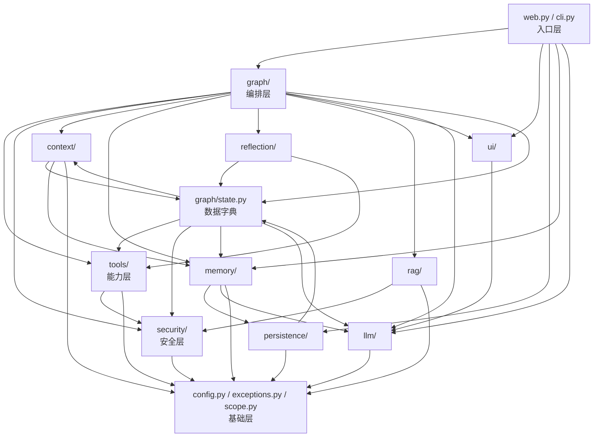

# L3 · 项目总览与技术选型

> 前两篇（L0 LangGraph、L1 消息与工具、L2 Python 语法）是**地基**，讲的是"框架长什么样"。
> 这一篇是**地图**，讲的是"这个项目把那些东西摆在哪"。
>
> 读完你应该能做到：随手指出任意一个功能（比如"删文件前为什么要审批"）该去哪个文件、哪个包找。

---

## 0. 这一篇解决什么

你现在的状态大概是：LangGraph 的 `add_node` / `add_conditional_edges` 看懂了，`AIMessage.tool_calls` 也看懂了，但打开 `src/local_agent/` 一看是 11 个目录、60 个文件、18461 行——**不知道从哪下手，也不知道为什么这么分**。

这一篇只回答四个问题：

1. **有哪些东西？**（11 个包 + 6 个根模块，各管什么）
2. **谁依赖谁？**（真实的 import 方向，不是想象的）
3. **为什么这么分？**（哪些是架构文档明写的约束，哪些是实现时自然形成的）
4. **选了什么、没选什么、代价是什么？**（LangGraph / Streamlit / SQLite / Chroma，以及"刻意不用"清单）

细节全都留给后面的 L4–L10。这一篇**故意不展开任何单个函数的实现**。

---

## 1. 先把尺子拿出来：实测规模

不要相信文档里的数字（包括这篇），自己量一遍：

```powershell
cd e:\pylianxi\chaiai\local-agent-web
$f = Get-ChildItem -Recurse -Filter *.py src\local_agent
"文件数=$($f.Count)  行数=$(($f | % { (Get-Content $_.FullName).Count } | Measure-Object -Sum).Sum)"
```

实测结果（2026-09-23）：

| 范围 | 文件数 | 行数 |
|---|---|---|
| `src/local_agent/`（产品代码） | **60** | **18461** |
| `tests/`（测试代码） | **16** | **17124** |

一个值得注意的比例：**测试代码几乎是产品代码的 0.93 倍**。这不是"测试写得啰嗦"，而是这个项目里有很多"防呆逻辑"（路径守卫、Patch 应用、幂等去重、Checkpoint 重放），每一处都对应一组边界用例。你在读产品代码时如果觉得"这段为什么要写这么绕"，先去看对应的测试，通常能直接看到它防的是什么。

---

## 2. 11 个包 + 6 个根模块

### 2.1 包级一览（行数实测）

| 包 | 文件 | 行数 | 一句话职责 | 后面哪一篇讲 |
|---|---|---|---|---|
| [`graph/`](../../local-agent-web/src/local_agent/graph) | 8 | **4792** | 编排层：State、节点、边、路由、图构建 | L4 / L5 / L6 |
| [`memory/`](../../local-agent-web/src/local_agent/memory) | 9 | **3329** | 三层记忆：短期、中期、长期、召回、遗忘、写入 | L9 |
| [`security/`](../../local-agent-web/src/local_agent/security) | 6 | **2001** | 安全层：路径守卫、命令判定、策略、审批、Diff 守卫 | L7 |
| [`llm/`](../../local-agent-web/src/local_agent/llm) | 6 | **1238** | 模型适配：工厂、能力探测、结构化输出降级、Embedding | L10 |
| [`tools/`](../../local-agent-web/src/local_agent/tools) | 5 | **1203** | 能力层：文件工具、Shell 工具、结果结构、注册表 | L8 |
| [`reflection/`](../../local-agent-web/src/local_agent/reflection) | 4 | **879** | 反思层：机械校验、LLM 反思、记忆候选校验 | L9 |
| [`rag/`](../../local-agent-web/src/local_agent/rag) | 4 | **819** | 按需代码检索：词项提取、候选发现、有界片段 | L9 |
| [`persistence/`](../../local-agent-web/src/local_agent/persistence) | 4 | **738** | 持久化：Checkpoint、会话索引、SQLite 迁移 | L10 |
| [`context/`](../../local-agent-web/src/local_agent/context) | 4 | **736** | 上下文层：AGENTS 加载、系统提示组装、token 预算 | L9 |
| [`ui/`](../../local-agent-web/src/local_agent/ui) | 4 | **714** | 界面组件：渲染、审批控件、流式接收 | L10 |
| — 合计 | 60 | 18461 | — | — |

一张图看懂"重心在哪"：`graph/` + `memory/` 两个包占了 **44%** 的代码。前者是流程，后者是记忆——这正是这个项目最想让你学的两件事。

### 2.2 根目录的 6 个模块

根目录不放业务逻辑，只放"跨层共用"和"入口"：

| 文件 | 行数 | 职责 | 关键点 |
|---|---|---|---|
| [web.py](../../local-agent-web/src/local_agent/web.py) | 828 | Streamlit 网页入口 | 唯一的**提交入口**：一次用户提交 = 一次 `graph.invoke` |
| [cli.py](../../local-agent-web/src/local_agent/cli.py) | 461 | 记忆管理命令行 | 长期记忆的**人工删除入口**；页面只读，写操作在 CLI |
| [config.py](../../local-agent-web/src/local_agent/config.py) | 527 | 配置加载与校验 | 19 个 pydantic 配置类，全部 `_StrictModel`（未知键直接报错） |
| [scope.py](../../local-agent-web/src/local_agent/scope.py) | 140 | 作用域与稳定标识 | `project_id_for` / `scope_key_for`：`persistence` 和 `memory` 必须用同一份 |
| [exceptions.py](../../local-agent-web/src/local_agent/exceptions.py) | 47 | 自定义异常 | 只放本项目自己的错误类型，第三方异常保持原样 |
| [__init__.py](../../local-agent-web/src/local_agent/__init__.py) | 9 | 版本号 | — |

**`scope.py` 为什么值得单独存在**（这段理由写在文件自己的 docstring 里）：`project_id` 与 `scope_key` 是跨层共用规则——`persistence` 的 `sessions` 表要存 `project_id`，`memory` 的中期记录和长期实体也要用同一个 `project_id`。如果把它放进 `memory/`，`persistence` 就要反向依赖 `memory`；而 `memory` 又要用 `persistence.migrations`——**循环依赖**。所以抽到根目录。

这是一个很好的 Java 类比：就像你把 `ProjectId` 这种共用值对象从 service 层抽到 `common` / `domain` 模块，避免两个 service 互相依赖。

---

## 3. 真实的依赖方向（实测）

下面这张图不是设计图，是**把 60 个文件的 `import` 抓出来归纳的**。箭头 = "A import 了 B"。



### 3.1 三个必须记住的结论

**结论 1：`graph/nodes.py` 是"导入一切"的汇聚点。**

看 [nodes.py:39-139](../../local-agent-web/src/local_agent/graph/nodes.py#L39-L139)——它 import 了 `config`、`context`、`exceptions`、`graph.*`、`llm`、`memory`、`rag`、`reflection`、`scope`、`security`、`tools`、`ui`。

这**不是**设计缺陷，而是编排层的天然位置：节点是"把各层能力串起来"的地方。所以你读代码时可以这样定位：

> 想知道"某个能力是怎么被用起来的" → 去 `nodes.py` 搜它。
> 想知道"这个能力本身怎么实现的" → 去那个包看。

**结论 2：`graph/state.py` 是全员依赖的"数据字典"。**

[state.py:26-33](../../local-agent-web/src/local_agent/graph/state.py#L26-L33) 明确 import 了四个方向的东西：

```python
from local_agent.config import AppConfig
from local_agent.context.token_budget import ContextBudget, TokenUsage
from local_agent.llm.models import ModelCapabilities
from local_agent.memory.schemas import MemoryReference
from local_agent.security.approval import ApprovalDecision, ApprovalRequest
from local_agent.security.policy import SecurityPolicy
from local_agent.tools.result_types import ToolResultRecord
from local_agent.tools.tool_registry import ToolRegistry
```

也就是说：**State 的结构里直接嵌了安全层、工具层、记忆层的类型**。这是刻意的——State 是"全项目共用的数据结构"，它必须能表达安全决策、工具结果、记忆引用。

代价是：`graph/state.py` 成了依赖图上的**最大枢纽**，任何一层的类型改名都会波及它。所以它才要写得这么克制（几乎只有类型定义和两个 reducer，没有业务逻辑）。

**结论 3：不存在循环依赖，但是"贴着线"走的。**

这四组关系最危险，值得单独记：

| 关系 | 方向 | 有没有反转 |
|---|---|---|
| `graph/state.py` ↔ `memory/` | `state.py` → `memory.schemas` | 但 `memory/writer.py:26` **反向** import `graph.state` |
| `graph/state.py` → `tools/` | 单向 | 无 |
| `tools/` → `security/` | 单向，`security` **从不** import `tools` | 无 |
| `memory/` → `persistence/migrations` | 单向 | 无 |

`memory/writer.py` 反向依赖 `graph.state` 是**能力层依赖编排层**，方向上不干净。今天能跑，只是因为 `graph/__init__.py` 是空的（[只有一行 docstring](../../local-agent-web/src/local_agent/graph/__init__.py#L1)）。一旦有人在 `graph/__init__.py` 里加上 `from local_agent.graph import nodes`，`nodes` → `memory.writer` → `graph.state` → 触发 `graph/__init__` → 已经加载一半 → **炸**。

这就是 L2 里说的"Python 的 import 是执行语句"。Java 里你不必担心这种事，这里必须担心。

---

## 4. 为什么是"五层"而不是 11 个平行包

`ARCHITECTURE.md` §2 给的是**功能模块**表（模式判定、文件工具、Shell 执行……），§3 给的是**目录约束**（`graph/`、`tools/`、`security/`……以 §2 为准）。它没有画"层"。

但读代码时按依赖方向看，这 11 个包自然分成五层——**这是本篇归纳的阅读地图，不是架构文档的术语**：

| 层 | 成员 | 特征 | 想改这里的代码意味着 |
|---|---|---|---|
| ① 入口层 | `web.py`、`cli.py` | 只做"提交→展示"，不含业务判断 | 改交互、改页面 |
| ② 编排层 | `graph/` | 唯一知道"流程长什么样"的地方 | 改流程、加节点 |
| ③ 能力层 | `tools/`、`memory/`、`reflection/`、`context/`、`rag/` | 提供能力，不知道流程 | 加工具、调记忆策略 |
| ④ 安全层 | `security/` | **被能力层调用，不调用能力层** | 改安全策略 |
| ⑤ 基础层 | `config.py`、`exceptions.py`、`scope.py`、`persistence/`、`llm/` | 全员可用 | 改配置项、改存储 |

**为什么安全层要单独一层、且方向是单向的？**

因为架构 §1.3 第 4 条是硬约束：

> 危险工具必须在代码层强制拦截，不能只依赖 Prompt。

如果 `security/` 反过来去调用 `tools/`，它就不再是"闸门"而变成"流程的一部分"——闸门失效时你无法单独证明文件访问被拦住了。现在这样，你可以**单独测试 `security/`**（`tests/test_security.py`，925 行），不用起图、不用起模型。

顺带说一个反直觉的事实：`tools/file_tools.py` 里的 `@tool` 函数**自己会调 `SecurityPolicy`**（[file_tools.py:33](../../local-agent-web/src/local_agent/tools/file_tools.py#L33) import 了 `SecurityPolicy`）。也就是说安全不是"节点层统一过一遍就完事"，而是**工具内部再自己守一道**。这就是"双保险"的具体形态。

---

## 5. 技术选型：选了什么，代价是什么

### 5.1 依赖清单与理由

`pyproject.toml` 的 10 个运行依赖：

| 依赖 | 角色 | 为什么选它 | 代价 / 约束 |
|---|---|---|---|
| `langgraph>=1.0,<2` | 编排核心 | 低层、状态化、支持持久执行 + 人机协同 + 中断恢复（§1.1 调研结论） | API 在 1.x 有断裂性变化，网上 0.x 教程基本对不上（L0 整篇在讲这个） |
| `langgraph-checkpoint-sqlite>=3.0,<4` | 落盘 | Checkpoint 直接进 SQLite，本地零运维 | 必须显式登记序列化白名单并关掉 pickle 回退（§10.1） |
| `langchain-core>=1.0,<2` | 消息与工具类型 | 只要 `HumanMessage` / `AIMessage` / `ToolMessage` / `@tool` / `BaseTool` | **没装顶层 `langchain`**，见下 |
| `langchain-openai>=1.0,<2` | 模型客户端 | 走 OpenAI 兼容协议 → 可接 DeepSeek 等任意兼容服务（BYO LLM） | 兼容层的坑要自己填（`llm/compat.py`，见 L1） |
| `streamlit` | 界面 | 纯 Python 就能出网页，学习项目不想写前端 | 交互模型是"整脚本重跑"，状态必须放 Checkpoint 而不是 `st.session_state`（§1.4） |
| `pydantic` | 数据校验 | 配置与工具结果都用它，`BaseModel` 直接当结构定义 | 需要理解 pydantic 与 `dataclass`/`TypedDict` 的分工（L2 §2） |
| `pydantic-settings` | — | 声明了 | **代码里一次都没用**（实测 0 处） |
| `pyyaml` | 配置格式 | YAML 比 JSON 好写注释、好手改 | 无类型存根，mypy 里按 `Any` 处理 |
| `python-dotenv` | 密钥 | 密钥只从环境变量来，`.env` 只是本地便利（硬约束：配置里不存密钥） | — |
| `filelock` | — | 声明了 | **代码里一次都没用**；开发文档 §9.1 明写"仅在需要进程间文件协调时调用，且不得替代 SQLite 事务或安全审批"——即**预留未启用** |

`pydantic-settings` 与 `filelock` 这两条是**诚实的实测结论**，不是我在猜：全仓库（含 tests）grep 零命中。它们属于"按计划先声明、用到再启用"的依赖，读代码时不要去找它们的用法。

### 5.2 可选依赖组 `memory`

```toml
memory = ["chromadb>=1.5,<1.6", "tiktoken", "fastembed>=0.8,<0.9"]
```

注意这里是**按小版本锁定**（`<1.6` 而不是 `<2`），`pyproject.toml` 的注释给了原因——实现依赖这三个版本实测到的具体行为：

- `hnsw:space` 元数据键
- 自定义 Embedding 函数必须有 `name()`，且 `__call__` 的参数名必须是 `input`
- `get_or_create_collection` 不覆盖已有 metadata
- 维度校验的时机

**这就是"选了 Chroma/向量库"的真实代价**：它不是一个"装了就忘"的依赖，而是一组**没有契约的隐式行为**。所以中期记忆才被设计成可选组 + 延迟导入——不装 `memory` 时，基础网页和工具模式必须照常工作。

`tiktoken` 也在这一组里：它只服务于精确 token 计数，而项目默认的估算口径是**纯字符规则**（CJK 1 token、其余 4 字符 1 token，见 [token_budget.py](../../local-agent-web/src/local_agent/context/token_budget.py#L3-L4)）。所以不装它也能跑，只是精度差一点。

### 5.3 `rag/` 的选型：反方向的选择

`rag/` 是 11 个包里最"反直觉"的一个——它**什么依赖都没加**。

[search.py 的 docstring](../../local-agent-web/src/local_agent/rag/search.py#L3-L5) 明确写着：

> **不建持久索引**：每次调用直接读当前工作区的磁盘现状，因此不存在"陈旧索引"，也没有增量维护任务。检索是**字面匹配**。

也就是说，这个项目**没有做向量 RAG**，做的是"ripgrep 级别的按需代码检索 + 有界片段读取"：

- 优先调外部 `rg`（**可选加速器，不由 uv 安装**）
- 缺失时退化为**有界 Python 扫描**
- 命中后只把"命中位置附近的一小段"送进 Prompt，绝不整文件注入（[snippets.py:3-4](../../local-agent-web/src/local_agent/rag/snippets.py#L3-L4)）
- 局部 AST 解析**暂未加入**，如果将来加，会单独开一个可选依赖组

**这是一个值得学的选型判断**：向量索引的价值在于"语义相似"，但代码检索的绝大多数请求是**字面命中**（文件名、标识符、路径）。为字面命中维护一套向量索引，付出的是"索引陈旧""增量更新""Embedding 一致性"三份复杂度，换来的收益很小。

### 5.4 分层存储：三个库，各存各的

| 库 | 位置（配置项） | 存什么 | 为什么不合并 |
|---|---|---|---|
| SQLite **聊天库** | `memory.short_term.path` | 会话索引 `sessions` 表 + LangGraph Checkpoint | 两者**共用同一个连接、同一个事务边界**，避免多连接互相加锁（[migrations.py:3-5](../../local-agent-web/src/local_agent/persistence/migrations.py#L3-L5)） |
| SQLite **长期库** | `memory.long_term.path` | 实体、事实、任务结论（结构化记忆） | 微秒级只读打开，页面侧栏直接查它（[web.py:245](../../local-agent-web/src/local_agent/web.py#L245)） |
| Chroma **中期库** | `memory.medium_term.path` | 向量化的摘要、任务片段、偏好片段 | 需要加载 Embedding 模型 → 启动慢 → 只走命令行，不进页面热路径 |

页面侧栏"记忆管理"只读长期库，理由是它快；中期库要加载模型，"在页面上做这件事会让每次交互都变慢"（[web.py:240-246](../../local-agent-web/src/local_agent/web.py#L240-L246)）。

---

## 6. 刻意不用清单（全部有实证）

这是本项目的"负空间"，读懂它比读懂正面清单更能理解作者的取向。

| 不用的东西 | 实证 | 替代方案 |
|---|---|---|
| **顶层 `langchain` 包** | `pyproject.toml` 只声明 `langchain-core` / `langchain-openai` / `langgraph`；开发文档 §9 原文："不需要为了 Agent 编排额外安装顶层 `langchain` 包" | 只要消息与工具类型，编排全部自己做 |
| LangChain 的 Chain / 旧版 Agent | 全仓库零 `from langchain.`（实测） | LangGraph `StateGraph` + 自己写的节点 |
| **`Enum`** | 全仓库零 `import enum`（实测） | `Literal["ok", "error", "denied"]`——为了 JSON 序列化无痛（L2 §3） |
| **日志框架** | 只有 2 个文件 `import logging`：[llm/protocol.py:17](../../local-agent-web/src/local_agent/llm/protocol.py#L17)、[llm/models.py:12](../../local-agent-web/src/local_agent/llm/models.py#L12) | **State 即日志**：工具调用、决策、反思结果都写进 Checkpoint，可回放 |
| ORM | 全仓库裸 `import sqlite3`（5 个文件），SQL 手写在 [migrations.py](../../local-agent-web/src/local_agent/persistence/migrations.py) | 手写迁移 + 版本号表；迁移只允许在末尾追加，不改写已发布版本 |
| 向量库做代码检索 | `rag/` 无新增依赖 | rg 优先 + 有界 Python 扫描（见 §5.3） |
| 独立 Web（FastAPI + React） | 代码里**没有** `application/` 包 | 已在 `ARCHITECTURE.md` §15 冻结为 v0.4 契约，属**规划中、未实现** |
| 思维链落盘 | §1.3 第 8 条硬约束 | 只记录计划、决策摘要、工具调用与证据 |

### 两个特别值得琢磨的取舍

**取舍 A：不用 logging，用 State。**

传统 Java 服务里你靠日志排查。但这个项目的每一步都要能被 Checkpoint 回放——写日志等于**维护两套事实来源**，而且日志里的内容无法让图从中恢复。所以 `nodes.py` 里的节点都不打日志，而是把结论写回 State（`decisions`、`tool_results`、`reflections`）。

代价是：**节点必须幂等**。因为 Checkpoint 恢复时节点会被重放（L0 第 9 节）。这是 L6 里反复出现的主题。

**取舍 B：不装 `pydantic-settings` 而用了 `pydantic` + `yaml` + `dotenv`。**

`config.py` 里 19 个配置类全部继承 `_StrictModel(BaseModel)`（[config.py:30](../../local-agent-web/src/local_agent/config.py#L30)）。`pydantic-settings` 的卖点是"从环境变量直接构造 Settings"，但本项目的硬约束是"**配置文件只存非秘密配置，密钥只从环境变量来**"——两者职责被刻意分开，所以不需要 Settings 那套合并逻辑。

---

## 7. 一次点击的完整穿越

现在把地图用起来。跟着"用户在页面上敲一句话 → 消息落盘"走一遍，看它穿过哪几层。

```text
① 页面提交
   web.py:650  main()                       ← Streamlit 脚本入口
   web.py:171  run_chat_turn(...)           ← 一次提交 = 一次调用
   web.py:195  turn_workspace(...)          ← 本轮跑在哪个工作区（不能被调用方覆盖）
   web.py:196  build_runtime_context(...)   ← 构造 RuntimeContext（DI 容器，见 L0 §7）
   web.py:213  graph.invoke(payload, config={"configurable": {"thread_id": ...}}, context=context)

② 进图（编排层）
   builder.py:66   build_chat_graph(...)    ← 图在这里被编译（应用启动时一次）
   builder.py:77-92  16 个 add_node          ← 注册节点
   builder.py:93  add_minimal_chat_edges     ← 注册所有边（L5 讲）
   nodes.py:177   prepare_context_node      ← 第一个真正执行的节点
   ...（中间若干节点，L6 讲）

③ 需要工具时（能力层 → 安全层往返）
   nodes.py:819   agent_decision_node       ← 模型提出 tool_calls
   nodes.py:879   safety_gate_node          ← 问 SecurityPolicy：放行？要审批？拒绝？
        ├─ 放行 → nodes.py:1078 tool_execution_node
        │         └─ tools/file_tools.py: @tool 函数内部再查一次策略，然后真读写文件
        ├─ 要审批 → nodes.py:3008 approval_interrupt_node → interrupt() 挂起
        └─ 拒绝 → 回 final_response

④ 落盘（基础层）
   graph.invoke 返回 → LangGraph 自动把 State 写进 Checkpoint
   persistence/checkpoint.py: SqliteSaver + 显式序列化白名单
   persistence/session_store.py: 更新 sessions 表的 last_active_at 与 checkpoint 指针

⑤ 下一轮
   web.py:221  thread_state(...) → builder.read_thread_state(...)  ← 从 Checkpoint 读回
   web.py:228  projected_history(...) ← 展示前投影（原文留存、读时替换）
```

看懂这条链之后，你应该能回答："如果我想改'审批通过后按钮显示什么'，该动哪里？"——`ui/approval_ui.py`；"如果想改'哪些命令要审批'？"——`security/shell_guard.py` + `security/policy.py`；"如果想改'审批的几个选项'？"——`graph/routers.py` 的 `route_after_approval`。

---

## 8. 全项目的骨架：16 个节点

这是整个项目的"目录树"，**L6 会逐个展开**。先记住位置，读代码时能跳转就够了。

16 个节点分两类定义：

**A. 业务节点——定义在 [nodes.py](../../local-agent-web/src/local_agent/graph/nodes.py)（14 个）**

| 常量 | 节点名字符串 | 函数定义 | 干什么（一句话） |
|---|---|---|---|
| `PREPARE_CONTEXT` | `prepare_context` | [nodes.py:177](../../local-agent-web/src/local_agent/graph/nodes.py#L177) | 归一化本轮输入，清掉上一轮残留 |
| `LOAD_AGENTS` | `load_agents` | [nodes.py:219](../../local-agent-web/src/local_agent/graph/nodes.py#L219) | 向上扫描并合并 `AGENTS.md` |
| `RECALL_MEMORY` | `recall_memory` | [nodes.py:331](../../local-agent-web/src/local_agent/graph/nodes.py#L331) | 召回中长期记忆 |
| `RETRIEVE_CODE_NODE` | `retrieve_code_node` | [nodes.py:419](../../local-agent-web/src/local_agent/graph/nodes.py#L419) | 按需检索代码片段 |
| `COMPRESSION_NODE` | `compression_node` | [nodes.py:573](../../local-agent-web/src/local_agent/graph/nodes.py#L573) | 接近上限时压缩历史 |
| `PLANNER_NODE` | `planner_node` | [nodes.py:762](../../local-agent-web/src/local_agent/graph/nodes.py#L762) | 产出任务计划 |
| `AGENT_DECISION_NODE` | `agent_decision_node` | [nodes.py:819](../../local-agent-web/src/local_agent/graph/nodes.py#L819) | 决定"调工具"还是"回计划"还是"回答" |
| `SAFETY_GATE_NODE` | `safety_gate_node` | [nodes.py:879](../../local-agent-web/src/local_agent/graph/nodes.py#L879) | 安全策略闸门 |
| `TOOL_EXECUTION_NODE` | `tool_execution_node` | [nodes.py:1078](../../local-agent-web/src/local_agent/graph/nodes.py#L1078) | 真正执行工具 |
| `REFLECTION_NODE` | `reflection_node` | [nodes.py:1323](../../local-agent-web/src/local_agent/graph/nodes.py#L1323) | 机械校验 + 反思 |
| `MEMORY_WRITE_NODE` | `memory_write_node` | [nodes.py:2620](../../local-agent-web/src/local_agent/graph/nodes.py#L2620) | 写记忆 |
| `CHAT_NODE` | `chat_node` | [nodes.py:721](../../local-agent-web/src/local_agent/graph/nodes.py#L721) | 闲聊分支 |
| `FINAL_RESPONSE_NODE` | `final_response_node` | [nodes.py:2952](../../local-agent-web/src/local_agent/graph/nodes.py#L2952) | 产出最终回答 |
| `APPROVAL_INTERRUPT_NODE` | `approval_interrupt_node` | [nodes.py:3008](../../local-agent-web/src/local_agent/graph/nodes.py#L3008) | `interrupt()` 挂起等审批 |

**B. 路由节点——定义在 [routers.py](../../local-agent-web/src/local_agent/graph/routers.py)（2 个）**

| 常量 | 节点名字符串 | 函数定义 | 为什么在 routers 里 |
|---|---|---|---|
| `MODE_ROUTER` | `mode_router` | [routers.py:127](../../local-agent-web/src/local_agent/graph/routers.py#L127) | 它和它的判定逻辑（`decide_mode`）是一体的 |
| `COMPLETION_ROUTER` | `completion_router` | [routers.py:293](../../local-agent-web/src/local_agent/graph/routers.py#L293) | 同上：`completion_route` 就在旁边 |

这 16 个节点的名字（2 个节点名 + 16 个路由目标）一共 **18 个字符串常量**，全部集中在 [routers.py:34-53](../../local-agent-web/src/local_agent/graph/routers.py#L34-L53)。全部用字面量字符串而不是 `Enum`，理由同 §6。

### 关于 nodes.py 的 3470 行

大到值得说一句：`nodes.py` 里有 **14 个节点函数，但占了 3470 行**——平均 248 行/函数，其中 `reflection_node`（[1323](../../local-agent-web/src/local_agent/graph/nodes.py#L1323) 到 2620 前）一个人就约 1300 行。

**读它的方法不是"从头读到尾"**，而是：

1. 先在 §8 的表里选定你要的节点，跳到那个行号；
2. 每个节点开头都有 docstring，先读它（写得很详细）；
3. 只看它"读哪些 State 字段、写哪些 State 字段"，把中间的细节当黑盒；
4. 需要细节时再往下读。

L6 会按这个顺序把 14 个节点过一遍。

---

## 9. 测试体系：16 个文件，17124 行

测试文件是**按包对应**的，找起来很快：

| 测试文件 | 行数 | 对应什么 |
|---|---|---|
| [test_memory.py](../../local-agent-web/tests/test_memory.py) | 3552 | `memory/`（最大，因为含中期/长期/遗忘/召回） |
| [test_router.py](../../local-agent-web/tests/test_router.py) | 2807 | `graph/routers.py`（路由是被测最细的地方） |
| [test_graph_resume.py](../../local-agent-web/tests/test_graph_resume.py) | 2152 | 中断/恢复/幂等（Checkpoint 重放） |
| [test_tools.py](../../local-agent-web/tests/test_tools.py) | 1394 | `tools/` |
| [test_web.py](../../local-agent-web/tests/test_web.py) | 1275 | `web.py` |
| [test_reflection.py](../../local-agent-web/tests/test_reflection.py) | 1058 | `reflection/` |
| [test_agent_eval.py](../../local-agent-web/tests/test_agent_eval.py) | 1007 | 端到端评测 |
| [test_security.py](../../local-agent-web/tests/test_security.py) | 925 | `security/` |
| [test_cli.py](../../local-agent-web/tests/test_cli.py) | 586 | `cli.py` |
| [test_agent_smoke.py](../../local-agent-web/tests/test_agent_smoke.py) | 554 | 冒烟 |
| [test_rag.py](../../local-agent-web/tests/test_rag.py) | 458 | `rag/` |
| [test_checkpoint_serde.py](../../local-agent-web/tests/test_checkpoint_serde.py) | 410 | 序列化白名单 |
| [test_streaming.py](../../local-agent-web/tests/test_streaming.py) | 367 | `ui/streaming.py` |
| [conftest.py](../../local-agent-web/tests/conftest.py) | 269 | 夹具 |

**两条使用建议**：

1. **产品代码里看不懂某段判断，去测试里搜同名字符串**。比如 `nodes.py` 里那个 `ROUTE_CLASSIFIER_MARKER = "意图分类器"`（[routers.py:56](../../local-agent-web/src/local_agent/graph/routers.py#L56)），注释说明它是"给测试留的缝"——用假模型替换分类器时靠这个标记识别提示词。
2. 有一个自定义 marker：`real_resolution`。带这个标记的用例**依赖真实的 PATH / 文件系统解析结果**，不用替身。整体跑测试时如果想跳过这类环境相关用例，用它排除即可。

---

## 10. 后面 7 篇怎么接上这张图

| 篇 | 挂在图的哪 | 读完你会得到 |
|---|---|---|
| **L4 · 数据模型** | `graph/state.py`（§3.1 结论 2 的枢纽） | 34 个 State 字段逐个的语义 + 三种更新语义 |
| **L5 · 流程骨架** | `graph/edges.py` / `routers.py` / `builder.py` | 11 条固定边 + 6 组条件边（展开成 17 条）怎么连的 |
| **L6 · 编排主干** | `graph/nodes.py` 的 14 个节点 | 每个节点读什么、写什么、调了什么 |
| **L7 · 安全层** | `security/`（④ 层，单向） | 从路径守卫到审批到动作指纹的完整链条 |
| **L8 · 能力层** | `tools/`（③ 层） | 文件工具与 Shell 工具怎么做出来的 |
| **L9 · 记忆·反思·上下文·检索** | `memory/` + `reflection/` + `context/` + `rag/` | 三层记忆、机械校验、提示词组装 |
| **L10 · 启动与界面** | `web.py` + `ui/` + `persistence/` + `llm/` | 从点击到落盘的完整一次调用 |

---

## 11. 自查清单

读完这一篇，你应该能**不看文档**回答下面 8 个问题。答不上来的，回去翻对应小节。

1. 全项目哪两个包代码量最大？各占多少行？ → §2.1
2. 为什么 `scope.py` 放在根目录而不是 `memory/` 下？ → §2.2
3. "哪些文件允许被读"这条规则，应该在哪个包找？ → ④ 安全层：`security/path_guard.py`
4. 全项目唯一知道"流程长什么样"的包是哪个？ → §4 ② 编排层
5. 为什么 `graph/state.py` 会 import `security` 和 `tools`，这不违反分层吗？ → §3.1 结论 2
6. `pydantic-settings` 和 `filelock` 在代码里用在哪？ → §5.1：**没用**（预留）
7. 这个项目的"代码 RAG"为什么不用向量库？ → §5.3
8. 为什么节点里几乎不打日志？ → §6 取舍 A（State 即日志，但节点必须幂等）

---

## 12. 三条读代码的方法论

这一篇讲的是"地图"，所以顺便给你三件工具，后面每一篇都会用到。

**工具 1：从症状定位到文件。**

| 你看到的现象 | 去哪个文件 |
|---|---|
| 提示词里多了一段不该有的东西 | `context/prompt_context.py` |
| 工具被拒绝但说不清为什么 | `security/policy.py` → `classify_tool` |
| 审批按钮点了没反应 | `graph/routers.py` → `route_after_approval` |
| 同一轮里工具执行了两次 | `graph/state.py` → `merge_appended` / `tool_scope_key` |
| 页面显示的消息和 State 里不一样 | `graph/projection.py`（**读时投影**，不是改原文） |
| 模型抱怨"内容被截断了" | `graph/evidence.py`（工具证据文本的取舍） |
| 配置改了一个键但没生效 | `config.py` 是 `_StrictModel`，未知键直接报错；再看 `@st.cache_resource` 的缓存键 |

**工具 2：逆着 import 找"谁在用我"。**

想改某个函数但怕影响面太大，就先查谁 import 它（用 Grep 搜函数名）。比如你准备改 `SecurityPolicy.classify_tool`，搜一遍就知道影响面是 `nodes.py:879` 和 `tools/`。

**工具 3：符号级定位用 `rg`（本机已有）。**

```powershell
rg -n "def classify_tool" src/
rg -n "SecurityPolicy" src/ -g "*.py"
```

`rag/search.py` 里也做了同样的事——这不是巧合，本项目自己检代码就是靠它。

---

## 下一步

地图画完了，接下来进入**阶段三 · 主干**之前，先把地图上最粗的那个点吃掉：

- **L4 · 数据模型**：`graph/state.py` 的 394 行逐个字段讲透。它是全员依赖的枢纽（§3.1 结论 2），读懂它之后，L6 里 14 个节点"读什么写什么"就变成查字典。
- 然后 **L5 · 流程骨架**（`edges.py` 143 行 + `routers.py` 350 行），把节点按边连起来。

建议接着写 **L4**。