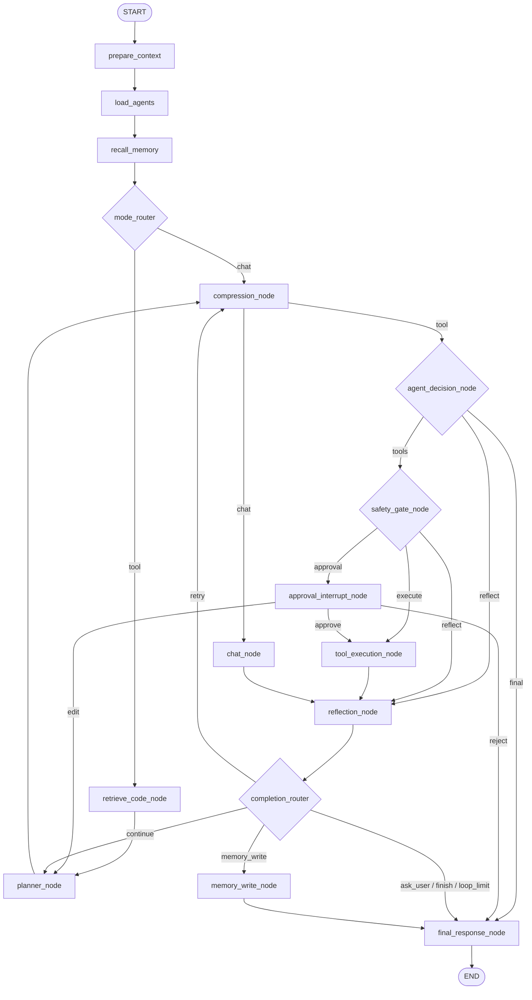

# L5 · 流程骨架：`edges.py` / `routers.py` / `builder.py`

> L4 讲了 State 的**字段**，这一篇讲**这些字段怎么被推动着走完一圈**。
>
> 读完你应该能回答：**"用户说了一句话，图会依次经过哪些节点？什么情况下会绕回来？绕回来的上限是什么？"**

三个文件的分工：

| 文件 | 行数 | 管什么 | 类比 |
|---|---|---|---|
| [builder.py](../../local-agent-web/src/local_agent/graph/builder.py) | 163 | **装配**：注册 16 个节点、编译图 | Spring 的 `@Configuration` |
| [edges.py](../../local-agent-web/src/local_agent/graph/edges.py) | 143 | **接线**：11 条固定边 + 6 组条件边 | `application.yml` 里的路由规则 |
| [routers.py](../../local-agent-web/src/local_agent/graph/routers.py) | 350 | **判定**：走哪条路的函数 | 一堆 `Predicate<T>` |

**关键点：接线和判定是分开的。** `edges.py` 只写"从 A 到 B 有哪些出口"，`routers.py` 只写"这个状态该走哪个出口"。改流程形状看前者，改判定规则看后者。

---

## 1. 全景图（实测生成，非手绘）

下面这张图不是从 `edges.py` 的注释抄的——是我编译出真实图、把 `graph.get_graph().edges` 全部导出后画的。**11 条固定边 + 17 条条件边展开 = 28 条边**。



> `{花括号}` 是"有条件出口的节点"，`[方括号]` 是普通节点。图里 `agent_decision_node` / `safety_gate_node` / `approval_interrupt_node` / `completion_router` 都是前者。

**先把这张图记住，后面全是它的细节。**

---

## 2. 图的装配：`builder.py`

[build_chat_graph](../../local-agent-web/src/local_agent/graph/builder.py#L66-L94) 只有 19 行，干三件事：

```python
graph: ChatStateGraph = StateGraph(AgentState, context_schema=RuntimeContext)  # ① 声明类型
graph.add_node(PREPARE_CONTEXT, prepare_context_node)                          # ② 注册 16 个节点
...  # 共 16 行
add_minimal_chat_edges(graph)                                                  # ③ 接线（在 edges.py）
return graph.compile(checkpointer=checkpointer)                                # ④ 编译
```

三个值得记住的细节：

### 2.1 节点名字符串和函数是**分开传**的

```python
graph.add_node(PREPARE_CONTEXT, prepare_context_node)
#                ^^^^^^^^^^^^^^^^  ^^^^^^^^^^^^^^^^^^^^
#                字符串常量（来自 routers.py）  函数（来自 nodes.py）
```

`PREPARE_CONTEXT = "prepare_context"` 这 16 个常量分两处定义：**14 个业务节点名在 [nodes.py](../../local-agent-web/src/local_agent/graph/nodes.py)**，**2 个路由节点名（`MODE_ROUTER` / `COMPLETION_ROUTER`）在 [routers.py:34-35](../../local-agent-web/src/local_agent/graph/routers.py#L34-L35)**。看 [builder.py:21-56](../../local-agent-web/src/local_agent/graph/builder.py#L21-L56) 的 import 清单就能确认这个分工。

**为什么要用常量而不是直接写字面量？** 因为同一个名字出现在三个地方：`add_node` 注册、`add_edge` 连线、`route_*` 函数返回。三处手写字符串，改一处漏两处就会出问题。用常量，至少 IDE 能改名。

**Java 类比**：这就是为什么你不会在 Spring 里写 `@RequestMapping("/api/user")` 然后又在测试里手写一遍同样的字符串。

### 2.2 `context_schema=RuntimeContext`

这一行让节点函数第二个参数名叫 `runtime` 时能注入 `RuntimeContext`（L0 §7 讲过参数名注入规则）。

**注意它和 `AgentState` 的分工**：第一个位置参数是"状态模式"（要进 Checkpoint 的），`context_schema` 是"运行上下文"（不进 Checkpoint）。这正是 L4 §6 那条分界线在类型层面的体现。

### 2.3 编译时传 `checkpointer`

```python
return graph.compile(checkpointer=checkpointer)
```

`checkpointer=None` 时图**无状态**——不保存任何历史。这就是 [web.py:112-118](../../local-agent-web/src/local_agent/web.py#L112-L118) 里那个分支：

```python
if app_config.memory.short_term.enabled:
    checkpointer = database.checkpointer
    ...
graph=builder.build_chat_graph(checkpointer)
```

**同一份图代码，两种运行模式**（有状态/无状态），靠编译参数切换。这是 L3 §6 取舍 A 的实现基础。

### 2.4 `build_runtime_context`：DI 容器的工厂

[builder.py:97-149](../../local-agent-web/src/local_agent/graph/builder.py#L97-L149)，13 个参数全带默认值或 `| None`。三个默认行为值得注意：

| 参数省略时 | 行为 |
|---|---|
| `security_policy` | 按配置现造一个（[130-132](../../local-agent-web/src/local_agent/graph/builder.py#L130-L132)） |
| `tool_registry` | 按策略现造（[133](../../local-agent-web/src/local_agent/graph/builder.py#L133)） |
| `model_capabilities` | **现探测一次模型能力**（[134-136](../../local-agent-web/src/local_agent/graph/builder.py#L134-L136)） |

最后一条有实际代价：`probe_capabilities` 会真的发一次请求（L1 §4 提过）。所以生产代码里 [web.py:129](../../local-agent-web/src/local_agent/web.py#L129) 是**在启动时探测一次、存进 `ChatApp`**，每次调用复用——而不是每次 `build_runtime_context` 都探一遍。

**这是"默认参数带来隐藏开销"的经典案例**：省略参数很方便，但省略的是"一次网络请求"就不方便了。

---

## 3. `edges.py`：11 条固定边

固定边 = `add_edge(A, B)`，**A 执行完必定去 B，没有任何判断**。

| # | 边 | 位置 | 为什么是固定的 |
|---|---|---|---|
| 1 | `START → prepare_context` | [76](../../local-agent-web/src/local_agent/graph/edges.py#L76) | 每轮固定从复位开始 |
| 2 | `prepare_context → load_agents` | [77](../../local-agent-web/src/local_agent/graph/edges.py#L77) | 复位完必加载规则 |
| 3 | `load_agents → recall_memory` | [78](../../local-agent-web/src/local_agent/graph/edges.py#L78) | 加载完必召回记忆 |
| 4 | `recall_memory → mode_router` | [79](../../local-agent-web/src/local_agent/graph/edges.py#L79) | 召回完必判模式 |
| 5 | `retrieve_code_node → planner_node` | [87](../../local-agent-web/src/local_agent/graph/edges.py#L87) | 检索完必进规划 |
| 6 | `planner_node → compression_node` | [88](../../local-agent-web/src/local_agent/graph/edges.py#L88) | 规划完必过压缩 |
| 7 | `tool_execution_node → reflection_node` | [123](../../local-agent-web/src/local_agent/graph/edges.py#L123) | 执行完必反思 |
| 8 | `reflection_node → completion_router` | [124](../../local-agent-web/src/local_agent/graph/edges.py#L124) | 反思完必过完成判定 |
| 9 | `memory_write_node → final_response_node` | [137](../../local-agent-web/src/local_agent/graph/edges.py#L137) | 写完记忆必收尾 |
| 10 | `chat_node → reflection_node` | [142](../../local-agent-web/src/local_agent/graph/edges.py#L142) | **见下** |
| 11 | `final_response_node → END` | [143](../../local-agent-web/src/local_agent/graph/edges.py#L143) | 唯一出口 |

### 3.1 前 4 条：固定前缀，一轮的开场白

```text
prepare_context → load_agents → recall_memory → mode_router
```

四个节点串行、无分支。含义是：**不管用户说什么，都要先复位状态、加载 AGENTS 规则、召回记忆，然后才判模式。**

为什么不能把 `load_agents` / `recall_memory` 放到模式判断之后？因为它们的结果**影响模式判断和后续所有 Prompt**：AGENTS 规则里可能写着"本项目所有测试用 pytest"，召回的记忆里可能有"用户偏好中文回答"。判模式之前就必须有这些信息。

### 3.2 第 10 条：为什么闲聊也要过反思

这是全图最反直觉的一条边，[edges.py:139-141](../../local-agent-web/src/local_agent/graph/edges.py#L139-L141) 的注释解释了：

> 闲聊也要过一次反思校验：按架构 §5.2，识别到用户要求记住时 `chat_node` 只产生 `memory_write_intent`，**转入现有 `reflection_node` 校验**，再由 `completion_router` 决定是否走 `memory_write_node`。普通闲聊在反思里得到空候选 → 直接进 `final_response_node`。

**这条边在防什么？** 防"两条写记忆的路径"。

假设闲聊分支直接进 `final_response_node`，那"用户说'记住我喜欢用 pytest'"这条记忆就得在 `chat_node` 或 `final_response_node` 里直接写库。于是你就有了**两个写库入口**，而 `reflection_node` 里的机械校验（证据是否充分、候选是否合法）只保护了工具分支那一条。

**结论：写库的入口必须唯一。** 这条边的代价是"普通闲聊多绕一次反思"，收益是"记忆写入链路只有一条，校验不会被绕过"。

**Java 类比**：就像你只允许一个 `@Transactional` 的 service 方法写某张表，不允许第二个入口绕过它——哪怕多绕一层调用。

### 3.3 第 11 条：`final_response_node` 是唯一出口

实测入边表：

```text
final_response_node  <- ['agent_decision_node', 'approval_interrupt_node',
                         'completion_router', 'memory_write_node']
```

**4 个不同的节点都指向它**，而它只指向 `END`。这是个好设计：

- **收尾逻辑只有一处**——`final_response_node` 负责把 `final_response` 写出来、把 `task_status` 定下来。
- **所有分支最终都汇到同一点**——没有"某个分支忘了收尾"的可能。

**Java 类比**：`try { ... } finally { ... }` 的 `finally`，或者一个统一的 `ResponseAdvice`。

---

## 4. `edges.py`：6 组条件边

条件边 = `add_conditional_edges(源节点, 判定函数, {出口名: 目标节点})`。

**这里有一个数量陷阱，必须先说清楚**：

```python
graph.add_conditional_edges(          # ← 1 次注册
    COMPLETION_ROUTER,
    completion_route,
    {
        ROUTE_CONTINUE: PLANNER_NODE,
        ROUTE_RETRY: COMPRESSION_NODE,
        ROUTE_ASK_USER: FINAL_RESPONSE_NODE,
        ROUTE_FINISH: FINAL_RESPONSE_NODE,
        ROUTE_LOOP_LIMIT: FINAL_RESPONSE_NODE,
        ROUTE_MEMORY_WRITE: MEMORY_WRITE_NODE,
    },                                 # ← 6 个出口，但只连到 4 个不同节点
)
```

所以：

- **`edges.py` 里 `add_conditional_edges` 出现 6 次**（实测 AST 计数）
- **编译后展开成 17 条边**（实测 `get_graph().edges`），因为 6 个出口里 `ask_user` / `finish` / `loop_limit` 都指向 `final_response_node`，去重后是 4 条
- **总边数 = 11 固定 + 17 条件 = 28**

6 组条件边的完整清单（全部实测）：

| 源节点 | 判定函数 | 出口 → 目标 |
|---|---|---|
| `mode_router` | `route_by_mode` | `chat`→compression_node、`tool`→retrieve_code_node |
| `compression_node` | `route_after_compression` | `chat`→chat_node、`tool`→agent_decision_node |
| `agent_decision_node` | `route_after_decision` | `tools`→safety_gate_node、`reflect`→reflection_node、`final`→final_response_node |
| `safety_gate_node` | `route_after_safety` | `execute`→tool_execution_node、`approval`→approval_interrupt_node、`reflect`→reflection_node |
| `approval_interrupt_node` | `route_after_approval` | `approve`→tool_execution_node、`edit`→planner_node、`reject`→final_response_node |
| `completion_router` | `completion_route` | `continue`→planner_node、`retry`→compression_node、`ask_user`/`finish`/`loop_limit`→final_response_node、`memory_write`→memory_write_node |

### 4.1 两条边共享同一个判定函数

注意前两组：`route_by_mode` 和 `route_after_compression` 的**函数体一模一样**（[routers.py:229-236](../../local-agent-web/src/local_agent/graph/routers.py#L229-L236)）：

```python
def route_by_mode(state):            return ROUTE_TOOL if state.get("mode") == "tool" else ROUTE_CHAT
def route_after_compression(state):  return ROUTE_TOOL if state.get("mode") == "tool" else ROUTE_CHAT
```

为什么写两个而不是共用一个？因为**出口名不同、语义不同**：

- `mode_router` 之后：`chat` 去压缩、`tool` 去检索。这是"两个分支的起点"。
- `compression_node` 之后：`chat` 去闲聊节点、`tool` 去决策节点。这是"两个分支合流后再分开"。

两处的 `mode` 值虽然相同，但**将来可能分化**（比如工具分支压缩后想加一个"先查记忆"的步骤）。写成两个函数，改动时不会互相牵连。

**这是"看起来重复但故意的重复"**——判断标准是：它们会不会独立变化？会，就别合并。

### 4.2 出口名的命名规律

看 [routers.py:37-53](../../local-agent-web/src/local_agent/graph/routers.py#L37-L53)，17 个出口常量分三类：

| 类型 | 例子 | 含义 |
|---|---|---|
| **模式名** | `ROUTE_CHAT="chat"`、`ROUTE_TOOL="tool"` | 用户请求的类型 |
| **动作名** | `ROUTE_EXECUTE="execute"`、`ROUTE_APPROVE="approve"`、`ROUTE_RETRY="retry"` | 下一步要干什么 |
| **判定结果名** | `ROUTE_WITH_TOOLS="tools"`、`ROUTE_WITHOUT_TOOLS="final"`、`ROUTE_LOOP_LIMIT="loop_limit"` | 判定函数的结论 |

**它们不是节点名**——实测确认：判定函数返回的是 `path_map` 的**键**，不是目标节点名。所以 `ROUTE_CHAT = "chat"` 对应的是 `compression_node`，而不是某个叫 `chat` 的节点。

**这个设计的好处**：出口名可以描述"为什么走这条路"，而不是"去哪"。调试时看 `route_reason` / 日志里的出口名，比看节点名信息量大。

---

## 5. `routers.py`：三组判定

文件开头的 docstring（[routers.py:3-9](../../local-agent-web/src/local_agent/graph/routers.py#L3-L9)）自己就分好了三组：

```text
1. mode_router：闲聊还是工具任务（LLM 分类 + 关键词兜底，T04）。
2. 分支选择：route_after_compression、route_after_decision、route_after_safety。
3. completion_router：架构 §5.3 要求"反思之后唯一决定继续、重试、追问或结束"。
```

### 5.1 第一组：`decide_mode` 的三层兜底

[mode_router_node](../../local-agent-web/src/local_agent/graph/routers.py#L127-L145) → [decide_mode](../../local-agent-web/src/local_agent/graph/routers.py#L148-L177)。

判定顺序（这是本项目"失败闭合"思想最清楚的一个例子）：

```text
① 输入为空？          → chat（"输入为空，按闲聊处理"）
② 调 LLM 分类
   ├─ 成功            → 用模型的结论
   └─ 抛任何异常      → ③
③ 关键词兜底
   ├─ 命中            → tool
   └─ 没命中          → chat（"未命中工具意图，按闲聊处理"）
```

三个细节：

**细节 1：`except Exception` 是刻意的**，注释明写（[164](../../local-agent-web/src/local_agent/graph/routers.py#L164)）：

```python
except Exception as exc:  # noqa: BLE001 — 任何分类失败都必须退化为规则判定
```

注意 `# noqa: BLE001` —— 项目的 ruff 配置默认禁止裸 `except Exception`，这里是**显式豁免**。意思是："我知道这样不好，但这里必须捕获一切。"因为分类失败（网络超时、模型返回畸形 JSON、API Key 过期）绝不能导致整个请求崩掉。

**Java 类比**：`catch (Exception e)` 配一个注释说明"这里故意兜住所有异常"，而不是让 `RuntimeException` 穿透到 Controller。

**细节 2：失败原因被写进 `route_reason`。**

```python
reason=f"规则兜底：命中关键词「{keyword}」（LLM 分类失败：{failure}）"
```

`failure` 是 `type(exc).__name__`。所以你在页面上能看到"为什么这轮走了规则兜底"——这是可观测性做在**数据结构**里，而不是日志里（L3 §6 取舍 A）。

**细节 3：三层兜底的最后一层是 `chat`，不是 `tool`。**

[170](../../local-agent-web/src/local_agent/graph/routers.py#L170)：*"未命中工具意图，按闲聊处理"*。

**为什么保守方向是 `chat`？** 因为 `tool` 分支能读写文件、执行命令。判错的代价不对称：

- 把工具任务误判成闲聊 → 用户不满意，重说一遍就好，**没有副作用**
- 把闲聊误判成工具任务 → 模型可能真的去动文件，**有副作用**

**这是"fail-safe 而不是 fail-open"的典型判断。** L7 讲安全层时会看到同一原则的更多实例。

### 5.2 分类提示词：把"什么不算工具任务"写清楚

[build_classifier_prompt](../../local-agent-web/src/local_agent/graph/routers.py#L189-L209) 值得一读，因为它花了一半篇幅讲**否定条件**：

```text
- 询问"我之前说过的偏好/设定""我习惯用什么""我们上次的结论是什么"，
  以及已经记住的项目事实或约定（例如"我们这个项目默认用什么跑自动化测试"）
  这类回忆型问题，mode 取 "chat"：答案来自系统提示里已召回的记忆，不需要读写文件或执行命令；
  只有当用户明确要求检查当前文件或运行命令时才取 "tool"。

- 判断标准是"完成这个请求是否必须访问本机文件或执行命令"；
  请求里只是提到文件名、工具名或"测试""配置"这类词，并不等于需要访问，不要据此取 "tool"。

- 不确定时取 "chat"。
```

**为什么需要这么啰嗦？** 因为 `recall_memory` 节点（L4 §7.1）已经把记忆召回并塞进系统提示了。如果模型看到"测试"两个字就判 `tool`，那"我们这个项目用什么跑测试"这种**纯记忆问题**会被拉进工具分支，白跑一轮文件检索。

**这是"上下文分层带来的新问题"**：因为记忆是预加载的，所以"需要记忆"的问题反而**不该**走工具分支。提示词必须显式说明这一点。

最后一行 `不确定时取 "chat"` 是**把兜底策略写进提示词**，和 §5.1 细节 3 的代码兜底呼应——两层都在往同一侧倒。

### 5.3 第二组：5 个纯判定函数（实测行为表）

这 5 个函数**不碰 State、不调模型、没有副作用**，只读 State 返回一个字符串。所以可以单独测（`tests/test_router.py` 有 2807 行）。

#### `route_by_mode` / `route_after_compression`

```text
mode == "tool"  → tool
其余（含 mode 缺失）→ chat
```

注意"含 mode 缺失"——`state.get("mode")` 返回 `None` 时走 `chat`。又是一次保守兜底。

#### `route_after_decision`（[239-251](../../local-agent-web/src/local_agent/graph/routers.py#L239-L251)）

实测五种情况：

| 情况 | 结果 |
|---|---|
| 有工具调用 | `tools` |
| 无工具 + 多步计划未完成 | `reflect` |
| 无工具 + 多步计划已完成 | `final` |
| 无工具 + 单步计划 | `final` |
| 无工具 + 无计划 | `final` |

**第二行是这里唯一有故事的**，docstring 讲了原因（[242-245](../../local-agent-web/src/local_agent/graph/routers.py#L242-L245)）：

> 计划里还有未完成步骤时**不能直接收尾**：模型偶尔会在第二步就给出"任务完成了"的回答，直接进 `final_response_node` 会让整张图在第二步结束、第三步永远不执行——而且 `task_status` 还显示 `running`，用户看到一个半截任务（复审实证）。

**这是个真实踩过的坑**：模型说"完成了"，图就真的结束了，但计划里还有两步没做。而且状态显示 `running`——用户看到的是"一个声称完成、但状态是运行中的半截任务"。

修法不是"不信任模型"，而是**加一条机械规则**：计划里有未完成步骤 → 先过反思，由 `_advance_plan`（L4 §4.3 提过）用机械规则决定继续还是收尾。

**注意最后三行的对比**：单步计划直接 `final`。为什么？docstring 补了一句（[256-258](../../local-agent-web/src/local_agent/graph/routers.py#L256-L258)）：

> **单步计划不走这条路**：单步任务的正常收尾就是"模型直接给回答"，把它也拉去反思会改变既有行为（验收基线：单步任务不回归）。多步计划里最后一步直接回答时多绕一次反思，结论不变。

**这是"修 bug 时顺手保住了兼容性"**：多绕一次反思对多步任务无副作用（结论不变），但对单步任务会改变行为。所以用 `len(plan) <= 1` 把单步摘出去。

`_plan_has_unfinished_steps` 的实测边界（[254-263](../../local-agent-web/src/local_agent/graph/routers.py#L254-L263)）：

| 计划 | 结果 | 说明 |
|---|---|---|
| 空计划 | False | `len <= 1` |
| 单步 pending | **False** | 单步特例，即使还没做也不拉去反思 |
| 两步全 completed | False | 没有 pending/running |
| 两步 一 failed | **False** | **只查 `pending`/`running`**，failed 不算"未完成" |
| 两步 一 blocked | **False** | 同上，blocked 也不算 |

**后两行值得留意**：`blocked`（等用户补充信息）的步骤不会被这里拦住。它会走到 `final_response_node`，由反思结果里的 `next_action` 决定追问——**职责在反思，不在这里**。

#### `route_after_safety`（[266-270](../../local-agent-web/src/local_agent/graph/routers.py#L266-L270)）

实测：

| 情况 | 结果 |
|---|---|
| 有 `pending_approval` | `approval` |
| 无审批 + 有放行调用 | `execute` |
| 无审批 + 无调用（全被拒） | `reflect` |

**判定顺序很关键**：先查审批、再查放行调用。如果反过来（先查 `pending_tool_calls`），那"一部分要审批、一部分放行"的批次会直接去执行——**审批被跳过**。

注意第三行：**全部被拒时不是去 `final_response`，而是去 `reflection`**。因为"工具被拒"也是一个需要反思的事件（为什么被拒？要不要换个做法？要不要问用户？）。这个判断交给反思层，而不是在路由里硬编码。

#### `route_after_approval`（[273-281](../../local-agent-web/src/local_agent/graph/routers.py#L273-L281)）

```python
history = list(state.get("approval_history", []))
decision = str(history[-1].get("decision")) if history else ""
if decision == "approve": return ROUTE_APPROVE
if decision == "edit":    return ROUTE_EDIT
return ROUTE_REJECT
```

实测：

| `approval_history` 最后一条 | 结果 |
|---|---|
| `approve` | `approve` |
| `edit` | `edit` |
| `reject` | `reject` |
| **空历史** | **`reject`** |
| 先 reject 后 approve | `approve` |

两个要点：

**要点 1：空历史 → `reject`。** 这是**fail-closed**：读不到审批结论时，默认拒绝执行。因为"执行"是有副作用的方向。

对比 §5.1 细节 3：模式判定读不到结论时倒向 `chat`（保守 = 不做事）；审批判定读不到结论时倒向 `reject`（保守 = 不做事）。**两处的保守方向一致：都不做事。** 这是个贯穿全项目的原则。

**要点 2：只读最后一条。** 因为 `approval_history` 是 `operator.add` 追加的（L4 §2.5），每次审批都往里加一条。所以"当前这次审批的结论"就是最后一条。**如果将来出现一次调用里产生两条审批决策的情况，这个判定会读到错的那条**——它假设"一次调用只审批一次"，这个假设靠 `merge_appended` + `approval_key` 去重来维持。

**要点 3：`edit` 去 `planner_node` 而不是 `agent_decision_node`。** 含义是"用户要求改方案"→ **回到规划重来**，而不是"用修改后的参数再试一次"。这是语义上的区别，别弄混。

---

## 6. 第三组：`completion_router` 的两段式

这是全篇最重要的设计，也是 L0 §5 那个"条件边不能改 State"限制的直接后果。

### 6.1 问题：条件边函数改不了 State

L0 说"条件边函数不能改 State"，但没说**改了会怎样**。实测（langgraph 1.2.11）：

```python
def bad_router(state):
    return {"next": "b", "user_input": "改一下"}     # 想同时选路 + 改状态

g.add_conditional_edges("a", bad_router, {"b": "b"})
```

```text
TypeError: unhashable type: 'dict'
```

**机制**：判定函数返回的值被拿去当 `path_map` 的**键**查表。字典不能做键 → 直接 `TypeError`。

**这个报错信息对使用者极不友好**——你看到 `unhashable type: 'dict'` 完全猜不到"原来是不能改 State"。这是 LangGraph 的一个可用性缺口。

**如果返回未登记的出口名呢？** 实测：

```text
KeyError: '不存在的出口'
```

KeyError 的 key 是**你返回的那个字符串**——还算能定位问题。但如果你写的是 `ROUTE_CHATAT`（拼错一个字母），你会看到 `KeyError: 'chatat'`，需要自己反应"哦，我拼错了"。

### 6.2 一个更危险的坑：`Command` 在条件边里**静默失效**

LangGraph 有 `Command(goto=..., update=...)`，节点函数返回它能**同时跳转 + 改状态**。实测（节点位置）：

```python
def node_a(state):
    return Command(goto="b", update={"user_input": "节点改的"})

# 结果：user_input = 节点改的 | mode = tool    ← 两个都生效
```

那把它用在**条件边判定函数**里呢？实测：

```python
def path_goto_only(state):
    return Command(goto="b")

g2.add_conditional_edges("a", path_goto_only)
# 结果：user_input = a | mode = None            ← b 根本没执行！
```

**没有异常，图正常结束，但目标节点从未运行。** 只在 stderr 留下一行警告：

```text
Task a with path ('__pregel_pull', 'a') wrote to unknown channel
branch:to:Command(goto='b'), ignoring it.
```

**这是最糟的一类 bug**：不报错、结果错、警告藏在日志里。`mode = None` 这种"下游字段没被写"的症状，排查起来要从下游一路倒推回上游。

**给你的经验**：条件边判定函数里，**只能返回字符串**。想要"选路 + 改状态"，就拆成两个东西——这就是 §6.3。

### 6.3 解法：节点 + 条件边两段式

```python
graph.add_node(COMPLETION_ROUTER, completion_router_node)   # ① 节点：负责改 State
graph.add_conditional_edges(                                 # ② 条件边：负责选路
    COMPLETION_ROUTER, completion_route, {...}
)
```

两段各自的职责（[routers.py:293-325](../../local-agent-web/src/local_agent/graph/routers.py#L293-L325)）：

**第一段 `completion_router_node`（节点，能改 State）**

```python
def completion_router_node(state):
    if _loop_limit_blocks(state):
        return {"messages": [AIMessage(content=LOOP_LIMIT_REPLY)], "task_status": "failed"}
    return {}          # ← 正常情况什么都不做
```

注意 `return {}`——**空字典是合法的"无更新"**。所以这个节点在 99% 的情况下是个**空操作**，只在"想继续但已达上限"时才写 State。

**第二段 `completion_route`（条件边，只能返回字符串）**

```python
def completion_route(state):
    action = _next_action(state)
    if action in LOOPING_ACTIONS and loop_limit_reached(state):
        return ROUTE_LOOP_LIMIT
    route = {"continue": ROUTE_CONTINUE, "retry": ROUTE_RETRY,
             "ask_user": ROUTE_ASK_USER, "finish": ROUTE_FINISH}.get(action, ROUTE_FINISH)
    if route == ROUTE_FINISH and _has_memory_candidates(state):
        return ROUTE_MEMORY_WRITE
    return route
```

**两段共享同一个判定**：`_loop_limit_blocks(state)`（[340-342](../../local-agent-web/src/local_agent/graph/routers.py#L340-L342)）就是

```python
_next_action(state) in LOOPING_ACTIONS and loop_limit_reached(state)
```

——和 `completion_route` 里那个 `if` 条件**逐字相同**。

**为什么要重复写？** 因为两段运行在不同的时机：

1. 节点先跑，判断"要不要补说明"，要就写 `task_status="failed"` + 一条说明消息
2. 条件边后跑，判断"走哪个出口"

如果节点和条件边对"是否达上限"的判断不一致，就会出现"补了失败说明但走的是 continue 出口"这种矛盾状态。**所以这个条件被抽成函数、两处共用。**

**Java 类比**：像一个"前置拦截器 + 路由判定"的组合，两者必须用同一个谓词，否则会出现"拦截器说通过、路由说拦截"的不一致。

### 6.4 `completion_route` 的实测行为表

| `reflection_result.next_action` | 达循环上限 | 结果 |
|---|---|---|
| `continue` | 否 | `continue` |
| `continue` | **是** | **`loop_limit`** |
| `retry` | 否 | `retry` |
| `retry` | **是** | **`loop_limit`** |
| `ask_user` | 否 | `ask_user` |
| `ask_user` | **是** | **`ask_user`** ← 不被拦 |
| `finish` | 否 | `finish` |
| `finish` | **是** | **`finish`** ← 不被拦 |
| 无 `reflection_result` | — | `finish` |
| `finish` + 有记忆候选 | — | **`memory_write`** |

**中间那两行是本篇最值得琢磨的设计**，[routers.py:287-289](../../local-agent-web/src/local_agent/graph/routers.py#L287-L289) 的注释：

> 达到循环上限时仍然"想继续"的动作：只有它们会被上限拦住（架构 §11.5）。
> `finish` / `ask_user` 本轮就能收尾，不受上限影响——拦它们只会把正常结论变成"失败"。

**这是一个修过的 bug**，`completion_router_node` 的 docstring 里留了记录（[299-301](../../local-agent-web/src/local_agent/graph/routers.py#L299-L301)）：

> 上限**不覆盖**已经确定的 `finish` / `ask_user`：那一轮反思已经给出可收尾的结论（而且是基于机械证据的结论），把它改成"失败"会让正常终止在边界轮次丢失（**复审实证：`verified + finish` 与 `ask_user` 都被改成了 `loop_limit + failed`**）。

**看懂这个 bug 的价值**：循环上限的目的是"防止无限循环"，而 `finish` / `ask_user` **本来就不会循环**——它们本轮就结束。所以拦它们不是"防循环"，只是"把成功改判成失败"。

**判据**：一个限流/熔断规则，只能拦"会导致资源继续消耗"的动作。拦"本来就要停下来"的动作，纯粹是伤害。

### 6.5 `LOOPING_ACTIONS` 是公开常量

```python
LOOPING_ACTIONS: tuple[str, ...] = ("continue", "retry")
```

注释（[288-289](../../local-agent-web/src/local_agent/graph/routers.py#L288-L289)）说：

> 反思节点也用这个集合判"空转保护"（§5.3），所以是公开常量，避免两处各写一份。

**注意它不是 `_LOOPING_ACTIONS`（带下划线）**——故意的，因为 `nodes.py` 要 import 它。这是"私有性让步于一致性"的合理决定。

---

## 7. 环路与循环控制

### 7.1 实测：9 个节点在环里

```text
agent_decision_node, approval_interrupt_node, chat_node, completion_router,
compression_node, planner_node, reflection_node, safety_gate_node, tool_execution_node
```

这 9 个节点构成"循环体"。其余的（`prepare_context` / `load_agents` / `recall_memory` / `mode_router` / `retrieve_code_node` / `memory_write_node` / `final_response_node`）**只走一次**。

**这张清单很有用**：如果某个节点的副作用可能被执行多次，它一定在这 9 个里。

### 7.2 三个回环入口

从 `completion_router` 出来，有三条回到循环体的路：

| 出口 | 去哪 | 语义 |
|---|---|---|
| `continue` | `planner_node` | **重新规划**——计划变了，从头理一遍 |
| `retry` | `compression_node` | **重做当前步**——计划不变，再试一次 |
| `memory_write` → `final_response` | 收尾 | — |

**`continue` 和 `retry` 的差异很重要**：

- `continue` 回 `planner_node` → 规划 → 压缩 → 决策。**规划节点会重新产出 `plan`**。
- `retry` 回 `compression_node` → 决策。**不重新规划**，直接让模型再决策一次。

**Java 类比**：`continue` 是"回到 for 循环开头重新算一遍条件"，`retry` 是"catch 到异常后重试这一次调用"。

另外还有一条**审批专用**的回环：

| 出口 | 去哪 | 语义 |
|---|---|---|
| `edit`（从 `approval_interrupt_node`） | `planner_node` | 用户要求改方案 → 重新规划 |

注意它和 `continue` 去的是同一个节点，但**触发原因完全不同**：一个是反思说"计划要调整"，一个是用户说"我不同意这个做法"。

### 7.3 循环上限：`loop_limit_reached` 的边界

```python
def loop_limit_reached(state):
    limit = state.get("max_loop_count")
    if not limit:                                    # ← 注意这里是 not，不是 is None
        return False
    return int(state.get("loop_count", 0)) >= int(limit)
```

实测边界：

| State | 结果 | 说明 |
|---|---|---|
| `max_loop_count=0, loop_count=0` | **False** | `0` 被当成"没设上限" |
| `max_loop_count=3, loop_count=2` | False | 还没到 |
| `max_loop_count=3, loop_count=3` | True | **`>=`，到达即触发** |
| 缺 `max_loop_count` | False | 没设上限 |
| `max_loop_count=None` | False | 同上 |

**第一行是个坑**：`if not limit` 把 `0` 和 `None` 当成同一件事。所以配置里写 `max_loop_count: 0` **不是"一次都不许跑"，而是"不限次数"**。

**如果你想让某个配置项表示"禁用"**，写 `0` 是危险的——读代码的人会以为是"零次"。这里至少没有反着来（没把 0 当成"禁止"从而拒绝所有请求），但**语义是模糊的**。

**这是 L3 §6"配置是 `_StrictModel`、未知键报错"背后的同一个取向**：配置校验很严，但**语义的清晰度依赖注释**。看到 `if not xxx` 这种写法，一定要去 docstring 里确认 `0` / `None` / 空字符串各自什么含义。

`max_loop_count` 由谁写？L4 §7.1 的表里有：**`planner_node`**。也就是说**上限是在规划时定的**，不是启动时写死的——它可能来自 `app_config`，但由规划节点写进 State。

---

## 8. 关键词兜底的真实缺口（实测）

`TOOL_INTENT_KEYWORDS`（[routers.py:65-107](../../local-agent-web/src/local_agent/graph/routers.py#L65-L107)）41 个词。实测几个例子：

| 输入 | 命中 | 为什么 |
|---|---|---|
| `帮我读一下 a.txt` | **None** | 词表里是 **"读取"**，不是"读" |
| `Read the file` | `read` | `"read "` 带尾随空格，`read the` 命中 |
| `什么是 REST` | None | 没有工具意图词 |
| `把这个文件删了` | **None** | 词表里是 **"删除"**，不是"删" |
| `怎样写一个好的单元测试` | None | 没有工具意图词 |

**第 1 行和第 4 行是真实缺口**："读一下""删了"这类自然口语**不会命中**。用户说"帮我读一下 a.txt"，如果此时 LLM 分类也失败，就会落到 `chat` 分支——**用户要读文件，系统当闲聊处理**。

**这个缺口的严重性取决于兜底链的第一层有多可靠**：

- LLM 分类成功 → 关键词兜底根本不参与 → 缺口不影响
- LLM 分类失败（网络问题、Key 过期）→ 落到关键词兜底 → 口语化请求会被误判成闲聊

**为什么不补更多词？** 因为"读""删""跑"这类单字/短词会大量误命中：`"删除"` 补成 `"删"` 之后，"这段代码删了注释会更清晰"也会命中 `tool`。**词表精度和召回是矛盾的**，这里选了精度（宁可漏，不可错）——和 §5.1 细节 3 的保守方向一致。

**另一个细节：英文词带尾随空格**（`"read "` / `"list "` / `"find "` / `"edit "` / `"write "` / `"run "` / `"git "`）。这是**词边界的最小实现**——避免 `"thread "` 命中 `read`、`"listing"` 命中 `list`。但它只能挡"后面还有字符"的情况，`"reading"` 仍然会命中（因为 `read` 后面是 `i` 不是空格…等等，`"read "` 需要空格，所以 `reading` 不命中）。

**验证一下**：`"Read the file"` 命中的是 `read`（`strip()` 后显示），因为 `"read the"` 里 `read` 后面正好是空格。所以规则是：**英文词必须后面跟空格才算命中**。所以句末的 `read`（"please read"）**不命中**。

**Java 类比**：这是最土的正则边界处理（等价于 `\bread\b` 的手写版），但它的失败模式是"漏"而不是"误"——符合保守原则。

### 8.1 大小写

`match_tool_keyword` 先 `text.lower()`（[182](../../local-agent-web/src/local_agent/graph/routers.py#L182)），但词表里的英文词**本来就是小写**（`"read "` / `"grep"` / `"pytest"`），所以 `"READ the file"` 也能命中。中文不受影响。

---

## 9. 全图的三个"保守方向"（汇总）

这三处是同一原则的三次应用，值得放在一起记：

| 位置 | 读不到结论时 | 保守方向 |
|---|---|---|
| `decide_mode` 第三层 | 没命中关键词 | `chat`（不做事） |
| `route_by_mode` / `route_after_compression` | `mode` 缺失 | `chat`（不做事） |
| `route_after_approval` | 审批历史为空 | `reject`（不做事） |
| `completion_route` | `reflection_result` 缺失 | `finish`（不做事） |
| `loop_limit_reached` | 没设上限 | `False`（不拦，**这一个是例外**） |

**前四行都是"不确定时选择不产生副作用"**。第五行是例外——不确定时**放行**。

为什么 `loop_limit_reached` 反过来？因为它的兜底方向决定了"配置缺失时会发生什么"：

- 倒向 `True`（拦）→ 配置忘了写，所有请求都跑不动 → **系统不可用**
- 倒向 `False`（放行）→ 配置忘了写，可能多跑几轮 → **浪费一些 token**

**"宁可浪费也不能不可用"** 和 "宁可不动也不能误动" 是两条不同的原则，用在哪一处取决于失败后果。这里选了前者，因为循环上限是"成本保护"而不是"安全保护"。

**这个区分很重要**：安全类的兜底一律 fail-closed；成本类的兜底可以 fail-open。

---

## 10. 图的结构体检（实测）

编译后对图做了一次静态检查，结果都是好的——但**这些检查值得你自己定期跑**，因为改边的时候很容易破坏它们。

### 10.1 可达性

```text
节点总数 = 18（16 个业务节点 + __start__ + __end__）
从 START 可达 = 17
能到达 END    = 17
从 START 到不了: []
到不了 END    : []
```

**没有孤儿节点，没有死路。** 每个节点都能从 START 走到，也都能走到 END。

### 10.2 出边数（查死路）

```text
__start__                出边 1: ['prepare_context']
prepare_context          出边 1: ['load_agents']
load_agents              出边 1: ['recall_memory']
recall_memory            出边 1: ['mode_router']
mode_router              出边 2: ['compression_node', 'retrieve_code_node']
retrieve_code_node       出边 1: ['planner_node']
planner_node             出边 1: ['compression_node']
compression_node         出边 2: ['agent_decision_node', 'chat_node']
agent_decision_node      出边 3: ['final_response_node', 'reflection_node', 'safety_gate_node']
safety_gate_node         出边 3: ['approval_interrupt_node', 'reflection_node', 'tool_execution_node']
approval_interrupt_node  出边 3: ['final_response_node', 'planner_node', 'tool_execution_node']
tool_execution_node      出边 1: ['reflection_node']
reflection_node          出边 1: ['completion_router']
completion_router        出边 4: ['compression_node', 'final_response_node', 'memory_write_node', 'planner_node']
memory_write_node        出边 1: ['final_response_node']
chat_node                出边 1: ['reflection_node']
final_response_node      出边 1: ['__end__']
```

**4 个"多出口"节点**：`mode_router`(2) / `compression_node`(2) / `agent_decision_node`(3) / `safety_gate_node`(3) / `approval_interrupt_node`(3) / `completion_router`(4)。

**其余全是单出口**——流程的"形状"就由这 6 个节点决定。你要改流程，改的一定是这 6 个之一。

### 10.3 入边数（查汇合点）

```text
final_response_node  <- ['agent_decision_node', 'approval_interrupt_node',
                         'completion_router', 'memory_write_node']      ← 4 条
reflection_node      <- ['agent_decision_node', 'chat_node',
                         'safety_gate_node', 'tool_execution_node']     ← 4 条
compression_node     <- ['completion_router', 'mode_router', 'planner_node']  ← 3 条
planner_node         <- ['approval_interrupt_node', 'completion_router', 'retrieve_code_node']  ← 3 条
tool_execution_node  <- ['approval_interrupt_node', 'safety_gate_node']   ← 2 条
其余 12 个节点         每条 1 条入边
```

**两个 4 入口的汇合点是"收尾"和"反思"**：

- `final_response_node` 汇聚 4 条路 → 收尾逻辑只有一处（§3.3）
- `reflection_node` 汇聚 4 条路 → **反思是所有路径的必经点**，不管是工具执行完、安全门全拒、审批被拒、还是闲聊

**第二点是本项目"机械校验不可绕过"的实现方式**：只要 `reflection_node` 是唯一通向 `completion_router` 的节点，就没有任何路径能跳过反思直接收尾。

**Java 类比**：像一个所有 service 方法都必须经过的 AOP 切点——但这里不是靠 AOP 的隐式织入，而是靠**图的拓扑结构**强制。拓扑比 AOP 更难绕过，因为它不是运行时注入的。

---

## 11. 一次完整穿越（工具分支，含审批）

把前面所有东西串起来。假设用户说"把 `config.py` 里的 DEBUG 改成 False"：

```text
① prepare_context        复位上一轮残留（写 17 个字段，L4 §7.1）
② load_agents            扫描合并 AGENTS.md → 写 RuntimeContext.agents_context
③ recall_memory          召回记忆 → memory_refs
④ mode_router            LLM 分类 → mode="tool"（含"修改"关键词，双保险）
                         ── 条件边 route_by_mode → "tool"
⑤ retrieve_code_node     检索代码片段 → rag_refs（T21）
⑥ planner_node           产出 plan → task_goal / max_loop_count / plan / task_status
⑦ compression_node       检查 token 预算，必要时压缩 → 条件边 → "tool"
⑧ agent_decision_node    模型提出 tool_calls → pending_tool_calls
                         ── 条件边 route_after_decision → "tools"
⑨ safety_gate_node       查策略：edit_file 属于写操作 → 需要审批
                         → pending_approval 有值
                         ── 条件边 route_after_safety → "approval"
⑩ approval_interrupt_node   interrupt() 挂起 ★ 图在这里暂停，返回页面
        ↓
     【用户在页面上点"批准"】
     web.py:366  graph.invoke(Command(resume=...), ...)
        ↓
⑩ approval_interrupt_node  恢复，把决策写进 approval_history
                         ── 条件边 route_after_approval → "approve"
⑪ tool_execution_node    真正改文件 → tool_events / tool_results
⑫ reflection_node        机械校验（Hash 真变了吗？）+ 反思 → reflection_result
⑬ completion_router      补循环上限说明（正常情况空操作）
                         ── 条件边 completion_route → "finish" 或 "continue"
   ├─ "continue" → 回 ⑥ planner_node（重新规划）
   └─ "finish"   → 若反思给了记忆候选 → "memory_write"，否则 "finish"
⑭ memory_write_node      写记忆（唯一写库入口）
⑮ final_response_node    产出 final_response + 定 task_status
⑯ END
```

**注意 ⑩ 出现了两次**——一次是挂起、一次是恢复。**同一个节点在 `interrupt` 前后各跑一次**，这是 Checkpoint 重放的具体形态（L0 §9）。所以这个节点必须幂等，否则恢复时会写两条审批记录（`approval_key` 去重就是为这个）。

**注意 ⑬ 是回环的入口**——多步任务会在 ⑥→⑬ 之间循环，直到 `loop_count` 到上限或反思说 `finish`。

---

## 12. 改流程时的检查清单

如果你要动 `edges.py` 或 `routers.py`，按这 6 条过一遍：

1. **新节点注册了吗？** `add_node` 在 `builder.py`，名字常量在 `nodes.py` 或 `routers.py`。
2. **新出口登记进 `path_map` 了吗？** 忘了会 `KeyError: '你的出口名'`（§6.1）。
3. **判定函数只返回字符串了吗？** 返回 dict → `TypeError: unhashable type`；返回 `Command` → **静默失效**（§6.2，最危险）。
4. **并行写同一个覆盖字段了吗？** 会 `InvalidUpdateError`（L4 §2.1）。要并行就得加 reducer。
5. **新节点在环里吗？** 如果在，它的副作用必须幂等（§7.1）。
6. **有没有绕过 `reflection_node` 的新路径？** 有的话，记忆写入的校验链就断了（§10.3）。

**建议顺手跑一次可达性检查**（§10 那三段代码的逻辑）：确认没有孤儿节点、没有死路。

---

## 13. 自查清单

1. `edges.py` 里有几次 `add_edge`、几次 `add_conditional_edges`？编译后总边数是多少？ → §4（11 / 6 / 28）
2. 条件边判定函数返回的是什么——节点名还是出口名？ → §4.2（`path_map` 的键）
3. 判定函数返回 `Command(goto=...)` 会怎样？ → §6.2（**静默失效**，无异常，目标节点不执行）
4. `completion_router` 为什么要拆成"节点 + 条件边"？ → §6.3（节点改 State，条件边只能返回字符串）
5. 循环上限会拦住 `finish` 吗？ → §6.4（不会，只拦 `continue`/`retry`）
6. `continue` 和 `retry` 分别回到哪个节点？区别是什么？ → §7.2（planner 重新规划 / compression 重做当前步）
7. `max_loop_count: 0` 表示"一次都不许跑"吗？ → §7.3（**不是**，表示不限次数）
8. `route_after_safety` 为什么先查 `pending_approval` 再查 `pending_tool_calls`？ → §5.3（反了会跳过审批）
9. 闲聊分支为什么也要过 `reflection_node`？ → §3.2（保证写记忆的入口唯一）
10. 哪个节点是所有路径的必经点？ → §10.3（`reflection_node`，4 条入边汇聚）
11. 图里有几个节点在环里？ → §7.1（9 个）
12. `loop_limit_reached` 为什么在配置缺失时倒向"放行"而不是"拦截"？ → §9（成本保护可 fail-open，安全保护必须 fail-closed）

---

## 下一步

流程的**形状**讲完了。接下来是流程里的**内容**——那 14 个节点各自在干什么。

- **L6 · 编排主干**：[nodes.py](../../local-agent-web/src/local_agent/graph/nodes.py) 的 3470 行。会按 L4 §7.1 那张"读什么/写什么"的表逐个过，重点讲：
  - `prepare_context_node` 为什么要写 17 个字段（复位清单）
  - `load_agents_node` 为什么一个 State 字段都不写
  - `reflection_node`（约 1300 行）里"机械校验"到底校了什么
  - `approval_interrupt_node` 的 `interrupt()` 前后各跑一次，怎么保证不写重

建议接着写 **L6**。
