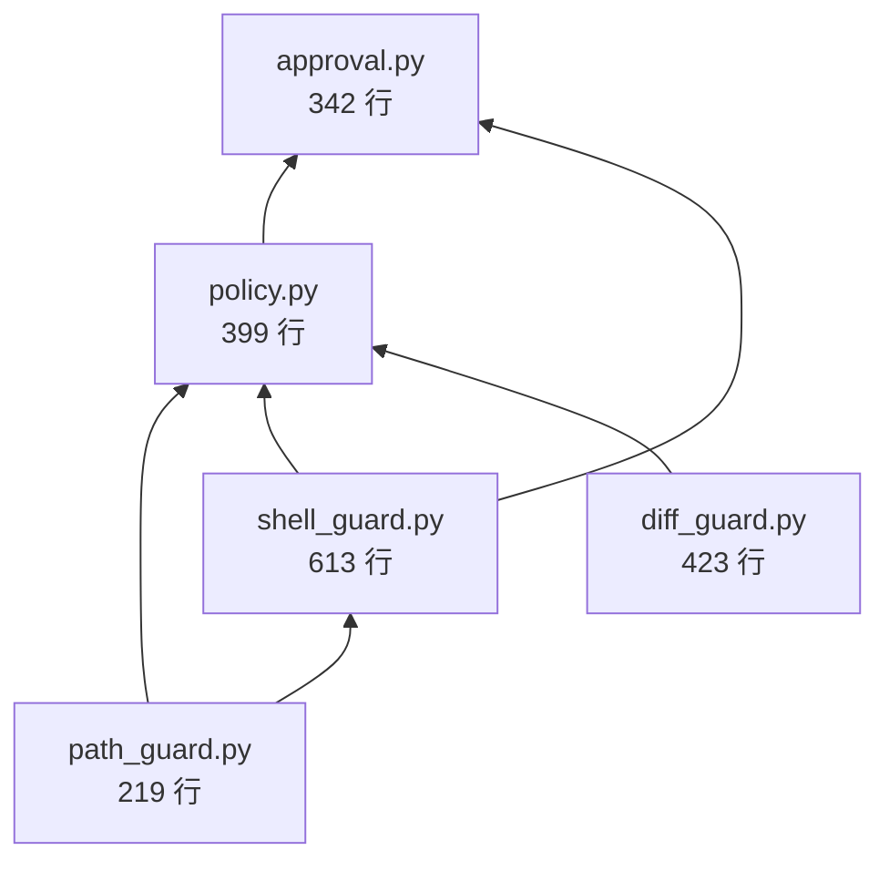
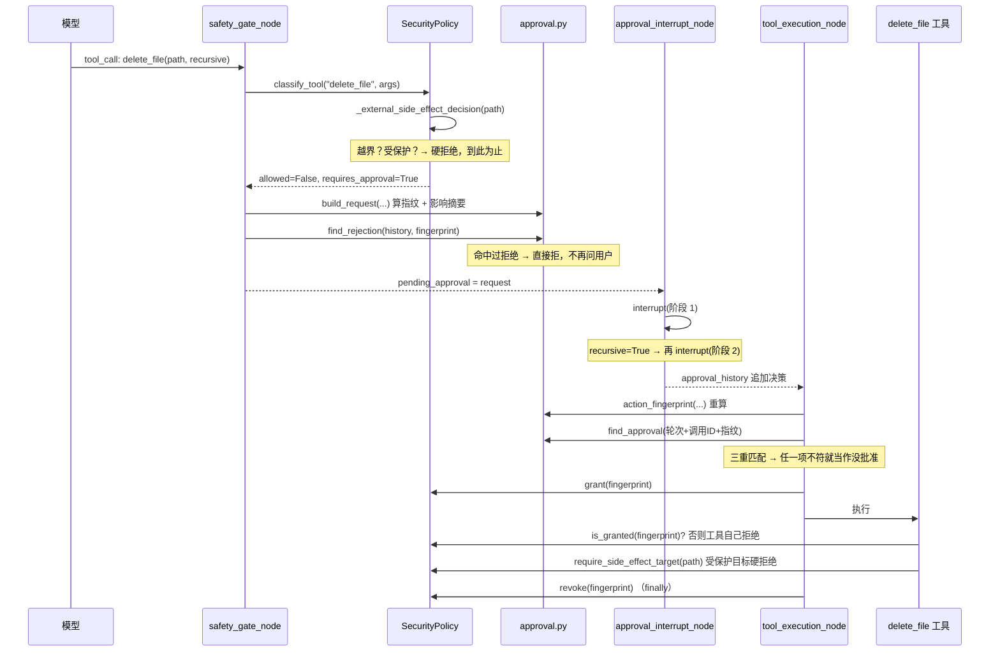

# L7 · 安全层：`security/`

> L6 里 `safety_gate_node` 反复说"安全门判定不通过""需要人工审批""指纹对不上"，但**判定逻辑本身**一行都没展开。这一篇就是拆那个黑盒。
>
> 读完你应该能回答：**"为什么 `~` 不算绝对路径？""工作区根目录为什么不是受保护目标？""为什么 `pytest --version` 在配置白名单里却还是被拒？""被拒绝过的动作换个 ID 还能不能执行？""为什么删除操作要问你两次？"**

文件：[security/](../../local-agent-web/src/local_agent/security)，**6 个文件、2001 行**。

| 文件 | 行数 | 一句话职责 |
|---|---|---|
| [path_guard.py](../../local-agent-web/src/local_agent/security/path_guard.py) | 219 | 路径边界、"不可审批目标"、敏感文件名 |
| [shell_guard.py](../../local-agent-web/src/local_agent/security/shell_guard.py) | 613 | 命令切词、语法检测、黑白名单、执行器选择 |
| [policy.py](../../local-agent-web/src/local_agent/security/policy.py) | 399 | **唯一总入口**：`classify_tool` + 一次性授权 + 脱敏 |
| [approval.py](../../local-agent-web/src/local_agent/security/approval.py) | 342 | 审批请求/决策、**动作指纹**、拒绝与批准的作用域 |
| [diff_guard.py](../../local-agent-web/src/local_agent/security/diff_guard.py) | 423 | 变更行数统计、patch 结构校验与应用 |
| [\_\_init\_\_.py](../../local-agent-web/src/local_agent/security/__init__.py) | 5 | **只有 docstring，没有导出** |

> **读代码时的一个坑**：`__init__.py` 的 docstring 还停留在早期阶段（写着"当前实现：路径边界与只读工具放行判定（T05）"），实际六个文件全都实现了。**包级 docstring 会过期，模块级 docstring 通常是最新的**——这个项目的模块 docstring 写得极其详细，优先信它。

---

## 0. 先看威胁模型：这一层在防什么

安全代码最容易"写成一堆 if 但没有重点"。看懂它的第一步是知道**它假设的敌人是谁**。

| # | 威胁 | 具体形态 | 防线在哪 |
|---|---|---|---|
| 1 | 模型被骗着读写不该动的文件 | 提示注入让模型去读 `.env`、`~/.ssh/id_rsa` | `path_guard.is_sensitive_path` + `policy._reject_sensitive` |
| 2 | 路径逃逸 | `../../../Windows/System32`、`~`、软链接指向工作区外 | `path_guard.resolve_target` |
| 3 | 破坏性命令 | `rm -rf /`、`format C:`、`curl xxx \| sh` | `shell_guard.prepare_shell` |
| 4 | **判定对象 ≠ 执行对象** | 判定时是 `git`，执行时 PATH 变了变成别的同名程序 | `shell_guard.resolve_executable` + 指纹里的 `executable_path` |
| 5 | 批准被复用 | 一次批准后，模型换个 `tool_call_id` 重放同一个动作 | `approval.find_approval` 按"轮次 + 调用 ID + 指纹"三重匹配 |
| 6 | 拒绝被绕过 | 用户拒绝了，模型换个 ID 再来一次 | `approval.find_rejection` **按指纹、跨轮匹配** |
| 7 | 密钥泄漏进上下文 | 把 `.env` 内容读进 Prompt，或透传 `*_API_KEY` 给子进程 | `SecretsConfig` + `_validate_env_keys` + `policy.redact` |

三条贯穿全层的原则（后面每个文件都会再遇到）：

1. **fail-closed（失败闭合）**：任何"不确定/没实现/配置冲突"的情况一律**拒绝**，绝不"默认放行"。
2. **机械规则优先**：所有拦截都是代码层 if 判断，**不依赖 Prompt 里写"请不要删除重要文件"**。
3. **判定对象必须等于执行对象**：判定时解析出的那个可执行文件绝对路径、那个规范化路径，会一路带进指纹和执行阶段。

> **Java 类比**：这一层相当于 Servlet 的 `Filter` 链 + Spring Security 的 `AccessDecisionManager`。区别是——**没有"放行清单"就一律拒绝**（Spring Security 的默认是 `permitAll` 之外还要显式配 `authenticated()`，而这里是反过来的：`classify_tool` 末尾那行就是 `deny`）。

---

## 1. 依赖关系：为什么 `security/` 是个"洋葱"



实测的 import 关系（[policy.py:32-40](../../local-agent-web/src/local_agent/security/policy.py#L32-L40)、[approval.py:22-23](../../local-agent-web/src/local_agent/security/approval.py#L22-L23)）：

- `path_guard` 是**最底层**，谁也不依赖（只依赖 `exceptions.py`）。
- `shell_guard` 依赖 `path_guard`（要判 cwd 边界、要查受保护目标）。
- `diff_guard` 独立，只依赖标准库 `difflib` 和 `exceptions`。
- `policy` 依赖上面三个 —— 它是**门面（Facade）**。
- `approval` 依赖 `policy` 和 `shell_guard`（算指纹时要重新跑一次 `prepare_shell`）。

**关键观察：`security/` 里没有任何一个文件 import `graph/`。**

谁在用 `security/`（实测 grep 结果）：

| 使用方 | 用了什么 | 场景 |
|---|---|---|
| [graph/nodes.py:120-136](../../local-agent-web/src/local_agent/graph/nodes.py#L120-L136) | `action_fingerprint`、`build_request`、`find_approval`、`find_rejection`、`SecurityPolicy`、`SafetyDecision` | 安全门与审批节点 |
| [graph/state.py:31-32](../../local-agent-web/src/local_agent/graph/state.py#L31-L32) | `ApprovalRequest`、`ApprovalDecision`、`SecurityPolicy` | 类型声明（策略挂在 `RuntimeContext` 上） |
| [tools/file_tools.py:24-33](../../local-agent-web/src/local_agent/tools/file_tools.py#L24-L33) | `action_fingerprint`、`diff_guard.*`、`assert_not_protected_target` | **执行前复核** |
| [tools/shell_tools.py:23-25](../../local-agent-web/src/local_agent/tools/shell_tools.py#L23-L25) | `prepare_shell`、`build_shell_invocation`、`action_fingerprint` | 真正 fork 子进程 |
| [rag/search.py:32-33](../../local-agent-web/src/local_agent/rag/search.py#L32-L33)、[rag/snippets.py:17](../../local-agent-web/src/local_agent/rag/snippets.py#L17) | `is_sensitive_path`、`is_within`、`build_environment`、`resolve_executable` | 检索时跳过敏感文件、复用同一套环境构造 |

**这个方向不能反**：`security/` 不知道有 LangGraph、不知道有 State。它的输入是"工具名 + 参数字典"，输出是"能不能做"。这样它才可能被单元测试直接调用（[tests/test_security.py](../../local-agent-web/tests/test_security.py) **925 行**，全部是纯函数级测试，不需要跑图）。

---

## 2. `path_guard.py`（219 行）：三道关卡

### 2.1 关卡一：边界判定 —— `resolve_target`

[path_guard.py:122-166](../../local-agent-web/src/local_agent/security/path_guard.py#L122-L166) 是全项目路径判定的唯一实现：

```python
text = path.strip()
if not text:
    raise WorkspaceBoundaryError("路径不能为空")

raw_absolute = Path(text).is_absolute()          # ← 先按"原始输入"判
candidate = Path(text).expanduser()              # ← 再展开 ~
if not raw_absolute:
    candidate = base_dir / candidate             # ← 相对路径拼基准目录
resolved = _resolve(candidate)                   # ← resolve() 展开 .. 与软链接
root = _resolve(workspace_root)
if is_within(resolved, root):
    return ResolvedTarget(path=resolved, external=False)
if raw_absolute and allow_external:              # ← 两个条件都满足才放行
    return ResolvedTarget(path=resolved, external=True)
raise WorkspaceBoundaryError(...)
```

三个细节值得单独记：

**① 顺序**：`is_absolute()` 必须在 `expanduser()` 和 `base_dir / candidate` **之前**调用。反过来写的话，`~` 展开成 `C:\Users\asus` 之后就是绝对路径了，会被当成"用户显式指定的外部路径"放行。这就是 [look_absolute](../../local-agent-web/src/local_agent/security/path_guard.py#L112-L119) 存在的理由——它单独抽出来就是为了强调"**按原始输入判**"。

**② `resolve()` 在边界校验之前**：所以"工作区内的软链接指向工作区外"也会被拦住（[path_guard.py:6-7](../../local-agent-web/src/local_agent/security/path_guard.py#L6-L7) 的规则 2）。`resolve()` 用的是 [\_resolve](../../local-agent-web/src/local_agent/security/path_guard.py#L215-L219)，`OSError` 时退回 `absolute()`——**目标不存在时也能判定**，所以"读一个不存在的外部路径"报的是边界错误，不是"文件不存在"。

**③ 放行需要"两个条件同时成立"**：`raw_absolute and allow_external`。

**实测**（`allow_external=True` 时）：

| 输入 | `look_absolute` | `resolve_target` 结果 |
|---|---|---|
| `~` | `False` | ❌ `WorkspaceBoundaryError`（展开后是 `C:/Users/asus`，但原始输入不是绝对路径） |
| `C:foo` | `False` | 被拒（Windows 盘符相对路径，原始输入 `is_absolute()` 为假） |
| `C:\Windows` | `True` | 若 `allow_external` 为真则放行，否则拒绝 |
| `src/a.py` | `False` | 拼基准目录，落在工作区内 |
| `../outside` | `False` | ❌ 即使 `allow_external=True` 也拒绝（相对路径逃逸） |
| `E:\pylianxi\chaiai`（工作区的父目录，**绝对路径**） | `True` | ✅ `ResolvedTarget(path=..., external=True)` |

注意最后一行的措辞：**`allow_external_paths=true` 打开的是"显式绝对路径的受控外部访问"，不是"关闭边界校验"**（[config.py:161-172](../../local-agent-web/src/local_agent/config.py#L161-L172) 把这个区别写得很清楚）。而且放行之后还有关卡二。

### 2.2 关卡二：不可审批目标 —— `protected_target_reason`

[path_guard.py:169-187](../../local-agent-web/src/local_agent/security/path_guard.py#L169-L187)。这一关的特殊性在于：**它不是"需要更高审批"，而是"根本不可审批"**——用户点"批准"也没用。

**实测**：

| 目标 | 原因 |
|---|---|
| `E:/` | `'文件系统或驱动器根目录'` |
| `Path.home()`（`C:\Users\asus`） | `'当前用户主目录'` |
| `E:/pylianxi/chaiai/local-agent-web/.git` | `'Git 元数据目录'` |
| **`E:/pylianxi/chaiai/local-agent-web`（工作区根）** | **`None`（不受保护）** |
| `E:/pylianxi/chaiai/local-agent-web/src` | `None` |

**第四行是最反直觉的一条，也是 docstring 专门解释过的**：

> 只约束副作用（写入/修改/删除/外部工作目录）；工作区根目录由各工具自己的检查负责（例如删除时禁止删根），不在这里判，否则 `run_shell` 默认的 `cwd="."`（= 工作区根）会被误伤。

翻译一下：如果工作区根也算"受保护目标"，那么**每一条 `run_shell` 都会当场被拒**，因为它的默认工作目录就是工作区根。所以"不许删工作区根"这条规则必须由 `delete_file` 工具自己实现，不能放进这个通用函数里。

> **Java 类比**：这是一个典型的"**公共校验方法被过度复用**"陷阱。`protected_target_reason` 的语义是"操作系统级别的、任何工具都不该碰的地方"，而"不许删工作区根"是 `delete_file` 的业务规则。两者混在一起，就会出现"为了拦住一种工具，误伤了另外三种工具"。

### 2.3 关卡三：敏感文件名 —— `is_sensitive_path`

[path_guard.py:209-212](../../local-agent-web/src/local_agent/security/path_guard.py#L209-L212)：

```python
def is_sensitive_path(path: Path, patterns: tuple[str, ...] = SENSITIVE_NAME_PATTERNS) -> bool:
    """文件名是否命中敏感模式（只匹配文件名，不匹配目录名）。"""
    name = path.name.lower()
    return any(fnmatch.fnmatch(name, pattern) for pattern in patterns)
```

模式表在 [path_guard.py:52-64](../../local-agent-web/src/local_agent/security/path_guard.py#L52-L64)：`.env`、`.env.*`、`*.pem`、`*.key`、`*.pfx`、`*.keystore`、`id_rsa*`、`id_ed25519*`、`id_ecdsa*`、`credentials`、`credentials.*`。

**实测**：

| 路径 | 结果 | 说明 |
|---|---|---|
| `.env` | `True` | |
| `.ENV` | `True` | 先 `.lower()` |
| `env.py` | `False` | 只匹配文件名，不匹配"包含 env 的任意名字" |
| `a/.env` | `True` | 取 `path.name`，目录层级不影响 |
| `config.key/x.txt` | **`False`** | **目录名叫 `config.key` 不算**——只匹配文件名 |
| `credentials` | `True` | 无扩展名也匹配 |
| `.env.example` | **`True`** | 被 `.env.*` 命中 |

最后一行是**误伤**：`.env.example` 是模板文件，通常**不含真实密钥**，但按规则一样被拦。这是有意的 fail-closed——**宁可少读一个模板，也不要漏读一个真 `.env`**。实测证据（`resolve_readable_file`）：

```
resolve_readable_file('.env.example') -> !! SecurityError: 该文件按策略禁止读取（疑似密钥文件）：.env.example
resolve_readable_file('pyproject.toml') -> OK（未拦）
```

拦截动作在 [policy.py:379-381](../../local-agent-web/src/local_agent/security/policy.py#L379-L381)，受 `security.secrets.block_known_secret_files` 开关控制（[config.py:321-325](../../local-agent-web/src/local_agent/config.py#L321-L325)，默认 `true`）。

---

## 3. `shell_guard.py`（613 行）：全项目唯一做"语法分析"的文件

其他安全判定都是"看参数值"，只有 Shell 判定要**真正解析一条命令字符串**。613 行里大部分复杂度来自这里。

### 3.1 五步判定顺序

[shell_guard.py:3-9](../../local-agent-web/src/local_agent/security/shell_guard.py#L3-L9) 的 docstring 直接给了顺序，这是理解整个文件的钥匙：

```text
1. 命令非空；按引号规则切分成 argv，并检测引号之外的 Shell 语法。
2. 可执行文件必须是裸名字（带路径一律提级审批，批准后才执行）。
3. 命中 blocked_patterns → 视为破坏性命令，强制审批。
4. 命中结构化白名单（平台 + 可执行名 + 参数结构 + 工作目录）→ 免审批放行。
5. 其余 → 需要审批。
```

**主判定是"解析后的命令结构"，黑名单只作最后兜底**——这句话很重要。它意味着"黑名单不全"不是致命问题（漏掉的命令会落到第 5 步"需要审批"），真正的安全边界是**第 5 步的默认值**。

### 3.2 `_tokenize`：切词与语法检测

[shell_guard.py:550-586](../../local-agent-web/src/local_agent/security/shell_guard.py#L550-L586)。它一次遍历同时做三件事：切 argv、记录引号外的语法字符、收集"未被引号包住的内容"用于命令替换检测。

语法字符表 [shell_guard.py:47](../../local-agent-web/src/local_agent/security/shell_guard.py#L47)：

```python
SHELL_SYNTAX_TOKENS: tuple[str, ...] = ("|", ">", "<", "&", ";", "`", "^", "\n")
```

命令替换正则 [shell_guard.py:50](../../local-agent-web/src/local_agent/security/shell_guard.py#L50)：

```python
_COMMAND_SUBSTITUTION = re.compile(r"\$\(|%[A-Za-z_][A-Za-z0-9_]*%")
```

**实测**（`split_command` 返回 argv，`syntax` 需从 `prepare_shell` 结果看）：

| 命令 | argv | 语法字符 |
|---|---|---|
| `echo hi > f` | `['echo', 'hi', 'f']` | `'>'` |
| `echo hi < f` | `['echo', 'hi', 'f']` | `'<'` |
| `python -c "import sys; sys.exit(0)"` | `['python', '-c', 'import sys; sys.exit(0)']` | `None`（引号内的 `;` 不算） |
| `echo "a\|b"` | `['echo', 'a\|b']` | `None`（引号内的 `\|` 不算） |
| `echo $(whoami)` | `['echo', '$(whoami)']` | `'$('` |
| `echo %PATH%` | `['echo', '%PATH%']` | `'%PATH%'` |
| `echo a && echo b` | `['echo', 'a', 'echo', 'b']` | `'&'` |
| `echo \`whoami\`` | `['echo', 'whoami']` | `'\`'`（反引号被吃掉，内容留下了） |
| `git status` | `['git', 'status']` | `None` |

**第一、二行是"为什么指纹里必须有原始命令"的直接证据**：`echo hi > f`（写文件）和 `echo hi < f`（读文件）切出来的 argv **完全一样**，但语义完全相反。所以 [approval.py:166](../../local-agent-web/src/local_agent/security/approval.py#L166) 把 `raw_command` 原文放进了指纹，实测两者指纹不同：

```
shell 'echo hi > f'  ->  '6eaa71e256b5914b'
shell 'echo hi < f'  ->  '155eda694cadd813'
```

**第八行也值得注意**：反引号被当作语法字符丢弃，内容 `whoami` 留在了 token 里。这不影响安全（因为有语法字符就走适配器 + 提级审批），但如果你要复用 `split_command` 做别的事，要记住**它不是无损的**。

### 3.3 判定分支的顺序不是随意的

[prepare_shell](../../local-agent-web/src/local_agent/security/shell_guard.py#L145-L356) 里的分支顺序有几处"看起来可以换、其实不能换"：

**① 黑名单（L225）先于"带路径"（L306）与"可解析性"（L296）判断**

[shell_guard.py:269-271](../../local-agent-web/src/local_agent/security/shell_guard.py#L269-L271) 的解释：

> 破坏性信号比路径风险更该出现在审批说明里，而且 `rm` / `del` / `chmod` 这类命令在 Windows 上本来就没有可执行文件（属于 shell 内建）。

**② 但"不可执行"的命令不能进审批**（L272-281）：

> 否则用户批准后必然启动失败，判定对象也不等于执行对象。

于是黑名单命中的命令会被**分成两种结局**：

| 情况 | 结局 | 实测 |
|---|---|---|
| 黑名单命中 **且** 可执行文件能解析到 | `requires_approval=True` | `curl https://x` → 强制审批（`curl.exe` 在 `C:\Windows\System32`） |
| 黑名单命中 **但** 可执行文件解析不到 | `allowed=False, requires_approval=False`（**硬拒绝**） | `rm -rf /` → 硬拒绝（Windows 没有 `rm`） |

**这就是"失败"与"没命中"必须分开**的另一个实例：硬拒绝（`requires_approval=False`）表示"这条路根本走不通"，审批（`requires_approval=True`）表示"用户点头就能走"。把前者做成审批，用户点完批准只会得到"命令无法启动"。

**③ 可执行文件解析失败一律硬拒绝**（L296-304）：

> 解析不到就当场拒绝，不再退回原名字让执行阶段重新搜索 PATH——那正是"判定对象 ≠ 执行对象"的缺口。

### 3.4 实测：13 条命令的完整判定

配置来自项目真实的 [config.yaml:91-124](../../local-agent-web/config.yaml#L91-L124)（白名单 5 条、黑名单 7 条）。

| 命令 | `allowed` | 需审批 | 走了哪一步 |
|---|---|---|---|
| `git status` | ✅ | 否 | 白名单命中 |
| `git diff` | ✅ | 否 | 白名单命中 |
| `python --version` | ✅ | 否 | 白名单命中（解析到 `E:\miniconda3 py\python.exe`） |
| `git status --short` | ❌ | **是** | 第 5 步：不在白名单 |
| `pytest --version` | ❌ | 否 | **硬拒绝**：PATH 里找不到 `pytest`（见 §3.5） |
| `pytest -q` | ❌ | 否 | **硬拒绝**：同上（卡在解析可执行文件，还没走到白名单） |
| `curl https://x` | ❌ | **是** | 黑名单命中 `curl `，且 `curl.exe` 存在 |
| `format C:` | ❌ | **是** | 黑名单命中 `format `，且 `format.com` 存在 |
| `reformat x` | ❌ | 否 | 黑名单**误伤** `format `（见 §3.6） |
| `echo hi \| more` | ❌ | **是** | Shell 语法提级，`executor=cmd` |
| `rm -rf /` | ❌ | 否 | 黑名单命中，但 Windows 上 `rm` 解析不到 → 硬拒绝 |
| `chmod +x a.sh` | ❌ | 否 | 同上（`chmod` 是 shell 内建） |
| `nonexistent-tool-xyz --version` | ❌ | 否 | 硬拒绝：解析不到可执行文件 |

注意 `pytest -q` 那一行：它本该落到"第 5 步 → 需要审批"，但因为**可执行文件解析**（L296）在**白名单匹配**（L326）之前，它在更早的地方就被硬拒绝了。**判定顺序会改变"需不需要审批"这个结论**——这是读这个文件时最容易看漏的一点。

### 3.5 白名单是"结构匹配"，不是"名字匹配"

[match_whitelist](../../local-agent-web/src/local_agent/security/shell_guard.py#L440-L464) 要同时满足四个条件：

```python
if entry.platform and platform not in entry.platform:        # ① 平台
    continue
if not same_executable(entry.executable, argv[0]):           # ② 可执行名（归一化后相等）
    continue
if list(argv[1:]) != list(entry.args):                       # ③ 参数**完全一致**
    continue
if not _cwd_allowed(entry, cwd=cwd, workspace_root=workspace_root):  # ④ 可选 cwd 限定
    continue
return entry
```

**③ 是 `!=` 而不是"前缀匹配"**，所以 `match: exact`（[config.py:295](../../local-agent-web/src/local_agent/config.py#L295) 里 `Literal["exact"]`，**只允许这一个值**，实测传 `match="prefix"` 会抛 `ValidationError`）意味着：

```
git status          -> 免审
git status --short  -> 需要审批
```

**② 的归一化在 [same_executable](../../local-agent-web/src/local_agent/security/shell_guard.py#L495-L501)**：忽略大小写、目录前缀、Windows 可执行后缀。实测：

| 比较 | 结果 |
|---|---|
| `python` vs `PYTHON.EXE` | `True` |
| `C:\x\git.exe` vs `git` | `True` |
| `format.com` vs `format` | `True` |
| **`python3` vs `python`** | **`False`** |

最后一行是**有意不做的**：docstring 原文——

> 只做归一化比较，不做别名映射：`python3` 不等于 `python`、`pip3` 不等于 `pip`，别名不能因为名字相近就共享免审资格。

**④ `cwd` 限定**实测（`ShellWhitelistEntry(executable="git", args=["status"], cwd="src")`）：

| 实际 cwd | 命中 |
|---|---|
| `<工作区>/src` | ✅ |
| `<工作区>`（根） | ❌ |
| 条目 cwd 本身越界（`../outside`） | ❌（`_cwd_allowed` 里 `resolve_within_workspace` 抛异常 → 返回 `False`） |

**⚠️ 一个必须知道的前提**：白名单要真正生效，**可执行文件必须能被 `shutil.which` 在当前进程的 PATH 上找到**（[resolve_executable:436-437](../../local-agent-web/src/local_agent/security/shell_guard.py#L436-L437)）。

**实测对照**（同一份配置、同一台机器）：

| 启动方式 | `pytest --version` |
|---|---|
| 直接调用 `.venv\Scripts\python.exe` | ❌ 硬拒绝："当前环境找不到可执行文件：pytest" |
| 用 `uv run` 启动 | ✅ 命中白名单（`shutil.which('pytest')` → `.venv\Scripts\pytest.EXE`） |

所以**"白名单里明明写了却还是被拒"**的第一嫌疑对象不是白名单逻辑，而是**进程 PATH**。这也是为什么本项目推荐用 `uv run` 启动（见 [README](README.md) 的环境速查）。

### 3.6 黑名单的两个坑（实测）

[match_blocked_patterns](../../local-agent-web/src/local_agent/security/shell_guard.py#L467-L492) 是**两级匹配**：

1. **结构匹配**：把 pattern 也切成 argv，比较归一化后的可执行名，并要求 pattern 的其余 token 是实际参数的**前缀**。这样 `format`、`FORMAT.COM`、`C:\Windows\System32\format.com` 会被同一条规则拦住。
2. **子串匹配**：pattern 不是合法命令形态时的兜底，用 `raw_pattern.casefold() in command.casefold()`。

**坑一：子串匹配是"包含"，不是"词边界"**。配置里写的是 `"format "`（带尾随空格），注释说这个空格是为了避免误伤 `reformat` 这类名字。**实测证明它只挡住了一半**：

```
prepare_shell('format C:')   -> 命中「format 」，强制审批          ✅ 符合预期
prepare_shell('reformat x')  -> 命中「format 」，且解析不到可执行文件 → 硬拒绝   ❌ 误伤
```

原因：`"format " in "reformat x"` 为 `True`（`reformat` 的第 3 个字符起正好是 `format `）。尾随空格只能挡住**光秃秃的 `reformat`**（后面没跟参数），挡不住 `reformat <参数>`。

**坑二：黑名单是"最后一道"，不是"安全边界"**。docstring 写得很直白：

> 黑名单兜底匹配（架构 §6.6 末段：只作最后一道，不是安全边界）。

也就是说：**黑名单漏掉一条命令不会造成放行**——它会落到第 5 步"不在白名单 → 需要审批"。黑名单的作用是**把审批说明写得更准确**（"命中破坏性命令模式"比"不在白名单内"更有信息量）。

### 3.7 环境变量透传：默认一个都不给

[build_environment:513-518](../../local-agent-web/src/local_agent/security/shell_guard.py#L513-L518) 构造子进程环境时，**不继承 `os.environ`**，而是从 [BASE_ENV_KEYS:62-81](../../local-agent-web/src/local_agent/security/shell_guard.py#L62-L81) 这个白名单里挑（`PATH`、`PATHEXT`、`SystemRoot`、`TEMP`、`USERPROFILE` 等 19 个），再叠加调用方显式申请的键。

显式申请要过 [_validate_env_keys:597-613](../../local-agent-web/src/local_agent/security/shell_guard.py#L597-L613)：

```python
name = (key or "").strip()
if not _ENV_KEY.match(name):
    return (), f"环境变量名不合法：{key}"
upper = name.upper()
if any(hint in upper for hint in _SECRET_ENV_HINTS):     # ("KEY","TOKEN","SECRET","PASSWORD","PASSWD","CREDENTIAL")
    return (), f"禁止透传疑似密钥的环境变量：{name}"
```

**实测**：

| `env_keys` | 结果 |
|---|---|
| `["DEEPSEEK_API_KEY"]` | ❌ 硬拒绝："禁止透传疑似密钥的环境变量" |
| `["MY_VAR"]` | ✅ 通过（随后走正常白名单判定） |
| `["1BAD"]` | ❌ 硬拒绝："环境变量名不合法" |

注意第 601 行有个 `del config`：

```python
del config  # 目前所有疑似密钥的名字一律拒绝，不提供按配置放开的入口
```

**这是一个"故意留的墓碑"**：签名里有 `config` 参数（为了将来可能放开），但当前实现**明确不使用它**，并用 `del` 让"我故意没用"这件事在代码里可见（同时让 lint 不报"未使用参数"）。读到这里应该立刻意识到：**这一条是硬规则，改配置也没用**。

> **Java 类比**：这相当于 `System.getenv()` 的"白名单包装"。Java 里进程环境是全量继承的，Agent 场景下这个默认值太危险——**子进程能读到你的 API Key**，而模型可以决定跑什么命令。

### 3.8 执行器：`argv` 直执行 vs 三种 Shell 适配器

[ShellPlan.executor](../../local-agent-web/src/local_agent/security/shell_guard.py#L129-L142) 有两个取值家族：

- `EXECUTOR_ARGV = "argv"`：**没有** Shell 语法 → 直接 `subprocess(argv, shell=False)`。
- `cmd` / `pwsh` / `sh`：**有** Shell 语法 → 交给适配器，`shell=False` 依旧成立，但首元素是适配器。

[build_shell_invocation:389-417](../../local-agent-web/src/local_agent/security/shell_guard.py#L389-L417) 拼出最终 argv：

| 适配器 | 前缀 | 实测（`echo hi \| more`） |
|---|---|---|
| `argv` | `[executable_path, *argv[1:]]` | `['C:\\Program Files\\Git\\cmd\\git.exe', 'status']` |
| `cmd` | `[launcher, "/d", "/s", "/c", command]` | `['C:\\Windows\\System32\\cmd.exe', '/d', '/s', '/c', 'echo hi \| more']` |
| `pwsh` | `[launcher, "-NoProfile", "-NonInteractive", "-Command", command]` | — |
| `sh` | `[launcher, "-c", command]` | — |

**关键点：调用方始终 `shell=False`**（docstring 原文"调用方始终 `shell=False`"）。"交给 Shell"这件事是通过**显式启动一个 Shell 进程**实现的，不是通过 `shell=True`。这样超时、输出捕获、进程树管理都还能控制。

**适配器与平台必须匹配**，[select_adapter:364-381](../../local-agent-web/src/local_agent/security/shell_guard.py#L364-L381) 实测：

| 配置 | 平台 | 结果 |
|---|---|---|
| `argv_preferred` | `posix` | `('sh', None)` |
| `pwsh` | `windows` | `('pwsh', None)` |
| **`sh`** | **`windows`** | **`('', '... 不适用于 windows 平台，已按失败闭合拒绝')`** |
| **`cmd`** | **`posix`** | **`('', '... 不适用于 posix 平台，已按失败闭合拒绝')`** |

配置写错平台 → **失败闭合**，不是"自动换个能用的"。

**另外**：适配器本身也会被 `resolve_executable` 解析（[L233-247](../../local-agent-web/src/local_agent/security/shell_guard.py#L233-L247)），解析不到就**当场失败闭合**——理由同样是"不能让用户先批准、执行时才报命令无法启动"。

**⚠️ 一个潜在陷阱**（实测发现，但当前代码路径不会触发）：`build_shell_invocation(plan, adapter=...)` 的 `adapter` 覆盖参数只改**标志位**，不改 launcher：

```
build_shell_invocation(plan_cmd, adapter='pwsh')
-> ['C:\\Windows\\System32\\cmd.exe', '-NoProfile', '-NonInteractive', '-Command', 'echo hi | more']
        ↑ 还是 cmd.exe，但用的是 pwsh 的参数
```

因为 launcher 取的是 `plan.executable_path`（判定阶段按 `plan.executor` 解析的）。实测 grep 全仓库，**生产代码 [shell_tools.py:104](../../local-agent-web/src/local_agent/tools/shell_tools.py#L104)、[139](../../local-agent-web/src/local_agent/tools/shell_tools.py#L139) 都只传一个参数**，所以现在不会踩到。写这一段的目的是：**看到一个"覆盖参数"时，先确认它覆盖的是不是全部相关字段**。

---

## 4. `policy.py`（399 行）：唯一总入口

### 4.1 `classify_tool`：一张分派表 + 一个兜底 deny

[policy.py:196-227](../../local-agent-web/src/local_agent/security/policy.py#L196-L227) 是整层最常被调用的函数。结构极简：

```python
args = dict(arguments or {})
if tool_name in READ_ONLY_TOOLS:          # ("list_dir", "read_file")
    return SafetyDecision(allowed=True, requires_approval=False, reason="只读工具")
if tool_name == "edit_file":
    return self._classify_edit(args)
if tool_name == "write_file":
    return self._classify_write(args)
if tool_name in SHELL_TOOLS:              # ("run_shell",)
    return self._classify_shell(args)
if tool_name in ALWAYS_APPROVAL_TOOLS:    # ("delete_file",)
    ...
return SafetyDecision(allowed=False, requires_approval=False,
                      reason=f"工具 {tool_name} 尚未接入或不在放行清单内")
```

**最后那个 `return` 就是 fail-closed 的落点**。实测：

```
classify_tool('some_new_tool') -> allowed=False, appr=False, reason='工具 some_new_tool 尚未接入或不在放行清单内'
```

四个工具分组常量在 [policy.py:43-57](../../local-agent-web/src/local_agent/security/policy.py#L43-L57)，实测值：

```python
READ_ONLY_TOOLS       = ('list_dir', 'read_file')
WRITE_TOOLS           = ('edit_file', 'write_file')
SHELL_TOOLS           = ('run_shell',)
ALWAYS_APPROVAL_TOOLS = ('delete_file',)
KNOWN_TOOLS           = READ_ONLY_TOOLS + WRITE_TOOLS + SHELL_TOOLS + ALWAYS_APPROVAL_TOOLS   # 共 6 个
```

> **注意 `WRITE_TOOLS` 在 `classify_tool` 里没有被用到**——它是给别处（提示词、工具注册）用的分组。**看到常量定义不要假设它一定在本文件被用**，用 grep 查引用。

### 4.2 `_external_side_effect_decision`：三出口

[policy.py:229-262](../../local-agent-web/src/local_agent/security/policy.py#L229-L262)。所有**有副作用**的工具（edit / write / delete）都会先过它，返回三种结果之一：

| 情况 | 返回 | 含义 |
|---|---|---|
| 路径为空 | `None` | "别抢着判"——交给工具自己的解析去报错 |
| 越界且不允许外部 | `SafetyDecision(False, False, ...)` | **硬拒绝** |
| 受保护目标 | `SafetyDecision(False, False, ...)` | **硬拒绝**（不可审批） |
| 工作区外普通目标 | `SafetyDecision(False, True, ...)` | **强制审批**，且不参与免审白名单 |
| 工作区内目标 | `None` | 按各工具自己的风险规则继续判 |

**第一行那个"路径为空返回 None"有个具体理由**（[policy.py:238-241](../../local-agent-web/src/local_agent/security/policy.py#L238-L241)）：

> 没给路径（或空串）：交给工具自身的解析去报错，这里不抢先判定，否则"只按文本判定"的调用（例如只传 `old_text`/`new_text`）会被误判为缺路径。

**实测三种结局**：

```
classify_tool('delete_file', {path: 'src/a.py'})  -> appr=True  「delete_file 属于强制审批动作」
classify_tool('delete_file', {path: 'E:/'})       -> appr=False 「路径超出工作区：E:/ ...」
classify_tool('write_file', {path: 'C:\\temp\\x.txt'})  -> appr=False 「路径超出工作区：C:/TEMP/x.txt ...」
```

第三行值得注意：`C:\temp\x.txt` 是**绝对路径**，但因为 `allow_external_paths=false`（本机配置 [config.yaml:27](../../local-agent-web/config.yaml#L27)），它在 `resolve_path` 阶段就抛 `WorkspaceBoundaryError` → **硬拒绝**，而不是"外部路径需要审批"。**顺序是：先判越界，再判受保护，最后才判"外部路径需审批"。**

### 4.3 免审上限：`large_edit`

[_classify_edit:264-302](../../local-agent-web/src/local_agent/security/policy.py#L264-L302) 的骨架：

```python
mode = edit_input_mode(args.get("old_text"), args.get("new_text"), args.get("patch"))
concern = self._external_side_effect_decision(str(args.get("path", "")), verb="修改")
if concern is not None:
    return concern
if mode == "patch":
    plan = parse_patch(str(args.get("patch") or ""))    # ← 结构非法直接硬拒绝
    changed_lines = plan.changed_lines
    what = f"unified diff（{len(plan.hunks)} 个 hunk）"
else:
    changed_lines = count_changed_lines(old_text, new_text)
    what = "精确串替换"
limit = self.security.large_edit.max_changed_lines_without_approval    # 默认 200
if changed_lines > limit:
    return SafetyDecision(False, True, f"... 超过免审上限 {limit} 行 ...")
return SafetyDecision(True, False, f"{what}，改动 {changed_lines} 行，在免审范围内")
```

**三个设计要点**：

**① 输入模式判定与工具执行共用同一个函数**（[policy.py:265-266](../../local-agent-web/src/local_agent/security/policy.py#L265-L266) 的注释）：

> 安全判定与工具执行**共用** `diff_guard.edit_input_mode`，不能两处各写一套互斥规则。

这是"**同一个事实只能有一个真相来源**"的实例。如果安全判定自己写一套"有 patch 就用 patch"、工具执行写另一套，两者迟早分叉——然后就会出现"判定时算的是 A 模式，执行时按 B 模式执行"。

**② 结构非法的 patch 硬拒绝，不进审批**（[policy.py:277-280](../../local-agent-web/src/local_agent/security/policy.py#L277-L280)）：

> 结构非法的 patch 永远不可能被执行：硬拒绝，不推进审批——不能让用户为一个必然失败的补丁点"批准"。

**③ `>` 而不是 `>=`**：`changed_lines == 200` 免审，`201` 才要审批。

**实测**：

| 调用 | 结果 |
|---|---|
| `edit_file{path, old_text:'a', new_text:'b'}` | ✅ `精确串替换，改动 2 行，在免审范围内` |
| `edit_file{path}`（只有路径） | ❌ 硬拒绝：`edit_file 需要提供 old_text 与 new_text ...` |
| `edit_file{old_text, new_text, patch}` 三种都给 | ❌ 硬拒绝：`patch 模式与 old_text/new_text 不能同时使用` |
| 202 行的 `new_text` | ❌ 审批：`改动约 203 行，超过免审上限 200 行` |
| `edit_file{patch: "not a patch"}` | ❌ 硬拒绝：`不是有效的 unified diff：文件头之后应当是 @@ 开头的 hunk 头` |

### 4.4 ⚠️ 分类层**不**做只读工具的路径校验

实测：

```
classify_tool('read_file', {path: 'C:\\Windows\\System32\\drivers\\etc\\hosts'})
-> SafetyDecision(allowed=True, requires_approval=False, reason='只读工具')
```

**只读工具在 `classify_tool` 里直接返回放行，完全不看路径**。那越界读取靠什么拦？靠**工具自己**：

```
policy.resolve_readable_file('C:\\Windows\\win.ini')
-> !! WorkspaceBoundaryError: 路径超出工作区：C:/Windows/win.ini（工作区 E:/pylianxi/chaiai/local-agent-web）
```

调用点在 [tools/file_tools.py:174](../../local-agent-web/src/local_agent/tools/file_tools.py#L174)。这就是 **L6 里 `safety_gate_node` 说的"只读工具直接放行"的真实含义**——不是"读哪里都行"，而是"这一层不判，下一层判"。

> **这是读安全代码时最需要建立的意识**：`classify_tool` 返回 `allowed=True` **不等于**"这个动作一定成功"。它只回答"**这一层**有没有意见"。真正的拦截可能发生在：
> - 工具执行时（`resolve_readable_file` / `resolve_writable_file` / `assert_not_protected_target`）
> - 参数校验时（`_invoke_tool` 里的 Pydantic）
> - 执行前复核时（`policy.is_granted`）

### 4.5 一次性授权：`grant` / `revoke` / `is_granted`

[policy.py:355-369](../../local-agent-web/src/local_agent/security/policy.py#L355-L369) 就是一个 `set[str]`：

```python
def grant(self, fingerprint: str) -> None:
    """登记一次人工批准（仅在 tool_execution_node 执行已批准动作前调用）。
    批准只对本次执行有效：动作执行完必须立刻 revoke，避免一次批准被复用。"""
    if fingerprint:
        self._granted.add(fingerprint)

def revoke(self, fingerprint: str) -> None:
    self._granted.discard(fingerprint)

def is_granted(self, fingerprint: str) -> bool:
    return bool(fingerprint) and fingerprint in self._granted
```

**实测**：

```
grant 后 is_granted('FP-1') -> True
revoke 后 is_granted('FP-1') -> False
is_granted('') -> False            # 空指纹永远不通过
```

**为什么需要这个机制？** 因为工具本身**也要**拦一道。看 [tools/file_tools.py:271-275](../../local-agent-web/src/local_agent/tools/file_tools.py#L271-L275)：

```python
resolved = policy.resolve_writable_file(path)
...
if not decision.allowed and not policy.is_granted(
    action_fingerprint("edit_file", arguments, policy=policy)
):
    raise SecurityError(...)      # 没有有效批准 → 工具自己拒绝
```

**工具不信任"调用方说已经批准了"**，它自己去 `policy` 里查。而 `policy` 里的授权是 [nodes.py:1235-1245](../../local-agent-web/src/local_agent/graph/nodes.py#L1235-L1245) 在执行前临时放进去、执行完 `finally` 立刻撤销的：

```python
if granted:
    policy.grant(fingerprint)
try:
    ...执行...
finally:
    if granted:
        # 批准是一次性的：执行完立即撤销（架构 §6.5 的"恰好执行一次"）
        policy.revoke(fingerprint)
```

> **Java 类比**：这是"**能力令牌（capability token）**"模式。`grant` 相当于发一个只能用一次的令牌，`finally { revoke }` 相当于用完即焚。为什么不能直接传个 `approved=true` 布尔参数？因为**布尔参数会被伪造/误传**，而令牌只能由持有 `policy` 引用的代码发放——而 `policy` 只在 `RuntimeContext` 里，模型碰不到。

---

## 5. `approval.py`（342 行）：指纹与"批准的作用域"

### 5.1 指纹算法

[action_fingerprint:103-179](../../local-agent-web/src/local_agent/security/approval.py#L103-L179) 的结构：

```python
parts: list[str] = [tool_name, policy.workspace_root.as_posix()]   # ← 所有工具都带前两项

if tool_name in {"edit_file", "write_file"}:
    path = _normalized_path(policy, str(args.get("path") or ""))
    change = json.dumps({... old_text / new_text / patch / replace_all / content / overwrite ...},
                        ensure_ascii=False, sort_keys=True, default=str)
    parts += [path, _file_digest(path), _hash_text(change)]
elif tool_name == "delete_file":
    path = _normalized_path(...)
    parts += [path, str(bool(args.get("recursive"))), _delete_target_summary(path)]
elif tool_name == "run_shell":
    ...
    parts += [raw_command, " ".join(plan.argv), cwd, ",".join(env_keys),
              str(plan.timeout_seconds), plan.executor, plan.executable_path or ""]
else:
    parts.append(json.dumps(args, ensure_ascii=False, sort_keys=True, default=str))

return _hash_text("|".join(parts))
```

**三个"为什么这些字段必须在里面"**：

**① 工作区根（第 113 行）**：

> 工作区根目录必须是指纹的一部分：同一个相对路径在不同工作区是两个不同的动作，否则"在 A 里批准过"的指纹会复用到 B。

**实测**（同一个 `edit_file` 调用，换 `workspace_root`）：

```
同一 edit，工作区 = local-agent-web   ->  '4a8a0bf357977112'
同一 edit，工作区 = local-agent-web/src ->  'cc627b661728b5f4'
```

**② 文件当前内容摘要（`_file_digest`）**：如果批准之后文件被别的东西改了，指纹会变 → 批准自动失效。`_file_digest` 对"不存在/读不了"返回 `"missing"` / `"unreadable"` 这样的**稳定标记**（[approval.py:279-293](../../local-agent-web/src/local_agent/security/approval.py#L279-L293)），而不是抛异常。

**③ `run_shell` 的 `executable_path`**：

> 指纹要覆盖"实际会被执行的计划"：……以及判定阶段解析出的可执行文件路径。这样批准后若 PATH 变化导致同一个命令会落到别的程序上，指纹随之变化、批准自动失效。

### 5.2 归一化：省略 == 显式默认

指纹最容易出问题的地方是"同一个动作算出两个指纹"，导致**批准莫名失效**。代码里有两处专门的归一化：

[\_text:336-342](../../local-agent-web/src/local_agent/security/approval.py#L336-L342)：

```python
def _text(value: Any) -> str:
    """把参与指纹的文本参数归一成字符串：省略 / None 与显式空串必须等价。"""
    return value if isinstance(value, str) else ""
```

[as_int:384-398](../../local-agent-web/src/local_agent/security/policy.py#L384-L398)（放在 `policy.py` 里，被 `approval.py` 引用）：

> 安全判定与动作指纹必须用同一套归一规则，否则同一个动作会在两处算出不同的计划（例如 `timeout_seconds` 传 `"60"` 与传 `60`）。

注意 `as_int` 里有个特殊分支：

```python
if isinstance(value, bool):
    return None        # ← bool 是 int 的子类，不特判的话 True 会变成 1
```

**实测**：

| 两次调用的差异 | 指纹 |
|---|---|
| `edit` 省略 `replace_all` vs `replace_all=False` | **相同**（`4a8a0bf357977112`） |
| `edit` `replace_all=True` | 不同（`121d343a1ac96168`） |
| `run_shell` 省略 `timeout_seconds` vs `=60` vs `="60"` | **三者相同**（`3475ce052061dbf8`） |
| `run_shell` `cwd="."` vs `cwd="./"` | **相同** |
| `run_shell` `echo hi > f` vs `echo hi < f` | 不同（见 §3.2） |

`timeout_seconds` 省略时取的是**配置值**（`policy.security.shell.default_timeout_seconds`），不是出厂常量 60（[approval.py:146-151](../../local-agent-web/src/local_agent/security/approval.py#L146-L151) 专门解释了这点）：

> 归一规则与 `SecurityPolicy.classify_tool` 一致；省略时取配置值（与安全判定、工具执行同一语义），而不是配置的出厂常量 60。

**如果这里写成 60**：把配置改成 30 秒后，"省略超时"的安全判定按 30 秒算、指纹按 60 秒算——同一个动作两个值，批准就会失效。

### 5.3 拒绝跨轮、批准限轮 —— 一个刻意的不对称

这是本节最值得记的设计。

| 函数 | 匹配条件 | 作用域 |
|---|---|---|
| [find_rejection:225-238](../../local-agent-web/src/local_agent/security/approval.py#L225-L238) | `decision == "reject"` **且** `action_fingerprint` 相等 | **不按轮次隔离**（跨轮生效） |
| [find_approval:241-263](../../local-agent-web/src/local_agent/security/approval.py#L241-L263) | `decision == "approve"` **且** `run_id` 相等 **且** `tool_call_id` 相等 **且** `action_fingerprint` 相等 | **三重限定**（只对同一次调用生效） |

**实测**：

```
find_rejection(同一指纹，换到 run-B)          -> True     # 拒绝跨轮仍然拦得住
find_approval(同轮 run-A + 同 call-2)         -> 命中
find_approval(换到 run-B)                     -> None     # 批准不跨轮
find_approval(同轮 run-A 但换 call-9)         -> None     # 批准不跨调用
```

**为什么要不对称？** 两侧的 docstring 都写了：

`find_rejection`：

> 与批准不同，拒绝**故意不按轮次隔离**：被拒绝过的动作指纹在后续轮次仍会被拦下。这是"拒绝后不再重复打扰用户"的兜底。**代价：用户若在下一轮仍然想执行完全相同的动作，不会被静默执行，也不会再次弹窗。**

`find_approval`：

> 轮次是作用域的一部分：模型在另一轮复用了同一个 `tool_call_id` 时，上一轮的批准不能被沿用。

翻译：**拒绝是"这个动作永远不许"，批准是"这一次可以"**。前者偏严（宁可挡住用户），后者偏紧（宁可重新审批）——两者都往"更安全"的方向偏。

`find_approval` 里还有一个升级兼容处理（[L256-258](../../local-agent-web/src/local_agent/security/approval.py#L256-L258)）：

```python
# 缺 run_id 的历史记录（升级前的 Checkpoint）一律不认，宁可重新审批
if str(record.get("run_id") or "") != run_id:
    continue
```

**旧数据一律不认，宁可让用户重新点一次批准**——又一处 fail-closed。

### 5.4 二次确认与影响摘要

**二次确认**（[requires_second_confirmation:220-222](../../local-agent-web/src/local_agent/security/approval.py#L220-L222)）：

```python
return tool_name == "delete_file" and bool(dict(arguments or {}).get("recursive"))
```

实测：

```
requires_second_confirmation('delete_file', {'recursive': True})  -> True
requires_second_confirmation('delete_file', {})                   -> False
```

这个布尔值被写进 `ApprovalRequest.requires_second_confirmation`（[build_request:78](../../local-agent-web/src/local_agent/security/approval.py#L78)），然后由 L6 §5 讲过的 [approval_interrupt_node:3025-3038](../../local-agent-web/src/local_agent/graph/nodes.py#L3025-L3038) **调两次 `interrupt()`** 来消费它。

> **注意作用域**：`security/` 只负责**算出"需不需要二次确认"**；"怎么问用户、问几次"是 `graph/nodes.py` 的事。这是很好的分层——安全层不做 UI 决策。

**影响摘要**（[describe_impact:182-210](../../local-agent-web/src/local_agent/security/approval.py#L182-L210)）实测：

```
describe_impact('delete_file', {path: 'src/a.py'})
-> '删除 E:/pylianxi/chaiai/local-agent-web/src/a.py（missing）'

describe_impact('run_shell', {command: 'dir', cwd: 'C:\\Windows'})
-> '【工作区外路径】执行命令：dir（工作目录 C:\\Windows）'
```

**注意两点**：

1. 给用户看的是**规范化绝对路径**（`E:/pylianxi/chaiai/local-agent-web/src/a.py`），不是模型给的 `src/a.py`。用户能一眼看出到底动的是哪个文件。
2. 工作区外目标带 **`【工作区外路径】`** 前缀（[policy.py:213-217](../../local-agent-web/src/local_agent/security/policy.py#L213-L217) 的 `_external_marker`）。

`（missing）` 来自 [_delete_target_summary:296-329](../../local-agent-web/src/local_agent/security/approval.py#L296-L329)，它给出的是 `dir:大小:修改时间:父目录状态:条目数` 这样的**状态快照**——这个快照**同时进指纹**，所以"批准后目录内容变了"会让批准失效。

**摘要扫描是有上限的**（[L266-268](../../local-agent-web/src/local_agent/security/approval.py#L266-L268)）：

```python
#: 删除目标摘要允许扫描的条目上限：超过就停止并标注 capped。
#: 摘要只用于审批展示与指纹，不该对大目录（更不该对用户主目录）做无界递归。
DELETE_SUMMARY_SCAN_LIMIT = 500
```

到 500 条就停，摘要里写 `files:N,dirs:M+,capped`。**理由在 L6 §4 也提过**：审批要弹到页面上，如果这里对一个大目录做无界 `rglob`，**页面会在等你点批准的时候卡死**。

---

## 6. `diff_guard.py`（423 行）：不是"安全"，是"规模闸门"

严格说这个文件不属于"拦截危险"，它属于**限制单次操作规模**。放在 `security/` 里是因为它服务两个安全目标：

- 给 `large_edit` 免审上限提供 `changed_lines` 数字；
- 给 `edit_file` 的 patch 模式做**结构合法性校验**（非法 patch 硬拒绝）。

### 6.1 两条硬口径

[diff_guard.py:7-13](../../local-agent-web/src/local_agent/security/diff_guard.py#L7-L13)：

> - **解析（`parse_patch`）只看 patch 自身**：格式、计数、顺序、重叠；不接触目标文件。安全判定（免审/审批）只需要这一步的结果，因此可以在读文件之前完成。
> - **应用（`apply_patch`）对着真实文件内容做严格校验**：按 `@@` 声明的旧行号定位，上下文行与删除行逐字一致；不做模糊搜索、不容忍行号漂移，不一致即冲突并拒绝。

**为什么这个拆分很重要？** 因为**安全判定必须能在读文件之前完成**。如果 `classify_tool` 需要读目标文件才能算改动行数，那么：

1. 判定阶段就产生了文件 IO（可能很慢、可能触发敏感文件拦截）；
2. "判定"和"执行"之间隔了一次文件读取，两者之间文件可能变了。

现在 `parse_patch` 是**纯字符串操作**，`count_changed_lines` 是**纯 `difflib` 操作**，都不碰磁盘。唯一碰磁盘的是 `action_fingerprint` 里的 `_file_digest`（这是有意为之——它就是要拿"当前内容"当指纹的一部分）。

### 6.2 有界操作

[diff_guard.py:26-30](../../local-agent-web/src/local_agent/security/diff_guard.py#L26-L30)：

```python
MAX_PATCH_CHARS = 200_000      # 解析必须是有界操作
MAX_PATCH_HUNKS = 200
```

**为什么"必须是有界操作"？** 因为 patch 文本来自**模型输出**，长度不可控。一个 10MB 的 patch 拿去正则解析可能吃掉几秒 CPU。**凡是处理模型输出的地方都要有上限**——这是本项目的通用纪律（L6 §7 的"所有送模型路径都要投影"是同一类思路）。

### 6.3 实测：patch 校验的 5 种失败

`edit_input_mode`（[L111-135](../../local-agent-web/src/local_agent/security/diff_guard.py#L111-L135)）：

| 输入 | 结果 |
|---|---|
| `("a", "b", None)` | `'replace'` |
| `(None, None, "@@ -1 +1 @@")` | `'patch'` |
| `("a", "b", "@@ -1 +1 @@")` | ❌ `SecurityError`：两种模式不能同时使用 |
| `(None, None, None)` | ❌ `SecurityError`：需要提供 old_text+new_text 或 patch |
| `(1, 2, None)` | ❌ 同上（**非字符串按"未提供"处理**） |

`count_changed_lines`（[L90-103](../../local-agent-web/src/local_agent/security/diff_guard.py#L90-L103)）口径是"新增行数 + 删除行数，不含上下文行"：

| 输入 | 结果 |
|---|---|
| `("a\nb\nc", "a\nx\nc")` | `2`（删 1 行 + 增 1 行） |
| `("", 201 行)` | `201` |

`parse_patch`（[L187-...](../../local-agent-web/src/local_agent/security/diff_guard.py#L187)）：

| 输入 | 结果 |
|---|---|
| 合法 patch | `hunks=[(old_start=1, old_count=3, new_start=1, new_count=3, 4 行)]`，`changed_lines=2` |
| `""` | ❌ `patch 为空：请提供 unified diff，或改用 old_text/new_text 精确串替换` |
| `"not a patch"` | ❌ `不是有效的 unified diff：文件头之后应当是 @@ 开头的 hunk 头，实际是 'not a patch'` |
| `"diff --git a/x b/x\n" + 合法 patch` | ❌ `不支持的 diff 头（只接受标准 hunk 头）：diff --git a/x b/x` |
| 声明 `-3/+3` 但只有 `-2/+2` 行 | ❌ `hunk 计数与内容不符（声明 -3/+3，实际 -2/+2）` |

**`diff --git` 被明确拒绝**（[\_UNSUPPORTED_HEADERS:41-55](../../local-agent-web/src/local_agent/security/diff_guard.py#L41-L55) 列了 14 个）：`git diff` 的输出带 `diff --git`、`index`、`rename from` 等扩展头，这个解析器**只接受标准 hunk**。所以模型不能直接粘贴 `git diff` 的输出——要先剥掉那些头。

`_NULL_TARGETS`（[L58](../../local-agent-web/src/local_agent/security/diff_guard.py#L58)）把 `/dev/null` 排除掉，因为那是"新建/删除文件"语义，不是 `edit_file` 该干的事（新建该用 `write_file`，删除该用 `delete_file`）。

---

## 7. 端到端：一个 `delete_file` 的完整旅程

把前面所有零件串起来。这是**读安全代码最有效的验证方式**——挑一个最危险的动作，追它到底经过多少道关。



**逐层说明每一道关拦什么、拦不住会怎样**：

| # | 位置 | 拦什么 | 拦不住会怎样 |
|---|---|---|---|
| 1 | `classify_tool` 的兜底 deny | 未登记的工具 | 模型自己编一个工具名就能执行 |
| 2 | `_external_side_effect_decision` | 越界 / 受保护目标 | 删除系统目录 |
| 3 | `find_rejection`（按指纹、跨轮） | 用户已拒绝过的动作 | 换个 ID 反复弹窗骚扰 |
| 4 | `interrupt()` 两次 | 递归删除的误点 | 手滑点一次就删掉整棵目录树 |
| 5 | `find_approval`（三重匹配） | 批准被复用/跨轮沿用 | 一次批准变成永久放行 |
| 6 | 指纹里的 `_file_digest` / `_delete_target_summary` | 批准后目标变了 | 批准"删 A"实际删了 B |
| 7 | `policy.grant` + `finally revoke` | 授权泄漏 | 令牌留在集合里，后续无审批执行 |
| 8 | 工具内 `is_granted` | 绕过安全门直接调工具 | 谁调用工具都能删文件 |
| 9 | 工具内 `assert_not_protected_target` | 受保护目标 | 批准了就能删 `C:\Windows` |
| 10 | `stale_side_effects`（L6 §4） | 崩溃后重放 | 重启后重复删除 |

**十道关，每一道都假设前面九道已经失效。** 这就是"纵深防御"的实际写法——不是"一个函数做对所有检查"，而是"每个环节都只做自己那部分，且都不信任上游"。

---

## 8. 八条设计原则（与 L6 §7 呼应）

| # | 原则 | 本层实例 |
|---|---|---|
| 1 | **fail-closed** | `classify_tool` 兜底 deny；`select_adapter` 平台冲突拒绝；`find_approval` 旧记录不认 |
| 2 | **"失败" ≠ "没命中"** | 硬拒绝（`requires_approval=False`）vs 需审批（`True`）vs 白名单命中 |
| 3 | **判定对象 = 执行对象** | `resolve_executable` 在判定阶段定下绝对路径，进指纹、进 `build_shell_invocation` |
| 4 | **机械规则优先** | 全部是 if/fnmatch/regex，没有一句"让模型判断是否危险" |
| 5 | **归一化必须共享** | `edit_input_mode`、`as_int`、`_text`、`_normalized_path` 都被判定与执行两侧共用 |
| 6 | **有界操作** | `MAX_PATCH_CHARS`、`MAX_PATCH_HUNKS`、`DELETE_SUMMARY_SCAN_LIMIT` |
| 7 | **作用域隔离** | 指纹含 `workspace_root`；批准限 `run_id`；拒绝跨轮但按指纹 |
| 8 | **降级必须可见** | 拒绝原因一定写清"为什么"（含规范化绝对路径、命中哪条规则） |

**还有一条"反向"原则值得单独说**：**该严的地方严，该松的地方松**。

- **安全类**（路径、命令、副作用）→ fail-closed，宁可误伤。
- **成本/体验类**（分类失败、召回失败、压缩失败）→ fail-open，退化为规则或跳过。

`decide_mode`（[routers.py:148-177](../../local-agent-web/src/local_agent/graph/routers.py#L148-L177)）是后者的代表：LLM 分类失败 → 退化为关键词匹配 → 再不行按闲聊处理。**如果这里也 fail-closed，一次网络抖动就会让用户什么都干不了。**

**判断"该严还是该松"的标准**：问一句"**最坏情况是什么**"。最坏是"数据被删/密钥泄漏"→ 严；最坏是"这次多绕一步/答得不够好"→ 松。

---

## 9. 自查清单

读完这一篇，你应该能回答下面 15 个问题（答案都在上文）：

**路径**
1. 为什么 `look_absolute` 必须在 `expanduser()` 之前调用？反了会怎样？
2. `allow_external_paths=true` 之后，哪些输入**仍然**被拒绝？
3. 工作区根目录为什么**不**在"不可审批目标"里？如果加进去会破坏什么？
4. `is_sensitive_path(Path("config.key/x.txt"))` 为什么是 `False`？
5. 读一个**不存在的外部路径**，报的是"文件不存在"还是"越界"？为什么？

**Shell**
6. `echo hi > f` 和 `echo hi < f` 切出来的 argv 一样，那什么把它们区分开的？
7. 白名单命中要同时满足哪四个条件？为什么 `match` 只能是 `exact`？
8. 黑名单命中的命令，什么时候是"需审批"、什么时候是"硬拒绝"？
9. 配置白名单里写了 `pytest --version`，为什么还是被拒？先查什么？
10. `del config` 那一行（shell_guard.py:601）想表达什么？

**策略与审批**
11. `classify_tool` 对 `read_file` 返回 `allowed=True`，为什么外部路径的读取仍然会失败？
12. `grant` / `revoke` 为什么必须成对出现？`finally` 里 `revoke` 漏了会怎样？
13. 指纹里为什么要放 `workspace_root` 和 `_file_digest`？
14. 为什么"拒绝跨轮生效"而"批准只限本轮"？两者能不能统一？
15. 为什么递归删除要 `interrupt()` 两次，而不是一次带个 `"confirm": true` 参数？

---

## 下一步

L7 讲完了"**谁能做、谁能做多大**"，但"**具体怎么做**"还没讲——`edit_file` 怎么把 `old_text` 换成 `new_text`、`apply_patch` 怎么逐行校验、`run_shell` 怎么起进程并截断输出、`delete_file` 的递归删除怎么实现。

所以下一篇推荐 **L8 · 能力层**（[`tools/`](../../local-agent-web/src/local_agent/tools)，5 文件 1203 行）：

- 6 个工具的真实签名与 Pydantic 参数校验；
- `ToolRegistry` 怎么把工具暴露给模型（`bind_tools` 的那一步）；
- `ToolResultRecord` 的结构（L6 里反复出现的 `output_digest`、`truncated` 从哪来）；
- **`apply_patch` 的严格校验**——L7 只讲了"结构非法就拒绝"，没讲"内容不一致怎么拒绝"；
- 执行阶段与 `security/` 的所有交互点（`is_granted`、`require_side_effect_target`）。

> 也可以先跳到 **L9**（上下文·记忆·反思·检索），因为 L7 的 `path_guard` 已经被 `rag/` 复用（[rag/search.py:32-33](../../local-agent-web/src/local_agent/rag/search.py#L32-L33)），想先看"安全层被谁复用"的话从 L9 进也顺。
