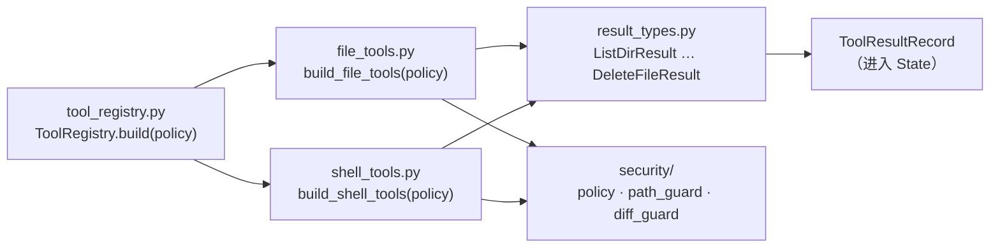
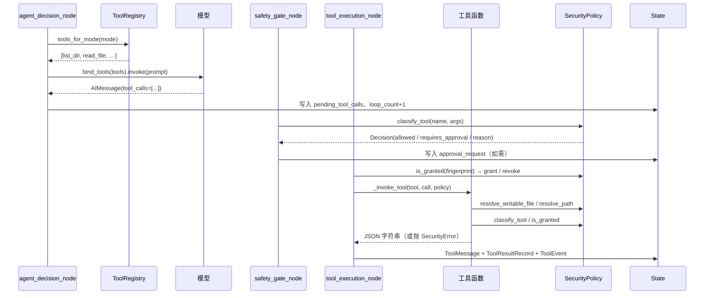

# L8 · 能力层：`tools/`

> 前置：L6（节点怎么组织流程）、L7（安全层怎么把关）。
> 本文回答一个问题：**安全门放行之后，工具到底做了什么？**

---

## 序：L7 和 L8 的分工

L7 讲的是"**能不能做**"——一次 `delete_file` 要过十道关，每一道都可能把它拦下。
但 L7 有意留了一个空白：**拦不住的那一路，到底是怎么"做"的？**

| 问题 | 谁回答 | 在哪 |
|---|---|---|
| 这次调用**允许**吗？需要审批吗？ | `security/` | L7 |
| 路径越界了吗？是敏感文件吗？ | `security/path_guard.py` | L7 |
| 命令在白名单里吗？要切词吗？ | `security/shell_guard.py` | L7 |
| **怎么替换文本？怎么校验 patch？怎么写盘？怎么起进程？** | `tools/` | **本文** |

一句话：**`security/` 说能不能做，`tools/` 说怎么做。**

`tools/` 是唯一真正**碰磁盘、碰子进程**的包。它的每一行都在"动真格"，所以它的代码密度很高——1203 行里塞了大量"为什么这里必须这样写"的注释。

---

## §0 全景：5 个文件、1203 行

```
tools/
├── __init__.py        1 行    包声明
├── tool_registry.py  69 行    工具注册表：有哪些工具、给谁看
├── result_types.py  122 行    7 个 Pydantic 结果模型 + State 记录结构
├── shell_tools.py   193 行    run_shell：起子进程、截断输出
└── file_tools.py    818 行    5 个文件工具：list_dir / read_file / edit_file / write_file / delete_file
```

### 5 个文件的关系



三条依赖，注意方向：

1. **`tools/` → `security/`**：单向。工具拿着 `SecurityPolicy` 调它的方法（`resolve_path`、`classify_tool`、`is_granted`、`grant`、`revoke`、`redact`）。
2. **`security/` ✗→ `tools/`**：安全层**从不** import 工具（L7 讲过的"依赖洋葱"）。这样安全层可以被任意复用、单独测试。
3. **`result_types.py` 谁都不依赖**：纯数据定义，只有 pydantic。

### 一个容易困惑的点：为什么工具要"拿着" policy？

看 [build_file_tools](file:///e:/pylianxi/chaiai/local-agent-web/src/local_agent/tools/file_tools.py#L507-L624) 的写法：

```python
def build_file_tools(policy: SecurityPolicy) -> list[BaseTool]:
    @tool
    def list_dir(path: str = ".", recursive: bool = False, ...) -> str:
        return list_dir_entries(path, policy=policy, ...).model_dump_json()

    @tool
    def read_file(path: str, start_line: int | None = None, ...) -> str:
        return read_file_content(path, policy=policy, ...).model_dump_json()
    ...
    return [list_dir, read_file, edit_file, write_file, delete_file]
```

**Java 类比**：这相当于一个 `ToolFactoryBean`，构造时注入 `SecurityPolicy` 这个单例，产出的每个工具都通过**闭包**持有它。

> Java 里你会写 `class ListDirTool implements Tool { private final SecurityPolicy policy; }`。
> Python 的闭包达到同样效果，不用建 5 个类——`list_dir` 函数体里那个 `policy` 名字，就是外层函数参数捕获进来的。

**为什么模型看不到 `policy` 参数？** 因为 `@tool` 只看**被装饰函数的签名**。`policy` 在闭包里，不在签名上，所以不会出现在给模型的 JSON Schema 里。这是这个设计最巧的地方：**安全能力对模型不可见、不可传参**。

### 与测试的分工

每个功能都拆成"普通函数 + `@tool` 包装"两层：

| 层 | 函数 | 谁能调 |
|---|---|---|
| 逻辑层 | `list_dir_entries(path, *, policy, ...)` | 测试直接调，返回 `ListDirResult` 对象 |
| 接口层 | `@tool def list_dir(...)` | 模型调，返回 `str`（JSON） |

文件头注释把理由写得很直白（[file_tools.py:1-8](file:///e:/pylianxi/chaiai/local-agent-web/src/local_agent/tools/file_tools.py#L1-L8)）：

> 工具逻辑写成普通函数（`list_dir_entries` / `read_file_content`），便于直接测试；`build_file_tools` 再包一层 `@tool`，通过闭包持有 `SecurityPolicy`。

**Java 类比**：接口层是 `@Controller`，逻辑层是 `@Service`。测试测 Service，不测 Controller 的参数绑定。

---

## §1 `ToolRegistry`：谁给谁看

[tool_registry.py](file:///e:/pylianxi/chaiai/local-agent-web/src/local_agent/tools/tool_registry.py) 只有 69 行，但它是"工具"和"模型"之间的唯一门面。

### 1.1 `MODE_TOOLS`：模式 → 工具名

```python
MODE_TOOLS: Mapping[str, tuple[str, ...]] = {
    "chat": (),
    "tool": (
        "list_dir", "read_file", "edit_file",
        "write_file", "delete_file", "run_shell",
    ),
}
```

**闲聊模式一个工具都不给**。这不是"洁癖"，而是实打实的省钱 + 防误伤：每绑一个工具，工具的 JSON Schema 就会进入出站 Prompt，按 token 计费。`nodes.py:506-513` 的 `_tool_definition_tokens` 专门统计这部分开销：

```python
def _tool_definition_tokens(state, context) -> int:
    if str(state.get("mode", "chat")) != "tool":
        return 0
    ...
    return estimate_tools_tokens(registry.tools_for_mode("tool"))
```

**Java 类比**：`MODE_TOOLS` 就是一张"角色 → 权限"的静态表，类似 `@PreAuthorize` 的注解清单。差别在于：这里的"权限"指的是"**看不看得见工具**"，**不是"能不能执行"**。这是两件事，见下一节。

### 1.2 看得见 ≠ 能执行

模块注释（`tool_registry.py:6-7`）明确：

> 放行与否由 `SecurityPolicy` 在 `safety_gate_node` 判定；注册表只负责"有哪些工具、给谁看"。

于是 `delete_file` 在 `tool` 模式下**是绑给模型的**，模型也**能提出**删除调用。但它在 `safety_gate_node` 会被判 `requires_approval`，没批准就在执行阶段抛 `SecurityError`，转成 `denied` 回填给模型。

这是刻意的设计：**让模型能"提出"被拒绝的事，然后从拒绝理由里学会边界**。如果把危险工具直接藏起来，模型只会收到"没有这个工具"，学不到"为什么不能删"。

### 1.3 `build` 与 `tools_for_mode`

```python
class ToolRegistry:
    def __init__(self, tools: Sequence[BaseTool]) -> None:
        self._tools: dict[str, BaseTool] = {tool.name: tool for tool in tools}

    @classmethod
    def build(cls, policy: SecurityPolicy) -> ToolRegistry:
        return cls([*build_file_tools(policy), *build_shell_tools(policy)])

    def names(self) -> tuple[str, ...]:
        return tuple(self._tools)

    def get(self, name: str) -> BaseTool | None:
        return self._tools.get(name)

    def tools_for_mode(self, mode: str) -> list[BaseTool]:
        allowed = MODE_TOOLS.get(mode, ())
        return [self._tools[name] for name in allowed if name in self._tools]
```

三个细节值得记：

| 写法 | 含义 |
|---|---|
| `self._tools: dict[str, BaseTool]` | 内部用 dict 索引，因为执行阶段要按名字快速 `get` |
| `MODE_TOOLS.get(mode, ())` | **未知模式返回空元组**，不是抛异常。实测 `tools_for_mode("未知模式")` → `[]` |
| `if name in self._tools` | 表里写了但没实现的工具会被静默跳过（防御"表超前于实现"） |

`names()` 返回 `tuple`、`tools_for_mode()` 返回 `list`——不是随手写的，前者是"快照"（不可变），后者要直接喂给 `bind_tools`（要 list）。

### 1.4 注册表在哪被用到

执行链上一共 3 处：

| 位置 | 用途 |
|---|---|
| [nodes.py:830](file:///e:/pylianxi/chaiai/local-agent-web/src/local_agent/graph/nodes.py#L830-L834) | `agent_decision_node`：`tools_for_mode(state["mode"])` → `bind_tools` |
| [nodes.py:513](file:///e:/pylianxi/chaiai/local-agent-web/src/local_agent/graph/nodes.py#L506-L513) | `_tool_definition_tokens`：估算工具定义占用的 token |
| `tool_execution_node` | 按 `call["name"]` 取工具执行 |

---

## §2 模型看到的接口

模型从来没见过 `file_tools.py` 的源码。它看到的只有 `@tool` 从**函数签名 + docstring** 生成的 JSON Schema。

### 2.1 实测：6 个工具的真实 Schema

用本机 `.venv` 直接 dump（`build_file_tools(policy)` + `build_shell_tools(policy)`）：

| 工具 | `required` | 参数（类型 / 默认值） |
|---|---|---|
| `list_dir` | `[]` | `path='.'`、`recursive=False`、`include_hidden=False`、`max_entries=200` |
| `read_file` | `['path']` | `start_line=None`、`end_line=None`、`max_chars=50000` |
| `edit_file` | `['path']` | `old_text=''`、`new_text=''`、`patch=''`、`replace_all=False`、`expected_sha256=None`、`reason=''` |
| `write_file` | `['path','content']` | `overwrite=False`、`reason=''` |
| `delete_file` | `['path']` | `recursive=False`、`reason=''` |
| `run_shell` | `['command']` | `cwd='.'`、`timeout_seconds=None`、`env_keys=None` |

返回类型全是 `StructuredTool`，`args_schema` 是 pydantic 的 `ModelMetaclass`。

### 2.2 "默认值"为什么是安全设计的一部分

模型经常**省略参数**。默认值决定了"省略时会发生什么"：

| 工具 | 参数 | 默认值 | 省略时的后果 |
|---|---|---|---|
| `list_dir` | `include_hidden` | `False` | 默认**不列** `.env`、`.git` 这类点开头项 |
| `list_dir` | `max_entries` | `200` | 有界，不会一次吐回十万条 |
| `edit_file` | `replace_all` | `False` | 默认**只改一处**；多处匹配直接拒绝 |
| `edit_file` | `expected_sha256` | `None` | 但代码里是**必填**——省略即拒绝，见 §5.1 |
| `write_file` | `overwrite` | `False` | 默认**不覆盖** |
| `delete_file` | `recursive` | `False` | 默认**删不了目录** |

**规律：每一个布尔参数的默认值，都是"更保守的那一侧"。**

**Java 类比**：像 `Files.deleteIfExists` vs `Files.delete`——库作者选哪个做默认，就是选"误删"还是"报错"。

### 2.3 docstring 就是给模型的说明书

`@tool` 会把 docstring 里的 `Args:` 段解析成每个参数的描述。所以 [edit_file 的 docstring](file:///e:/pylianxi/chaiai/local-agent-web/src/local_agent/tools/file_tools.py#L570-L585) 写得像一份契约：

```
两种输入模式**互斥**，请只用其中一种：

1. 精确字符串替换（默认）：给出 old_text 与 new_text；
2. unified diff（patch）：只给出 patch，old_text/new_text 留空。
```

这不是"给人看的注释"，而是**直接被序列化进 Prompt 的文本**。写清楚，模型就少犯错；写含糊，模型就会把 `old_text` 和 `patch` 一起传（然后被 `edit_input_mode` 拒绝）。

**Java 类比**：相当于 Swagger 的 `@ApiModelProperty`——注释即接口文档，只不过这里的"客户端"是 LLM。

---

## §3 `list_dir`：有界遍历

[list_dir_entries](file:///e:/pylianxi/chaiai/local-agent-web/src/local_agent/tools/file_tools.py#L51-L146) 是 6 个工具里逻辑最绕的一个。它的核心矛盾是：

> 用户要"看目录"，但目录可能有一百万个文件（比如 `C:\Windows`），而工具必须**在有限时间里返回有限大小的结果**。

### 3.1 第一行就是安全：`resolve_path`

```python
resolved = policy.resolve_path(path)
if not resolved.is_dir():
    raise SecurityError(f"目标不是目录或不存在：{resolved.as_posix()}")
```

`resolve_path` 做工作区边界判定 + 敏感路径判定（L7 §2）。**注意**：`is_dir()` 检查在安全判定**之后**——顺序不能反，否则会通过报错文案泄露"这个路径存不存在"。

### 3.2 关键辅助：`_bounded_children`

[file_tools.py:705-723](file:///e:/pylianxi/chaiai/local-agent-web/src/local_agent/tools/file_tools.py#L705-L723)：

```python
def _bounded_children(directory: Path, limit: int) -> tuple[list[Path], bool]:
    """读取目录的前 limit + 1 个条目（**不排序**），返回 (条目, 是否还有未读条目)。"""
    items: list[Path] = []
    stopped = False
    try:
        stream = directory.iterdir()
        for child in stream:
            items.append(child)
            if len(items) > limit:
                stopped = True
                break
    except OSError:
        return items, stopped
    return items, stopped
```

**为什么不能写 `sorted(directory.iterdir())`？** 注释回答了：

> 那会先把整个目录枚举并保存下来再裁剪，条目上限只限制返回数量、挡不住超大目录（外部盘符、用户主目录）的卡顿与内存占用。

**这是"执行限制"和"显示限制"的区别。**

| 写法 | 上限是"显示限制" | 上限是"执行限制" |
|---|---|---|
| `sorted(dir.iterdir())[:200]` | ✅ 只返回 200 条 | ❌ 仍然枚举了全部 100 万条 |
| `_bounded_children(dir, 200)` | ✅ | ✅ 读到第 201 条就 `break` |

**Java 类比**：`Files.list(path)` 返回 `Stream` 是惰性的，`Files.newDirectoryStream(path)` 更是明确"只读一次、边读边处理"。而 `path.toFile().listFiles()` 会**一次性全量加载**——`_bounded_children` 要避开的就是后者。

`limit + 1` 这个"多读一项"是经典技巧：**多读一项才能知道"后面还有没有"**。所以：

- 返回 `200` 项 + `stopped=True` → 200 项之后还有东西，结果不完整；
- 返回 `200` 项 + `stopped=False` → 目录里**恰好** 200 项，结果是完整的。

### 3.3 递归模式：显式栈 + 三重上限

递归分支（[file_tools.py:81-113](file:///e:/pylianxi/chaiai/local-agent-web/src/local_agent/tools/file_tools.py#L81-L113)）用显式栈而不是递归函数调用：

```python
stack: list[tuple[Path, int]] = [(resolved, 0)]
while stack and not truncated:
    current, depth = stack.pop()
    raw, stream_stopped = _bounded_children(current, max_entries - len(candidates))
    if stream_stopped:
        truncated = True
    for child in sorted(raw):
        if not include_hidden and child.name.startswith("."):
            continue
        if child.is_dir() and depth + 1 > MAX_RECURSIVE_DEPTH:
            depth_limited = True
            continue
        candidates.append(child)
        if len(candidates) >= max_entries:
            truncated = True
            break
        ...
```

三个上限同时在起作用：

| 上限 | 值 | 超出时 |
|---|---|---|
| 条目总数 | `max_entries`（默认 200） | `truncated = True` |
| 递归深度 | `MAX_RECURSIVE_DEPTH = 5` | `depth_limited = True`，**超深目录本身也不进结果** |
| 每次读目录 | `max_entries - len(candidates)`（**剩余额度**） | `truncated = True` |

注意 `_bounded_children` 的第二个参数是 `max_entries - len(candidates)`——**剩余额度**，不是固定值。已经收集了 150 条，下一层就只读 51 项。这保证总量永远不会超过 `max_entries + 1`。

### 3.4 防 Junction / 软链接外逃

递归时有一个不起眼但很关键的分支：

```python
try:
    real = child.resolve(strict=True)
except OSError:
    continue
if not is_within(real, resolved):
    continue
stack.append((child, depth + 1))
```

注释解释了它是防什么：

> 目录符号链接 / Windows Junction 可能指向工作区外：**入栈前解析真实目标**，只有仍位于本次列举的根目录内才继续。只看 `is_symlink()` 挡不住 Junction（它未必被识别为符号链接），严格模式下就会泄露外部目录里的文件名与大小。

**为什么 `is_symlink()` 不够？** Windows Junction（`mklink /J`）在 Python 里可能**不被** `is_symlink()` 识别为符号链接，但它指向别处。如果只查 `is_symlink()`，`list_dir(recursive=True)` 就能穿过 Junction 把 `C:\Users\` 下面的文件名和大小列出来——**绕过 L7 讲的工作区边界**。

正确做法是**解析真实路径再判断**（`resolve(strict=True)` → `is_within`）。这是"检查身份，不检查伪装"。

**`strict=True` 的作用**：符号链接指向不存在的目标时 `resolve` 会抛 `OSError`，`except OSError: continue` 直接跳过。悬空链接不当目录处理，也不会让整个列举失败。

**Java 类比**：这相当于用 `toRealPath()` 而不是 `getCanonicalPath()`——前者会解析链接并验证存在性，后者只做字符串层面的规整。

### 3.5 实测：`max_entries` 的额度会被隐藏项吃掉 ⚠️

`_bounded_children` **在过滤隐藏项之前**就已经按 `limit` 读了一批。于是有下面这个真实行为：

工作区里有 `5 个可见文件 + 2 个隐藏文件`（`.h1`、`.h2`）：

```
_bounded_children(limit=2) -> 读了 3 项 ['.h1', '.h2', 'v1'] stopped=True
_bounded_children(limit=3) -> 读了 4 项 ['.h1', '.h2', 'v1', 'v2'] stopped=True
```

`limit=2` 读了 3 项（2+1），其中两项是隐藏项 → 过滤后只剩 `v1` 一项。实测后果：

```
max_entries=3（目录里 2 个可见文件）
 -> 返回 2 项 ['a.txt', 'b.txt'] truncated=True
    note = 结果已截断：已达上限，只返回前 3 项，未继续遍历剩余目录
    ↑ note 说"3 项"，实际只返回了 2 项

全隐藏目录 + max_entries=2 + include_hidden=False
 -> 返回 0 项 truncated=True
    note = 结果已截断：已达上限，只返回前 2 项，未继续遍历剩余目录
    ↑ note 说"2 项"，实际返回 0 项
```

**怎么看这个现象？**

- ✅ **`truncated=True` 是诚实的**：结果确实不完整（目录里还有没读的条目），标注正确。
- ⚠️ **`note` 里的数字是"读取额度"，不是"返回数量"**。文案写"只返回前 N 项"，容易被理解成"结果里有 N 项"。

这是"**文案语义 vs 字段语义**"不一致的问题，不是安全漏洞：`truncated` 字段是对的，`entries` 数组是对的，只有给人看的 `note` 措辞有歧义。

> **给你的思考题**：如果要修，应该改文案（比如"最多读取 N 项"）还是改逻辑（先全量读再过滤）？
> 后者会破坏 §3.2 的"执行限制"——所以**正确答案是改文案**。

### 3.6 实测：`total_entries` 是"已读取"，不是"磁盘总数"

```
500 项的目录，max_entries=5
 -> 返回 5 项，total_entries=6，truncated=True
```

`total_entries` 来自 `total = len(candidates)`，而 `candidates` 是**已经读进内存的那一部分**。所以它是"我看过 6 条"，不是"磁盘上一共 500 条"。

对比 [run_shell 的 `_describe_target`](file:///e:/pylianxi/chaiai/local-agent-web/src/local_agent/tools/file_tools.py#L726-L750)——它碰到同样的困境，但选择了**显式说明**：

```python
if files + directories >= DELETE_IMPACT_SCAN_LIMIT:
    return (
        f"目录，至少含 {files} 个文件与 {directories} 个子目录"
        "（已达扫描上限，影响范围为有界摘要；递归删除需要二次确认）"
    )
```

注意那个"**至少含**"和"**有界摘要**"——同一份代码里，`delete` 路径把"这是有界估计"说清楚了，`list_dir` 的 `note` 没说。这正好互相印证了 §3.5 的判断：**问题是文案，不是逻辑**。

### 3.7 实测：递归深度

7 层嵌套目录（`d1/d2/.../d7`），`recursive=True`：

```
total=5，返回 ['d1','d2','d3','d4','d5']
note = "递归深度超过 5 层的条目已省略"
truncated = True
```

两个细节：

1. `d6`、`d7` **本身也不在结果里**（对应代码里 `depth_limited = True; continue`）——注释说这是为了"与'超过 N 层的条目已省略'的文案一致"。
2. **`truncated` 被复用为"结果不完整"**，不只是"数量截断"。深度省略也会让它变 `True`。这符合 `truncated` 的语义（"你看到的不是全部"），但要记住它**不止一种原因**。

### 3.8 结果结构

[DirEntry](file:///e:/pylianxi/chaiai/local-agent-web/src/local_agent/tools/result_types.py#L19-L26)：

```python
EntryKind = Literal["file", "dir", "symlink", "other"]

class DirEntry(BaseModel):
    name: str
    path: str
    kind: EntryKind
    size_bytes: int | None = None
    modified_at: str | None = None
```

实测返回的 JSON：

```json
{"path":".","entries":[{"name":"adir","path":"adir","kind":"dir","size_bytes":null,
"modified_at":"2026-09-24T06:58:44+00:00"}, …],"total_entries":2,"truncated":true,"note":"…"}
```

三个设计点：

| 点 | 说明 |
|---|---|
| `kind` 是 `Literal` 而非 `str` | pydantic 会校验；模型拿到的是一个**封闭取值集**，不是自由文本 |
| 目录的 `size_bytes=null` | 目录没有"大小"这个概念，不编造一个 0 |
| `modified_at` 是 **UTC ISO8601 字符串** | `datetime.fromtimestamp(..., tz=timezone.utc).isoformat(timespec="seconds")`——带时区、精确到秒 |

**`_dir_entry` 的坑**：`path.is_symlink()` **优先于** `is_dir()` / `is_file()` 判断。一个指向目录的软链接，`kind` 是 `"symlink"` 而不是 `"dir"`。这是刻意的——**先报身份，再报类型**。

### 3.9 死代码（顺带一提）

`_is_hidden_relative`（[file_tools.py:797](file:///e:/pylianxi/chaiai/local-agent-web/src/local_agent/tools/file_tools.py#L797-L803)）和 `_depth`（[file_tools.py:806](file:///e:/pylianxi/chaiai/local-agent-web/src/local_agent/tools/file_tools.py#L806-L810)）**在全项目里没有任何调用点**（已 grep 确认）。

它们是递归遍历的早期版本遗留：隐藏判定改成内联的 `child.name.startswith(".")`，深度改成栈里的 `depth` 变量后，这两个函数就没人用了。`_is_hidden_relative` 还带着"路径任一段以点开头"的额外语义（比内联版更严格），`_depth` 甚至有 `MAX_RECURSIVE_DEPTH + 1` 的兜底返回——都是好想法，但没接上。

**读代码时的经验**：看到一个辅助函数，先 grep 它的调用点。**没人调的函数不是"预留接口"，就是"改版的残留"**——不要花时间去理解它。

---

## §4 `read_file`：编码、二进制与"Hash 悖论"

[read_file_content](file:///e:/pylianxi/chaiai/local-agent-web/src/local_agent/tools/file_tools.py#L149-L214) 只有 65 行，但里面藏着一个非常漂亮的设计。

### 4.1 第一行就有讲究

```python
resolved = policy.resolve_readable_file(path)
```

注意是 `resolve_readable_file`，不是 `resolve_path`。区别在 L7 讲过：`read_file` 会**额外**检查敏感文件名（`.env`、密钥等）。实测读 `.env` 直接 `SecurityError`。

**为什么不用 `resolve_path` 加个 if？** 因为这正是 L7 §2 的设计：**只读工具要额外过"敏感文件"关卡，写工具的关卡更严**。把不同严格度的解析入口分开命名，调用点就不会选错。

### 4.2 编码策略：只认 UTF-8

```python
if b"\x00" in data[:4096]:
    is_binary = True
    note_parts.append("二进制文件，未返回内容")
else:
    try:
        text = data.decode("utf-8-sig")
        encoding = "utf-8"
    except UnicodeDecodeError:
        note_parts.append("无法按 UTF-8 解码（未知编码），未返回内容")
```

四层判断：

| 情况 | 处理 | 实测结果 |
|---|---|---|
| 前 4096 字节含 NUL | 判为二进制 | `is_binary=True`、`content=''`、`note="二进制文件，未返回内容"` |
| UTF-8 能解码 | 正常返回 | `encoding='utf-8'` |
| UTF-8 解码失败 | 返回空 + 说明 | `encoding=None`、`content=''`、`note="无法按 UTF-8 解码（未知编码），未返回内容"` |

实测 GBK 文件（中文 Windows 的常见编码）：

```
encoding = None
content  = ''
note     = "无法按 UTF-8 解码（未知编码），未返回内容"
```

**为什么含 NUL 就判二进制，哪怕"能解码成功"？** 注释写了：这类内容即使能"解码成功"也不该注入 Prompt。原因是二进制数据解码后常常是**大量控制字符和无意义符号**，既污染上下文、又浪费 token。

**为什么只查前 4096 字节？** 平衡：查全文件要读完整个文件（大文件会慢），而真实的文本文件几乎不会"前 4KB 全是文本、后面全是二进制"。这是个**概率性但足够可靠**的启发式。

**Java 类比**：类似 `Files.probeContentType()` 的"探测"思路——不保证 100% 准确，但比读全文件便宜得多。

### 4.3 `utf-8-sig`：为什么不是 `utf-8`

`data.decode("utf-8-sig")` 会自动**吃掉**开头的 BOM（`\ufeff`），而这一步在编辑时会被**还原**（§5.5）。实测：

```
BOM 文件编辑后 -> b'\xef\xbb\xbfHELLO\nworld\n'
```

如果不处理 BOM：

- 读的时候：文件第一行会多一个不可见字符，`old_text` 永远匹配不上；
- 写的时候：BOM 会被静默丢掉，文件编码格式变了。

**这就是"读进来要干净、写回去要还原"的经典配对。**

### 4.4 行号截取与 `line_count` 的不一致（实测）

```python
line_count = len(text.splitlines())          # 全文行数
selected = _select_lines(text, start_line=start_line, end_line=end_line)
```

实测：

```
普通文件          -> line_count=5
start_line=2,end_line=4 -> content='line2\r\nline3\r\nline4\r\n'，但 line_count 仍是 5
```

`line_count` 是**全文**行数，不随 `start_line` / `end_line` 变化。

**为什么这样设计？** 因为它要回答的问题是"这个文件多大"，而不是"这次返回了多少行"。模型拿到 `line_count=5, start_line=2, end_line=4` 就知道"文件还有第 1 行和第 5 行没给我"，可以决定要不要继续读。

`_select_lines` 的参数校验（[file_tools.py:753-765](file:///e:/pylianxi/chaiai/local-agent-web/src/local_agent/tools/file_tools.py#L753-L765)）实测：

| 调用 | 结果 |
|---|---|
| `start_line=0` | ❌ `ValueError: start_line 必须从 1 开始` |
| `end_line < start_line` | ❌ `ValueError: end_line 不能小于 start_line` |

注意这是 **`ValueError` 不是 `SecurityError`**——它是**参数错误**，不是安全事件。这个区分在 `_invoke_tool` 里会体现（§9.1）：`ValueError` 走 `error` 分支，`SecurityError` 走 `denied` 分支。

### 4.5 核心设计：`_read_prefix_and_sha256` 的"Hash 悖论"

这是 `read_file` 最值得学的一段。[file_tools.py:637-654](file:///e:/pylianxi/chaiai/local-agent-web/src/local_agent/tools/file_tools.py#L637-L654)：

```python
def _read_prefix_and_sha256(path: Path, max_bytes: int) -> tuple[bytes, str, bool]:
    """有界保留文件前缀，同时流式计算**整文件** Hash。

    read_file 的正文受 max_file_size_bytes 限制，但返回的 sha256 会被
    edit_file.expected_sha256 当成整文件版本号。只对前缀计算 Hash 会让被截断的文件永远
    无法通过编辑前校验；这里流式扫完整文件，不把完整内容装进内存。
    """
    digest = hashlib.sha256()
    prefix = bytearray()
    total = 0
    with path.open("rb") as handle:
        while chunk := handle.read(1024 * 1024):
            digest.update(chunk)
            total += len(chunk)
            remaining = max_bytes - len(prefix)
            if remaining > 0:
                prefix.extend(chunk[:remaining])
    return bytes(prefix), digest.hexdigest(), total > max_bytes
```

**矛盾在哪？**

| 约束 | 要求 |
|---|---|
| 正文**必须有界**（`max_file_size_bytes`） | 不能把 500MB 文件塞进内存 |
| `sha256` 必须能通过 `edit_file.expected_sha256` 校验 | 必须是**整文件**的 Hash |

如果只对前缀算 Hash，那个 Hash 就是"前 N 字节的 Hash"——但 `edit_file` 会拿它跟**整文件**的 Hash 比，永远不等。于是被截断的文件**永远无法编辑**（一个隐蔽的死锁）。

**解法：一次流式扫描，同时满足两个约束。**

```
while chunk := handle.read(1MB):
    digest.update(chunk)              # 每块都进 Hash → Hash 覆盖全文件
    total += len(chunk)
    remaining = max_bytes - len(prefix)
    if remaining > 0:
        prefix.extend(chunk[:remaining])   # 只保留前 max_bytes 字节
```

- `digest` 吃到**每一块** → Hash 是整文件的；
- `prefix` 只装前 `max_bytes` 字节 → 内存有界；
- `total > max_bytes` → 返回 `size_limited` 标记。

**实测验证**：

```
大文件（远超 max_file_size_bytes）
 -> content 只返回 100 字符，但 sha256 == 整文件 sha256（实测 True）
```

**Java 类比**：这就是 `DigestInputStream` 的思路——边读边算摘要，而不是"读完存起来再算"。区别是这里还在同一个循环里顺手截了前缀。

**这也是一个通用模式**：当"计算一个值需要读全量"但"返回结果必须小"时，**不要分两次读文件，要在一次流式扫描里同时产出两样东西**。

### 4.6 输出有界

```python
if len(selected) > max_chars:
    selected = selected[:max_chars]
    truncated = True
    note_parts.append(f"内容已截断到 {max_chars} 字符")
if size_limited:
    truncated = True
    note_parts.append(f"文件超过 {max_bytes} 字节，只读取了前 {len(data)} 字节")
```

实测 `max_chars=8`：`content='line1\r\nl'`、`truncated=True`。

注意 `truncated` **可能由两个原因触发**（正文超 `max_chars`、文件超 `max_file_size_bytes`），`note` 里会分别说明。这是 L7 讲过的"**降级必须可见**"原则的又一次落地——不只是给个 `true`，还要说清楚是哪种截断。

---

## §5 `edit_file` 精确替换模式

[edit_file_content](file:///e:/pylianxi/chaiai/local-agent-web/src/local_agent/tools/file_tools.py#L217-L353) 是全包第二长的函数（137 行），它把"改文件"这件事拆成了 8 道机械检查。

### 5.1 执行链路

```python
arguments = {"path": path, "old_text": old_text, "new_text": new_text,
             "patch": patch, "replace_all": replace_all}

resolved = policy.resolve_writable_file(path)          # ① 先解析目标（越界/敏感/受保护）
decision = policy.classify_tool("edit_file", arguments) # ② 安全判定
if not decision.allowed and not policy.is_granted(
    action_fingerprint("edit_file", arguments, policy=policy)
):                                                      # ③ 大改动要批准
    raise SecurityError(decision.reason)

mode = edit_input_mode(old_text, new_text, patch)       # ④ 模式互斥判定

data = resolved.read_bytes()                            # ⑤ 读原文
original = _decode_text(data)
current_sha256 = hashlib.sha256(data).hexdigest()

expected = (expected_sha256 or "").strip().lower()      # ⑥ 版本校验（见 5.2）
```

顺序要点：**安全判定在读写之前**。注释（`file_tools.py:269-270`）明确：

> 先解析目标：越界（`WorkspaceBoundaryError`）、敏感文件与受保护目标（`SecurityError`）必须在看审批之前就失败闭合。

**"失败闭合"（fail-closed）** 是 L7 反复强调的原则：不确定的时候选"拒绝"那一侧。

### 5.2 `expected_sha256`：三重校验

```python
expected = (expected_sha256 or "").strip().lower()
if not expected:
    raise SecurityError(
        "修改已有文件必须提供 expected_sha256：请先用 read_file 读取该文件，"
        "并把返回的 sha256 原样带上"
    )
if expected != current_sha256:
    raise SecurityError(
        f"expected_sha256 与当前文件不一致（当前为 {current_sha256[:12]}…）："
        "文件已被改动，请重新读取后再修改"
    )
```

| 检查 | 实测结果 |
|---|---|
| 缺 `expected_sha256` | ❌ "请先用 read_file 读取该文件，并把返回的 sha256 原样带上" |
| `expected_sha256` 过期 | ❌ "文件已被改动，请重新读取后再修改"（含当前值前 12 位） |

三个细节：

1. **`.strip().lower()`**：模型可能带上空格或大写，归一化后再比（Hash 是十六进制，大小写无意义）。
2. **只显示前 12 位**：`current_sha256[:12]`——给模型足够信息重试，但**不把完整 Hash 塞进错误消息**（省 token）。
3. **这就是乐观锁**。模型必须"先读后写"，`read_file` 返回的 `sha256` 当版本号。文件被别人改了 → 版本号不等 → 拒绝。

**Java 类比**：`UPDATE ... WHERE version = ?` 的乐观锁；或者 JPA 的 `@Version`。区别是这里**强制**，不给你"跳过版本校验"的选项。

**这解决了什么问题？** 没有它，模型基于"5 秒前读到的内容"生成 `old_text`，而这 5 秒里文件被改了 → `old_text` 匹配失败或改错位置。有了它，模型必须重新读取、重新生成。

### 5.3 模式互斥：一个函数，两处复用

```python
mode = edit_input_mode(old_text, new_text, patch)
```

`edit_input_mode` 定义在 `security/diff_guard.py:111-135`，但被**两处**调用：

| 调用点 | 目的 |
|---|---|
| `security/policy.py` 的 `classify_tool` | 判定"这次调用算不算 patch 模式"（要按 patch 的规则审） |
| `tools/file_tools.py` 的执行逻辑 | 决定"这次走哪条路径" |

注释解释了为什么要共用（`diff_guard.py:114-115`）：

> 安全判定与工具执行**共用这一个**函数，避免两处各写一套互斥规则而分叉。

**这是"单一事实来源"（single source of truth）的典型应用。** 如果安全判定认"patch 模式"、执行认"replace 模式"，就会出现"按宽松规则审、按危险路径执行"的绕过漏洞。

**Java 类比**：同一段业务规则不能既写在 `@PreAuthorize` 的 SpEL 表达式里，又写在 Service 的 if 判断里——两处一定会分叉。

### 5.4 精确替换的 5 道检查（实测）

```python
if old_text == new_text:
    raise SecurityError("old_text 与 new_text 相同，没有需要修改的内容")

if len(original.splitlines()) > 1 and old_text.rstrip("\n") == original.rstrip("\n"):
    raise SecurityError("不接受用整份文件内容做替换：请给出更小的唯一片段（架构 §6.3）")

occurrences = original.count(old_text)
if occurrences == 0:
    raise SecurityError("old_text 在文件中没有精确匹配：请核对空格、缩进与换行（Windows 文件可能是 CRLF）")
if occurrences > 1 and not replace_all:
    raise SecurityError(f"old_text 匹配到 {occurrences} 处：请提供更长的唯一片段，或显式设置 replace_all=true")
```

完整实测表：

| 调用 | 结果 |
|---|---|
| `old_text` 不存在 | ❌ "请核对空格、缩进与换行（Windows 文件可能是 CRLF）" |
| `old_text == new_text` | ❌ "没有需要修改的内容" |
| **整份文件内容替换（多行）** | ❌ "不接受用整份文件内容做替换：请给出更小的唯一片段" |
| **单行文件用整行替换** | ✅ **例外生效** → `@@ -1 +1 @@` |
| 多处匹配未开 `replace_all` | ❌ "匹配到 3 处：请提供更长的唯一片段，或显式设置 replace_all=true" |
| `replace_all=True`（3 处） | ✅ `replaced_count=3 changed_lines=6` |
| 正常替换 | ✅ `replaced_count=1 changed_lines=2`，diff 落盘，两个 Hash 都返回 |

### 5.5 "整份替换"守卫与它的单行例外

```python
if len(original.splitlines()) > 1 and old_text.rstrip("\n") == original.rstrip("\n"):
```

为什么禁止整份替换？因为**整份替换 = 覆盖写**，只是披着 `edit_file` 的外衣。它的风险是：

- 模型读到的内容可能已经过期 → 用旧内容覆盖新内容；
- diff 会显示"整个文件都变了"，人工审计无法快速看出改了什么；
- 绕过 `write_file` 的"覆盖需要审批"限制。

**为什么单行文件要例外？** `len(original.splitlines()) > 1` 这个条件。注释说得很实在：

> 单行文件例外——那一行本身就是最小的唯一锚点，否则会出现"文件只有一行就没法改"的怪现象。

**这是"规则要有例外，但例外要写在代码里、要有理由"的好例子。** 如果是靠"模型自己注意点"，这个例外就会变成漏洞。

### 5.6 diff 与原子写

```python
diff = build_unified_diff(original, updated, path=resolved.name)
if not diff.strip():
    raise SecurityError("计算出的 diff 为空，没有可写入的改动")

new_data = (codecs.BOM_UTF8 if data.startswith(codecs.BOM_UTF8) else b"") + updated.encode("utf-8")
_atomic_write(resolved, new_data)
```

三件事：

1. **写盘前先算 diff**：diff 为空 → 拒绝。这是最后一道"无变化"守卫（前面已经查过 `old_text != new_text`，但 patch 模式可能算出空结果）。
2. **BOM 还原**：`codecs.BOM_UTF8` 显式写回。注释（`file_tools.py:336-337`）：
   > `utf-8-sig` 解码会有意移除 BOM；编辑已有文件时必须把原来的编码标记写回去，否则一次普通文本替换会静默改变文件格式。
3. **`_atomic_write`**（见 §7.2）。

返回结果：

```python
return EditFileResult(
    path=..., reason=reason,
    replaced_count=replaced_count,
    changed_lines=count_changed_lines(original, updated),
    old_sha256=current_sha256,
    new_sha256=hashlib.sha256(new_data).hexdigest(),
    diff=diff,
    line_count=len(updated.splitlines()),
    note=note,
)
```

`old_sha256` / `new_sha256` 成对返回，是为了让**反思节点做机械校验**（[result_types.py:55-56](file:///e:/pylianxi/chaiai/local-agent-web/src/local_agent/tools/result_types.py#L52-L67)）：

> `old_sha256` / `new_sha256` 供反思阶段机械校验"Hash 是否真的变了"。

**这是"让模型自述 vs 让证据说话"的分界**。模型可以说"我成功修改了文件"，但代码检查的是 `old_sha256 != new_sha256`——**机械事实优先于模型结论**（L6/L7 反复出现的模式）。

---

## §6 `edit_file` patch 模式：严格定位

patch 模式允许模型给出 unified diff。它的承诺是"**按标准 patch 语义精确应用**"，实现上用了两条硬口径（`diff_guard.py:7-12`）：

| 口径 | 函数 | 是否接触目标文件 |
|---|---|---|
| **解析只看 patch 自身**（格式、计数、顺序、重叠） | `parse_patch` | ❌ 不接触 |
| **应用对着真实内容严格校验** | `apply_patch` | ✅ 接触 |

**为什么要分开？** 因为安全判定（要不要审批）只需要第一步的结果——**可以在读文件之前就完成**。这样"格式非法的 patch"不会让程序去 touch 文件。

### 6.1 `parse_patch` 的 4 组结构校验

| 校验 | 拒绝条件 |
|---|---|
| 长度 | `len(patch) > MAX_PATCH_CHARS`（200000） |
| 空 | `not patch.strip()` |
| Git 扩展头 | 命中 `_UNSUPPORTED_HEADERS`（`diff `、`index `、`rename from`、`Binary files`… 共 15 项） |
| hunk 头格式 | 不匹配 `^@@ -(\d+)(?:,(\d+))? \+(\d+)(?:,(\d+))? @@` |
| hunk 数 | `>= MAX_PATCH_HUNKS`（200） |
| 行前缀 | 不是 ` ` / `-` / `+` 开头 |
| `\ No newline` | 出现即拒绝 |
| **计数相符** | 声明 `-3/+2` 与实际不符 |
| hunk 顺序 | 必须按旧行号**升序且不重叠** |

`_UNSUPPORTED_HEADERS` 的存在理由（`diff_guard.py:40`）：

> 明确**不支持**的 Git 扩展 diff 头（架构 §6.3：T22 只接受标准 hunk）。

**"不支持"要说出来，而不是让它掉进"格式非法"的模糊错误里。** 这两句错误消息的差别，决定了模型能不能自我修正：

```python
# 说得清 → 模型知道该怎么改
raise SecurityError(
    f"不支持的 diff 头（只接受标准 hunk 头）：{line.strip()[:60]}；"
    "Git 扩展 diff 头与二进制差异不在支持范围内（架构 §6.3）"
)

# 说不清 → 模型只能瞎猜
raise SecurityError(f"不是有效的 unified diff：…")
```

### 6.2 `apply_patch` 的严格定位

[apply_patch](file:///e:/pylianxi/chaiai/local-agent-web/src/local_agent/security/diff_guard.py#L298-L370) 的核心循环：

```python
result = _split_lines(original)
default_terminator = "\r\n" if any(term == "\r\n" for _, term in result) else "\n"
offset = 0

for hunk in plan.hunks:
    index = hunk.insert_index + offset
    end = index + hunk.old_count
    if index < 0 or end > len(result):
        raise SecurityError(
            f"patch 定位越界（@@ -{hunk.old_start},{hunk.old_count} @@）："
            f"目标文件当前只有 {len(result)} 行，patch 与当前文件不匹配"
        )

    cursor = index
    for item in hunk.lines:                     # 逐行比对（跳过 "+" 行）
        if item.mark == "+":
            continue
        actual = result[cursor][0] if cursor < len(result) else "<文件结束>"
        if cursor >= len(result) or actual != item.text:
            raise SecurityError(
                f"patch 上下文不匹配（第 {cursor + 1} 行）：期望 {item.text!r}，"
                f"实际 {actual!r}；文件已被改动或 patch 针对的是另一个版本，"
                "请重新读取文件后再生成 patch"
            )
        cursor += 1

    replacement = [...]                          # 重建这个 hunk 的内容
    result[index:end] = replacement
    offset += hunk.new_count - hunk.old_count
```

三个关键机制：

**① `offset` 累积**：每个 hunk 应用后，后续 hunk 的行号要按 `new_count - old_count` 平移。这是标准 patch 算法。

**② 不做模糊搜索**——注释（`diff_guard.py:11-12`）：

> 按 `@@` 声明的旧行号定位，上下文行与删除行逐字一致；**不做模糊搜索、不容忍行号漂移**，不一致即冲突并拒绝。

对比一下两种策略：

| 策略 | 好处 | 坏处 |
|---|---|---|
| 模糊搜索（找不到就往下挪） | 对行号漂移容忍，成功率高 | **可能改到错误的位置** |
| 严格定位（本文选择） | 改错位置的可能性为零 | 行号漂移就失败 |

安全敏感的场景选严格：**"失败"比"改错地方"好得多**。

**③ 先全部校验还是边校验边改？** 看代码顺序：**每个 hunk 内部先校验完所有上下文行，再重建 `replacement`，最后才 `result[index:end] = replacement`**。所以单个 hunk 是"校验完才改"。但**多个 hunk 之间**：前一个 hunk 改完了，后一个 hunk 校验失败 → 抛异常 → 整个 `updated` 变量没被创建 → `_atomic_write` 根本没被调用。

**所以文件一字不动**——实测确认：

```
上下文不匹配 -> ❌ "第 2 行：期望 'WRIGHT'，实际 'TWO'…" 文件一字不动（实测确认失败后文件未变）
```

**Java 类比**：这就是"先在内存里构建新对象，构建成功才 `save`"。不是"边改数据库边校验"。

### 6.3 `_split_lines`：CRLF 的优雅处理

`_split_lines` 把原文拆成 `(内容, 结束符)` 的列表，结束符是 `""` / `"\n"` / `"\r\n"` 三者之一。

于是比对时用的是 `result[cursor][0]`——**只比内容，不比结束符**。

**这一个设计同时解决三个问题**：

| 问题 | 解决方式 |
|---|---|
| patch 文本里的行是 `\n` 结尾，文件是 `\r\n` | 比对时忽略 `\r`（比的是 `[0]`） |
| 写回时不能把 CRLF 文件变成 LF | 保留原有的 `[1]` 结束符 |
| **新增的行**用什么结束符 | `default_terminator` 按文件风格选 |

实测：

```
CRLF 文件加一行 -> b'a\r\nb\r\nNEW\r\nc\r\n'
                        ↑ 新增行也用了 CRLF
```

`default_terminator = "\r\n" if any(term == "\r\n" for _, term in result) else "\n"`——**文件里只要有一行是 CRLF，新增行就用 CRLF**。

还有一段处理"末尾无换行"的代码（`diff_guard.py:361-365`）：

```python
result = [
    (content, terminator or default_terminator) for content, terminator in result[:-1]
] + result[-1:]
```

注释：

> 只有文件的最后一行允许"没有结束符"（原本没有末尾换行、且 patch 没碰它）。这类行被插入的行推到中间时必须补上换行，否则拼接会把两行粘在一起。

**这是"边界情况"的典型处理**：最后一个元素保持原样（允许无结束符），前面所有元素如果没结束符就补一个。

### 6.4 `_NULL_TARGETS` 守卫：一个永不触发的检查 ⚠️

`diff_guard.py:310-319`：

```python
for name in plan.header_names:
    basename = _header_basename(name)
    if basename in _NULL_TARGETS:
        raise SecurityError(
            "patch 的文件头是 /dev/null（新建或删除文件）：edit_file 只修改已有文件"
        )
    if basename != file_name:
        raise SecurityError(
            f"patch 的文件头指向 {basename}，与目标文件 {file_name} 不一致：已拒绝应用"
        )
```

而 `_NULL_TARGETS`（`diff_guard.py:58`）是：

```python
_NULL_TARGETS = ("/dev/null", "dev/null")
```

**问题：`_header_basename` 会剥掉路径、只留文件名。** 实测：

```python
_header_basename('/dev/null')  = 'null'   in _NULL_TARGETS ? False
_header_basename('dev/null')   = 'null'   in _NULL_TARGETS ? False
_header_basename('a/dev/null') = 'null'   in _NULL_TARGETS ? False
```

三者都是 `'null'`，而 `_NULL_TARGETS` 里存的是**带路径**的字符串。**所以 `basename in _NULL_TARGETS` 永远为 `False`——那条"patch 的文件头是 /dev/null"的专用拒绝，永远不会触发。**

**为什么平时看不出问题？** 因为下一步兜住了。实测：

```
--- /dev/null 文件头 -> ❌ "文件头指向 null，与目标文件 p.py 不一致"
```

`'null' != 'p.py'` → 被"文件头不一致"拦下。**结果正确，但错误消息不是专门为这种情况准备的。**

**那什么情况下会出问题？** 目标文件**恰好叫 `null`** 时：

```
工作区里创建文件名为 null 的文件，内容 b"original\n"
patch = "--- /dev/null\n+++ b/null\n@@ -1 +1 @@\n-original\n+REPLACED\n"
-> 成功：replaced_count=1，文件内容变成 b'REPLACED\n'
```

`'null' == 'null'` → NULL 检查通过、一致性检查也通过 → **patch 被应用**。

**这算漏洞吗？评估一下**：

| 维度 | 判断 |
|---|---|
| 可利用性 | 极低——需要目标文件恰好命名为 `null`，且没有实际危害（patch 仍被严格校验、只改这一个文件） |
| 安全影响 | 无——`/dev/null` 语义在这条路径上无关紧要（`edit_file` 只改已有文件，本来就改不到 `/dev/null`） |
| 真正的问题 | **死代码 + 误导性文案**——那个检查看起来在防什么，实际上没防 |

**这是读代码时最值得留意的一类发现**：一段检查"永远为真"或"永远为假"时，它给的**安全感是假的**。写代码的人可能真的相信它在工作。

**给你留一个问题**：要修的话，怎么修才对？

<details>
<summary>参考思路</summary>

`basename in _NULL_TARGETS` 想表达的语义是"文件头指向 /dev/null"。正确写法有二：

```python
# 方案 A：在 basename 层面比较（改常量）
_NULL_BASENAMES = ("null",)
if basename in _NULL_BASENAMES: ...

# 方案 B：在完整名字层面比较（改判断）
raw_name = name.strip()
if raw_name in _NULL_TARGETS or raw_name.startswith("a/dev/null"): ...
```

方案 A 更简单，但会把"任何叫 `null` 的文件"都判成 `/dev/null` —— **那正是 §6.4 里"恰好叫 null 被放行"的镜像错误**（从"该拦的没拦"变成"不该拦的拦了"）。

方案 B 保留了路径上下文，语义更准。代价是要处理 `a/` `b/` 前缀。

**更本质的解法**：承认"文件头一致性检查已经足够"，直接删掉 `_NULL_TARGETS` 这段死代码——因为对 `edit_file` 来说，`/dev/null` 文件头最终一定会被"与目标文件不一致"拒绝（除非目标就叫 `null`，而那种情况无关痛痒）。

**这是"少即是多"的典型**：一个不起作用的检查，比没有这个检查更糟，因为它误导读者。

</details>

### 6.5 patch 模式实测总表

| 情况 | 结果 |
|---|---|
| 合法 patch | ✅ `replaced_count=1`（**hunk 数**），`note="补丁模式：已应用 1 个 hunk（replaced_count 为 hunk 数）"` |
| 上下文不匹配 | ❌ "第 2 行：期望 'WRONG'，实际 'TWO'…"，**文件一字不动** |
| 文件头 basename 不一致 | ❌ "文件头指向 other.py，与目标文件 p.py 不一致" |
| `/dev/null` 文件头 | ❌ "文件头指向 null，与目标文件 p.py 不一致"（**不是**那句专用提示——见 §6.4） |
| 定位越界（`@@ -99,1 @@`） | ❌ "目标文件当前只有 3 行，patch 与当前文件不匹配" |
| CRLF 文件加一行 | ✅ `b'a\r\nb\r\nNEW\r\nc\r\n'` |
| `\ No newline at end of file` | ❌（`parse_patch` 阶段就拒绝） |
| 应用后无变化 | ❌ "patch 应用后内容没有变化，已拒绝写入" |

**注意 `replaced_count` 的语义在两种模式下不同**——代码里专门写进了 `note`（`file_tools.py:302-304`）：

```python
# replaced_count 在 patch 模式下表示**应用的 hunk 数**（不是替换处数）。字段语义写进
# note：页面与审计据此区分两种模式，模型也能看到这次改了几个 hunk（架构 §6.3）。
note = f"补丁模式：已应用 {replaced_count} 个 hunk（replaced_count 为 hunk 数）"
```

**这是一个"字段复用导致语义歧义"的处理范例**：既然复用了同一个字段名，就把差异**显式写进返回给模型的消息里**。不靠调用方"记得看模式"。

---

## §7 `write_file` / `delete_file`

### 7.1 `write_file`：只创建，不覆盖

[write_file_content](file:///e:/pylianxi/chaiai/local-agent-web/src/local_agent/tools/file_tools.py#L356-L423) 的实测表：

| 调用 | 结果 |
|---|---|
| 创建新文件 | ✅ `size_bytes=3 line_count=1` |
| 再次创建同名（不带 `overwrite`） | ❌ "文件已存在…修改现有文件请用 edit_file（精确串替换），不要整体覆盖" |
| 带 `overwrite` 但无批准 | ❌ "覆盖已有文件需要人工审批" |
| 带 `overwrite` + `policy.grant` | ✅ 原子覆盖成功 |
| 写到不存在的父目录 | ❌ "父目录不存在，未创建文件"（**不自动建目录**，实测） |
| 写到**真实目录**上 | ❌ "目标是一个目录，不能用 write_file 写入" |

注意最后一条：实测时先有 `write_file('adir')` 报"目标是一个目录"，因为 `sub` 目录确实存在。这说明**即便有审批，目录也挡得住**。

**不自动建父目录**是个明确的设计选择。Let me think about why：自动 `mkdir -p` 会让一次 `write_file` 产生两个副作用（建目录 + 建文件），审计时不好说清。而且绝对路径 `a/b/c/d.txt` 里的中间目录可能都是意料之外的。

### 7.2 `_atomic_write`：临时文件 + `os.replace`

[file_tools.py:657-670](file:///e:/pylianxi/chaiai/local-agent-web/src/local_agent/tools/file_tools.py#L657-L670)：

```python
def _atomic_write(path: Path, data: bytes) -> None:
    """先写同目录临时文件再原子替换，并保留已有文件的权限位（架构 §6.3）。"""
    original_mode = stat.S_IMODE(path.stat().st_mode)
    handle_fd, temp_name = tempfile.mkstemp(
        dir=path.parent, prefix=f".{path.name}.", suffix=".tmp"
    )
    try:
        with os.fdopen(handle_fd, "wb") as handle:
            handle.write(data)
        os.chmod(temp_name, original_mode)
        os.replace(temp_name, path)
    except BaseException:
        Path(temp_name).unlink(missing_ok=True)
        raise
```

四个设计点：

| 点 | 为什么 |
|---|---|
| 临时文件在**同目录**（`dir=path.parent`） | `os.replace` 只在同一文件系统内保证原子性。跨盘会变成"复制+删除"，不原子 |
| 权限位**先保存后恢复** | `mkstemp` 创建的文件是 `0600`（只有主可读写）。不恢复，一个普通 `.py` 文件编辑后就变成"其他人不可读" |
| `os.replace` 而不是 `os.rename` | `replace` 在 Windows 上也能覆盖已存在的目标；`rename` 在 Windows 上会失败 |
| **`except BaseException` 而不是 `Exception`** | 连 `KeyboardInterrupt`、`SystemExit` 也清理临时文件。`BaseException` 是 Python 所有异常的根 |

**Java 类比**：这就是 `Files.move(tmp, target, ATOMIC_MOVE, REPLACE_EXISTING)` 的标准写法。Java 里你也会遇到"同分区才原子"的限制。

**"写入过程中断电会怎样？"** —— 要么看到旧文件（完整的），要么看到新文件（完整的）。**永远不会看到"改了一半"的文件**。这就是"原子"的意义。

### 7.3 `_create_new_file`：`O_EXCL` 关掉时间窗

[file_tools.py:673-698](file:///e:/pylianxi/chaiai/local-agent-web/src/local_agent/tools/file_tools.py#L673-L698)：

```python
flags = os.O_WRONLY | os.O_CREAT | os.O_EXCL | getattr(os, "O_BINARY", 0)
try:
    handle_fd = os.open(path, flags, 0o644)
except FileExistsError as exc:
    raise SecurityError(
        f"文件已存在：{path.as_posix()}。写入过程中它被创建或改动过，已拒绝覆盖"
        "（改现有文件请用 edit_file）"
    ) from exc
```

注释把"时间窗"讲得非常清楚：

> "先检查存在、再写入"存在时间窗：若另一进程在两步之间创建了同名文件，普通写入会把它的内容覆盖掉，而这次写入并没有经过任何审批（架构 §6.4）。`O_EXCL` 把"检查 + 创建"合成一个原子操作，从根上关掉这个时间窗。

**对比两种写法**：

```python
# ❌ 有时间窗（TOCTOU：Time-of-check to time-of-use）
if not path.exists():        # 检查
    path.write_bytes(data)   # 使用 ← 这中间文件可能被创建了

# ✅ 原子
os.open(path, O_CREAT | O_EXCL)   # 检查和创建是同一次系统调用
```

**注意 `write_file_content` 里先有 `overwriting = resolved.exists()` 的判断**——那是为了给出**更好的错误消息**（"文件已存在，请用 edit_file"）。真正的**原子性保障在 `_create_new_file` 里**。两者分工：一个负责体验，一个负责正确性。

**"为什么 `_atomic_write` 用覆盖、新建用 `O_EXCL`，不统一？"** 因为语义不同：

| 场景 | 期望语义 |
|---|---|
| `overwrite=True`（已批准） | "把内容换掉"——用 `_atomic_write`（原子替换） |
| 新建 | "只在不存在时创建"——用 `O_EXCL`（不存在才成功） |

### 7.4 `delete_file`：三层防护 + 一次扫描

[delete_file_target](file:///e:/pylianxi/chaiai/local-agent-web/src/local_agent/tools/file_tools.py#L426-L480) 的结构：

```python
arguments = {"path": path, "recursive": recursive}
decision = policy.classify_tool("delete_file", arguments)
if not decision.allowed and not decision.requires_approval:
    # 硬拒绝（受保护目标、越界、敏感文件…）：立即失败，**不算指纹、不描述目标**
    raise SecurityError(policy.redact(decision.reason))

fingerprint = action_fingerprint("delete_file", arguments, policy=policy)
if not policy.is_granted(fingerprint):
    resolved_for_message = policy.resolve_path(path)
    target = _describe_target(resolved_for_message, recursive)
    ...

resolved = policy.resolve_path(path)
_assert_deletable(resolved, policy.workspace_root, recursive)
```

**"不算指纹、不描述目标"这句话很重要**（`file_tools.py:447-448`）：

> 硬拒绝（受保护目标、越界、敏感文件…）：立即失败，**不算指纹、不描述目标**——这两件事都要遍历目标目录，对主目录那种目标会直接卡死（T14C 复审）。

**这是一个性能与安全的连锁问题**：`_describe_target` 要 `rglob("*")` 遍历目录。如果目标是"C:\Users"，即使它有 50 万个文件，`_describe_target` 也会去数——**在拒绝路径上做了昂贵的操作**。

所以顺序是：**能硬拒绝就立刻拒绝，不做任何额外工作**。只有"需要审批"这条路径（确实要给用户看影响范围）才去扫描。

**Java 类比**：异常路径要保持廉价。不要为了"给个更好的错误消息"去查数据库。

### 7.5 实测：删除的完整行为

| 调用 | 结果 |
|---|---|
| 无批准 | ❌ "属于强制审批动作…目标：…/d1.txt（文件，5 字节）" |
| 有批准（文件） | ✅ `kind=file removed_files=1` |
| 目录 + `recursive=false` | ❌ "删除目录必须显式设置 recursive=true" |
| 目录 + `recursive=true` | ✅ `removed_files=2 removed_dirs=1` |
| **已批准 + 删工作区根** | ❌ **"禁止删除工作区根目录"** |
| **已批准 + 删 `.git`** | ❌ "禁止删除受保护目标（Git 元数据目录）" |

最后两行是 L7 的实证回流：

- **已批准还能拒绝** —— 这正是 L7 讲的"**不可审批目标**"：工作区根、`/`、主目录、系统目录、Git 目录，**即使有人工批准也不允许删**。
- **`.git` 的错误消息来自 `classify_tool` 上游抢先**，`_assert_deletable` 里那条同名检查被跳过了。这是**重复但无害**的防御（L7 讲的"纵深防御"）。注意消息是"受保护目标（Git 元数据目录）"而不是 `_assert_deletable` 里的"禁止删除 Git 目录"——**从错误文案能反推出是哪一层拦的**。

### 7.6 `_assert_deletable`：执行前复核

[file_tools.py:483-497](file:///e:/pylianxi/chaiai/local-agent-web/src/local_agent/tools/file_tools.py#L483-L497)：

```python
def _assert_deletable(path: Path, workspace_root: Path, recursive: bool) -> None:
    if path == _normalized_root(workspace_root):
        raise SecurityError("禁止删除工作区根目录")
    if path.name == ".git" or ".git" in path.parts:
        raise SecurityError("禁止删除 Git 目录")
    assert_not_protected_target(path, verb="删除")
    if not path.exists():
        raise SecurityError(f"目标不存在：{path.as_posix()}")
    if path.is_dir() and not recursive:
        raise SecurityError("删除目录必须显式设置 recursive=true")
```

注释（`file_tools.py:486-487`）：

> 这里是**执行前**的复核：即使已经拿到人工批准，受保护目标也照样拒绝（架构 §1.5 的"不可审批目标"），因此判定、指纹与执行三处都以同一个规范化路径为准。

**注意 `.git` 检查有两种写法**：

```python
if path.name == ".git" or ".git" in path.parts:
```

- `path.name == ".git"`：目标**就是** `.git`
- `".git" in path.parts`：`.git` 在**路径中间**（比如 `repo/.git/config`）

**这个 `or` 体现了对真实场景的思考**：用户（或模型）可能不删 `.git` 本身，而是删它下面的东西——同样会破坏仓库。

**`path.parts` 是什么？** `Path` 的每一段名字组成的 tuple。`Path("a/.git/config").parts` → `('a', '.git', 'config')`。**Java 类比**：相当于 `Path.getName(i)` 的集合。

**注意 `_normalized_root` 的存在**（`file_tools.py:500-504`）：

```python
def _normalized_root(workspace_root: Path) -> Path:
    try:
        return workspace_root.resolve()
    except OSError:
        return workspace_root.absolute()
```

为什么不能直接 `path == workspace_root`？因为**路径可能有多种写法**：`e:\ws`、`E:\ws`、`e:\ws\`、`e:\ws\.`、以及经过软链接的路径。`resolve()` 把它们归一。**不归一就会出现"换个写法就绕过了"的漏洞。**

---

## §8 `run_shell`：起进程

[run_shell_command](file:///e:/pylianxi/chaiai/local-agent-web/src/local_agent/tools/shell_tools.py#L36-L148) 193 行里，真正的"执行"只有十来行，剩下的全是"**确保执行的是被批准的那件事**"。

### 8.1 第一件事：定住有效超时

```python
requested_timeout = (
    timeout_seconds
    if timeout_seconds is not None
    else policy.security.shell.default_timeout_seconds
)
```

注释（`shell_tools.py:59-61`）讲清了为什么这行必须在最前面：

> 先定住有效超时：省略时取**配置值**（`security.shell.default_timeout_seconds`），与安全判定、动作指纹、工具 Schema 完全同一语义。判定与指纹必须用同一个值，否则审批节点按默认值算、工具按另一套算，批准会莫名失效。

**这是"approval fingerprint 一致性"问题**：审批时算指纹用了 `timeout_seconds=30`（默认值），执行时如果算出 `timeout_seconds=None`（没填），指纹就不同 → 合法批准被判为无效。

对应的工具 Schema 也把这个语义写进了 docstring（`shell_tools.py:158-159`）：

```python
# 省略（None）时用 security.shell.default_timeout_seconds，不写死常量，
# 否则"配置调小 + 模型省略参数"会在执行阶段被判超限
```

**这是一个"配置改了但代码没跟上"的经典陷阱**：如果 Schema 里写死 `30`，而用户在配置里把默认值调到 `10`，模型省略参数时 Schema 说 30、判定说 10 → 冲突。

### 8.2 四道执行前检查

```python
plan = prepare_shell(command, config=..., workspace_root=..., cwd=cwd,
                     timeout_seconds=requested_timeout, env_keys=env_keys,
                     allow_external_cwd=policy.allow_external_paths)
if plan.cwd is None:
    raise SecurityError(plan.reason)          # ① 判定没给出可执行目录 → 失败闭合

fingerprint = action_fingerprint("run_shell", {...}, policy=policy)  # ② 与审批同源的指纹

if policy.is_external(plan.cwd) and not policy.is_granted(fingerprint):
    raise SecurityError(                      # ③ 工作区外 cwd 再拦一次
        f"工作区外工作目录（{plan.cwd.as_posix()}）必须人工审批：{plan.reason}"
    )
if not plan.allowed and not policy.is_granted(fingerprint):
    raise SecurityError(plan.reason)          # ④ 判定不放行
```

**③ 和 ④ 的区别**是 L7 讲过的"**双重复核**"：即使 `prepare_shell` 说 `allowed=True`（比如白名单命中），只要 cwd 在工作区外，**执行侧再拦一次**。

注释（`shell_tools.py:92`）：

> 执行侧再拦一次：工作区外 cwd 即使被判为免审也不执行（架构 §1.5）

**这就是"纵深防御"在代码里的样子**：不信任上游的 `allowed`，自己再看一遍外部路径。

### 8.3 `subprocess.run` 的四个参数

```python
completed = subprocess.run(
    build_shell_invocation(plan),
    cwd=str(plan.cwd),
    env=build_environment(plan.env_keys),
    shell=False,               # ← 固定 False，永不交给系统 shell 解析
    capture_output=True,       # ← 不继承父进程的 stdout/stderr
    timeout=plan.timeout_seconds,
    check=False,               # ← 非零退出码不抛异常
)
```

| 参数 | 为什么 |
|---|---|
| `shell=False` | **模块头注释（`shell_tools.py:2`）**："执行方式固定为 `shell=False` + argv 数组"。含 Shell 语法的命令由**平台适配器**（`cmd.exe /d /s /c` 或 `pwsh -NoProfile -NonInteractive -Command`）执行，适配器本身仍以 argv 数组启动 |
| `capture_output=True` | 结果要回填给模型，不能被打到终端 |
| `timeout=...` | 超时抛 `TimeoutExpired`，进入专门的处理分支 |
| `check=False` | **退出码非 0 不算异常**，见 §8.5 |

**`shell=False` 是安全基石。** `shell=True` 会把命令字符串交给系统 shell 解析，那么 `"git status; rm -rf /"` 就会被拆成两条命令执行——**绕过所有安全检查**（安全检查看的是"git status"这一条）。

**注意 `build_shell_invocation(plan)` 返回的是 argv 数组**，即使最终走 `cmd.exe` 适配器，也是 `["cmd.exe", "/d", "/s", "/c", "命令字符串"]` 这样的数组形式。**Python 不会去解析它。**

**Java 类比**：`new ProcessBuilder(List.of("git", "status"))` vs `new ProcessBuilder("sh", "-c", "git status; rm -rf /")`。前者每个参数边界明确，后者把解释权交给了 shell。

### 8.4 超时处理

```python
except subprocess.TimeoutExpired as exc:
    timed_out = True
    stdout_bytes = exc.stdout or b""
    stderr_bytes = exc.stderr or b""
    exit_code = None
except OSError as exc:
    raise SecurityError(f"命令无法启动（{type(exc).__name__}）：{exc}") from exc
```

两个分支语义完全不同：

| 异常 | 含义 | 处理 |
|---|---|---|
| `TimeoutExpired` | 命令**跑起来了**，但太久 | 记录已产生的输出，`exit_code=None`、`timed_out=True` |
| `OSError` | 命令**根本没起来**（可执行文件不存在、权限不足） | 转成 `SecurityError`（走 `denied`） |

**"跑起来了但超时" vs "没跑起来"** 是 L7 反复提到的"**失败与没命中要分开**"。前者是执行结果（可以给模型看部分输出），后者是环境问题。

注意超时**也会返回已有输出**：`exc.stdout or b""`。子进程被杀之前写到管道里的内容不会丢——这对调试很重要（"它卡在哪一步"）。

### 8.5 退出码非 0 ≠ 工具失败（实测）

```
run_shell_command("git status", policy=policy)   # 在非 git 目录
-> exit_code=128  executor=argv  argv=['C:\\Program Files\\Git\\cmd\\git.exe', 'status']
```

**工具正常返回了一个 `ShellResult`**，`exit_code=128` 是"git 说这里不是仓库"的证据，不是"工具坏了"。

这个区分贯穿整个系统：

- `_invoke_tool` 只在**抛异常**时给 `denied` / `error`；正常返回永远是 `ok`；
- `exit_code` 进 State，让 **反思节点**机械判断"上一步的任务成功了吗"；
- 模型看到 `exit_code=128` + stderr 内容，自己会决定下一步（比如先 `ls` 看看在哪个目录）。

**如果工具把 `exit_code != 0` 当失败**，模型就永远看不到"命令跑了、失败了、原因是这个"这条最有价值的信息。

### 8.6 输出截断

```python
def _decode_and_truncate(data: bytes, encoding: str, max_chars: int) -> tuple[str, bool]:
    text = data.decode(encoding, errors=_ERRORS)      # _ERRORS = "replace"
    if len(text) <= max_chars:
        return text, False
    return text[:max_chars], True
```

- **`errors="replace"`**：解码失败不抛异常，用 `` 替代。注释（`shell_tools.py:32-33`）说明原因：Windows 控制台常用本地代码页，输出不是 UTF-8 时不能整个失败。
- **编码来自 `locale.getpreferredencoding(False)`**：跟随系统区域设置，而不是硬编 `utf-8`。
- **stdout / stderr 分别截断**，`truncated = stdout_cut or stderr_cut`。

**注意 `exit_code` 不在截断范围**——它是数字，是机械证据。

### 8.7 实测：两条被拒的命令

```
run_shell_command("git --version")            -> ❌ "不在安全白名单内，需要人工审批"
run_shell_command("git status", timeout=999)  -> ❌ "超时时间不能超过配置上限 60 秒"
```

第一条是 L7 §3 的白名单判定；第二条是**参数越界**——比配置上限更大的超时请求直接被拒（不可能靠"申请更长时间"绕过限制）。

### 8.8 结果结构

[ShellResult](file:///e:/pylianxi/chaiai/local-agent-web/src/local_agent/tools/result_types.py#L81-L95)：

```python
class ShellResult(BaseModel):
    command: str
    argv: list[str] = Field(default_factory=list)
    cwd: str = ""
    exit_code: int | None = None
    stdout: str = ""
    stderr: str = ""
    timed_out: bool = False
    duration_ms: int = 0
    truncated: bool = False
    note: str | None = None
    executor: str = "argv"
```

| 字段 | 用途 |
|---|---|
| `argv` | **审计产物**：证明"实际执行的是这个数组"，而不是用户看到的 `command` 字符串 |
| `exit_code: int \| None` | `None` 表示超时（进程被杀，没有退出码） |
| `timed_out` | 与 `exit_code=None` 冗余但**显式**——不用调用方去推断 |
| `duration_ms` | 性能证据（"这条命令花了 47 秒"） |
| `executor` | `argv` / `cmd` / `pwsh` / `sh`，**执行方式可追溯** |

**`argv` 字段的意义**：一个 `run_shell` 的审计记录里，如果只有 `command="git status"`，你没法知道它究竟怎么执行的。有 `argv` 就能证明"没有经过 shell 解析"。这是"**降级/变化必须可见**"原则的体现——如果这次的执行方式跟预期不同，记录里看得出来。

---

## §9 工具 → State 的桥

工具函数返回的是 Pydantic 对象（`.model_dump_json()` 变成字符串）。剩下的事由 `nodes.py` 汇总。这一节把 L6 里出现过的那些"工具相关神秘字段"接上。

### 9.1 `_invoke_tool`：三态归一

[nodes.py:3405-3423](file:///e:/pylianxi/chaiai/local-agent-web/src/local_agent/graph/nodes.py#L3405-L3423)：

```python
def _invoke_tool(tool, call, policy) -> tuple[str, ToolResultStatus]:
    """调用单个工具并归一化输出：返回（回填给模型的内容, 状态）。"""
    invoke = getattr(tool, "invoke", None)
    if not callable(invoke):
        return f"工具 {call['name']} 不可调用", "error"
    try:
        raw = invoke(call)
    except SecurityError as exc:
        return f"被安全策略拒绝：{policy.redact(str(exc))}", "denied"
    except Exception as exc:  # noqa: BLE001 — 工具失败必须回填给模型，不能中断整张图
        return f"工具执行失败（{type(exc).__name__}）：{policy.redact(str(exc))}", "error"

    content = raw.content if isinstance(raw, ToolMessage) else raw
    text = content if isinstance(content, str) else str(content)
    return policy.redact(text), "ok"
```

这是**整个工具层的"异常边界"**：

| 情况 | 状态 | 消息 |
|---|---|---|
| 工具不存在 / 不可调用 | `error` | "工具 X 不可调用" |
| 抛 `SecurityError` | **`denied`** | "被安全策略拒绝：…" |
| 抛其它异常 | `error` | "工具执行失败（异常类型）：…" |
| 正常返回 | `ok` | 工具返回的 JSON（经 `redact`） |

**四个要点**：

**① 三态而不是两种。** `denied` 和 `error` 必须分开——这是 L7 反复强调的："被安全策略拒绝"是**预期内的结果**（模型提出了越界请求），"工具执行失败"是**意外**（代码 bug、环境问题）。把它们混成一个 `false`，反思节点就分不出"模型该收敛"还是"系统该修"。

**② `except Exception` 而不是让异常冒出去。** 注释：

> 工具失败必须回填给模型，不能中断整张图

**如果异常冒出去**，LangGraph 会终止整个 `invoke`，用户看到的是一个堆栈，模型**永远不知道自己错在哪**。回填给模型，模型就有机会自我修正（"哦，原来是 Hash 不对，我重新读一下"）。

**③ `policy.redact(...)` 一视同仁地清洗**。异常消息里可能含路径、含环境变量值 → 全部过一遍脱敏。注意 `redact` 是**第三道**（L7 讲过：写日志一道、进 State 一道、出站 Prompt 一道）。

**④ `raw.content if isinstance(raw, ToolMessage) else raw`**：兼容 `invoke` 返回 `ToolMessage` 或裸字符串两种情况。这是**防御第三方工具实现**的写法。

### 9.2 `ToolResultRecord`：进 State 的那条记录

[result_types.py:109-122](file:///e:/pylianxi/chaiai/local-agent-web/src/local_agent/tools/result_types.py#L109-L122)：

```python
class ToolResultRecord(TypedDict):
    """进入 State 的单次工具调用结果记录。

    run_id 与 tool_call_id 一起构成作用域键：不同轮次复用同一个调用 ID 时，
    两条结果互不覆盖，也不会被误判成"这次已经执行过"（架构 §4.2）。
    """
    tool_call_id: str
    tool_name: str
    status: ToolResultStatus          # ok / error / denied
    truncated: bool
    output_preview: str
    output_digest: str
    run_id: str
```

字段逐个说：

| 字段 | 来源 | 用途 |
|---|---|---|
| `tool_call_id` | 模型给的调用 ID | 与 `ToolMessage` 对应 |
| `tool_name` | `call["name"]` | 统计、证据分类 |
| `status` | `_invoke_tool` 的第二返回值 | 三态 |
| `truncated` | `_result_truncated(content)`（见 9.3） | 提示"证据不完整" |
| `output_preview` | `content[:OUTPUT_PREVIEW_CHARS]` | 给人看的预览 |
| `output_digest` | `sha256(content)` | **完整性指纹**——同样的输入应当产生同样的输出 |
| `run_id` | `_run_id(state)` | **作用域**：区分不同轮次 |

**为什么 `run_id` + `tool_call_id` 一起才是键？** 注释讲了：不同轮次里模型可能复用同一个 `tool_call_id`（比如它每次都生成 `call_1`）。只有 `tool_call_id` 做键，"这轮的结果"会覆盖"上轮的结果"，"这轮执行过没"的判定也会串轮。

**这跟 L4 讲的 `tool_scope_key` 必须带 `run_id` 是同一件事。**

**为什么同时要 `preview` 和 `digest`？**

| | preview | digest |
|---|---|---|
| 给人看 | ✅ 可读 | ❌ 一串十六进制 |
| 比较两次输出是否相同 | ❌ 被截断过，不可靠 | ✅ 准 |
| 大小 | 受 `OUTPUT_PREVIEW_CHARS` 限制 | 固定 64 字符 |

**用 digest 判断"两次调用结果一样吗"，用 preview 让人知道"大概是什么内容"。** 这和 L4 里"用证据 ID 去重、不用内容去重"是同一个思路。

### 9.3 `_result_truncated`：从 JSON 里捞标记

[nodes.py:3435-3441](file:///e:/pylianxi/chaiai/local-agent-web/src/local_agent/graph/nodes.py#L3435-L3441)：

```python
def _result_truncated(content: str) -> bool:
    """从工具返回的 JSON 里读取截断标记；解析不出来时按未截断处理。"""
    try:
        payload = json.loads(content)
    except (TypeError, ValueError):
        return False
    return bool(payload.get("truncated")) if isinstance(payload, Mapping) else False
```

三层防御：

1. `try/except` —— 内容不是 JSON（比如 `_invoke_tool` 返回的"被安全策略拒绝：…"纯文本）→ 返回 `False`；
2. `isinstance(payload, Mapping)` —— JSON 解析成功但顶层是数组/数字 → 返回 `False`；
3. `payload.get("truncated")` —— 字段不存在 → `None` → `False`。

**为什么解析不出来就按"未截断"处理？** 这是**成本类 fail-open**——L7 讲过的原则：安全类失败要闭合（拒绝），成本类失败要开放（放行）。`truncated` 只影响"是否提示模型证据不完整"，误判为 `False` 只是少一条提示，不影响安全。

**如果这里 fail-closed（解析不出来就 `True`）会怎样？** 每一条 `denied` 消息都会被标记为"结果被截断"，反思节点会以为证据普遍不完整。**降级信号一旦泛滥就失去了意义。**

### 9.4 `_evidence_type`：工具产出什么证据

[nodes.py:3444-3452](file:///e:/pylianxi/chaiai/local-agent-web/src/local_agent/graph/nodes.py#L3444-L3452)：

```python
def _evidence_type(tool_name: str) -> EvidenceType:
    """工具产出对应的证据类型（架构 §4.3 的取值集合）。"""
    if tool_name == "read_file":
        return "file_hash"
    if tool_name in {"edit_file", "write_file"}:
        return "diff"
    if tool_name == "run_shell":
        return "exit_code"
    return "stdout"
```

| 工具 | 证据类型 | 为什么 |
|---|---|---|
| `read_file` | `file_hash` | 它给的是一个**版本号**，证明"我看到的是这一版" |
| `edit_file` / `write_file` | `diff` | 它给的是**变更内容**，证明"改了什么" |
| `run_shell` | `exit_code` | 它给的是**成败信号** |
| 其它（`list_dir`、`delete_file`） | `stdout` | 兜底：通用输出 |

**这是一个"工具 → 证据语义"的映射表。** 反思节点拿到证据后，按类型做不同的机械校验：

- `file_hash` → 跟 `expected_sha256` 比
- `diff` → 检查 `old_sha256 != new_sha256`
- `exit_code` → 检查是否 0

**为什么用 `if` 链而不是 dict 查表？** 4 个分支、每个只一行——`if` 链更直观，而且 `return "stdout"` 作为兜底天然在末尾。用 dict 反而要额外处理"没命中"的情况。

### 9.5 一次工具调用的完整链路



**三个"策略交互点"**（注意 `SecurityPolicy` 被三个不同阶段的代码调用）：

| 阶段 | 谁调 | 目的 |
|---|---|---|
| 安全门 | `safety_gate_node` | 判定要不要审批 |
| 执行 | `tool_execution_node` | `grant` 批准 / `revoke` 撤销 |
| 工具内部 | 工具函数自己 | **再判一次**（纵深防御） |

**这就是"同一条规则判三遍"的设计**：任何一处出问题，另外两处还在。

### 9.6 那些"工具相关"的常量

| 常量 | 值 | 在哪 | 作用 |
|---|---|---|---|
| `OUTPUT_PREVIEW_CHARS` | `2000` | `file_tools.py:48` | 预览进 State / 进事件的长度上限 |
| `MAX_RECURSIVE_DEPTH` | `5` | `file_tools.py:45` | 递归列目录深度上限 |
| `DELETE_IMPACT_SCAN_LIMIT` | `500` | `file_tools.py:702` | 删除影响范围摘要的扫描上限 |
| `MAX_PATCH_CHARS` | `200000` | `diff_guard.py:27` | patch 文本长度上限 |
| `MAX_PATCH_HUNKS` | `200` | `diff_guard.py:30` | 单次 patch 的 hunk 数上限 |

注意 `OUTPUT_PREVIEW_CHARS` **定义在 `file_tools.py`，却被 `nodes.py:137` import**：

```python
from local_agent.tools.file_tools import OUTPUT_PREVIEW_CHARS
```

**这个位置有点奇怪**——它既不属于文件工具，也不属于 Shell 工具，而是"State 预览长度"，被 `ToolEvent` 和 `ToolResultRecord` 共用。放在 `file_tools.py` 里，`shell_tools.py` 和 `nodes.py` 都要反向依赖它。

**这是"常量放错位置"的典型**：放到 `result_types.py` 会合理得多（那里已经是"工具结果的公共定义"）。不过它不影响行为，属于代码组织问题。

### 9.7 一次工具调用的真实数据流（含被拒情况）

```
模型提议:  delete_file(path="d1.txt")
    ↓
safety_gate_node:  classify_tool → requires_approval=True
                   → 写 approval_request，等人工
    ↓ （用户点了"拒绝"）
tool_execution_node:  is_granted() == False
                   → 不走 _invoke_tool
                   → ToolResultRecord(status="denied", truncated=False,
                                       output_preview="工具调用未获批准…")
    ↓
reflect:  status="denied" → 记 ErrorEvent(stage="tool_execution")
    ↓
下一轮 agent_decision:  prompt 里包含这条 denied，模型据此收敛
```

**注意这个"被拒"路径完全没有进入 `tools/` 包**——`safety_gate_node` 和 `tool_execution_node` 就已经拦下了。**这就是"闸门在工具之外"的设计**：工具只管执行，不管放行。

---

## 自查清单

读完本文，你应该能不看答案回答下面 15 条。**答不出来的，回去看对应小节。**

**架构层**
1. `tools/` 和 `security/` 的分工是什么？为什么 `security/` 不 import `tools/`？（§0）
2. 为什么 `policy` 通过闭包注入而不是作为工具参数？这带来的最大好处是什么？（§0）
3. `MODE_TOOLS` 里 `chat` 模式为什么是空元组？后果是什么？（§1.1）
4. "工具绑给模型"和"工具允许执行"是两件事——分别由谁决定？（§1.2）

**接口层**
5. 模型看到的工具参数里，哪个是"看起来可选、实际必填"的？（§2.1、§5.2）
6. 每个工具的布尔参数默认值有什么共同规律？（§2.2）

**实现层**
7. 为什么 `_bounded_children` 不能写成 `sorted(directory.iterdir())`？（§3.2）
8. 为什么只查 `is_symlink()` 挡不住 Windows Junction 外逃？（§3.4）
9. 大文件的 `sha256` 为什么必须是整文件的？（§4.5，提示："Hash 悖论"）
10. `list_dir` 的 `max_entries` 为什么会被隐藏项"吃掉"？这是 bug 吗？（§3.5）
11. `edit_file` 的 `expected_sha256` 是什么锁？不做这个校验最坏会怎样？（§5.2）
12. 为什么"整份文件替换"被禁止，但单行文件例外？（§5.5）
13. `_split_lines` 拆成 `(内容, 结束符)` 一次性解决了哪三个问题？（§6.3）
14. `_NULL_TARGETS` 那段检查为什么永远不会触发？（§6.4）
15. `run_shell` 为什么要固定 `shell=False`？`exit_code=128` 算工具失败吗？（§8.3、§8.5）

**加分题**（思考题，没有标准答案）
16. §6.4 那个 `_NULL_TARGETS` 该怎么修？直接删掉行不行？
17. `OUTPUT_PREVIEW_CHARS` 放在 `file_tools.py` 有什么问题？该放哪？

---

## 下一步：L9 · 上下文·记忆·反思·检索

L8 讲完了"**具体怎么做**"——工具怎么改文件、怎么起进程、结果怎么进 State。

但还有一条**更长的链路**没讲：模型在提议工具调用**之前**，它的 Prompt 是怎么攒出来的？工具执行完**之后**，谁来判断"这一步到底成没成功"？下次对话怎么记得上次做了什么？

这就是 L9 的四个包（共 5762 行）：

| 包 | 行数 | 干什么 |
|---|---|---|
| `context/` | 736 | 出站 Prompt 怎么组装、怎么按预算裁剪 |
| `memory/` | 3329 | 三层记忆：工作记忆 / 长期记忆 / 召回 |
| `reflection/` | 879 | 机械校验 + LLM 反思：判断"这次任务成了吗" |
| `rag/` | 819 | 代码检索（Chroma 向量库） |

**为什么这四个放一起？** 因为它们都围绕一个核心问题：**模型看不到全部真相，我们怎么决定"给它看什么"**。

- `context/` 决定看什么（当前事实）
- `memory/` 决定记住什么（跨轮事实）
- `rag/` 决定检索什么（跨文件事实）
- `reflection/` 决定相信什么（事实的可靠性）

**L9 会讲清的悬念**（L6/L8 里反复出现但没展开的）：

- `_prompt_window(state, context)` 到底怎么算出那个 window？
- `recall_memory` 召回了什么？`_recall_failed` 为什么能区分"没查到"和"查失败"（L8 §9.2 提到过）？
- `reflection_node` 的机械校验具体查哪几条？`evidence_type` 用来做什么（L8 §9.4 讲了它的来源，没讲它的用途）？
- `memory_refs` 里存的到底是什么？

建议继续写 **L9 · 上下文·记忆·反思·检索**。