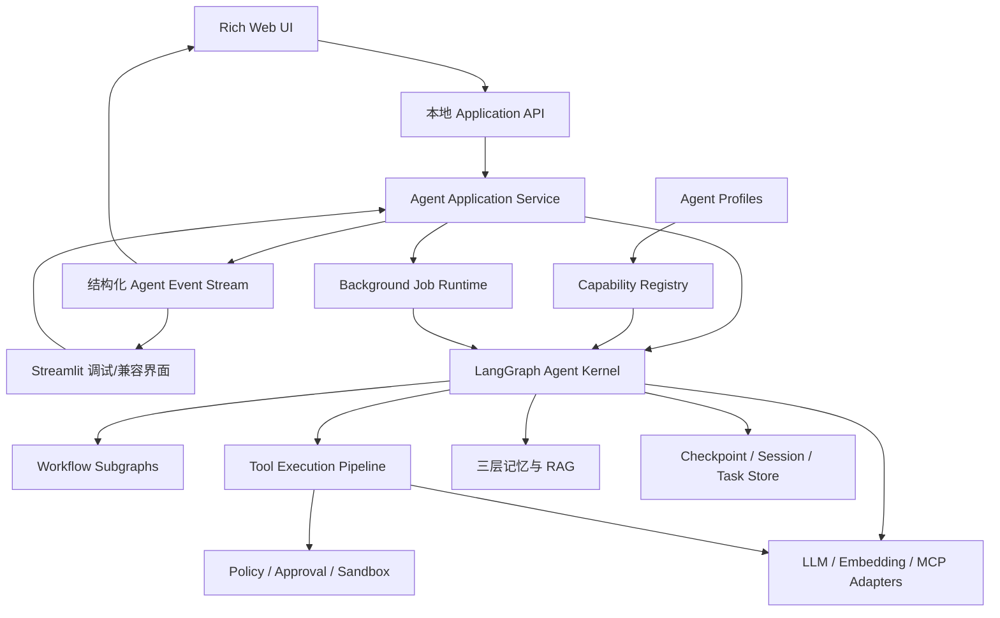
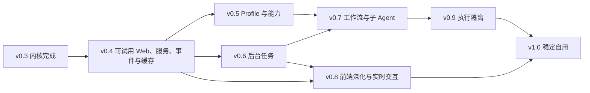

# 后续规划与候选优化

> 不决定当前任务，也不授权实现。当前状态、下一步和门槛见 [项目总览](../../README.md) 与 [v0.4 计划](../../V0_4_DEVELOPMENT_PLAN.md)。长期路线和 B 编号条目合并到一处，历史“下一步”属于原规划时点。

- [长期产品路线](#roadmap)：v0.5 及以后，须在 v0.4 试用门槛后另行立项。
- [候选优化清单](#backlog)：B 编号保留，实施前核实当前源码及触发证据。
- 已实现或已交付的能力（页面、设置、会话管理、地图、只读数据中台）不因旧条目再次变成待开发。暂缓的回答/召回质量问题不因 UI 交付自动通过。

<a id="roadmap"></a>

## 长期产品路线（原规划）

> 原 PRODUCT_EVOLUTION_ROADMAP.md；保留阶段目标与约束。文内“当前下一步”是历史，请使用根目录 README。

## Local Agent Web 后期产品演进路线图

> 状态：项目负责人反馈 v0.4 主体开发已完成；当前执行顺序为 T38 权限、T39 展示与浏览器数据收口、T40 Windows 可解压 EXE 试用包、T37 朋友试用复验。四者完成后再启动 v0.5 能力扩展。未通过对应验收的后续能力仍不是当前实现承诺。
>
> 起点：v0.3 已完成，v0.4 主体功能进入收尾。当前先完成 T38，再解决普通页面暴露过多系统细节、浏览器响应字段和 Windows 免开发环境分发门槛。
>
> 定位：在保留 Python + LangGraph 内核的前提下，把项目从“可学习、可自用的本地 Agent”演进为“能力丰富、可处理复杂任务、Web 交互完善的本地 Agent 产品”。
>
> 关系：`ARCHITECTURE.md` 与 `DEVELOPMENT_PLAN.md` 仍是 v0.1–v0.3 的权威文档；本文只规划 v0.4 之后。实施任何阶段前，必须先把该阶段涉及的稳定契约同步回架构文档，再形成具体开发任务。

---

### 1. 最终目标

最终产品应允许用户在本机浏览器中选择工作区和 Agent 类型，通过自然语言完成聊天、代码修改、命令执行、资料检索、长任务和复杂工作流，并能随时查看计划、工具调用、审批、证据、记忆和任务状态。

目标能力包括：

- 多种 Agent Profile，例如编码、研究、审查和通用助手。
- 文件、Shell、Git、代码检索、网页检索、MCP、Skill 等可组合能力。
- 多步骤规划、失败重试、动态重规划、暂停、继续和取消。
- 后台长任务、任务队列、进度展示和恢复。
- 必要时使用 LangGraph Subgraph 或子 Agent 隔离上下文和权限。
- 富 Web 交互：流式回答、计划面板、工具时间线、diff、终端、审批中心和任务历史。
- 本地优先、默认单用户、所有副作用可审计，危险操作必须经过代码级安全策略。

目标不是复刻 DeepSeek Harness 的 Cordis 插件运行时，而是在顶层实现同类用户能力，并保持整个 Agent 内核能够由个人读懂、调试和解释。

---

### 2. 明确不走的路线

以下内容不是默认方向，只有出现真实需求并单独立项后才考虑：

- 不采用“一切皆插件”，不把 State、Graph、数据库、UI 和 Agent Loop 全部动态装卸。
- 不为了扩展性提前拆成大量独立包或微服务。
- 不在没有评测证据前堆叠多个子 Agent。
- 不把 Streamlit 直接重写为复杂前端；先隔离应用边界，再替换展示层。
- 不默认支持公网、多租户、企业账号、集群调度和分布式执行。
- 不把 MCP Server、第三方工具或外部内容视为可信输入。
- 不用 Prompt 代替权限、路径、进程、资源和审批控制。

---

### 3. 长期设计原则

1. **LangGraph 继续是编排权威**：复杂任务、Subgraph、中断恢复和状态迁移继续由 LangGraph 表达，不另造 Agent 编排框架。
2. **内核与 UI 分离**：网页不直接拼装 Graph 参数或解释内部 State；所有交互通过稳定的应用服务入口和结构化事件完成。
3. **能力组合不等于动态插件**：先用显式注册和 Agent Profile 组合能力；只有第三方独立发布、安装和卸载成为真实需求时，才设计插件协议。
4. **确定性流程优先于模型自治**：能用规则、状态机或工作流确定的步骤，不交给模型自由决定。
5. **副作用必须可追溯**：模型看到的关键上下文、工具请求、安全判定、审批和执行结果都能从持久记录中解释。
6. **复杂度按证据增长**：每引入一种能力，都必须有固定评测、失败样例、资源上限和可关闭路径。
7. **本地优先且失败闭合**：网络、模型、MCP、浏览器或后台任务异常时，不得继续执行不确定副作用。
8. **模型请求可重建且缓存友好**：模型实际看到的系统提示、工具 Schema、消息前缀和动态上下文必须能从持久状态解释；稳定内容留在前缀，变化内容以可追溯快照追加，并记录供应商返回的实际 Token 与缓存命中数据。
9. **后续演进保持能力兼容**：v0.4 以现有 Python、LangGraph、Checkpoint、安全审批、三层记忆、上下文压缩、代码 RAG 和工具能力为基线做增量演进；在新路径通过行为等价与完整回归前，不删除、降级或静默关闭已经完成的功能。

---

### 4. 目标架构



职责边界：

- **LangGraph Agent Kernel**：任务状态、节点、边、循环、中断、恢复和 Subgraph。
- **Agent Application Service**：提交消息、恢复任务、审批、取消、读取状态；对 UI 隐藏 LangGraph 内部细节。
- **Agent Event Stream**：只负责 UI 增量展示和审计，不取代 Checkpoint，也不作为新的编排状态。
- **Capability Registry**：描述当前进程已经安装并允许使用的能力，不负责运行 Graph。
- **Agent Profiles**：选择某类 Agent 可见的工具、Prompt、模型、权限和工作流。
- **Background Job Runtime**：托管长任务生命周期，不把后台线程状态塞进浏览器会话。
- **Tool Execution Pipeline**：工具参数校验、安全分类、审批、执行、结果标准化和证据生成。
- **Security**：工作区权限、Shell 策略、资源上限、秘密保护和可选 OS 级隔离。
- **Checkpoint / Session / Task Store**：执行恢复、会话索引、任务索引和持久状态。

---

### 5. 能力模型：组合能力，不做万物插件

后期需要一个轻量能力注册层，但它只解决“某个 Agent 能使用什么”，不承担完整插件生命周期。

每项能力至少描述：

```text
Capability
├── stable_name
├── tools
├── prompt_sections
├── required_config
├── permission_policy
├── runtime_requirements
└── ui_presentation
```

概念示例：

```text
files       → list/read/edit/write/delete/search
shell       → run command / persistent terminal
git         → status/diff/log/branch/commit
web         → search/fetch
memory      → recall/write/forget
code_rag    → index/retrieve/symbol lookup
mcp         → discover and invoke external tools
skills      → load scoped instructions and resources
workflow    → run approved deterministic subgraphs
subagent    → delegate isolated tasks
```

Agent Profile 只引用能力名称，不复制工具实现：

```yaml
agent_profiles:
  coder:
    capabilities: [files, shell, git, code_rag, memory]
  researcher:
    capabilities: [web, memory, mcp]
  reviewer:
    capabilities: [files, git, code_rag]
```

以上只是目标配置形式，不是现有配置契约。真正实施前必须确定字段、迁移和校验规则；不得直接把示例加入当前 `config.yaml`。

---

### 6. Web 交互目标

#### 6.1 v0.4 首个可试用页面

当前 Streamlit 页面不足以承担对外试用。独立 Web 页面不再等到后期统一重写，而是作为 v0.4 的首要用户成果；应用服务与事件边界围绕这个真实消费者同步建立，避免先做一套没有页面验证的抽象。

首个可试用版本以 DeepSeek Harness 当前 Web 页面为**明确的视觉与交互基准，进行高保真实现**，不是只借鉴页面组成后自由发挥。开工前必须保存经过确认的参考截图和状态清单，先提取设计 Token，再实现组件；布局比例、配色、字体层级、字号、间距、圆角、边框、阴影、信息密度、图标尺寸、悬停/选中/禁用状态和动画节奏都应尽量对齐。允许因本项目功能边界做删减，不允许以“功能已经存在”为理由交付明显粗糙、浏览器默认样式或视觉层级混乱的页面。

“高保真”不表示复制 DeepSeek Harness 的源码、Logo、鱼形标记、产品名称、专有图标资产、插件运行时、Slot 系统或 Monorepo 组织；本项目使用独立实现和自身标识。视觉参考范围包括：

- 常驻会话壳：工作区/会话侧栏、当前会话标题、对话主区域和始终可达的输入区。
- 空会话可直接选择工作区并开始对话；已有会话可切换、恢复和继续。
- 用户消息、模型回答、错误和上下文说明有稳定且可区分的展示层级。
- 工具调用在对话流中显示为可折叠状态行，至少呈现工具名、阶段、耗时、结果摘要和失败原因；文件修改提供 diff。
- 当前计划显示在输入区附近，默认紧凑，按需展开步骤与状态。
- 审批发生时由审批卡接管输入区，展示动作、参数、影响与风险，并提供一次性批准或拒绝；前端按钮不构成授权边界。
- 每个助手轮次底部用紧凑、低干扰的统计行展示本轮实际输入/输出 Token、缓存命中率和端到端耗时；一次用户提交包含多次模型调用或工具循环时默认展示整轮汇总，可展开查看各模型调用明细。供应商未返回缓存字段时显示“未知”，不能显示为 0%；只能使用估算量时必须标注“估算”。
- 输入区旁提供圆形上下文计量器，显示“当前已使用 / 模型最大上下文”，例如 `371k / 1000k`，圆环按占用比例变化并为接近上限提供清晰但不过度惊扰的状态；悬停或展开后说明系统提示、工具 Schema、消息与输出预留的统计口径。
- 页面提供与整体视觉一致的模型选择器和设置入口：可保存多个 OpenAI 兼容聊天模型连接，填写显示名称、端点、模型 ID、可选 API Key、上下文窗口、输出上限及必要的生成参数；无鉴权的本地兼容端点可明确选择“不需要 Key”。无本机配置文件或模型密钥时，Web 仍能启动到初始设置页；完成连接后无需重启即可开始对话。可主动测试连接、查看能力/错误、设置新会话默认模型，并在会话中选择下一轮使用的模型。保存和切换后无需重启 Python 服务或刷新页面。
- API Key 只在录入或更换时发送给本地服务；设置页仅显示“已配置/未配置”和掩码，不提供明文回读。删除连接需二次确认；旧会话和历史用量仍保留当时的模型标识。
- 页面刷新后恢复已经发生的消息、工具、计划和审批状态，不重新执行 Graph 或工具。

必须为下列状态建立成对参考截图或原型，不得只画一个理想静态首页：空会话、普通对话、流式生成、工具执行中、工具成功、工具失败、等待审批、文件 diff、长回答/长工具输出、错误提示和刷新恢复。首版以桌面端为主，至少覆盖常用 1440×900 与 1280×800 视口；更窄屏幕可以在 v0.4 明确标注限制，但关键审批和发送操作不能被遮挡。

#### 6.2 最终页面组成

- 会话与工作区侧栏。
- 对话主区域，支持流式文本和中断状态。
- 当前目标、计划、步骤和完成度面板。
- 工具时间线：等待、执行、成功、失败、拒绝和取消。
- 文件修改 diff 视图，支持按文件查看与审批。
- Shell/终端输出视图，区分 stdout、stderr、退出码和超时。
- 审批中心：动作、参数、影响范围、风险、修改参数、批准和拒绝。
- 记忆面板：召回来源、作用域、写入候选、删除和失效状态。
- 后台任务中心：排队、运行、等待用户、完成、失败和取消。
- 模型、能力和权限设置页；v0.4 先交付可编辑的聊天模型连接设置，能力和权限编辑按后续阶段各自的安全契约开放。
- 任务轨迹与评测结果页。

#### 6.3 UI 事件

UI 不应解析任意内部 State 差异。v0.4 先定义下列最小稳定类别，后续阶段只在真实消费者需要时扩展：

```text
session_snapshot
message_started / message_delta / message_completed
plan_updated / step_started / step_completed
tool_started / tool_output / tool_completed
approval_required / approval_resolved
memory_recalled / memory_written
model_call_started / model_usage_reported / model_call_completed
task_completed / task_failed
```

事件必须带稳定的事件与会话标识；任务级事件还必须带任务和运行标识。空会话的 `session_snapshot` 可以没有当前任务/运行标识，不能为满足字段而伪造。重复投递不能让 UI 重复显示或触发工具。具体字段不在本文提前定义，避免与未来 State 契约冲突。

`job_queued / job_progress / job_waiting / job_completed / task_cancelled` 属于 v0.6 后台任务契约，不是 v0.4 的占位实现。v0.4 不公开没有真实后端语义的取消按钮或取消事件。

v0.4 的 SSE 是进程内实时投影，不承诺持久游标续传。首次连接和重连都先取得权威 `session_snapshot`，再接收连接建立后的增量；最终消息、审批、工具结果和任务状态必须能从 Checkpoint 快照恢复。持久事件游标、长时间断线补发和分页留到 v0.8。

模型用量事件只携带展示与诊断所需的安全字段：供应商、模型、估算 Prompt Token、实际未缓存输入、缓存读取、缓存写入、输出、推理 Token，以及系统提示、工具 Schema 和历史前缀的不可逆指纹。不得写入 API Key、隐藏思维链或未经脱敏的完整 Prompt。缓存命中率统一按 `cache_read / (uncached_input + cache_read + cache_write)` 计算；字段缺失表示未知。

页面展示的是**可验证的执行过程**，不是模型隐藏思维链：可以流式展示最终回答、当前阶段、安全的决策摘要、计划、面向用户的工具动作与状态、脱敏参数、输出摘要、记忆/RAG 的来源与命中状态、审批、错误证据和用量；不得把原始工具名、线程/会话/运行 ID、DTO 名和指纹当作普通页面文案，也不得展示供应商 `reasoning_content`、原始 Chain-of-Thought、系统/开发提示、完整 Prompt、密钥或未经脱敏的记忆正文。推理 Token 只作为数值指标展示。为请求、重连和幂等必需的不透明 ID 可留在浏览器协议字段，但不在页面显示；其余字段由服务端投影收口。Web 搜索在 v0.5 实现后复用同一工具时间线，v0.4 不伪造联网过程。

#### 6.4 独立 Web 与 Streamlit 的边界

v0.4 直接启动独立 Web 前端，技术栈冻结如下；具体依赖版本在开工时通过锁文件固定，不照抄 DeepSeek Harness 的版本号：

```text
Python 服务端     FastAPI + Uvicorn
前端              React + TypeScript + Vite
命令与查询        JSON HTTP API
流式文本与事件    SSE
服务端状态        TanStack Query
本地 UI 状态      Zustand
样式              CSS Modules + CSS Variables / Design Tokens
前端单元测试      Vitest + React Testing Library
端到端与视觉回归  Playwright
生产发布          Vite 静态产物由 FastAPI 同源托管
```

选择原则：Agent、LangGraph、Checkpoint、安全和审批继续留在 Python；React 只负责展示事件和提交命令。开发时 Vite 与 Uvicorn 分别运行并由 Vite 代理 `/api`；发布时前端先构建为静态文件，再由 FastAPI 在同一回环地址和端口提供页面与 API。T40 把服务端与静态资源组成 Windows 可解压文件夹，朋友双击 EXE 启动，无需安装 Python/Node/uv；Node 只属于开发和构建环境。

样式不以 Ant Design、Material UI 等带完整视觉语言的组件库为基础，也不以 Tailwind 工具类临场拼接为主要实现方式。先从确认后的 DeepSeek Harness 参考截图提取颜色、字体、字号、行高、间距、尺寸、圆角、边框、阴影、透明度和动画时间等设计 Token，再用 CSS Modules 和项目自己的 React 组件实现。可以使用无样式基础组件或通用图标库，但不得让其默认外观覆盖高保真目标。

服务端单向增量使用 SSE：提交消息、审批和状态查询走普通 HTTP，请求成功后由事件流推送模型文本、工具、计划、错误和用量变化。v0.4 没有持久终端和真正双向实时控制需求，不引入 WebSocket；没有 SEO 和服务端渲染需求，不引入 Next.js。

v0.4 的受支持部署拓扑固定为单个 Python 进程、单个 Uvicorn worker（`workers=1`）。进程内事件广播、会话互斥和幂等保护都以此为边界；多 worker、跨进程广播和分布式锁只有在后续引入持久任务运行时后才评估。

- 独立 Web 是朋友试用和后续产品演进的主界面。
- Streamlit 在过渡期只保留为内核调试、故障定位和回归对照入口，不再作为新交互能力的首选实现。
- 两个界面必须调用同一应用服务，不得各自解释 Graph State 或复制审批、错误和恢复逻辑。
- 独立 Web 达到 v0.4 验收后，是否继续维护 Streamlit 由实际调试价值决定，不预先承诺长期双 UI 功能对等。

浏览器服务默认只监听回环地址。朋友试用优先采用“在其本人机器上本地启动”的方式；公网部署、账号体系和远程工作区不属于 v0.4。

---

### 7. 分阶段路线图

#### v0.4｜可试用 Web、应用服务、结构化事件与缓存优化

**目标**：先交付一个朋友能够实际使用的本地 Web 页面，同时把 UI 与 LangGraph 内部调用分开，并建立模型用量、缓存命中与请求稳定性的可观测基线。

主要工作（按实施顺序）：

- 先冻结 DeepSeek Harness 参考截图集、页面状态矩阵、设计 Token、关键交互、桌面端布局和高保真验收原型；优先完成常驻会话壳、对话流、输入区、工具状态行、计划条、diff 和审批卡。
- 按已冻结的 FastAPI/Uvicorn + React/TypeScript/Vite 技术栈建立最小启动骨架、开发代理和生产静态托管；默认本机回环访问，不建立公网服务。
- 交付可视化聊天模型设置：现有 `config.yaml`/环境变量中的单模型配置作为首次迁移来源，用户可以增加多个 OpenAI 兼容连接、保存密钥引用、主动测试连接、选择新会话默认模型和会话下一轮模型；修改立即用于后续新提交，无需重启。已开始或等待审批的运行固定原模型与参数，切换不改写其执行上下文。
- 建立应用服务入口：创建/选择会话、提交消息、继续任务、读取状态和审批；v0.4 不公开取消接口，也不渲染没有后端语义的停止按钮。
- 定义最小 UI 事件投影，覆盖消息、工具、计划、审批、错误、模型用量和最终状态。
- 同一会话的执行状态修改采用单飞语义：消息提交和审批恢复不能并发执行；不同 `client_request_id` 的第二个执行请求得到稳定的“会话忙”错误，同一请求 id 的重试返回原执行关联结果，不能再次调用模型或工具。模型选择只配置下一轮，不改变当前运行。幂等记录必须跨进程重启恢复，但不成为第二套任务执行真源。
- 独立 Web 只调用应用服务并渲染事件，不导入 Graph State、节点、LangChain 消息类或 LangGraph `Command`。
- Streamlit 改为调用同一应用服务并渲染同一事件，作为调试与回归对照入口。
- 统一错误分类：配置、模型、工具、安全、审批、恢复和系统错误。
- 保持现有 Checkpoint 为执行状态真源，不引入第二套可写状态。
- 采集每次模型调用的供应商实际 Token 用量；统一区分未缓存输入、缓存读取、缓存写入、输出与推理 Token，供应商未报告的字段保持未知。
- 为模型请求记录安全指纹，至少覆盖模型/端点、稳定系统提示、工具 Schema、历史前缀、动态上下文版本和压缩边界，用于解释缓存命中与失效。
- 把 Prompt 拆为稳定系统前缀和动态运行上下文快照；记忆、RAG、摘要、任务、计划、模式理由和当前目录等变化内容不得继续改写第一条系统消息。
- 动态快照使用固定顺序和确定性序列化，作为与聊天消息分离的 `RuntimeContextSnapshot` 持久记录；请求组装器只把最新快照以带明确来源标记的上下文块注入当前真实用户输入之前。它不能直接拼入用户原文，不能显示成用户气泡、建立新轮次、触发记忆写入或被摘要器当作用户陈述。
- 在真实用量基线建立后，再把持续滑动窗口调整为缓存 epoch：普通轮次只追加，达到压缩边界时统一生成新快照并允许一次可解释的缓存失效。
- 朋友试用前完成权限边界、普通页面与浏览器响应字段收口，交付可解压后双击启动的 Windows EXE 文件夹；未参与开发的人使用实际分发包复验核心任务。

不做：后台并发、持久任务队列、持久终端、WebSocket、Next.js、Electron/Tauri、Redis/Celery、微服务、MCP、子 Agent、Profile 扩展、远程访问、账号系统，也不复制 DeepSeek Harness 的插件运行时和包结构。v0.4 模型设置限于聊天模型的 OpenAI 兼容接口，不做任意供应商私有协议、Embedding 模型热切换或安全/权限的通用配置编辑器。

验收：

- 现有 v0.1–v0.3 回归全部通过。
- 新用户能够在本机完成“选择工作区 → 新建会话 → 发送消息 → 查看流式回答和工具进度 → 审批或拒绝 → 查看 diff/结果 → 刷新后继续”的逐项人工操作检查。
- 新用户从缺少 `config.yaml`/API Key 的干净环境启动 Web，进入初始设置页配置两个不同的兼容模型连接，在页面主动测试、保存、选择并连续对话；切换后下一轮使用新模型且不重启服务，刷新后选择仍在。正在运行或等待审批的任务继续使用原模型；端点无效、密钥错误、能力不支持时给出可执行提示，不能悄悄退回旧模型。
- 在固定 1440×900 与 1280×800 视口为关键状态生成本项目截图，并与已确认的 DeepSeek Harness 参考截图逐项对照；布局、尺寸、间距、颜色、字体层级、圆角、边框、阴影、图标和状态反馈的差异都必须有明确理由，不能用“主观上差不多”代替验收。
- 页面不得出现未经设计的浏览器默认控件、裸露原始 JSON、明显错位/跳动、文本溢出、低对比度状态或风格不一致的临时组件；关键状态的截图回归进入前端测试资产。
- 页面在常用桌面浏览器尺寸下没有遮挡关键操作、不可达审批或必须阅读原始 JSON 才能继续的问题。
- 普通页面不显示原始工具名、线程/会话/运行 ID、DTO 名和指纹；服务端投影不把无业务必要的内部字段送到浏览器，必要的不透明协议 ID 不作为页面文案。
- 每个已完成助手轮次都显示独立统计行；多模型调用汇总与明细加总一致，刷新后不串到相邻轮次。耗时口径为用户提交被接受到该轮最终状态确定的端到端时间，模型/工具分项只在明细中展示。
- 每次模型调用与轮次明细保留实际模型连接的稳定 ID/版本、模型 ID 和端点安全指纹；跨模型切换的统计分别归属，不能把旧模型 Token 或缓存命中算到新模型。
- 圆形上下文计量器显示已组装模型请求的估算输入 Token 与配置中的模型最大上下文；执行中显示最新一次即将发送/已经发送的模型请求，空闲时明确标记为“上一请求”，尚未组装或窗口未知时显示未知，不能把旧值伪装为当前草稿的实时精确值。数值、百分比、颜色状态和悬停说明一致，输出预留单独展示且不重复计入已用输入；达到压缩阈值或接近上限时有确定性视觉状态。
- 开发模式下 Vite 能稳定代理本地 API 与 SSE；生产构建后只启动 Python 服务即可访问页面、普通 API 和事件流，不要求朋友另开 Node 进程。
- Windows 试用包在无 Python、Node、uv 的目标环境解压并双击 EXE 后可使用页面/API/SSE、设置模型、选择工作区、审批和重启恢复；试用包不含开发者密钥或真实数据。
- 前端组件测试由 Vitest + React Testing Library 执行，关键用户路径与固定视口截图由 Playwright 执行；截图差异必须人工确认后才能更新基线。
- 同一任务经独立 Web、Streamlit 和直接应用服务调用得到等价业务结果。
- 页面刷新只读取权威 `session_snapshot` 并继续接收实时事件，不重放模型、Graph 或工具副作用。
- 两个 UI 都不导入 Graph 节点实现、State、LangChain 消息类或 LangGraph `Command`，也不根据节点名决定业务结果。
- 固定任务可导出无密钥、无隐藏思维链的事件轨迹。
- 实际 Token 与估算 Token 分开记录；DeepSeek 未返回缓存字段时显示未知，不得伪造零命中。
- 相同模型、端点、工具集和静态配置下，连续请求的系统提示与工具 Schema 字节一致；动态记忆、计划和任务变化不改变稳定系统提示指纹。
- DeepSeek 固定多轮任务在首轮之后至少一次报告 `cache_read_tokens > 0`；优化前后保存未缓存输入与缓存读取对照，不预设未经基线证明的命中率百分比。供应商或网络不可用时可以把真实验证标记为 `blocked-external` 并继续不依赖该结果的开发，但不能据此宣称缓存验收通过；正式发布若要豁免，必须由人工在验收记录中明确批准、写明证据、影响和补验条件。
- 摘要、模型切换、工具 Schema 变化或动态上下文重建造成的缓存下降能够由事件指纹解释。
- 缓存优化不得降低记忆召回、RAG、计划、审批和错误承诺修正的现有正确性。
- 新应用服务和独立 Web 不得删减 v0.1–v0.3 已完成能力；旧入口只有在等价测试通过后才能移除直接依赖，功能关闭必须继续由既有显式配置控制。

学习与简历证据：可试用 Agent Web UX、前后端边界、事件投影、幂等 UI、可恢复 Agent API、可重建模型请求、Token 与 KV Cache 可观测性。

#### v0.5｜Agent Profile 与业务能力扩展

**目标**：让不同 Agent 拥有不同工具、Prompt 和权限，但仍采用静态注册，不实现动态插件安装。v0.5 在 v0.4 的收口与朋友试用完成后开始；**已于 2026-10-08 立项**，实施顺序与逐任务验收见 [V0_5_DEVELOPMENT_PLAN.md](../../V0_5_DEVELOPMENT_PLAN.md)。

主要工作：

- 建立 Capability Registry 和 Agent Profile 配置校验。
- 增加 Git 能力：状态、diff、日志和受控提交；高风险写操作继续审批。
- 增加 Web 搜索/读取能力；外部内容标记为不可信上下文。
- 增加 Skill 能力：按需加载指令和资源，复用 AGENTS 的作用域、安全和截断原则。
- 在页面展示当前 Profile、已启用能力及不可用原因。
- 每个 Profile 只把自身工具 Schema 注入模型，减少 Token 和误调用。

不做：第三方 Python 包动态加载、插件市场、运行期热卸载。

验收：

- `coder`、`researcher`、`reviewer` 至少三个 Profile 有固定任务集。
- Profile 之间不可见的工具不能被模型调用，也不能绕过注册表直接执行。
- 缺配置或依赖时在启动或选择 Profile 时明确失败。
- Web 内容中的提示注入不能修改系统安全策略或自动授权工具。
- 关闭新增能力后，原基础 Agent 行为不变。

学习与简历证据：能力注册、Profile 组合、最小权限工具集、Prompt Injection 防护。

#### v0.6｜后台任务与长时间运行

**目标**：支持不占用一次页面请求的长任务，并允许查看进度、等待审批、取消和重启恢复。

主要工作：

- 建立持久任务索引，区分会话、任务和单次运行。
- 建立本机后台 Job Runtime；任务状态至少覆盖排队、运行、等待用户、完成、失败和取消。
- 把长任务进度转换为结构化事件。
- 支持协作式取消、超时、资源上限和进程树清理。
- 明确“副作用已发生但状态未提交”的恢复策略，不能自动假定恰好执行一次。
- 页面提供任务中心和恢复入口。

不做：分布式队列、远程 Worker、多机调度。

验收：

- 关闭浏览器后任务可按策略继续，重新打开可查看状态。
- 服务重启后能区分可恢复、失败和需要人工核对的任务。
- 取消后不会启动新的工具调用；已启动进程按平台策略终止并记录结果。
- 一个任务等待审批时不阻塞其他会话的只读操作。
- 任务状态变化有自动测试和页面演示。

学习与简历证据：持久任务状态机、协作式取消、后台执行、崩溃恢复。

#### v0.7｜复杂工作流、Subgraph 与受控子 Agent

**目标**：在单 Agent 评测稳定后，用确定性工作流和隔离执行处理更复杂任务。

主要工作：

- 把常见复杂任务建成 LangGraph Subgraph，例如“理解代码→修改→测试→复盘”。
- 工作流显式声明输入、输出、资源上限、可调用能力和终止条件。
- 主 Agent 优先调用确定性工作流，而不是临时生成任意控制流。
- 仅对适合隔离或并行的任务增加子 Agent：独立上下文、权限、预算和结果报告。
- 子 Agent 只返回有界结构化结果和证据，主 Agent 负责验收，不直接继承隐藏推理。
- 加入并发上限、总 Token 上限、总工具调用上限和失败收敛。

不做：自治 Agent 社会、无上限递归委派、默认并行执行所有工具。

验收：

- 至少两个 Subgraph 在固定复杂任务上优于自由工具循环，并有对照指标。
- 子 Agent 失败、超时或返回无证据结果时，主任务不会伪装成功。
- 子 Agent 不能获得 Profile 未授予的工具和工作区。
- 重启后可恢复主任务，并正确识别已完成的子任务。
- 委派层级、并发数、Token 和循环次数都有硬上限。

学习与简历证据：LangGraph Subgraph、层次化规划、上下文隔离、并发与结果验收。

#### v0.8｜前端深化与可恢复实时交互

**目标**：在 v0.4 可试用 Web 和 v0.6 后台任务已经稳定后，补齐多任务、断线恢复和高级实时交互，而不是重新建设另一套前端。

开工决策门：

- 复核 v0.4 的 API、SSE 和前端测试栈是否仍满足后台任务与多任务展示。
- 根据 v0.4 的实际调试价值决定 Streamlit 是保留为调试入口还是进入维护模式。
- 只有出现持久终端或真正双向实时控制需求时，才评估并批准 WebSocket。

主要工作：

- 深化会话、计划、工具时间线、diff、审批、记忆和任务中心，不重写 v0.4 已有页面壳。
- 支持后台任务、多会话并行状态和等待用户操作的集中展示。
- 完善断线重连、游标续传、长时间流式输出和大结果分页。
- 在需求成立并批准后增加持久终端等双向交互。
- 前端根据事件标识去重，断线重连后从游标恢复。
- 所有危险操作仍由 Python 安全层裁决，前端按钮不构成授权边界。

不做：默认公网监听、多人账号、云端同步。

验收：

- 前端断线重连不丢最终结果、不重复工具和审批。
- 流式关闭时可退化为完整结果。
- diff、Shell、审批和任务状态均能从事件恢复。
- 直接伪造前端请求不能绕过权限与审批。
- v0.4 页面与 v0.8 增强功能共享同一应用服务回归集；若 Streamlit 仍保留，也必须继续走这套契约。

学习与简历证据：前后端分离、SSE/WebSocket、事件恢复、Agent UX、安全边界。

#### v0.9｜执行隔离与可靠性增强

**目标**：把应用层路径检查和审批扩展为更可靠的本机执行边界。

主要工作：

- 抽离文件系统和子进程执行适配器，保持工具 Schema 不随执行环境变化。
- 评估 Windows 受限令牌/ACL、Linux namespace/Landlock、容器或其他本机隔离方式。
- 限制环境变量、网络、CPU、内存、运行时间、进程树和磁盘范围。
- 对工具执行、审批和恢复增加故障注入测试。
- 建立数据库备份、迁移、损坏检测和恢复流程。
- 完善敏感信息审计和日志脱敏。

不做：未经验证就宣称“安全沙箱”或“完全隔离”。

验收：

- 每个平台只声明实际测试过的隔离能力。
- 子进程无法通过软链接、路径别名或环境变量越过允许范围。
- 超时和取消能终止完整进程树。
- 服务崩溃、数据库锁、磁盘满和部分写入均有明确恢复或停止策略。
- 无隔离后端时明确显示降级边界，不静默使用更高权限执行。

学习与简历证据：OS 级隔离、资源治理、故障注入、跨平台安全验证。

#### v1.0｜稳定自用版本与公开演示

**目标**：形成可重复安装、可长期自用、可公开演示且能力声明真实的稳定版本。

主要工作：

- 冻结首个受支持的配置、数据库、事件和 API 版本。
- 提供迁移、备份、恢复、卸载和模型缓存管理说明。
- 建立完整固定评测集和版本基线。
- 提供一键本机启动和环境诊断。
- 完成威胁模型、已知限制和隐私说明。
- 准备演示任务、录屏脚本、架构图和简历证据。

验收：

- 新机器按 README 可完成安装、配置和首个任务。
- 升级不会静默丢失会话、记忆、任务或审批记录。
- 固定评测结果达到预先定义的成功率、错误宣称率和重复副作用上限。
- 离线能力、联网能力和需要 API Key 的能力在 UI 中明确区分。
- 所有简历与 README 能力都对应代码、测试和可复现演示。

---

### 8. 阶段依赖关系



说明：v0.4 先交付可试用 Web，并同时建立应用服务、事件与缓存观测边界；v0.5 与 v0.6 可以在 v0.4 后并行。v0.8 不再创建独立前端，只在 v0.4 页面基础上深化多任务与可恢复实时交互，因此依赖 v0.6 的后台任务边界；v0.9 可以针对已经稳定的工具管线独立推进。

---

### 9. 每阶段统一交付要求

每个阶段都必须交付：

- 对应的架构契约修订和迁移说明。
- 可逐个开工的开发任务清单。
- 单元测试、集成测试和至少一个真实可运行演示。
- 关闭新增能力时的基础功能回归。
- 失败路径、资源上限和安全边界。
- 用户可见的状态和可执行的错误提示。
- README 当前进度与已知限制更新。
- 不含密钥、隐藏思维链和私人数据的演示证据。

阶段退出前统一检查：

```text
功能是否真实可用
错误是否能被观察和恢复
副作用是否可追溯且不会重放
新增能力是否可以关闭
配置、文档、代码和 UI 是否一致
是否有固定任务证明效果优于前一阶段
```

---

### 10. 关键风险与停止条件

| 风险 | 停止条件 | 控制方向 |
|---|---|---|
| 能力越多，工具选择越差 | 基础任务成功率明显下降 | Profile 限定工具集、工具描述评测、分层路由 |
| UI 与 Graph 强耦合 | 修改节点导致大量 UI 回归 | 应用服务与稳定事件投影 |
| 为追求页面效果复制第二套业务逻辑 | 新页面与 Streamlit、Checkpoint 得出不同任务状态 | 先定义最小应用服务与事件契约，所有 UI 只做投影和命令提交 |
| 动态上下文破坏前缀缓存 | Token 成本随对话增长且缓存读取长期接近零 | 实际用量观测、请求指纹、稳定系统前缀、追加式动态快照、缓存 epoch |
| 只优化命中率而损害正确性 | 记忆、计划、审批或错误修正回归 | 固定评测与真实任务双门槛；正确性回归立即停止缓存改造 |
| 后台任务重复副作用 | 刷新、重启或重连重复执行写操作 | 幂等键、Checkpoint、执行前后证据、人工核对 |
| 子 Agent 成本失控 | 委派递归、并发或 Token 无上限 | 层级、并发、预算和总循环硬限制 |
| 外部内容提示注入 | 网页/MCP 内容改变安全策略 | 不可信内容标记、权限隔离、系统规则不可覆盖 |
| 本地 Web 被误开放 | 非回环地址无认证访问 | 默认回环、启动检查、远程访问另行设计 |
| “沙箱”名不副实 | 未隔离的命令被描述为安全沙箱 | 只声明实测能力，缺后端时明确降级 |
| 事件与 State 双写漂移 | UI 和恢复看到不同事实 | State 负责执行，事件负责投影；单向生成、禁止双向修改 |
| 过度平台化 | 大量基础设施没有用户场景 | 每个抽象必须由两个以上真实消费者证明 |

---

### 11. 从 DeepSeek Harness 借鉴与不复制的内容

值得借鉴：

- 模型可见的关键输入必须能够追溯。
- 模型请求的稳定头部、工具 Schema 和历史前缀可重建；变化的运行上下文以有来源的完整快照追加，避免重写首条系统消息。
- 供应商实际 Token 与缓存读取数据进入统一用量模型，并在页面显示可解释的命中率。
- 工具注册、执行、安全策略和 UI 展示职责分离。
- 会话、轮次、步骤、工具和取消有明确生命周期。
- 能力提供方与使用方分离，便于替换执行环境。
- 固定场景回放、快照和故障路径测试。
- 前端以其当前 Web 页为高保真视觉与交互基准，对齐常驻会话壳、输入区、紧凑工具行、计划条、审批接管和统计状态行的布局、层级、密度与状态反馈，用最少层级让用户看清“正在做什么、是否需要我、花费多少”。

不直接复制：

- Cordis 运行时和“一切皆插件”。
- 前端 Slot/插件注册体系及其大量细粒度 UI 包；当前项目使用普通组件和显式页面结构即可。
- 数百包粒度的 Monorepo。
- 当前项目没有消费者的动态安装、热卸载和插件市场。
- 为平台兼容性而引入的完整 SDK、协议和多进程组合层。

判断标准：如果一个顶层能力能通过 LangGraph 节点、Subgraph、普通 Python 服务和显式注册清楚实现，就不引入更重的插件生命周期。

#### 11.1 本地 Codex / OpenManus 源码对照

以下结论直接核对了 `E:/pylianxi/codex` 与 `E:/pylianxi/OpenManus` 的源码；它们是可借鉴的实现思路，不表示已在本项目落地，也不要求复制框架。

| 源码证据 | 取用的思路 | 本项目顺序 |
|---|---|---|
| Codex `codex-rs/core/src/tools/approvals.rs:479-551` 集中处理工具审批决议；`codex-rs/app-server-protocol/src/protocol/item_builders.rs:46-61` 从原始命令生成已处理敏感值的客户端表示 | 权限判定、审批、给浏览器看的内容各有明确边界；不让页面成为授权真源 | T38 保住强制审批，T39 审查客户端投影；本项目已有安全门与投影层，先补缺口 |
| Codex `codex-rs/utils/output-truncation/src/lib.rs:20-37`、`codex-rs/core/src/tools/mod.rs:99-125` 对输出设预算、标明截断和退出状态 | 长工具输出保留结果事实，默认只展示有界摘要 | T39；核对本项目已有裁剪的全部路径，不引入第二套截断库 |
| Codex `codex-rs/app-server-protocol/src/protocol/v2/turn.rs:568-606` 使用结构化计划步骤状态 | 审批拒绝后计划与会话终态应一致 | T39/T37 复验；不迁移 Codex 协议 |
| OpenManus `app/tool/tool_collection.py:15-35,51-71` 以显式集合映射工具名并对未知工具返回失败 | 后续 Profile 的模型可见工具与服务端允许执行集同源 | v0.5 候选；现有安全门和审批继续负责执行授权 |
| OpenManus `app/tool/web_search.py:22-35,53-62,290-327` 使用带标题、URL、来源的结构化搜索结果 | 搜索证据能被用户定位；外部正文须按不可信内容处理 | v0.5 Web 能力候选；多引擎回退等真实故障再引入 |
| OpenManus `app/agent/base.py:135-152,170-186` 有步数上限和重复输出探测 | 用固定任务检查空转与误报完成 | T37 朋友试用复验；本项目继续使用 LangGraph，不移植其进程内循环 |
| Codex `scripts/codex_package/README.md:15-33` 与 `scripts/codex_package/layout.py:15-79` 以含 EXE、资源和元数据的目录作为主交付物 | 把可运行目录、资源清单和可验证入口作为交付单位，再压缩传输；不复制 Rust 构建链 | T40 Windows 目录式试用包与清洁机器冒烟验证 |

OpenManus `app/sandbox/core/sandbox.py:105-121` 只显示工作目录和额外挂载；未核实到挂载 deny-list，不能将其作为 T38 的安全依据。OpenManus `setup.py:46-49` 提供 Python `console_scripts` 入口；未核实到 Windows EXE 交付实现，T40 不以它作为打包依据。

---

### 12. 可展示的最终成果

完成本文路线后，可以真实展示：

- 一个基于 LangGraph、支持复杂任务恢复的本地 Agent 内核。
- 可组合 Agent Profile 和最小权限能力集。
- 本地三层记忆、代码 RAG、Web/MCP 工具和受控子 Agent。
- 后台长任务、取消、审批、失败恢复和事件轨迹。
- 独立富 Web 前端与可恢复流式交互。
- 跨平台工具策略和经过实测的本地执行隔离。
- 固定评测集、错误宣称控制和重复副作用验证。

简历表述必须以实际完成阶段为准。本文中的能力在对应验收完成前只能描述为“规划中”，不能描述为已实现。

---

### 13. 当前下一步

**v0.4 的 T38 → T39 → T40 → T37 已按 [V0_4_DEVELOPMENT_PLAN.md](../../V0_4_DEVELOPMENT_PLAN.md) 走完（T37 记录含人工批准的豁免项），v0.5 已于 2026-10-08 立项，现按 [V0_5_DEVELOPMENT_PLAN.md](../../V0_5_DEVELOPMENT_PLAN.md) 推进。** [候选优化清单](FUTURE_WORK.md#backlog) 是候选资料，不决定当前任务。契约变动仍须先修订 `ARCHITECTURE.md`。

以下是 v0.4 规划时的实施顺序记录，不代表这些任务仍待开工：

具体施工、依赖、逐任务测试与退出门槛见 [V0_4_DEVELOPMENT_PLAN.md](../../V0_4_DEVELOPMENT_PLAN.md)。路线图继续负责产品方向，该计划负责 v0.4 的实施顺序；两者冲突时必须先修订文档，不能由代码自行选择一种解释。

1. 先冻结首个可试用 Web 的页面范围、DeepSeek Harness 参考截图集、页面状态矩阵、设计 Token、高保真原型和逐项视觉/操作验收清单；模型选择器与设置页包含在参考状态内。视觉与交互高度还原，但不复制其源码、品牌资产和运行时架构。
2. 根据页面真实需要定义最小应用服务、模型连接设置和 UI 事件；模型设置先支持多个 OpenAI 兼容聊天连接及下一轮免重启切换，不提前建设后台任务、并发调度、取消或通用插件协议。
3. 建立模型实际 Token、缓存命中和请求指纹观测，跑固定多轮 DeepSeek 场景，保存优化前基线。
4. 拆分稳定系统前缀与动态上下文快照，再根据观测结果处理滑动窗口、压缩边界和回答投影；每一步都用固定评测保护正确性。
5. 用一个纵向切片接通“工作区/会话 → 对话 → 工具 → 审批 → diff/结果 → 刷新恢复”，通过后再补齐 v0.4 页面细节。
6. 只把 v0.4 转换为可逐个开工、可独立验收的开发任务；不要一次性把 v0.5–v1.0 落成代码任务。

v0.4 的停止条件：页面原型不能覆盖一次完整安全任务、应用服务需要复制 Graph 真源、快照/事件投影会触发副作用、缓存优化降低现有正确性，或为了页面效果需要引入当前没有真实消费者的平台化抽象。命中任一条件时先修订架构契约，不继续堆功能。


<a id="backlog"></a>

## 候选优化清单（B 编号）

> 原 OPTIMIZATION_BACKLOG.md；建议做、证据触发与已裁定不做的边界保留，旧行号不是当前缺陷的再次确认。

## 优化待办（Backlog）

> **状态：备选资料，不决定下一步。当前只按 `V0_4_DEVELOPMENT_PLAN.md` 的 T38 → T39 → T40 → T37 朋友试用复验执行。**
> 本文件不授权任何实现，不改变 `ARCHITECTURE.md`、`PRODUCT_EVOLUTION_ROADMAP.md` 或各阶段计划文档中的任何条款。
> 落地任何一条前，仍必须写进对应阶段的计划文档；涉及 §15 或 §10 契约的改动，按 `ARCHITECTURE.md` §15.10 先修订契约再编码。
>
> 建立日期：2026-09-29。来源：一次与外部开源 Agent 项目（OpenClaw、OpenManus）的对照分析，
> 全部条目都落回了本项目的具体文件与行号。

### 0. 怎么读

**条目状态取值：**

| 状态 | 含义 |
|---|---|
| **建议做** | 已确认有价值、有明确落点，缺的只是排期 |
| **证据触发** | 先要看到**可重复的证据**才动手；写法与 `V0_4_DEVELOPMENT_PLAN.md:2017` 的 T36 进入条件一致 |
| **已裁定不做** | 附**重开条件**，避免同一个问题被反复讨论 |

**每条给出：** 依据（`文件:行号`）/ 阶段建议 / 触发条件 / 落点 / 验收 / 明确不做什么。

**与既有文档的关系：**

- 本文件不替代 `PRODUCT_EVOLUTION_ROADMAP.md`（方向）与各阶段计划（任务）。
- 本文件对 v0.5 及以后只给**阶段建议**，不构成任务拆分；v0.5 的任务拆分见 [V0_5_DEVELOPMENT_PLAN.md](../../V0_5_DEVELOPMENT_PLAN.md)（2026-10-08 立项）。
- 条目里的"阶段建议"在立计划时必须重新判定——触发条件可能已经不成立。
- **§1–§6 从工程侧切入**（记忆、检索、CI）；**§7 从"用户点下去会怎样"切入**。两节不重叠，需要各自排期。

**修订记录：**

| 日期 | 变更 |
|---|---|
| 2026-09-29 | 建立。含 19 条：建议做 6 条、证据触发 4 条、已裁定不做 5 条、既有缺陷 3 条、工程化缺口 1 组。 |
| 2026-09-30 | 复核并更正 OpenManus 沙箱挂载的描述；当前执行顺序统一以 v0.4 计划为准。原有 B-01–B-19 的裁定不变。 |
| 2026-09-30 | 新增 §7「用户视角缺陷（产品可用性）」：**B-20–B-32**，来源为 `frontend/src` 交互面 + CSS/浮层全量审计、`src/local_agent` 能力边界审计、回答渲染全链路审计，以及与 `E:/pylianxi/codex`、`E:/pylianxi/OpenManus` 的路径呈现策略对照（**未在浏览器实测**）。原 §7「未核实清单」顺移为 §8，并新增 U-9–U-21。其中 **B-31 已由项目负责人裁定必须改**（跨工作区访问把绝对路径脱敏成占位符）。 |

---

### 1. 记忆可信度

**为什么这一节排最前：** 这是本项目记忆子系统的**真实缺口**（不是从外部抄来的优点）。当前架构的短板不在检索、不在存储，在**写入侧没有信任分级**。

#### B-01 `origin` 信任分级（建议做）

> **2026-10-08 已实施（v0.5 T52）**，但**档位从四值改为三值**（`owner` / `system` / `untrusted`，不设
> `agent`）：本项目里"模型推导"是唯一写入形态，按字面分档会让 `owner` 近乎为空且不改变"能否自动注入"的
> 判定；理由与重新评估条件写在 `ARCHITECTURE.md` §16.2。实现与验收见
> [V0_5_DEVELOPMENT_PLAN.md](../../V0_5_DEVELOPMENT_PLAN.md) §T52。本节余下内容是当时的建议原文。

**是什么**
给每条记忆候选与召回结果加一个来源可信级别，闭集四值：`owner`（用户明确表达）/ `agent`（模型从用户内容推导）/ `untrusted`（来自外部内容）/ `system`（脚手架）。并按级别决定**能否自动注入 Prompt**。

**依据（缺口证据）**

- `src/local_agent/memory/schemas.py:63-90`：`MemoryReference` 的字段里**没有来源可信级别**。
- `ARCHITECTURE.md` §4.3：`MemoryCandidate` 有 `memory_type` / `importance` / `confidence` / `source_event_ids`，同样**没有**来源级别。
- 后果：模型从对话里推导的内容，与用户亲口说的偏好，**同级且同等自动注入**。

**依据（为什么它不只是"想加的东西"）**

v0.5 已经承诺了它的验收条件：

- `PRODUCT_EVOLUTION_ROADMAP.md:319`（v0.5 主要工作）："增加 Web 搜索/读取能力；**外部内容标记为不可信上下文**。"
- `PRODUCT_EVOLUTION_ROADMAP.md:331`（v0.5 验收）："Web 内容中的提示注入不能修改系统安全策略或自动授权工具。"

**没有 `origin` 分级，这两句无法实现**——你无法表达"这段内容来自外部、不可信、不能自动注入"。因此它是 v0.5 的**前置任务**，不是并行需求。

**参考做法**（`E:\openclaw`，已核验）

- `docs/concepts/memory-architecture.md:71-84`：origin class 是**闭集**，且"**无法判定时永不默认成 `owner`**"——外部推导的判 `untrusted`，脚手架的判 `system`。
- `docs/concepts/memory-architecture.md:172-175`：`untrusted` / `system` 在**任何 prompt 构建之前**就被结构性排除，是"precondition, not a score penalty"——召回频次再高也不能把它推进长期记忆。
- `docs/concepts/memory-builtin.md:124-127`：**provenance 故意不放 Markdown**，"so recalled prose cannot rewrite its own trust classification"。
- `docs/concepts/memory-architecture.md:242-247`：只有 curated 层能**自动注入**，episodic 永不，"this restriction is a security property, not a tuning choice"。

**阶段建议**：v0.5 的**第一个任务**（v0.4 关闭之后）。

**落点**

- `src/local_agent/memory/schemas.py`：`MemoryReference` / `MemoryCandidate` 加字段
- `src/local_agent/reflection/memory_candidates.py`：候选生成时打标
- `src/local_agent/memory/writer.py`：写入时落标（中期 metadata + 长期列）
- `src/local_agent/memory/recall.py`：注入资格门控
- `src/local_agent/context/prompt_context.py`：`render_memory_section` 按级别处理
- `src/local_agent/persistence/migrations.py`：长期库加列（**前向迁移**）

**验收**

- `untrusted` 来源的记忆**在任何配置下都不自动进 Prompt**（加断言，不能只是文档约定）
- 缺 `origin` 的历史记录**默认按最保守级别处理**，不默认 `owner`
- 召回结果里 `origin` 可被页面展示（`ARCHITECTURE.md:1449` 的"来源类型"列已预留这个位置）

**明确不做**

- 不把 `origin` 存进 Markdown 或任何正文可写的位置（这正是 OpenClaw 刻意避免的）。
- 不引入"按 origin 加权"的软排序——先只做**能不能自动注入**这个二元门控。

#### B-02 recall-loop 防护（建议做，与 B-01 同批）

**是什么**
被召回进过上下文的内容，**不得再次被抽取成新记忆**。OpenClaw 的原话是"一个事实被召回一百次还是一个事实"。

**依据**

- 通路在本项目**已经存在**：`recall_memory` 把结果注入 Prompt → 模型在反思时看到这些内容 → 可能把它们作为新候选写回。
- 参考：`E:/openclaw/docs/concepts/memory-architecture.md:94-97`（"Content that was injected into context from memory ... is structurally marked and never re-extracted as a new memory"）。

**阶段建议**：与 B-01 同一次改动（都是"给回来的内容打标记"）。

**落点**：`recall.py` 的返回结果打标记 → `reflection/memory_candidates.py` 过滤。

**验收**：注入过的记忆内容再走一轮完整反思，**候选数为 0**。

#### B-03 session-kind gating（证据触发）

**是什么**
不同来源的会话（定时任务 / 心跳 / 子 Agent）**不产生持久记忆候选**。它们可以写任务产物，但其输出不具备晋升资格。

**依据**

- 参考：`E:/openclaw/docs/concepts/memory-architecture.md:91-93`。
- **本项目当前没有可验证的对象**：cron / heartbeat 要到 v0.6（后台任务）、"子 Agent"要到 v0.7（`PRODUCT_EVOLUTION_ROADMAP.md` §7）才存在。

**阶段建议**：不单独立项。作为 **v0.6 与 v0.7 的任务前置条件**记入那两阶段的计划文档。

**明确不做**：现在实现。按 `PRODUCT_EVOLUTION_ROADMAP.md:52`"复杂度按证据增长"，没有触发源的防线无法验证，只会变成死代码。

---

### 2. 记忆可观测与评测

#### B-04 召回质量评测维度（建议做；**优先于第 3 节全部**）

**是什么**
在现有固定任务集里补一条**召回质量**维度：固定若干问法，记录命中率与相似度分布。

**依据（缺口）**

- `tests/test_agent_eval.py:198-448` 的 `CASES` 共 **18 条固定任务**，覆盖闲聊 / 读 / 改 / 审批 / 拒绝 / 恢复 / 越界 / 敏感文件 / 记忆写入 / RAG 开关 / 错误宣称 / 空转保护 / 思考模型 / 多步计划。
- 其中**与记忆相关的只有 1 条**：`tests/test_agent_eval.py:317` 的 `memory-chat-remember`，且它测的是**写入链路**，不是召回质量。
- 与检索相关的 4 条（`rag-on` / `rag-off` / `rag-natural-question` / `rag-natural-question-asks`）测的是**代码 RAG**，不是记忆召回。
- 结论：**18 条里没有一条在衡量"记忆召回得好不好"**。

**为什么它必须排在前面**

第 3 节的三条（Embedding 缓存 / MMR / 超时降级）全是"让召回更快 / 更多样 / 更健壮"，但**当前没有数据说明召回哪里差**。具体地：

- `src/local_agent/config.py:212-217` 自己写明：`min_score=0.53` 只来自 **5 组查询**的标定，"换模型或换成真实记忆库必须重新标定"。
- 没有召回质量的评测，就无法区分"漏召回"与"阈值标定不当"——而这两者的修法完全不同。

**阶段建议**：v0.5（与 `PRODUCT_EVOLUTION_ROADMAP.md:326-328` 的"三个 Profile 固定任务集"一起做）。

**验收**：能回答"某个已知存在的记忆，在 N 种不同问法下被召回几次、相似度是多少"。有了这个数，第 3 节才能按证据排序。

#### B-05 `memory export` 只读视图（建议做，**仅 CLI**）

**是什么**
`python -m local_agent.cli memory export` 把当前可见作用域内的记忆渲染成 Markdown。

**依据（为什么值得做）**

- `ARCHITECTURE.md:1012-1014`（§10.3）已要求"遗忘与人工操作必须有**用户可触达的入口**"，目前只有 `list|delete|forget`，缺"看全文"。
- 它是"记忆黑盒"这个痛点的最低成本解法。

**依据（为什么只能做 CLI）**

页面版在 v0.4 被**三处**明确禁止：

| 位置 | 原文 |
|---|---|
| `ARCHITECTURE.md` §15.8（`:1449`） | 记忆/RAG 一行"明确不展示：**未经脱敏的长期记忆正文**、向量或内部评分细节" |
| `V0_4_DEVELOPMENT_PLAN.md:2061`（§9） | "可见执行过程"失败判据含"泄露隐藏推理或**记忆正文**" |
| `V0_4_DEVELOPMENT_PLAN.md:2096`（§11） | "不泄露隐藏思维链、完整 Prompt、密钥或**未经脱敏的记忆正文**" |

**阶段建议**：CLI 形式可在 v0.4 的 T36 判定空档期做（零契约影响）；页面形式要等 §15.8 修订。

**落点**：`src/local_agent/cli.py` + `src/local_agent/memory/recall.py`（复用 `visible_scope_keys()`，**不要自己拼一套作用域**——`src/local_agent/scope.py:91-93` 明确警告过"命令行看得到、模型召回不到"）。

**验收**：导出结果的作用域可见性与 `memory list`、与模型召回**完全一致**。

---

### 3. 检索性能与质量（全部为证据触发）

**共同前置：B-04 必须先做。** 以下三条在没有召回质量数据之前都是猜测。

#### B-06 Embedding 结果缓存（证据触发）

**是什么**
在进程内缓存"文本 → 向量"的结果（键含 provider + 模型 + 文本 hash）。

**依据**

- 本项目**没有**该缓存：`src/local_agent/llm/embedding.py` 里的 "cache" 全部指**模型权重缓存**（`cache_dir` / `HF_HOME` / `HF_HUB_CACHE` / `HF_XET_CACHE`），不是推理结果复用。
- 本项目的 embedding 是**本机 ONNX CPU 推理**（FastEmbed，`onnx_local`），是召回链路上真正耗时的一环（HNSW 检索在本地规模可忽略）。

**触发条件**（任一成立）

1. v0.5 的固定任务集显著扩大（`PRODUCT_EVOLUTION_ROADMAP.md:326-328` 要求三个 Profile 各一套），批量跑评测时重复计算变明显；
2. 出现"索引重建 / 记忆迁移"这类批量场景。

**落点**：`src/local_agent/llm/embedding.py`（适配器层已具备按 provider/模型区分的能力）。

**明确不做**

- **不做跨进程持久缓存**。那会引入"模型换了、缓存没失效"的新一类兼容性问题，而 `ARCHITECTURE.md` §10.2 的 collection 兼容性校验正是为防这类事。进程内 LRU + 上限足够。
- **口径上不要和 v0.4 的"缓存优化"混为一谈**。T34–T36 做的是**供应商侧 prompt cache（KV cache）**；本条是**本机推理结果复用**。两者同名不同物。

**验收**：同一批评测的第二次运行，embedding 调用次数显著下降，且召回结果与未缓存时**逐条一致**。

#### B-07 MMR 召回多样性（证据触发）

**是什么**
对召回候选做最大边际相关性去重，避免返回多条几乎相同的记忆。

**依据**

- 本项目**没有**：全 `src/` 搜 `mmr|MMR|diversit|hybrid|rerank|bm25|fts5` **零命中**（`recall.py` 是纯向量召回）。
- **有成本，不是零改动**：`src/local_agent/memory/medium_term.py:169-174` 的查询 `include=["metadatas", "documents", "distances"]` **不含 `embeddings`**；MMR 需要候选之间的相似度，而 Chroma 只返回候选到 query 的距离，所以**必须先改 `include` 把候选向量取回来**。
- 传输量取舍：`src/local_agent/memory/recall.py:74,77` 的 `OVERFETCH_FACTOR=4` / `MAX_CANDIDATES=200` 意味着一次最多回 200 条候选；取回 200 个向量不便宜。

**触发条件**

出现**可重复的重复召回**证据：同一轮召回里有多条内容高度相近的记忆（例如同一结论被写了多次）。

**阶段建议**：v0.6（后台任务会让记忆条数与召回频次同时上升）。

**落点**：`medium_term.py`（`include` 加 `embeddings`）+ `recall.py`（`_top_references` 之后加一步去重）。

**验收**：重复召回率下降，且**Top-1 不被削弱**（去重不能把最相关的那条挤掉）。

#### B-08 召回超时降级返回部分结果（证据触发）

**是什么**
召回超时或部分失败时，先返回**已经就绪的部分结果并明确标注 partial**，而不是整体失败。

**依据**

- 参考：`E:/openclaw/docs/concepts/memory-builtin.md:30-34`（语义检索触到 15 秒工具超时后，先返回已就绪的关键词命中 + partial-result 警告）。
- **本项目当前没有触发场景**：召回是在图节点里同步执行的，默认 embedding 是**本机 ONNX（无网络）**，没有可超时的远程调用。

**触发条件**（任一成立）

1. 默认启用 `openai_compatible` embedding provider（`ARCHITECTURE.md` §10.2 已支持，当前非默认）；
2. 召回变成**模型可调用的工具**（`PRODUCT_EVOLUTION_ROADMAP.md` §5 的能力模型里 `memory → recall/write/forget` 已被列为一项 capability，v0.5 做 Capability Registry 时可能这么落地）。

**明确不做**：现在做。没有触发源的降级逻辑不可验证。

---

#### B-34 代码检索的两条硬上限在本机同时生效：只看得到约 1/3 工作区（证据已成立，建议先做最便宜的两处）

- **是什么**：在 2026-10-01 的实机配置下，**按需代码检索只能看到工作区约三分之一的内容**。两条原因同时存在，且都是"限额"而不是"算法"：
  1. **`rg` 未安装**（`Get-Command rg` 实测无结果）——所以一直在走 `rag/search.py` 的**退化路径**：对已遍历文件逐行做字面匹配。功能等价，但更慢、更容易撞上限。
  2. **`rag.max_files = 200` 而工作区候选文件 599 个**（实测：排除 `.git`/`.venv`/`node_modules`/`__pycache__`/`dist`/`build`/`.pytest-temp*` 等忽略目录后 `Get-ChildItem -Recurse -File` 计 599）。达到上限即停止，**未遍历到的文件完全不参与检索**；而且**是哪 1/3 由遍历顺序决定**（不是随机采样），所以这是**系统性盲区**，不是"偶尔漏一点"。
- **依据（文件:行号）**：`local-agent-web/src/local_agent/rag/search.py:1-17`（"不建持久索引、字面匹配、`rg` 优先、退化路径共用同一套限额、文件数与单文件字节数与墙钟时间都有上限"）、同文件 `_RG_BASE_ARGV`（`--json --no-config --color=never --fixed-strings`）、`_walk_files` 与 `_scan_matches` 的限额实现；`config.yaml` 的 `rag: max_results: 8 / max_files: 200 / max_file_bytes: 262144 / timeout_seconds: 10 / max_terms: 4`。**"`uv sync` 不会安装 `rg`"是设计如此**（`search.py` 原文），所以这不是装漏了，而是分发时就不会有。
- **性质**：**遗漏**（限额从未按真实工作区规模标定过）。**不是**"不建索引"造成的——见"明确不做"。
- **为什么先不改选型**：599 个文件的规模用 `rg` 一次扫描是毫秒级，**不需要向量索引**；索引要解决的是"几万文件 + 语义查询"，不是这个量级（同一判断见 `docs/lessons/03-project-map.md:260-269`：为字面命中维护索引要付出"索引陈旧 / 增量更新 / Embedding 一致性"三份复杂度，收益很小）。
- **落点（两处，均不碰架构）**：① 分发说明与试用包前置条件里写明 `rg` 是可选加速器（或直接随包提供）；② `rag.max_files` 提到能覆盖整个工作区（当前 599 → 建议 2000 量级，留余量）；是否同时提高 `max_results` 取决于 B-04 的评测结果，**不要先改**。
- **验收**：在同一个工作区、同一个查询下，检索结果说明里**不再出现"已截断"**；用一组含"只在第 200 个文件之后才出现"（按遍历顺序构造）的标识符作为负例，确认它现在能被召回——这条负例是**证明盲区真的消失**的唯一办法。
- **明确不做**：不做向量索引 / Embedding 索引 / 持久语义索引（理由见上，且与 T21、§5.3 的既有裁定一致）；不加 LSP 或全库符号图。
- **未核实**：① `_walk_files` 的**遍历顺序**（决定哪 1/3 被看到）未逐行核对——是字母序、目录序还是 `os.walk` 的返回序，直接决定盲区的形状；② ~~提高 `max_files` 后退化路径的墙钟时间是否成为新瓶颈~~ → **2026-10-01 已实测**（见下方处置结果），不是瓶颈；③ 检索被截断时，结果说明里的"已截断"标注在实际回答中是否被模型如实转述，未核对。
- **2026-10-01 处置结果（T42，含探针原始数据）**：
  - **条目 ② 已修**：`rag.max_files` 由 `200` 提到 **`2000`**（`config.yaml` 与 `config.yaml.example` 同改，注释里带探针数据），重启进程后生效。实测（`E:\tmp\probe_rag.py`，**不调用模型**）：两个此前**召不回目标文件**的真实查询（`routers.py`、`config.py`）**都恢复召回**，`truncated` 由 `True` 变 `False`；退化扫描耗时 **0.31s → 0.66s**（上限 `timeout_seconds=10`）。
  - **条目 ① 按证据降级为"暂不需要"**：在这个规模（599 文件）上 `rg` 与退化扫描只差 **0.35 秒**，装它不解决任何当前问题——参照实现"打包二进制"的做法**留作工作区量级再上一个数量级时的选项**，从当前待办里撤下。
  - **新增一条待查**：多词项查询在 `max_files=2000` 下**仍可能 `truncated=True`，来源是"按词项的命中配额"**，与文件上限无关——不要把它误读成"文件又漏了"。需在 B-04 里与召回质量一起量。

- **参照实现（`dsh` = `deepseek-harness`，本地检出 `D:\ideaTest2\deepseek-harness` @ `b150a551`，对应包 `packages/fs/tool-fs-search`）怎么解**：它也有上限，而且**做得更细**，值得抄的是下面两点——都不是"把上限调大"：
  - **它的上限是三类，不是一个数**（见该包 `README.zh.md` 的配置表）：`globMaxResults=100`（路径条数）、`grepMaxMatches=250`（平铺匹配行数，注明"与 Claude Code 的 `GrepTool` `head_limit` 相同"）、`grepMaxLineBytes=2000`（每条预览字节）、`rawOutputMaxBytes=20MB`（超了直接以 `SEARCH_RAW_OUTPUT_OVERFLOW` 失败）、`timeoutMs=30000`。**注意单位不同、不可直接比大小**：这里 `max_results` 数的是"片段"（每条含多行代码），不是一个路径或一行预览。
  - ① **超限后结果仍可恢复**：超限的完整结果经 spill 后端保存并回一个 locator，模型可循它取回；"spill 缺失时保留内联页面并报告完整结果无法保存，**绝不会成为 `isError`**"（`src/search-core.ts` 的 `spillStore.saveText()`）。**本项目现在只追加一句"候选超过上限 N 条"然后 `break`——被截掉的候选永远取不回来**，这是与参照实现最实的一处差距。
  - ② **"超限时怎么选"是必须显式决定的配置**：`sampleOverCapGlobResults` **必填、无回退值**——`true` 在顶层条目之间采样（避免只看得到一个子树），`false` 保留按修改时间排序的前部。**这正好是上面"系统性盲区"的现成解法**：本项目现在是"遍历顺序的前 N 个"，而参照实现要求部署先把这个问题想清楚。
  - 附带两条：③ 它**打包 ripgrep**（`@vscode/ripgrep`，Node 与单文件运行时都随包提供，"不要求宿主安装 `rg`"），因此不依赖外部 `rg`——这正是本机"未安装 `rg`"那条的对照答案；④ 它的**上限不进入面向模型的 schema**（不提供 `head_limit` / `offset` / 大小写开关），模型要更多内容就 `read` 匹配文件或循 locator——与本项目"固定上限、不给模型参数"的做法一致。

### 4. 已裁定不做（附重开条件）

**本节的目的：避免同一批问题被反复讨论。** 每条都给重开条件，条件成立时可以推翻。

#### B-09 记忆正文改为文件真源（Markdown 是主数据源）

**裁定：不做。**

**理由**

1. **覆盖写会撞 §6.4**：`ARCHITECTURE.md` §6.4 规定"覆盖已有文件默认需要审批"，而记忆写入现在是**免审批**的自动链路（`src/local_agent/memory/writer.py` 全文无审批逻辑）。要让记忆文件成为真源，要么每次写入弹审批，要么给记忆文件开一条"不受文件策略管"的例外。
2. **模型会绕过反思链路**：文件在工作区内 → 模型可用 `edit_file` / `write_file` 直接改记忆，**绕过 §10.4**"所有 `memory_write_intent` 必须经 `reflection_node` 验证"。参考项目能接受这一点是因为它把工作区文件视为操作者信任边界内（`E:/openclaw/docs/concepts/memory-architecture.md:110-115`）；本项目把模型当作需要证据与审批的不可信执行者，**信任假设相反**。
3. **`scope` / `origin` 无处安放**：文件位置天然表达作用域，但 §10.2 要求的是**精确硬过滤**；而把作用域写进正文行内注释，就等于让模型改自己的作用域。
4. **会拆掉可见性唯一真源**：`src/local_agent/scope.py:86-99` 的 `visible_scope_keys()` 是四处共用的唯一真源，文件布局会引入第二套映射。
5. **`global` 作用域在工作区内无法表达**，必须放工作区外，又回到第 1 条。

**代价（如实记录）**：放弃"记忆可读可编辑、可 git 携带、索引可重建"这三项治理收益。

**重开条件**（任一成立）

1. 真的出现"记忆改错且看不见、改不了"的实际阻碍；
2. 需要记忆随项目一起做版本管理；
3. 把"记忆可读可编辑"作为对朋友的**产品卖点**（定位从学习项目变为产品，判断标准随之改变）；
4. `run_shell` 那个绕过口子被解决（见下）。

**未解决的技术障碍（写在这里防止实现时才发现）**：即使做了文件化，`run_shell` 仍是绕过口子——
`Set-Content MEMORY.md` 是合法命令，而 `security/shell_guard.py` 按可执行名 + 参数结构判定，
**无法判断 argv 里的路径是不是记忆文件**。要么在 shell 判定里加"argv 出现记忆文件路径 → 拒绝"，
要么承认只能防住文件工具。

#### B-10 读取时切分（400 token / 80 重叠 chunk）

**裁定：不做。**

**理由**：本项目的模型是**写入时定粒度**——`src/local_agent/memory/medium_term.py:136-141` 一条记忆记录 = 一个 `documents` 元素 = 一个向量，而候选本身由反思产出，天然是原子单位（一条摘要 / 一个任务片段 / 一条偏好）。改成读取时切分要放弃"不切断语义"这个优点，并额外引入 overlap 去重与排序补偿。

**重开条件**：出现"单条记忆过长、整条占满召回预算"的真实问题。

#### B-11 plugin slot / 独占插槽

**裁定：不做（作为插件体系的一部分）。**

**理由**：`PRODUCT_EVOLUTION_ROADMAP.md` §2 明确"不采用一切皆插件"；v0.4 也不做 Profile / 能力注册。插槽没有宿主。

**保留的部分**：**"独占"这个语义**值得保留，但落法是**一条断言**而不是机制——"同一时刻只有一个记忆后端可写"（启动校验 + 一条测试）。本项目事实上已经是独占的（`MediumTermStore` + `LongTermStore` 两个 store，同一个 `writer.py` 入口）。

**一个需要澄清的误读**：参考项目的 memory slot 是"**同一时刻只激活一个记忆引擎实现**"（memory-core / honcho / lancedb 三选一，`E:/openclaw/docs/concepts/memory.md:176-191`），**不是**"一次只加载一份记忆文件"，也不限制召回条数或文件数。所以"单插槽会削弱多记忆并发检索"这个担心不成立。

#### B-12 dreaming 式后台晋升（把 curation 移出回复链路）

**裁定：不做。**

**理由**：本项目的记忆写入是**同步在回复链路里、由反思节点把关**的（§10.4），而 `PRODUCT_EVOLUTION_ROADMAP.md:283` 明确 v0.4 不做后台任务、v0.6 才做。照抄只有两条路：越过 v0.6 引入调度器，或让记忆写入脱离反思节点（违反 §10.4）。

**保留的部分**："两阶段晋升"思想可以用同步版本表达——**本项目事实上已经是这个形状**（反思产出候选 → 写入）。真正缺的是**晋升门**，不是后台。

**重开条件**：v0.6 引入 Job Runtime 之后，如果出现"写入质量明显受对话延迟限制"的证据。

#### B-13 长期 `facts` / `task_conclusions` 文件化为真源

**裁定：不做。** 长期记忆可以只做**只读导出**（并入 B-05）。

**理由**：长期记忆是**写入时判定的结构化数据**，不是从文本抽取的：

- `src/local_agent/memory/long_term.py:14-15`：`replaced` / `conflicted` 取决于**置信度高低比较**——无法从 Markdown 正文反推；
- `src/local_agent/memory/long_term.py:11-13`：`superseded` / `conflicted` 行是**版本历史与审计**，§10.3 要求"历史行保留用于审计"；
- `fact.value_json` / `task_conclusion.evidence_json` 是结构化值与证据引用。

文件化会丢掉：置信度来源、冲突裁决链、版本历史。

**一个来自参考项目的旁证**：它把最"结构化"的那类记忆（standing intents）**故意留在 SQLite**，理由是"把意图当散文存进记忆文件是现有设计里最不可靠的一种"（`E:/openclaw/docs/concepts/memory-architecture.md:339-344`）。

---

### 5. 顺手发现的既有缺陷（**只报告，未修改**）

这三条不属于任何优化项，是本次分析过程中读代码时发现的既有问题。

#### B-14 `write_on` 是死配置

- `src/local_agent/config.py:220` 声明了 `write_on: list[str]`。
- **`src/` 与 `tests/` 内零消费者**（`tests/` 里唯一命中是 `test_upsert_fact_does_not_silently_overwrite_on_conflict` 的字符串巧合）。
- 而 `config.yaml.example:71-74` 还给它配了三个值（`task_completed` / `important_fact_changed` / `explicit_user_preference`）。

**需要你判定**：是实现没接上（则写入触发条件实际不可配），还是废弃键没清（则样例应删）。

#### B-15 样例配置的注释已过期

- `config.yaml.example:62`：`enabled: false  # v0.1a / v0.1b 保持关闭，节点透传`
- 实际：现在是 v0.4，中期记忆从 v0.2（T14B）起就是可用能力。这句注释会让新读者以为它还没实现。

#### B-16 `min_score` 标定样本过小

- `src/local_agent/config.py:212-217` 自己写明：0.53 只来自 **5 组查询**的标定，"换模型或换成真实记忆库必须重新标定"。
- 影响：召回是否"够用"目前**没有数据支撑**。这与 B-04 是同一个缺口的两面。

---

### 6. 工程化缺口（来自外部对照，独立于记忆）

> **证据强度说明**：本节的**本项目侧**依据是我直接读过的；**参考项目侧**依据来自对 `E:\openclaw` 的探索，落地前需要复核。按项目纪律，这些属于"报告"，不是"建议立即做"。

#### B-17 CI 与架构边界守卫（建议做）

**缺口（本项目侧，已确认）**：仓库根**没有 `.github/`**，也没有 `Dockerfile`。850 个测试用例只靠本地跑。

**参考做法**：参考项目有 105+ 个 workflow，且 CodeQL **按信任边界分区**配置，lint 里有一批自研的**架构守卫规则**（禁止 chained assertion、禁止 widen-then-assert、pairing account scope 守卫等），配置在 `config/oxlint/boundary-guards.json`。

**为什么对本项目有价值**：`ARCHITECTURE.md` §15.1 已经写明依赖方向契约——"LangGraph 不导入 api、frontend 或应用层 DTO"、"application 不导入 Streamlit"、"frontend 不知道 AgentState、节点名、LangChain 消息类或 LangGraph `Command`"。**这些目前没有任何机械手段守着**，只能靠 review。

**落点**：可以先只做一件事——一条 import 方向的 lint 规则 + 把现有 `uv run pytest` / `ruff` / `mypy` 接进 CI。这是全清单里成本最低、收益最直接的一条。

#### B-18 审批机制的三个可选增强（证据触发）

| 增强 | 参考做法 | 本项目的现状 |
|---|---|---|
| `allow-always` 粒度（会话内免审白名单） | 审批记录支持 `allow-once` / `allow-always`，绑定精确 command/cwd/env | 本项目有动作指纹 + 三出口审批，但**没有** `allow-always` 粒度 |
| "无法唯一定位操作数时**拒绝**而不是放行" | 写成显式规则并有测试 | 与本项目 fail-closed 精神一致，但**未见显式规则** |
| 危险配置**显式标记 + 审计**（而非直接拒绝启动） | `dangerous*` 前缀的配置计入 `config.insecure_or_dangerous_flags` 并进审计 | 本项目是"配置想关强制审批 → **直接启动失败**"（`src/local_agent/config.py:272-279`） |

**说明**：第三条是**设计取舍**，不是缺陷。本项目更保守；参考项目允许关但要求显式标记与审计。要不要改由你定。

#### B-19 Skill 层（建议做，但需要先立项论证）

**是什么**
"目录 + `SKILL.md`（frontmatter）→ 以目录形式注入 prompt，模型按需读文件"的渐进式披露机制。

**为什么它可能值得**：它和本项目**已有的 AGENTS.md 机制**是同源问题（`ARCHITECTURE.md` §7.1 的向上扫描 + 逐级合并 + 优先级），参考做法只是更完整：多了作用域优先级链、per-agent allowlist、依赖门控（`requires.bins/env`），以及"**给人用还是给模型用**"两个开关（`user-invocable` / `disable-model-invocation`，见 `E:/openclaw/docs/tools/creating-skills.md:113-152`）。

**为什么需要先论证**：它**不需要 plugin runtime** 就能实现，但会与本项目的 AGENTS 加载、RAG 作用域、Prompt 预算三处交互。按 §2 的"复杂度按证据增长"，应该先确认"AGENTS.md 不够用"的具体场景。

---

### 7. 用户视角缺陷（产品可用性）

> 建立日期：2026-09-30。来源：项目负责人反馈"页面特别垃圾、各种样式乱飞、各种超出、返回的东西乱七八糟、弹窗管不了、连玩具都算不上"，
> 据此对 `frontend/src`（交互面 + CSS/浮层）与 `src/local_agent`（能力边界）各做一轮全量审计，全部条目都落到了具体文件与行号。
>
> **两条证据边界（先读）**：
> 1. 本轮**未在浏览器实测**，所有"会溢出/被裁/关不掉"均来自静态读取代码，未取实际 `scrollWidth` 或点击验证（见 §8 U-9）。
> 2. 审计期间 `ApprovalCard.tsx`、`PlanStrip.tsx`、`PlanStrip.module.css` 处于**未提交改动中**（T39 进行时）；涉及这三处的行号以改动后版本为准（见 §8 U-10）。

**这一节的判据只有一个**：一个普通用户（开发者或文职）打开页面点下去，会不会卡住、看不懂、或认定"这是坏的"。不评价代码风格。

#### B-20 惰性控件：有按钮、无行为（建议做）

**是什么**
界面上多处**渲染成可点**的元素没有接任何行为。用户点三下没反应，就会判定"这东西是坏的"——这是"连 demo 都算不上"最直接的来源。

**依据（缺口证据）**

| 控件 | 用户预期 | 实际 | 证据 |
|---|---|---|---|
| 侧栏「搜索会话…」 | 过滤历史会话 | 无 `value`/`onChange`，打字无反应 | `frontend/src/components/Sidebar.tsx:134-137` |
| 错误卡「重新发送」 | 重发该条 | 无 `onClick` | `frontend/src/features/error/ErrorNotice.tsx:46-49` |
| 工具卡复制按钮 | 复制输出 | 空 `<button>` | `frontend/src/features/tool/ToolCards.tsx:29-31` |
| diff 卡复制按钮 | 复制补丁 | 空 `<button>` | `frontend/src/features/tool/DiffCard.tsx:34-36` |
| 输入区 `＋` | 打开命令/附件 | 无 `onClick`，且**无对应浮层** | `frontend/src/components/Composer.tsx:141-143` |
| 输入区「Workspace Write」chip | 切换权限档位 | 静态文案，不可点、不反映真实档位 | `frontend/src/components/Composer.tsx:144-146` |
| 上下文计量器圆环 | 展开详情 | `aria-expanded` 恒 false，无 `onClick`；`meterOpen` 在真宿主里从不置真 | `frontend/src/components/ContextMeter.tsx:111-117`；`app/LiveApp.tsx:198-206` |
| `MeterPanel` 关闭按钮 | 收起面板 | 无 `onClick` | `frontend/src/components/ContextMeter.tsx:146-148` |
| 顶栏「Session log」 | 打开日志 | 惰性入口，无页面、无接口 | `frontend/src/components/TopBar.tsx:19-21,54-56` |

**性质**：半成品/装饰性 UI（遗漏），不是设计取舍。`Session log` 一项已在 `V0_4_DEVELOPMENT_PLAN.md:2315` 记录并申请分发门槛豁免，此处不重复立项。

**阶段建议**：v0.4 的 **T39（展示与浏览器数据收口）**范围内收口——它正好是"展示"阶段。

**落点**：上表各文件；`ContextMeter` 需要一并决定"圆环是装饰还是入口"。

**验收**：每个可聚焦按钮**要么有可见行为、要么不呈现为可点**（不是 `disabled` 灰着，而是根本不渲染成按钮）。加一条前端守卫测试，禁止"渲染了 `<button>` 却没有 `onClick`/`type=submit`"的新增。

**明确不做**：不借这一条新增"会话日志导出"功能——那是独立需求，需要单独裁定。

#### B-21 没有"停下来"的能力（建议做最小版）

**是什么**
用户提交后想改主意，**没有任何办法中止**；关掉页面、断网也不停。这是用户视角的阻断级缺陷。

**依据**

- 前端注释明写 v0.4 无 `cancel_task()`，故不渲染停止按钮：`frontend/src/components/Composer.tsx:160-162`、`components/Composer.module.css:143`、`frontend/README.md:164`。
- 后端**没有取消接口**：`api/` 下搜 `cancel` 零命中；错误文案自己写明"没有取消接口"（`src/local_agent/application/errors.py:145`、`:342`）。
- **SSE 断线不取消任务**，只说"任务不受影响"（`src/local_agent/api/sse.py:8`、`:105`）。
- 同会话第二个请求**不排队**，直接 `SESSION_BUSY`（`src/local_agent/application/service.py:1099`）。

**阶段建议**：完整取消归 **v0.6（后台任务与长时间运行）**，不在 v0.4 越级实现。但 v0.4 至少要做**诚实告知**的最小版：输入区/提交后明确显示"当前版本无法中止，关闭页面不会停止任务"，并写进 README 已知限制。

**落点**：`frontend/src/components/Composer.tsx`、`frontend/README.md`、（若做真取消）`api/routes.py` + `application/service.py`。

**验收**：用户在不看文档的情况下，能从界面上知道"现在停不了、关页面也没用"。

**明确不做**：不在 v0.4 引入 `cancel_task`、任务队列或后台 Job Runtime（撞 v0.6 的边界）。

#### B-22 会话管理只有"新建 / 切换"（建议做）

**是什么**
不能重命名、不能删除、不能搜索历史；草稿刷新即丢。

**依据**

- 无重命名、无删除入口：`frontend/src/api/client.ts` 无对应方法（唯一 delete 是"停用模型连接"，`:243-253`）。
- 搜索框惰性（见 B-20），`Sidebar.tsx:134-137`。
- 同一时刻只有一个 `activeSessionId`：`frontend/src/stores/ui.ts:17-18`。
- 草稿仅进程内、刻意不持久化，刷新即丢：`stores/ui.ts:9-10,20,34`。
- 连带影响：`request_ledger` 明确"跨重启保留到会话删除"（`src/local_agent/persistence/request_ledger.py:1`）——**删不掉会话就意味着台账永远留着**。

**阶段建议**：v0.4 的 T39。

**落点**：`components/Sidebar.tsx`、`api/client.ts`；删除需要后端路由（`session_store.py` 已有会话索引）。

**验收**：能重命名、能删除（删除后该会话的 checkpoint、台账、记忆作用域按既有口径处理并说明清楚）、搜索框能过滤。

**明确不做**：不做多会话并行、不做会话回放/时间旅行（后者本就不在当前能力内，见 §8 U-15）。

#### B-23 布局溢出：2026-09-29 那轮之后仍有 5 处未覆盖（建议做）

**是什么**
`V0_4_DEVELOPMENT_PLAN.md:2336-2375` 已修过一轮（三层结构性缺陷，实测 100 次加载页面级溢出为 0）。本轮审计发现**新的**不可收缩/未截断点，属同类缺陷的另一批实例。

**依据（本轮新发现，均未在这些位置看到防护声明）**

| 位置 | 问题 | 证据 |
|---|---|---|
| 顶栏工作区面包屑 | `.breadcrumb` 无 `overflow`/`text-overflow`/`white-space`，而 `.bar` 高度写死 `--law-header-height`（63px）→ 长绝对路径换行会撑高内容、压到下一行 | `components/TopBar.module.css:6,15-19`；`styles/tokens.css:175` |
| 侧栏工作区标题 / 树错误 | `.workspaceTitle`、`.treeError` 无任何截断或折行控制；`.sidebar` 只声明 `overflow-y: auto` → 按 CSS Overflow 规范 `overflow-x` 计算为 `auto`，268px 侧栏内会出现横向滚动条 | `components/Sidebar.module.css:10,169-174,180-195` |
| 行内代码 | `.inline` 无 `overflow-wrap`/`word-break` → 长 URL、长 token 撑破段落 | `features/conversation/MarkdownMessage.module.css:28-34`（对照：代码块 `.pre` 已正确 `:53`） |
| 工具卡 cwd | `.cwd` 无 `min-width:0`/省略，且 `.meta` 是 `flex:0 0 auto` → 长 cwd 不可收缩，挤掉标题并溢出卡头 | `features/tool/ToolCards.module.css:36-46,48-50`（对照 `:26-29` 已正确） |
| 计量器气泡 | `.popover` `width:340px` + `right:0`，无 `max-width`、无断点 → 窄输入区向左溢出容器 | `components/ContextMeter.module.css:25-37` |

**阶段建议**：v0.4 的 T39（与既有口径一致："任何宽度都不得出现横向滚动条"）。

**落点**：上表各 `.module.css`。

**验收**：把这几类内容作为**固定用例**灌进越界扫描——最长工作区路径、最长 `cwd`、长 URL 行内代码、340px 气泡——在 640/768/900/1024/1440 各跑一遍页面级 `scrollWidth - clientWidth <= 0`（复用 2026-09-29 那轮的 100 次加载口径）。同时把 e2e 视口从当前两个扩到含 ≤1024（见 §8 U-12）。

**明确不做**：不重做布局结构，只补可收缩与截断。

#### B-24 视觉一致性：有 token 体系，但没用全（建议做）

**是什么**
`styles/tokens.css` 约 140 个变量，且**全 `src` 内唯一含硬编码色值的文件就是它**（色值这块做得好）。但**间距、尺寸、圆角、控件高度**大量硬编码，"同一类元素各写一套"——这是"样式乱飞"的主观来源。

**依据（缺口证据）**

1. **同类元素多套外观**（举例）：
   - 复制按钮 2 套：文本按钮 `MarkdownMessage.module.css:60-70` vs 24×24 图标按钮 `DiffCard.module.css:51-59` / `ToolCards.module.css:64-73`。
   - 卡片圆角混用：`--law-radius-2xl`（22px，`ApprovalCard.module.css:7`、`Composer.module.css:22`）vs `--law-radius-lg`（12px，`DiffCard.module.css:4`、`ToolCards.module.css:3`）。
   - "说明文字" 4 套：`ToolCards.module.css:234-241` / `TraceView.module.css:233-238` / `MemoryRow.module.css:107-111` / `ModelMenu.module.css:99-106`。
   - 图标按钮 3 种尺寸：20px（`ContextMeter.module.css:13-14`、`Sidebar.module.css:70-71`）/ 24px（`DiffCard.module.css:55-56`、`Conversation.module.css:64-65`）/ 28px（`Composer.module.css:92-93`）。
   - 状态标记 4 种尺寸：6px（`Sidebar.module.css:226-227`）/ 8px（`TraceView.module.css:125-126`）/ 12px（`PlanStrip.module.css:96-98`）/ 14px（`ToolRow.module.css:30-32`）。
   - **按钮高度 8 档**：26 / 27 / 30 / 32 / 36 / 38 / 42px（`Composer.module.css:109`、`TopBar.module.css:46`、`ErrorNotice.module.css:89`、`ModelMenu.module.css:42`、`Sidebar.module.css:37,93,270`）。
2. **跨 module 同名类各写一套**（CSS Modules 不冲突，但语义已崩）：`.head` / `.card` / `.status` / `.note` / `.title` / `.copy` / `.code` / `.row` / `.hint` / `.input` / `.body` 均为同名不同物。
3. **未走标尺的硬编码 px 广泛存在**（逐文件通读汇总，非计数查询，见 §8 U-11），例如 `Sidebar.module.css:37-38,55,59-60,70-71,93,115,147-148,226-229,270`、`Composer.module.css:20,54,92-93,109,135-136`、`SettingsDialog.module.css:13-14,47-48,86,130,237,343`、`TraceView.module.css:23,36,210,251`。

**阶段建议**：T39 之后、T40 打包之前的那段空档（纯样式，零契约影响）。

**落点**：`styles/tokens.css` 补 spacing / control-height / radius 标尺；各 `.module.css` 全量引用。

**验收**：同类元素（按钮高度、图标按钮、状态点、说明文字、卡片圆角）各只剩**一种**取值；新增模块不再出现未走 token 的尺寸。

**明确不做**：不重做视觉设计、不主动改既有视觉基线的尺寸——任何会改变 1440×900 / 1280×800 像素基线的改动都需要事先裁定并重拍截图（2026-09-29 那轮 54 张的教训）。

#### B-25 浮层：关不掉、层级不受控、焦点无归属（建议做）

**是什么**
"弹窗管不了"在代码里有四条具体成因，全部可复现。

**依据（缺口证据）**

1. **全仓没有任何 Escape 监听**：`.tsx` 里仅有的两处 keydown/`addEventListener` 是 `Composer.tsx:117`（Enter 发送）与 `LiveApp.tsx:74`（matchMedia change）→ **按 Esc 关不掉任何浮层**。
2. **点遮罩不关**：设置遮罩 `div` 只有 `className`，没有 `onClick`：`features/settings/SettingsDialog.tsx:253`。
3. **层级不受控**：遮罩与对话框**都没有 `z-index`**（`features/settings/SettingsDialog.module.css:1-7,10-19`），而 `ContextMeter` 气泡是 `z-index: 2`（`components/ContextMeter.module.css:29`）、轨迹表头是 `z-index: 1`（`features/trace/TraceView.module.css:59`）→ 谁压谁取决于运行时焦点与悬停，**可能出现气泡绘制在设置遮罩之上**。全仓**没有 z-index token**（`styles/` 内零命中）。
4. **两个浮层可同屏打开**：侧栏「设置」只置 `settingsOpen`，不关模型菜单：`app/LiveApp.tsx:385` vs `:81`、`Composer.tsx:83`。
5. **焦点无归属**：有 `role="dialog" aria-modal`（`SettingsDialog.tsx:254`），但背景无 `inert`/`aria-hidden`、无焦点陷阱、打开不聚焦、关闭不归还（`.tsx` 内无 `.focus()`/`inert`）；且**无 body 滚动锁**（`document.body` 零命中）。
6. **计量器面板一旦打开就关不掉**：关闭按钮无 `onClick`（`ContextMeter.tsx:146-148`），且全仓**没有 `setMeterOpen`**（`Composer.tsx:68,85` 只读）。
7. **移动端没有遮罩**：除设置遮罩外全仓无第二个 mask/scrim，侧栏在窄窗展开时没有东西吸收点击：`components/Sidebar.module.css:1-11`、`LiveApp.tsx:386`。

**一处刻意设计，不要当缺陷改**：审批卡**待决态没有关闭途径**（`features/approval/ApprovalCard.tsx:155,165`），注释写明"待决必须做决定"。这也符合"批准/拒绝是业务决定、不是关闭"。但"待决时输入区被接管"这件事**必须在界面上说明**，否则用户只会感到"弹窗管不了"。
（注：该文件本轮正在改动中，已加入终态默认收起 + `localStorage` 记忆关闭；见 §8 U-10。）

**阶段建议**：v0.4 的 T39。

**落点**：`features/settings/`、`components/ContextMeter.tsx`、`components/Sidebar.tsx`、`app/LiveApp.tsx`、`styles/tokens.css`（z-index 标尺）。

**验收**：Esc 能关、点遮罩能关、打开时焦点进入且关闭后归还、打开时锁 body 滚动、`z-index` 全部走变量、同屏最多一个浮层。加一条 e2e 断言。

**明确不做**：不引入 portal 库或浮层框架——当前只有 1 个 `role="dialog"`，手写足够。

#### B-26 状态与故障反馈缺口（建议做其中前三条）

**是什么**
出问题时用户看不出来，或看到白屏。

**依据**

- **连接状态算出来了但从不渲染**：`api/useSessionStream.ts:36,128` 产出 `connected`，`app/LiveApp.tsx:103-104` 未消费 → 断线无感知。
- **网络断开 / 后端崩没有专用 UI**：`workspaces`/`sessions`/`health` 查询的 `.error` 在页面里从未被引用；传输层只是把英文 token 拼成人话（`LiveApp.tsx:396-401`、`useSessionStream.ts:64,136-142`）。
- **没有 ErrorBoundary**：全库无 `componentDidCatch` → 渲染异常直接白屏。
- 没有"回到底部"按钮；流式输出**无 `aria-live`**（全库零命中）；消息/diff/轨迹**无虚拟化**，长会话全量渲染（`Conversation.tsx:230-235`、`TraceView.tsx:64-104`）。

**阶段建议**：前三条进 v0.4 的 T39；虚拟化与"回到底部"可延后（先要有真实长会话证据）。

**落点**：`app/LiveApp.tsx`、新增 ErrorBoundary 组件、`api/useSessionStream.ts`。

**验收**：拔网线、杀后端、构造一次渲染异常，各得到一条人话提示 + 可重试入口，而不是静默或白屏。

**明确不做**：不引入全局状态管理或错误上报服务。

#### B-27 信息呈现分层：审计信息对最终用户不可见（建议做，与 T39 同批）

**是什么**
产品把"给开发者/审计看"的东西无差别铺给最终用户：工具名与参数、截断字段、token 与缓存统计、记忆编号、内部 id。用户会以为系统坏了（例：如实汇报"只返回前 N 项"）。

**依据**

- **提示词内部自相矛盾**：禁止暴露内部细节只有 2 条（`context/prompt_context.py:407-408`、`:496`），而要求"如实汇报成功/失败/失败在哪一步/等待审批"的有 6 处（同文件 `:123-126`、`:385-386`、`:443-469`、`:484`、`:491-492`、`:495`；`graph/nodes.py:2162-2168` 的 `FINAL_ANSWER_INSTRUCTION`）。后者更具体 → 模型照后者执行。
- **前端没有"开发者视图"开关**：轨迹页签常驻顶栏（`components/TopBar.tsx:30-53`、`app/LiveApp.tsx:440-444`）；逐轮 token/缓存/步数/「N 次模型调用」直接渲染（`features/conversation/Conversation.tsx:87-132`）；记忆命中编号（`features/memory/MemoryRow.tsx:34-70`）；审批 `approvalId` 明文（`features/approval/ApprovalCard.tsx:154`）；计划的失败/受阻状态（`features/plan/PlanStrip.tsx:18-25`）。设置里只有"模型连接 / 权限"两节，无相关开关（`features/settings/SettingsDialog.tsx:48-51`）。

**阶段建议**：v0.4 的 T39。

**落点**：`context/prompt_context.py`（把"内部机制不可见"提到与安全条款同级，并明确"截断要改成用户语气"）、`frontend/src/features/{trace,conversation,memory,tool}`（收进开关）。

**验收**：**默认状态**下，最终用户界面不出现工具名、字段名、token 数值、记忆编号、内部 id；工具明细/证据/trace 收进"开发者视图"，默认关闭。用一条断言守住（不能只靠文档约定）。

**明确不做**：不删底层可观测能力（T21/T32/T34 的字段与事件契约不动，只改呈现层开关）。

#### B-28 闲聊会话不取证：**提示词与工具绑定自相矛盾**（建议先做最小改动）

> **本条初版结论已被推翻并改写**（2026-09-30 复核）。错误内容与来源见「附录 A」第二行——**这是本项目文档里第一次出现"子代理报告读错、未复核即写入"的事故，读本节时请以改写后的依据为准。**

**是什么**
用户问一个**只存在于工作区代码里**的事实（例：一个方法名），产品给出"我手上没有这个方法代码 + 按命名推断"。
**纠正**：这不是"没有工具"，而是**提示词不让它用已经绑好的工具**。

**依据（2026-09-30 逐行复核）**

- **chat 会话有工具**：`tools/tool_registry.py:24` 实际是 `"chat": ("list_dir", "read_file")`。
- **chat 会话走的是带工具的节点**：`route_after_compression`（`graph/routers.py:241-245`）中 `session_mode == "chat"` → `ROUTE_TOOL`，注释原文"固定闲聊会话通过只读工具决策取得文件证据"。
- **默认会话模式是 `agent`**：`application/models.py:725`（`mode: Literal["chat","agent"] = "agent"`），服务层每轮都传（`application/service.py:960`）→ 默认路径是 tool + 全部 6 个工具，**根本不需要**靠 chat 分支。
- **真正的矛盾在提示词的拼接条件**：
  - 「工具使用规范」（含"**先取证据再下结论**：需要工作区内容时先用 list_dir / read_file 看清现状，不要凭猜测回答"）**只在 `mode == "tool"` 时拼接**：`context/prompt_context.py:113-116`、`:412-415`、`:419`。
  - 而 `_mode_rules("chat")` 明确写"**不调用文件工具**""**不假设已经读取或修改了任何本地文件**"：`prompt_context.py:502-512`。
  - 结果：chat 会话**绑着工具、又被明令不许用、还拿不到"先取证"那句** → 表现就是"诚实地猜"。
- **分类器不是本现象的成因（原判断亦更正）**："不确定时取 `chat`"（`routers.py:206`）只在**未传 `session_mode`** 的兜底分支才生效（`routers.py:134-139`），真实入口传了，分类器不被调用。
- **无兜底、不能升级**：反思对 chat 直接短路（`graph/nodes.py:1544-1548`），只审"是否要求记住"；全 `src/local_agent` 搜 `escalat|re-route|reclassif|重新路由|二次判定` **零命中**。
- **无指代消解**（与"长会话丢主题"同源的一类缺陷：产品没有任何把"他 / 这个 / 上面那个"绑定到前文实体的机制）：全仓搜 `指代|coreference|rewrite|话题` **0 匹配**。
- **两处注释已过期**（与 B-14/B-15 同类）：`tools/tool_registry.py:4` 写"闲聊模式的集合为空"、`context/prompt_context.py:414` 写 `MODE_TOOLS["chat"] == ()`，都与 `tool_registry.py:24` 矛盾。**2026-10-08 T50 已修**：两处注释随能力/Profile 契约一起订正，工具归属改为 `local_agent/capabilities.py`。**但本条要修的是行为矛盾（chat 绑着工具却拿不到工具规范），仍然未做**——改它等于改稳定前缀，须连同缓存回落口径一起做，见 [V0_5_DEVELOPMENT_PLAN.md](../../V0_5_DEVELOPMENT_PLAN.md) §T51。

**阶段建议**：先做**最小改动**——统一"工具绑定"与"提示词"的口径（择一，不要并行）：

| 方向 | 做法 | 代价 |
|---|---|---|
| **E（推荐）** | 让 chat 会话也拿到"先取证"那句，并把 `_mode_rules("chat")` 的"不调用文件工具"改为"**只用只读工具**" | 提示词措辞属会影响模型行为的改动，需先出方案；顺带修掉两处过期注释 |
| C | 加"升级/二次判定"边：判到回答涉及工作区事实就退回 tool 重跑 | 可能多一轮，需预算与死循环控制 |
| D | 路由前先检索一次，把"工作区里有没有这个名字"喂给分类器 | 每次路由多一次检索开销；但分类器只在兜底分支生效，收益有限 |
| ~~A~~ | ~~反转 `routers.py:206` 的"不确定取 chat"~~ | **已证伪**：真实入口不调分类器，改了无效 |
| ~~B~~ | ~~给 chat 挂只读工具子集~~ | **已完成**：`MODE_TOOLS["chat"]` 本来就挂着两个只读工具 |

**落点**：`context/prompt_context.py`（`_TOOL_USAGE_RULES` 的拼接条件、`_mode_rules("chat")`、`:414` 注释）、`tools/tool_registry.py:4` 的模块 docstring。

**验收**：给定一个只存在于工作区的方法名，产品**要么去读文件，要么明确说明"这需要读取工作区"**；**不允许**把"按命名推断"当作答案交付。

**明确不做**：不把 chat 会话升级为可写（只读边界是既有安全条款，保留）。

#### B-29 工具能力边界（建议除前两条外归 v0.5）

**是什么**
工具集只有 6 个，且缺主流 Agent 的搜索/查找/分页能力；其中**两条属诚实性缺陷，应在 v0.4 收口**。

**依据**

- 工具集硬编码为 6 个：`tools/tool_registry.py:23`；放行清单同样固定（`security/policy.py:57`）。**无 grep、无 glob、无 rename/move/copy**。
- **`list_dir` 无分页/游标**：入参只有 `path`/`recursive`/`include_hidden`/`max_entries`（`tools/file_tools.py:51-58,515`），返回只有 `entries`/`total_entries`/`truncated`/`note`（`tools/result_types.py:30-36`）→ 拿到 `truncated=true` 后**没有任何标准手段续取**。
- **`total_entries` 不是真实总数**：`file_tools.py:124` 的 `total = len(candidates)`，而 `candidates` 是**提前停止后已收集**的条目 → 它说得出"截断了"，却说不出"漏了多少"。这是本条最该在 v0.4 修的一条。
- **`max_entries` 无上界钳制**：全 `src/` 内 11 处出现，无任何校验（`file_tools.py` 11 处）→ 模型可传任意大值，把"有界遍历"变成无界。
- `run_shell` 非交互（`subprocess.run` 未传 stdin）、无后台长驻、默认 60s 超时（`config.py:349`）、stdout/stderr 各 30k 截断（`config.py:361`）；工作区外 `cwd` 强制审批（`security/policy.py:358`）。
- **无 Git 集成**（全仓 `git` 命中均为非工具用途）；**无 MCP、无插件、无自定义工具注册**（`tool_registry.py:23` 硬编码）。
- 计划上限 **5 步**（`reflection/reflector.py:115`）、工具循环上限 **20**（`config.py:414`）。

**阶段建议**：`total_entries` 语义 + `list_dir` 续取能力 + `max_entries` 钳制 → **v0.4（诚实性与可控性）**；grep/glob/rename/git/MCP → **v0.5 能力扩展**。

**落点**：`tools/file_tools.py`、`tools/result_types.py`（后者是契约，按 §15.10 先改契约再编码）。

**验收**：`list_dir` 要么给出可续取的游标，要么让"总数"字段名副其实；`max_entries` 有明确上界且超限被拒。

**明确不做**：不在 v0.4 增加 grep/glob/git 工具（属能力扩展阶段）。

#### B-30 能力面：对非开发者用户不可用（建议只做定位声明）

**是什么**
把产品当"通用助手"用（文职场景）会立刻撞死——这解释了你"连玩具都算不上"的判断里最重的那部分。

**依据**

- **完全没有联网**：全仓无 `requests`/`httpx`/`http.client`，无 web 搜索、无抓取、无 HTTP 工具；联网要到 v0.5（`PRODUCT_EVOLUTION_ROADMAP.md:319`）。
- **无附件/粘贴图片/文件上传**（无 `onPaste`、无 `type="file"`）；**无文档处理**（docx/xlsx/pdf）。
- **无导出**：结论只能手抄。
- **无费用/计价**：只有 token 统计（`application/models.py:495,543`），全仓无价格表。
- **记忆正文不允许在页面展示**（`ARCHITECTURE.md` §15.8，`:1449`）→ 用户无法回答"你到底记住了我什么"，只能走 CLI（见 B-05）。

**阶段建议**：**不立项实现**，只做**定位声明**：把"当前只面向开发者、且为本机单用户自用"写进 `README.md` 与对朋友的试用说明。

**验收**：README 的能力声明与实测一致（T37 的视觉/功能门槛已有此要求），且**不含**"通用助手"这类暗示。

**明确不做**：不在 v0.4 加联网、不上传附件、不做文档解析、不做计价。

#### B-31 跨工作区访问时把绝对路径脱敏成 `[已隐藏的绝对路径]`（**已裁定：必须改**）

**是什么**
用户在工作区 A 里要求访问**另一个盘（工作区外）**的文件时，页面上的路径**全部**被替换成 `[已隐藏的绝对路径]`——包括 AI 回答正文、工具参数、输出摘要、diff 每一行，**以及用户自己输入的提问原文**。用户无法核对"到底是哪个文件"，判定为"非常弱智"。
**裁定（2026-09-30）**：必须改。

**依据（缺口证据）**

实现只有三行：

```text
src/local_agent/application/projection.py:195  _ABSOLUTE_PATH = re.compile(r"(?:[A-Za-z]:[\\/][^\s\"'，。；：、（）()\[\]]*|/(?:home|Users)/[^\s\"'，。；：、（）()\[\]]*)")
src/local_agent/application/projection.py:199  _HIDDEN_PATH = "[已隐藏的绝对路径]"
src/local_agent/application/projection.py:213-221  sanitize_text() = redact_secrets → _KEY_LIKE.sub → _ABSOLUTE_PATH.sub
```

套用点（全部为静态读取，**未实测**）：

| 位置 | 后果 | 证据 |
|---|---|---|
| AI 回答正文 | 回答里所有绝对路径变占位符 | `application/projection.py:361-368` |
| **用户自己的提问** | **用户输入里的路径也被替换** | `application/projection.py:353-360` |
| 工具参数 | 同上 | `application/projection.py:244-260`（`_display_arguments`） |
| 工具输出摘要 / stdout / stderr / diff 每一行 | 同上 | `:600-700`、`:533-557`、`:685-696` |
| 计划步骤标题、记忆来源引用 | 同上 | `:446`、`:906` |
| 事件流文案 | 同上 | `application/service.py:364` |

**根因：是契约被读错，不是实现写错**

契约原文用的是"**私人**绝对路径"，但全文只有这四个字，**没有定义"私人"指什么**：

- `ARCHITECTURE.md:1389`（§15.5）："API 不返回密钥、**绝对私人路径**、隐藏推理或未经脱敏的供应商响应。"
- `ARCHITECTURE.md:1448`（§15.8）工具行"明确不展示：密钥、**私人绝对路径**、无界 stdout/stderr"。

实现方按最保守方式理解成"**所有**绝对路径"。`E:\pylianxi\...` 这类另一个盘的项目目录**不是私人路径**。

**三个同源缺陷（一并记录）**

1. **含空格的路径只抹一半**：正则 `[^\s...]*` 遇空白即止，`C:\Program Files\x.txt` 会被抹成 `[已隐藏的绝对路径] Files\x.txt`——**一半路径反而暴露**。
2. **口径不一致**：Windows 端抹**所有**盘符路径；POSIX 端只抹 `/home/`、`/Users/`，`/etc/`、`/opt/`、`/tmp/` 一律放过。
3. **行为被测试锁死**：`tests/test_projection.py:1152`（`C:/Users/someone/private.txt` → 占位符），另有 `:236`、`:243`、`:276`、`:634`、`:1164`，共 6 处。

**对照：两家参考项目都不做路径脱敏**

| | codex（`E:/pylianxi/codex`） | OpenManus（`E:/pylianxi/OpenManus`） |
|---|---|---|
| 路径呈现 | **四层降级**：相对路径 → 相对 cwd → 同 git 仓库相对 → `~/...` → **回退真实绝对路径** | **直接绝对路径**，零脱敏 |
| 证据 | `codex-rs/tui/src/diff_render.rs:789`、`codex-rs/tui/src/exec_command.rs:35` | `app/tool/str_replace_editor.py:141,172,178,193,428-430` |
| 有没有路径脱敏 | **无**。全仓唯一 `[redacted]` 用于 MCP 负载给远程客户端，与路径无关（`codex-rs/app-server/src/request_processors/thread_resume_redaction.rs:9`） | **无**。全 `app/` 搜 `allowed_dir\|denied\|forbidden\|redact\|mask\|obfuscat` **零命中** |
| 工作区外怎么处理 | 边界 = cwd + `writable_roots`；界外**要审批**而不是拒绝（`codex-rs/protocol/src/protocol.rs:1072`、`codex-rs/prompts/templates/permissions/sandbox_mode/workspace_write.md:1`） | **无边界概念**；`work_dir` 只是默认起始目录（`app/config.py:99,361-364`），`bash` 无 cwd 约束（`app/tool/bash.py:35-43`） |
| 审批提示怎么写 | `Destination: <完整路径>`，不写基名（`codex-rs/tui/src/bottom_pane/apply_patch_header.rs:52`） | 不适用（无审批） |
| 多目录 | `--add-dir` + `writable_roots`，提示词里用 `<workspace_roots><root>绝对路径</root>` 明示可用目录（`codex-rs/utils/cli/src/shared_options.rs:74`、`codex-rs/core/src/context/environment_context.rs:59`） | 任意绝对路径一律放行（`app/sandbox/core/sandbox.py:248-252`） |
| 引用格式 | **File References 规则**：`path:line[:column]` 或 `path#Lline` 行内代码，允许 absolute / workspace-relative / bare filename，禁止 `file://` URI 与行范围；并禁止 `【F:xx†L5-L14】` 这类点不开的引用（`codex-rs/protocol/src/prompts/base_instructions/default.md:219`、`:147`） | 无强指示；但 SWE 提示词把 `(Open file: <path>)`、`(Current directory: <cwd>)` 直接写进 shell prompt（`app/prompt/swe.py:11-14`） |

**改法（推荐口径 = codex 四层降级）**

1. 工作区内 → 相对路径（**现状即如此，不动**）。
2. 工作区外但在**同一 git 仓库**内 → 相对路径。
3. `$HOME` 内 → `~/...`（这一步专门用来解决"怕泄露家目录/用户名"的原始顾虑）。
4. 以上都不满足 → **真实绝对路径，原样显示**。
5. **消息正文（用户提问 + AI 回答）完全不参与路径替换**；`sanitize_text` 只保留密钥抹除（已知密钥值 + `sk-…` 样式）。
6. 顺带补上 codex 的 File References 规则（`path:line` 行内代码、禁止点不开的引用）——这条同时补掉 B-27 的"引用不可核对"。

**阶段建议**：**v0.4，排期优先于 §7 其余条目**——它是"回答不可用"，不是"体验不佳"。但它改的是 §15 契约，必须按 `ARCHITECTURE.md` §15.10 **先修订契约再编码**，所以实际顺序上要先插一小段契约修订。

**落点**

- `ARCHITECTURE.md:1389`、`:1448`：给"私人绝对路径"下定义（建议：**仅指 `$HOME` 下的路径，呈现时相对化为 `~/...`**），并明确"工作区外路径必须原样显示"。
- `src/local_agent/application/projection.py:195,199,213-221`：`_ABSOLUTE_PATH` / `_HIDDEN_PATH` 换成相对化函数；消息正文不再替换。
- `tests/test_projection.py:236,243,276,634,1152,1164`：六处断言同步。
- `src/local_agent/context/prompt_context.py`：补 File References 规则。

**验收**

- 在工作区 A 里读/改另一个盘的文件，页面上看得到**真实路径**，能据此定位文件。
- **用户自己在提问里写的路径，页面上原样回显**，不被替换。
- `$HOME` 下的路径显示为 `~/...`，**不含用户名**。
- 路径**含空格**时不会只抹掉前半段（`C:\Program Files\x.txt` 必须整段按规则处理）。
- 密钥值 / `sk-…` 仍被抹成 `***`——**这条不能被顺手改掉**。

**明确不做**

- 不做"按盘符或目录白名单决定要不要显示路径"——显示与否不应取决于路径在哪。
- 不在前端再加第二套路径处理（避免形成两个口径）。

**待实现时定的小口径**：`$HOME` 内是否用 `~/` 相对化（推荐用），还是也原样显示绝对路径。此项不影响上面的主裁定。

#### B-32 回答正文的渲染与呈现（建议做；**按性价比排在全清单第一**）

**是什么**
模型回答在页面上的呈现能力：markdown 支持面、代码块、流式渲染、长回答组织、导出。用户评价"回答给用户渲染这一块，我们系统非常差，可以说没有"。

**核实结论**：**骨架已在，缺的是效果**。缺的九项里五项属"配置级/小改级"，惟二的中等成本是**流式节流**与**长文组织**。真正的成本不在代码，在**流程**（视觉基线重拍 + 提示词同步），见下面「流程成本」。

> 证据边界：以下全部为静态读取，**未在浏览器实测**；唯一可能被推翻的判断是"流式全量重解析"的实际性能影响（见 §8 U-18）。

---

##### 依据 · 一、已具备的能力（**不要当成缺口重做**）

| 能力 | 实现 | 证据 |
|---|---|---|
| Markdown 解析库已接入（非自研） | `react-markdown@^10.1.0`，锁文件实装 `10.1.0` | `frontend/package.json:30`、`frontend/package-lock.json:4384-4385` |
| 全仓只有一处使用与定制 | 仅传 `components={{ pre, code, a, img }}`，**未注册任何 remark/rehype 插件** | `frontend/src/features/conversation/MarkdownMessage.tsx:11,110`、`frontend/package-lock.json:4389-4400`（依赖里只有 `remark-parse` + `remark-rehype`，无 gfm） |
| 代码块**自带复制按钮**，复制代码原文（从子节点抽文本），失败会如实显示"复制失败"而非假装成功 | `CodeBlock` + `CopyButton` | `MarkdownMessage.tsx:29-44,70-81` |
| 链接 = 新标签打开 + `rel="noreferrer noopener"` | 定制 `a` 组件 | `MarkdownMessage.tsx:91-98`（测试 `:73-75`） |
| 图片**主动不加载**（防追踪像素，本机页面无鉴权） | 渲染成 `[图片未自动加载：alt]` | `MarkdownMessage.tsx:100-103`（测试 `:63-72`） |
| 代码块超长**横向滚动**已处理 | `overflow-x: auto` | `MarkdownMessage.module.css:53` |
| 粗体/斜体、有序/无序列表、引用块、行内代码 已渲染且有测试/样式 | — | 测试 `MarkdownMessage.test.tsx:31,32`；样式 `MarkdownMessage.module.css:13-15,17-20,22-26` |
| 流式增量已按 chunk **追加**（非整段替换）+ 去重 | 身份键 `model_call_id#chunk_sequence` | `frontend/src/features/conversation/streamTail.ts:55-59,68` |
| 整条回答可复制（复制原始 Markdown 文本） | `IconCopyButton` | `Conversation.tsx:46`、`MarkdownMessage.tsx:51-68` |

**一个必须保住的安全口径**（不是缺口，是约束）：**不渲染原始 HTML**，刻意**不**启用 `rehype-raw`——理由写在注释里（模型输出是外部内容，本机页面无鉴权）。见 `MarkdownMessage.tsx:4-5`、测试 `MarkdownMessage.test.tsx:70`。后续加任何 remark/rehype 插件时，**不得**顺手打开 raw HTML。

*顺带一处小瑕疵*：`.module.css:5` 的块级元素外边距复位列表**未包含 `hr`**（`---` 分隔线走 CommonMark 默认行为渲染，无显式测试与样式复位）。

---

##### 依据 · 二、缺失清单（逐项，含证据与相对成本）

| # | 缺的东西 | 现状（已核实） | 证据 | 相对成本 |
|---|---|---|---|---|
| 1 | **GFM 未开启** → **表格、任务列表、删除线、脚注全都没有** | 未注册 `remark-gfm`；`package.json` 无该依赖 | `MarkdownMessage.tsx:110`、`frontend/package.json:26-31` | **极低**（装依赖 + 传 `remarkPlugins`） |
| 2 | **代码块无语法高亮** | CSS 仅等宽字体，无 token 着色；全仓无 shiki/prism/highlight.js | `MarkdownMessage.module.css:50-58` | 低 |
| 3 | **代码块无语言标签** | `CodeBlock` 未读取 `className` 里的 `language-xxx`，也无 `.language-*` 样式 | `MarkdownMessage.tsx:70-81` | **极低** |
| 4 | **代码块无行号** | 正文代码块无 gutter（工具卡 `DiffCard.tsx:52-53`、`ToolCards.tsx:50,80` 的行号是另一套，属工具结果卡） | `MarkdownMessage.tsx:70-81` | 低 |
| 5 | **流式无节流/防抖** → 每个 delta 都把全文重新解析一遍 | 全仓搜 `requestAnimationFrame\|debounce\|throttle\|节流\|防抖` **零命中** | 链路见下方「三」 | **中** |
| 6 | **流式中未闭合代码块/表格无占位或降级** | 全仓未找到相关逻辑 | — | 中 |
| 7 | **无打字机光标 / 完成态切换动画** | 搜 `typewriter\|打字机\|caret\|光标` 零命中；仅滚动自动跟随 | `Conversation.tsx:186-205` | **极低** |
| 8 | **长回答无分段/折叠/大纲/目录**（正文是一整块） | 折叠能力只存在于周边元素 | `Conversation.tsx:43`；对照 `PlanStrip.tsx:43,64-76`、`ToolRow.tsx:74-88`、`Conversation.tsx:113-130` | 中 |
| 9 | **无导出 md / 打印**（整条复制有） | 搜 `window.print\|Blob(\|download` 零命中 | — | **极低** |
| 10 | 行内代码**缺 `overflow-wrap`** → 长 URL/长 token 撑破段落 | 与 B-23 同一处 | `MarkdownMessage.module.css:28-34` | 极低 |

---

##### 依据 · 三、流式渲染链路（时序，含待优化点）

**增量入口与追加语义**
- 订阅与事件分发：`frontend/src/api/useSessionStream.ts:68-121`，`message_delta` 分支 `:80-88`。
- 纯函数规则与追加：`frontend/src/features/conversation/streamTail.ts:68`（`text: base.text + payload.text_delta`），去重键按 `model_call_id#chunk_sequence`（`:55-59`）。
- 整段替换只发生在**权威快照**路径：`useSessionStream.ts:74`（`setQueryData(..., event.payload)`）。

**全量重解析路径（待优化点 5 的具体位置）**
`useSessionStream.ts:82`（`store.setTail`）→ `LiveApp.tsx:106`（订阅 `useStreamTail`）→ `LiveApp.tsx:230`（`scenario` 的 `useMemo` 依赖 `tail`）→ `Conversation.tsx:43` → `MarkdownMessage` **每次增量把全文重新解析一遍**。

**多段输出（工具调用前后各一段）怎么拼接**
- 顺序由快照 `messages` 数组决定，适配层按 `kind` 逐条映射并穿插：`frontend/src/features/conversation/adapters.ts:337-375`。
- 未完成时用 `tail.text`：`adapters.ts:349-357`；末尾兜底追加：`adapters.ts:376-380`。
- 渲染层把每条消息作为独立块顺序渲染：`Conversation.tsx:230-235`；回答正文是独立 `AssistantMessage`（`:137-151`），工具行是独立 `toolSlot`（`:147-157`）。

---

##### 依据 · 四、回答之外的结构化呈现（现状）

- 与「这一轮回答」相关的周边元素：阶段提示（`Composer.tsx:100-104`，文案 `LiveApp.tsx:207`）、计划条（`Composer.tsx:84`）、工具卡（`Conversation.tsx:147-157`）、逐轮用量统计（`Conversation.tsx:87-133`，渲染点 `:233,236`）、记忆行/错误行/审批卡/上下文计量器（`Conversation.tsx:158-169`、`Composer.tsx:86-97,168`）。
- **视觉层级现状是对的**：回答正文是主级（`font-size: var(--law-text-base)`、`line-height: var(--law-leading-lg)`，`Conversation.module.css:46-51`）；统计行是次级（`var(--law-text-xs)` + caption 色 + 上分割线，`:154-166`）。**这条不在缺口范围内**，但它是 B-27「信息呈现分层」的前置事实。

---

##### 依据 · 五、提示词侧对「输出格式」的要求（现状）

**已有的格式要求**（`src/local_agent/context/prompt_context.py`）：

| 条款 | 行号 |
|---|---|
| 输出要求：最终回答说明做了什么、依据是什么、哪些未验证/需确认 | `:123-127` |
| 输出模板是**分档**的，不是单一模板：简单问答一两句话、不套模板 | `:475-498`（`:480`） |
| 执行操作后按「结论 → 依据（相对路径 + 1 基行号，如 `src/app.py:12`）→ 未验证部分 → 下一步建议」 | `:483-488` |
| 引用工作区内容用相对路径 + 1 基行号，必要时用**带语言标注的代码块** | `:489` |
| 报告型「先结论后细节，能用清单就不用大段叙述」 | `:493-494` |
| 反思要求：结论须能对应到证据 | `:117-121` |
| 其他零散：关键结论引用工具输出的路径/行号/字段 | `:222`、`:525` |
| 禁止：罗列模板用于简单问答、输出内部机制说明、向用户报数值/分数、粘贴大段无关内容 | `:480`、`:496`、`:367`、`:489` |

**关键缺口（**这一条决定前端改了有没有效果**）**：**没有任何一条要求模型用 markdown 标题或表格**，也没有「禁止表格」的条款——即格式要求里对结构化输出的覆盖是**空白**。若不开这一档，前端即使打开 GFM，也可能仍然看不到表格。

**注意一处易误读**：提示词里的 `## 输出要求`、`## 输出模板` 是对**系统提示自身**的分节，**不是**要求模型回答必须用标题（`prompt_context.py:96-123,476`）。

---

##### 难度评估（相对档位，人日不在此文档预估）

| 档位 | 包含 | 说明 |
|---|---|---|
| **极低** | #1 GFM、#3 语言标签、#7 光标/完成态、#9 导出、#10 `overflow-wrap` | 改依赖、抽一个 `className`、加几行 CSS —— 一天内可全部完成并验证 |
| **低** | #2 语法高亮、#4 行号 | 需要引入一个高亮库并做主题适配 |
| **中** | #5 流式节流、#6 未闭合块降级、#8 长文组织 | 需要设计（把一个长回答切成"稳定块 + 活跃尾块"；尾块降级为纯文本；提取标题生成目录） |

**结论：这是全清单里性价比最高的一项**——基础设施已就位，五项改动是配置级，两项中成本，其余是打磨。

---

##### 流程成本（**必须预算，不在代码里**）

1. **视觉基线要重拍**：开 GFM、加高亮、加语言标签都会动样式。T37 的 54 张像素基线必须逐张比对并给出书面差异理由（参考 `V0_4_DEVELOPMENT_PLAN.md:2366` 那轮的做法与 `:2367` 记录的回归教训）。
2. **提示词要同步**（属于会影响模型行为的改动，按项目纪律**先给方案和依据再动手**）：见「五」的关键缺口。

---

##### 阶段建议

- #1、#3、#4、#7、#9、#10（低成本项）→ **v0.4 的 T39**（展示收口），与 B-23/B-25/B-27 同批，可共用一次视觉基线重拍。
- #2 语法高亮、#5 流式节流、#6 未闭合块降级 → **T39 之后、T40 打包之前**。
- #8 长文组织 → 有真实长回答证据后再做。
- 提示词侧的结构化输出要求 → 单独立项，先出方案。

##### 落点

- `frontend/package.json`（加 `remark-gfm`；高亮库待选型）
- `frontend/src/features/conversation/MarkdownMessage.tsx`（`remarkPlugins`、`CodeBlock` 抽语言/行号）
- `frontend/src/features/conversation/MarkdownMessage.module.css`（`hr` 复位、`.language-*`、行号 gutter、`.inline` 的 `overflow-wrap`）
- `frontend/src/features/conversation/Conversation.tsx`、`api/useSessionStream.ts`、`features/conversation/streamTail.ts`（流式节流与尾块降级）
- `src/local_agent/context/prompt_context.py`（结构化输出要求，**先出方案**）

##### 验收

- 模型输出含**表格 / 任务列表 / 删除线**时，页面**渲染为对应结构**而不是一堆竖线纯文本。
- 代码块显示**语言标签**与**行号**，且有语法着色；复制仍复制**代码原文**。
- 长回答流式过程中**不出现明显卡顿**（需要一个可复现的长回答用例 + 帧率或耗时的记录口径）。
- 流式写到一半的代码块**不导致页面抖动或错位**。
- 整条回答可复制、可导出为 `.md`。
- **不渲染原始 HTML 的口径未破**（`rehype-raw` 仍关闭，有断言）。
- 中文标点、行内代码长 URL、表格窄容器三种情况**都不撑破容器**（与 B-23 合用同一轮越界扫描）。

##### 明确不做

- 不启用 `rehype-raw` / 不渲染原始 HTML（安全口径，见「一」）。
- 不自动加载图片（`InertImage` 的行为保留）。
- 不引入第二套 markdown 解析器或自研渲染。
- 不做数学公式 / mermaid（无证据表明需要；要做得单独立项并先解决"高亮库体积"的同类问题）。

---

#### B-33 除模型连接外，其余设置只能改 `config.yaml` 且必须重启（建议做）

- **是什么**：页面上能改的只有**模型连接**（含窗口 / 输出上限 / 温度 / 超时 / 重试 / 流式 / 密钥）、每会话模型、工作区、权限授权与审批。**记忆与压缩（`memory.compression.*`，含 `tool_step_budget_chars` / `tool_result_keep_chars` / `trigger_ratio`）、按需代码检索（`rag.enabled`）、`agents.*`、`web.*`、`embedding.*` 都只能改 `config.yaml`，且改完必须重启进程。** 用户原话：「大部分设置后面要页面可改的，不能每次都修改 config，每次都重启项目，很难受」。
- **依据（现状，均可核对）**：
  - 配置在**进程启动时读一次**：`local-agent-web/src/local_agent/api/container.py:99` 的 `open_runtime(app_config, ...)` 把 `AppConfig` 当参数注入；`container.py` 内没有重读文件或监听变更的路径（`load_config` 的全部调用点未逐处核对，见"未核实"）。
  - 现有设置类接口**只有这些**（`local-agent-web/docs/api/openapi.json`）：`/api/model-connections*`、`/api/sessions/{session_id}/model`、`/api/permissions`（含 `/grants`）、`/api/workspaces`（含 `/pick`、`/select`）。**没有任何 memory / compression / rag 的设置接口。**
  - **接缝已经现成**：`local-agent-web/src/local_agent/application/service.py:1462-1500` **每次运行**都解析一份运行期配置——连接模式下是 `self._app_config.model_copy(update={"llm": llm}).as_run_config()`（`:1499`），其 docstring 明写「按**这次真正在用的模型窗口**算，而不是进程启动时那一段」；`src/local_agent/config.py:554-562` 的 `as_run_config()` 就是这个收窄点。
  - **"不重启即生效"是已冻结的契约要求**，不是新需求：`ARCHITECTURE.md:1593-1595`（§15.9）写「完成首个有效连接后**无需重启即可对话**」。
  - **这条路径已经跑通过一次（实测）**：2026-10-01 通过 `PATCH /api/model-connections/{connection_id}` 把两条连接的 `context_window_tokens` 由 `65536` 改成 `1048576`，**进程未重启**，新值即对后续运行生效。
- **性质**：**遗漏**（不是有意不做）。安全那几项**是有意不给页面**：`ARCHITECTURE.md:738` 规定删除 / 破坏性 Shell / 大范围编辑 / 覆盖已有文件「任一项配置为 `false` 时启动校验失败，**不能由配置关闭代码级拦截**」——它们属于安全边界，**本条不含它们**。
- **阶段建议**：第一步只做**运行期覆盖层 + 最常动的少数键**；第二步再做页面完整性与"哪些键必须重启"的如实标注。
- **落点**：
  - **设置库**：复用 `model_settings` 那一套（SQLite + `config_version` 乐观校验），**只存被改过的键**，未改的仍走 `config.yaml`；
  - **合并点**：`application/service.py` 的运行期配置解析处（`:1499` 那一行附近），把覆盖层合并进 `RunConfig`；
  - **接口**：新增 `GET/PATCH /api/settings/runtime`（或同类命名），DTO 按现有 `_Dto` 口径；
  - **前端**：设置页新增一节，第一批只放 `rag.enabled`、`memory.compression.tool_step_budget_chars`、`tool_result_keep_chars`、`trigger_ratio`。
- **验收**：
  1. 页面上改 `rag.enabled`，**不重启**，下一次提交即按新值执行（在快照的代码检索段落与 `rag_refs` 上核对）；
  2. 改 `tool_step_budget_chars` 后，压缩触发与上下文计量器按新值计算；
  3. 未改过的键仍与 `config.yaml` 一致（不产生"影子默认值"）；
  4. 版本冲突按 `MODEL_SETTINGS_CONFLICT` 同一口径拒绝；
  5. 安全四项**不出现在**接口与页面上，且仍由启动校验强制。
- **明确不做**：不做任意键的通用 JSON 编辑器；不把安全四项放进页面；不改 `config.yaml` 的真源地位（覆盖层只存差异，`config.yaml` 仍是未改键的来源）。
- **已核实（2026-10-01）**：`load_config` **只**在启动入口被调用——`api/__main__.py:59`（Web/API）、`web.py:91`（Streamlit）、`cli.py`（各命令）；**服务起来后从不重读文件**。所以"改配置要重启"是**当前实现的硬约束**，但也说明"运行前按 mtime 热加载"是一条可行的小成本止血办法（可单独做，见上）。
- **未核实**：① 覆盖层应按**全局**生效还是**按会话**固定（现在连接是提交边界固定，设置若也按会话固定，语义更一致）——未定；② 前端设置页的表单与校验组件的复用程度未评估；③ 若做热加载，并发写 `config.yaml` 与"运行中读取到半写文件"的处理口径未定。

### 8. 未核实清单

**写在这里，防止把判断当事实用。**

| 编号 | 未核实的点 | 影响 |
|---|---|---|
| U-1 | `src/local_agent/memory/recall.py` 我只读了前 160 行（docstring + `recall_memory` + `_to_reference`），**未读** `_is_usable` / `_top_references` / `recall_long_term` | B-07 的"无去重逻辑"结论来自全 `src/` 的关键词零命中，不是逐行确认 |
| U-2 | `src/local_agent/memory/medium_term.py` 只读了前 95 行 + `upsert` / `query` 片段 | "一条记录一个向量"是从 `upsert` 实参直接读出；"写入前是否对超长 `content` 截断"未核实 |
| U-3 | `src/local_agent/llm/embedding.py` 未通读 | B-06 的落点判断（"适配器已按 provider/模型区分"）未在代码里确认 |
| U-4 | 未实测召回延迟 | "HNSW 检索可忽略、瓶颈在 ONNX 推理"是基于实现的推断 |
| U-5 | 参考项目侧：MMR 是否默认生效、检索是否有硬分数下限 | 文档写法留了余地（我读的是 `docs/concepts/memory-builtin.md`，未读实现） |
| U-6 | 参考项目侧：`tools.exec` / 审批实现的细节 | 来自探索，未逐条复核 |
| U-7 | `v0.5` 独立计划文档尚不存在，只有 `PRODUCT_EVOLUTION_ROADMAP.md` §7 的方向 | 本文所有阶段建议都须等 v0.4 的 T38/T39/T40/朋友试用完成后重新判定 |
| U-8 | 未通读 `DEVELOPMENT_PLAN.md`（v0.1–v0.3 实施记录） | 可能漏掉历史任务里对某一项已有的规划或明确排除 |
| U-9 | **§7 的前端结论全部来自静态读代码，未在浏览器实测**：所有"会溢出/被裁/关不掉/层级倒置"均为规则推导，未取实际 `scrollWidth`、未做点击验证 | B-23/B-24/B-25 定稿前需在实机复核 |
| U-10 | **审计期间 `ApprovalCard.tsx`、`PlanStrip.tsx`、`PlanStrip.module.css` 处于未提交改动中**（`git status` 三处 `M`）；B-20/B-25/B-27 中引用这三处的行号以改动后版本为准，可能已再次变化 | 引用行号前需重读 |
| U-11 | 本工具对 `\b\d+px\b` 的正则计数查询返回 0（与事实不符，属查询异常）；B-24 的硬编码 px 明细是**逐文件通读手工汇总**，个别行可能遗漏 | B-24 的"未走变量"清单不保证穷尽 |
| U-12 | **e2e 布局守卫只在 1440×900 与 1280×800 两个视口跑**（`frontend/e2e/prototype.spec.ts:6-7`，守卫本体 `:81-85`），1280 以下**完全没有自动验证** | B-23 的验收必须先扩视口 |
| U-13 | 是否存在**用户可手选 chat/tool 模式**的入口：`application/service.py` 内 `mode` 相关零命中，但 API 层与前端未逐行核 | B-28 的边界需先确认 |
| U-14 | live 链路是否真的会产生"记忆 `m-xxxx`"这类行：我只在 `frontend/src/fixtures/scenarios.ts` 见到样例，未确认真实 SSE 快照会带 | B-27 的"记忆编号暴露"可能是 fixture 专有 |
| U-15 | 是否存在面向用户的**会话回放/时间旅行**能力：只找到从当前 Checkpoint 投影快照（`application/projection.py:1486`、`api/sse.py:3`），未见历史逐轮回放入口 | B-22 的"明确不做"依据 |
| U-16 | **"私人绝对路径"在 `ARCHITECTURE.md` §15.5（`:1389`）与 §15.8（`:1448`）中只有这四个字，无定义、无注释说明原始意图**；我复核了这两处及其上下文，未找到任何解释 | B-31 的契约修订必须建立在这个判断上；若原始顾虑**不是**"家目录/用户名"，四层降级里的 `~/...` 那一层要重新设计 |
| U-17 | `projection.py` 之外是否还有**第二层路径处理**（前端渲染层或事件层）未查完；本轮只核了后端展示层与 `application/service.py:364` | B-31 的落点清单可能不完整 |
| U-18 | **B-32 中"流式每个 delta 全量重解析"的实际性能影响未实测**——只从代码路径推断（`useSessionStream.ts:82` → `LiveApp.tsx:230` → `Conversation.tsx:43`）。**这是 B-32 里唯一可能被推翻的判断** | 决定"流式节流"这一项要不要做、优先级多高 |
| U-19 | **代码高亮库选型未定**：`shiki`（体积大、准确）vs `highlight.js`（轻、主题弱）；需与当前打包体积比较（前端主包 `index-D-9ldOyf.js 494.43 kB / gzip 152.35 kB`，见 `V0_4_DEVELOPMENT_PLAN.md:2364`） | B-32 的 #2 尚未可开工 |
| U-20 | **嵌套列表、分隔线（`hr`）、标题渲染无专项测试断言**，仅依赖 CommonMark 默认行为；`.module.css:5` 的复位列表也未含 `hr` | B-32 改样式时可能踩到无测试保护的区域 |
| U-21 | 后端是否对模型输出做**二次 markdown/HTML 处理**：`src/local_agent/` 内 `markdown` 关键词只出现在文档/注释语境，回答正文以纯文本字段 `message.text` 交给前端（`adapters.ts:351-355`）。此项是「**判断没有**」，不是逐行证否 | B-32 的"纯前端任务"结论建立在此假设上 |

---

### 附录 A：本次分析中的两处更正

| 说法 | 更正 |
|---|---|
| 早前判断"固定评测只有 2 个用例" | 那是按 `def test_` 计数的结果。实际是**2 个测试函数 + 18 条固定任务用例**（`tests/test_agent_eval.py:198-448` 的 `CASES`，数据驱动）。评测集比最初判断的厚；真正的缺口是"**18 条里没有一条衡量记忆召回质量**"，见 B-04。 |
| **B-28 初版：`MODE_TOOLS["chat"] == ()`，"chat 模式零工具、想查也查不了"；并把 `routers.py:206` 的"不确定取 chat"当成该现象的成因** | **两处都错，已改写 B-28。** 实测：`tools/tool_registry.py:24` 是 `"chat": ("list_dir", "read_file")`；`graph/routers.py:241-245` 让 `session_mode == "chat"` 走 `ROUTE_TOOL`；`routers.py:134-139` 表明分类器**只在未传 `session_mode` 的兜底分支**才被调用。真因是**提示词拼接条件与工具绑定矛盾**（`prompt_context.py:113-116` vs `:502-512`），外加 `tool_registry.py:4`、`prompt_context.py:414` 两处过期注释。<br>**错误来源（如实记录）**：一次子代理报告把该文件读错，我未复核即写入文档与项目记忆。**教训：子代理给的"代码事实"在写进文档前必须自己读一遍原文**——尤其当它与另一份报告冲突时。 |

### 附录 B：对照分析中值得保留的观察

**OpenClaw（`E:\openclaw`）**

| 观察 | 依据 |
|---|---|
| 记忆 = **普通文件 + 一个 SQLite 索引**；正文在文件、信任元数据只在库里，索引可重建 | `docs/concepts/memory-architecture.md:11`；`docs/concepts/memory-builtin.md:124-127,210-213` |
| `MEMORY.md` / `USER.md` / `memory/*.md` 是**硬编码常量**，且 `WORKSPACE_BOOTSTRAP_FILENAMES` 是"单一真源"；名字会出现在提示词里，但"什么时候写、什么格式"是通过 **AGENTS.md 模板**教会的 | `src/memory/root-memory-files.ts:7-9`；`src/agents/workspace.ts:242-256`；`src/agents/system-prompt.ts:89-97,211-236`；`docs/reference/templates/AGENTS.md:26-58` |
| 稳定前缀与动态上下文分离，且"**只有 compaction 可以重写历史**" | `docs/concepts/system-prompt.md:22-23,51`；`AGENTS.md:14` |
| 检索层是**混合**（FTS5 BM25 + 向量 + MMR + CJK trigram），`sqlite-vec` 是默认开的可选加速、失败自动降级 | `docs/concepts/memory-builtin.md:17-28,115-122`；`package.json:2283`；`docs/reference/memory-config.md:604,609` |

**OpenManus（`E:\pylianxi\OpenManus`）**

| 观察 | 依据 |
|---|---|
| **无任何向量化与文本切分**：全 `app/` 搜 `embedding\|vector\|faiss\|chroma\|sentence_transformers` 零命中，所有 `chunk` 命中都是 socket / 文件流 / SSE 块 | — |
| "记忆"只有一张 100 条的消息列表，超限丢最老的；进程内、无持久化、无检索 | `app/schema.py:159-168` |
| 上下文管理只有"100 条滚动窗口"：token 检查默认**永远返回 True**（`max_input_tokens` 默认 `None`） | `app/llm.py:249-254`；`app/config.py:24-27` |
| 记忆之外可参考的是**进程内连续 bash 会话**与**显式 Docker 挂载/网络配置**；本轮复核 `app/sandbox/` 未发现所谓挂载 deny-list，不能把它当成已实现的防护 | `app/tool/bash.py:17-35,116-150`；`app/sandbox/core/sandbox.py:65-66,105-121` |
