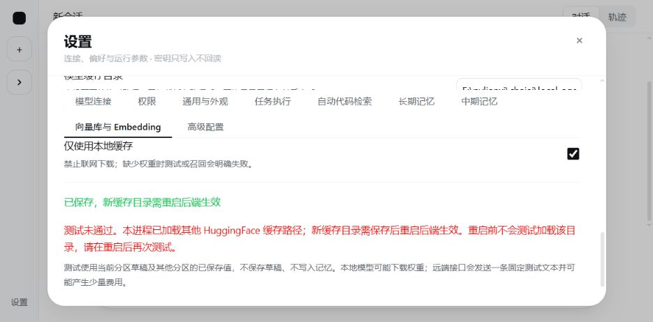

# 中期记忆与 Embedding 设置审查：真实案例（2026-10-06）

下面保留修复前的审查现场；用户随后确认“直接改”，实现与复验结果见本文末尾“修复落地”节。

本轮审查新增设置是否实际驱动记忆运行、是否兼容当前真实供应商，以及失败是否诚实可见。结论：**需要修改，当前真实千问配置不能通过正常记忆链路验收**。业务源码未修改；以下诊断进程的参数覆盖不代表修复已经落地。

## 必须改

1. **[P1] `src/local_agent/llm/embedding.py:442` → 兼容 API 适配器沿用 OpenAI 的 token 数组输入 → 当前千问的向量测试、召回、写入均失败 → 为兼容供应商发送字符串数组，显式处理输出编码与超长文本。**

   实际配置：`qwen3.7-text-embedding-flash`，端点 `https://maas.qianwenaiapi.com/compatible-mode/v1`。抓取项目 SDK 出站请求的类型（未记录鉴权头）：`input` 为嵌套 token ID 数组，`encoding_format=base64`。同端点返回 HTTP 400：`input must be an array of strings`。直接向同模型发送字符串数组并使用 float 编码成功，返回 1024 维向量；因此本次不是密钥缺失，也不是该模型没有向量能力。

   安装的 SDK 自身文档 `.venv/Lib/site-packages/langchain_openai/embeddings/base.py:166` 明确给出兼容 API 的原文输入开关；同文件 `:624` 将切分后的 tokens 发给供应商。候选参数如下，**本轮仅在诊断对象上使用，未改项目构造器**：

   ```python
   check_embedding_ctx_length=False,
   model_kwargs={"encoding_format": "float"},
   ```

   改动验收应覆盖查询和文档两条路径的出站字符串数组、真实千问测试通过、跨会话写入/召回成功、供应商超长输入处理；不能只测 `MemoryProbeResult` 的模拟成功值。兼容不同供应商时是否统一强制 float，还需按实际接口验证。

2. **[P2] `frontend/src/features/settings/PreferenceSection.tsx:48`、`:140` 与 `src/local_agent/llm/embedding.py:394` → 开放缓存目录修改并提示“下一次新任务生效”，但 HuggingFace 导入后缓存常量固定 → 保存成功且显示静态 ready，随后模型加载必然失败 → 明确缓存目录变更的生效边界，并在保存/测试反馈中处理需要重启的状态。**

   实证：进程构造目录 A 的 ONNX 适配器（注册表查询实际导入 FastEmbed/HuggingFace），通过应用服务把缓存目录 B 保存为版本 1，资源状态为 `ready`；构造 B 适配器后 `prepare()` 抛 `EmbeddingLoadError`，列出的 `HF_HOME`、`HF_HUB_CACHE`、`HF_XET_CACHE`、`AGENT_HARNESSES_PATH` 仍在 A 下。该失败发生在读取模型权重之前，不依赖联网或模型缓存是否齐全。

   最小改法是缓存路径变更需重启并给出准确状态/提示，避免继续承诺下一任务直接生效；如果要求热切换，就需通过独立加载进程处理导入时固定的缓存路径。这里不建议通过静默写到旧目录来绕开原有边界检查。

## 建议改

1. **`src/local_agent/model_settings/memory_settings.py:99` → 所有第三方异常压成相同的 `EmbeddingLoadError` 提示 → 真实 HTTP 400 与超时都只提示查模型缓存、网络、端点及密钥，用户无法定位格式兼容问题 → 保留安全的错误类别和 HTTP 状态，原始报文仍不直接回显。**

   本次设置测试首次 30.06 秒返回通用失败，再次 0.95 秒仍返回同文案；直接读取脱敏异常后才看到明确的输入类型错误。原来的“不返回供应商原始报文”防密钥泄漏设计应保留，建议映射为安全分类，如请求格式、鉴权、模型不可用、超时、缓存冲突。

## 不用管

- 显式测试没有保存草稿、没有创建目标集合：测试前后版本不变，目标 `vectors` 目录不存在。
- 运行配置确实进入 Checkpoint：实际三轮中期开关、`top_k=3`、`min_score=0.4` 与保存版本一致；关闭后的新任务开关为 false，召回引用和错误都为空。
- 已有集合检查仍保护数据：诊断的真实千问向量 + Chroma 集合有 1 条记录，匹配身份读取成功，不匹配模型被拒绝，检查后仍 1 条。
- 实际失败回答没有冒充成功：记忆写入答“没有保存成功”，新会话明确说检索失败、不能确认偏好；关闭记忆的新会话答不知道。
- 密钥没有落入本轮 JSON、SQLite 等测试产物；配置和 `.env` 文件内容哈希保持不变。

## 真实案例与证据

真实供应商为 DeepSeek `deepseek-flash` 和上述千问向量模型，均使用现有环境变量凭据。案例通过正式 FastAPI 装配点和 TestClient 传输执行，供应商 SDK、LangGraph、SQLite 和 Chroma 使用真实实现，无假聊天模型或假向量。独立数据目录为 `eval/memory-review-20261006`；聊天配置仅在测试对象中设置输出上限 2048、超时 60 秒、零自动重试，未保存到用户配置。

| 案例 | 结果 |
| --- | --- |
| 设置读取、启用向量草稿测试 | 读接口不建索引；真实向量测试失败；版本不变且不建库 |
| 明确要求记住“蓝鲸731项目只用 pytest，回答中文” | 真实 DeepSeek 4 次调用，11.33 秒；向量接口 HTTP 400；答复明确未保存，没有写入候选 |
| 新会话询问已保存的测试工具偏好 | 真实 DeepSeek 3 次调用，5.94 秒；`memory_refs=[]`；明确检索失败，无编造工具名 |
| 关闭中期记忆，再开新会话询问同一偏好 | 真实 DeepSeek 3 次调用，5.53 秒；没有召回引用和错误，明确不知道 |
| 同模型、同端点的原始字符串数组向量请求 | 成功，1024 维；该请求仅作格式根因诊断 |
| 诊断对象覆盖原文输入 + float 后真实向量写入/召回 | 成功，1 条记录，相似度 **0.788544**；覆盖仅在进程内，不能算项目已修复 |
| 诊断集合的匹配/不匹配身份检查 | 匹配读取 1 条，不兼容模型拒绝，记录数保持 1 |
| 同进程 ONNX 缓存目录 A → B | 保存版本 1、静态 ready，但实际加载失败；没有下载本地模型权重 |

三轮供应商上报的缓存率分别为 **44.77%、90.00%、82.49%**。这是不同问题/失败与关闭路径、不同缓存温度的短样本，**不是质量合格条件下的缓存 A/B**。第二轮达到 90% 时记忆检索仍失败，不能据此声明功能已验收或稳定高命中。

证据文件（相对 local-agent-web）：

- `eval/memory-review-20261006/run_live.py`：真实 API 案例脚本；运行方式为 `.venv/Scripts/python.exe eval/memory-review-20261006/run_live.py`，会新建隔离会话并调用实际供应商。
- `eval/memory-review-20261006/live-results.json`：三轮结果、参数快照、用量和用户配置未改的校验。
- 同目录 `remember_failed_embedding-snapshot.json`、`recall_failed_embedding-snapshot.json`、`recall_disabled-snapshot.json`：实际接口投影。
- 同目录 `embedding-wire-diagnostic.json`：实际请求类型、HTTP 400 与字符串数组成功的对照。
- 同目录 `cache-change-diagnostic.json`：缓存 A/B 生效冲突。
- 同目录 `real-vector-diagnostic.json`：仅诊断参数覆盖后的真实向量、相似度和集合兼容检查。

## 自动回归与范围

- 偏好/API 小专项 **23 passed / 53 deselected**；扩大到记忆层后最终 **151 passed / 2 skipped / 53 deselected**，25.29 秒，32 条既有 Starlette/Chroma 弃用警告。
- 前端偏好交互 **10 passed**。
- 扩大回归首次把临时目录放在项目 Git 根之下，导致六条“无 Git 时不同目录是不同项目”的测试前提失效（实际均归属同一 Git 根）。改用现有可写的仓库外临时目录后，全部 151 项通过；未改测试或业务代码。这是本轮执行环境问题，不是向量作用域回归。
- 真实千问参数覆盖是诊断手段，正式程序仍有上述兼容缺陷；本轮未验证真正的成功跨会话记忆链路、真实审批挂起恢复、本地 ONNX 权重加载或稳定缓存 A/B，审批恢复由自动测试覆盖。
- 首轮失败回答中“未保存”提示重复，是此次真实回答的质量观察，未扩展为无关主循环重构。

本轮仅新增审查记录、隔离测试脚本与证据，并将结论记入 T39。建议先修复两个必须改问题，再复跑成功链路和真实缓存/质量 A/B。

## 修复落地（2026-10-06，用户确认“直接改”）

两个必须改问题及安全错误分类已修复。兼容 API 的正式适配器使用原文字符串数组、float 输出；保留原来的归一化、模型身份与集合维度校验。超长文本不自动截断或按 OpenAI 模型拆分，由供应商明确拒绝。ONNX 缓存目录变更不尝试修改第三方已固化的模块常量，而是允许保存待重启配置，并在资源状态、保存结果与显式测试中提示重启。测试在重启前不加载新目录。

页面回归还复现了较早发出的设置 GET 在 PUT 成功后覆盖新响应的问题；保存成功后取消该设置查询，再写入保存响应，避免把待重启状态改回旧状态。新前端用例在该修正前失败，修正后通过。

本次修改文件（相对仓库根目录）：

| 文件 | 改动 |
| --- | --- |
| `local-agent-web/src/local_agent/llm/embedding.py` | 正式兼容 API 原文/float 参数，以及静态缓存重启判断与加载错误指引 |
| `local-agent-web/src/local_agent/model_settings/preferences.py` | 资源待重启标志、测试错误分类和安全 HTTP 状态 |
| `local-agent-web/src/local_agent/model_settings/memory_settings.py` | 待重启配置可保存、测试预检阻止加载、SDK 异常链安全分类 |
| `local-agent-web/frontend/src/features/settings/PreferenceSection.tsx` | 保存/准备/测试的重启文案，阻止旧查询覆盖保存结果 |
| `local-agent-web/docs/api/openapi.json`、`local-agent-web/frontend/src/api/schema.gen.ts` | 由正式接口导出并生成新增契约字段 |
| `local-agent-web/tests/test_memory_settings.py` | 真实 SDK 出站格式、超长输入无截断、错误脱敏、缓存变更与不写入检查 |
| `local-agent-web/tests/test_api.py` | 已加载缓存 A 后保存 B、读取/测试待重启状态且不加载模型 |
| `local-agent-web/tests/test_memory.py`、`local-agent-web/tests/test_web.py` | 原有静态准备状态用例明确隔离为未导入 HF 的新进程前提 |
| `local-agent-web/frontend/src/features/settings/Preferences.test.tsx` | 待重启保存、测试提示与响应状态回归 |
| `ARCHITECTURE.md`、`local-agent-web/README.md` | 记录兼容输入、超长文本、缓存变更重启和安全错误契约 |
| `V0_4_DEVELOPMENT_PLAN.md`、本文 | 记录 T39 修复与实际验收边界 |
| `local-agent-web/docs/ui-reference/t39-20261002/settings-cache-restart-fixed-20261006.png` | 隔离实例缓存 B 保存/测试后的实际页面证据 |

### 正常生产实现的真实案例

使用相同 DeepSeek `deepseek-flash` 与千问 `qwen3.7-text-embedding-flash`，正式 FastAPI、SDK、LangGraph、SQLite、Chroma 实现；**不覆盖适配器私有参数，不使用假向量/假聊天模型**。全部数据与工作区隔离，用户 `config.yaml` 和 `.env` 哈希保持不变。聊天超时 60 秒、零重试、输出上限 2048 只在案例配置对象中设置。

修复后先完整重跑原先的个人偏好案例，保存在 `eval/memory-fix-20261006`：千问向量测试已通过且不再报接口错误，但没有记忆写入。原因是模型提取为 `entity_fact`，按既有 `src/local_agent/reflection/memory_candidates.py:188` 分派到长期事实库，而案例主动关闭了长期记忆；这不能算中期写入验收，失败结果完整保留。没有擅自改变记忆分层契约。

随后用全新目录 `eval/memory-fix-summary-20261006` 明确要求保存“本次对话总结”，长期记忆仍关闭，走正常中期记忆链路。召回阈值仅在隔离设置库中设为 `min_score=0.4`、`top_k=3`，用来验证当前千问模型链路；实际相似度低于用户启动配置的 0.72，**不能据此声称原阈值也能召回，不能把该校准值当成所有模型的通用默认值**。

| 案例 | 实际结果 |
| --- | --- |
| 千问草稿向量测试 | 0.92 秒、1024 维；未保存版本、未创建目标向量库 |
| 保存“pytest 执行测试、中文错误报告、下次验证向量召回”的对话总结 | 12.67 秒、4 次真实聊天调用；保存 1 条 `conversation_summary`，回答与写入状态均明确成功，无错误和工作区工具调用 |
| 独立新会话询问该项目测试工具偏好 | 4.26 秒、3 次聊天调用；实际中期引用 1 条，相似度 **0.564463**；正确答 pytest、中文报告，来源明确为已保存记忆 |
| 显式测试已有集合 | 1024 维、1 条记录；测试前后均 1 条 |
| 保存不匹配的向量模型 | HTTP 422 拒绝；记录仍 1 条 |
| 关闭中期记忆，新会话再询问 | 5.64 秒、3 次调用；无引用/错误，明确“不知道”；原记录仍保留 |

保存答复包含重复成功提示，召回答复的来源解释偏长，作为回答质量观察保留，没有顺手修改提示或主循环。成功链路三轮缓存率 **45.02% / 83.56% / 90.45%**；其中 90.45% 是关闭记忆路径。这些是短样本，不是同题同温度的质量/缓存 A/B，不能宣称稳定 90% 或证明本次修复对缓存率无影响。

### 本地缓存页面与新进程验证

`eval/memory-fix-summary-20261006/preview_cache.py` 启动隔离设置库/工作区的正式页面和后端；UI 服务使用假聊天模型，不向供应商发送聊天请求。本地模型只实际导入 FastEmbed 注册表以固定 HF 缓存 A，**未加载或下载 ONNX 权重**。浏览器将目录改成 B 并保存后，页面显示“已保存，新缓存目录需重启后端生效”；点击测试返回明确重启提示，B 目录仍不存在。另起新进程用 `--status-only` 读取同一份设置，版本 1、目录 B、`restart_required=false`，静态状态明确“模型缓存尚未验证”。这证明待重启配置持久化和新进程读取，不证明 B 已有可用权重。



### 最终验证与复现

- Python 全量 **1018 passed / 7 skipped**，208.61 秒；前端全量 **276 passed / 31 files**，12.10 秒；类型、ESLint、生产构建、Ruff、Mypy（97 源文件）和 OpenAPI 类型漂移检查通过。
- 首次全量 2 条失败是旧静态状态测试隐含“HF 尚未导入”的前提，与前序真实导入的进程状态冲突。明确隔离前提后重跑全量通过；新的待重启测试仍验证实际冲突边界。最终有 32 条既有依赖弃用警告和 1 条 pytest 缓存目录写入权限警告，均未影响测试执行；没有改依赖。
- 两个修复案例目录扫描 26 个文件，未发现实际供应商密钥字节；用户配置与 `.env` 内容未改变。原审查目录保留。
- 在 `local-agent-web` 执行 `.venv/Scripts/python.exe -m pytest -q -p no:cacheprovider` 可复跑自动回归；临时根须位于本项目 Git 根之外且可写，避免改变无 Git 项目作用域测试的前提。前端目录执行 `npm test`、`npm run build`、`npm run lint`、`npm run check:api`。
- 真实证据：`eval/memory-fix-summary-20261006/live-results.json`、`remember-snapshot.json`、`recall_new_session-snapshot.json`、`recall_disabled-snapshot.json` 与 `ui/fresh-process-status.json`。真实重跑需把 `run_live.py` 放入新的隔离目录再执行 `.venv/Scripts/python.exe <新目录>/run_live.py`，以免复用已有记忆；会调用实际供应商并产生费用。
- 实际使用：重启当前后端加载修复，在“向量库与 Embedding”点击“测试当前配置”；若更换已加载的本地缓存目录，先保存、重启后端、重新测试，再开始新任务。

本轮不改主循环、反思提示、计划工具 Schema 或记忆类型分派；未测试真实 ONNX 权重加载、超长文本的真实供应商边界及稳定缓存/回答质量 A/B。超长输入由真实 SDK + 模拟 HTTP 400 验证完整发送、无截断及安全错误，不能冒充供应商真实长度实测。

## 后续剩余验收（2026-10-06）

用户要求“待验收的全部测试”后已全部执行，详见 [剩余验收实测](memory-settings-acceptance-20261006.md)。真实 ONNX 权重/无网络重载、缓存 A→B 保存与重启后实际加载、真实长文本拒绝、真实审批挂起/重启/幂等、四条真实代码质量案例均通过。当前 0.72 阈值的千问有答案样本命中仅 8/17，BGE 12/17；正式千问自然问法也复现漏召回，质量未通过。当前产品开关 ABBA 的 8 次续问均 94.55%–96.09%，供应商与应用用量一致；12 轮中 1 轮不合法记忆候选触发 MEMORY_WRITE_FAILED，严格无错误质量门槛未通过。未改业务源码/用户配置、未回退代码、未降低验收标准；不能声明整体记忆体验或稳定 90% 已验收。

## 后续处理（2026-10-07）

已修复新任务的实体候选双层 JSON 转义问题：允许对象内容由代码序列化，静态格式检查进入原有一次重试；旧格式、旧循环/闲聊逐条报告、来源/作用域保护保持。最终 Python **1032 passed / 7 skipped**、Ruff/Mypy 通过。真实开工前源码快照再次复现拒写错误；定稿独立两组 6/6 无错误，续问 **94.55%–95.27%**、加权 **95.41%**，代理/应用 token 一致。引用总数 29→19，未声明 T43 全门槛通过。

独立保留集不支持单阈值标定：千问开发集选择 0.63 后仍仅 13/17，BGE 0.71 仅 11/17。正式 API 在隔离默认 0.53 下，17 条有答案问题答对 16，10 条缺失具体信息的问题均拒绝编造；仍有一条漏召回和一条相关度数值回显。实际向量复核确认行为约束使同一自然问题分数 0.565→0.527，`normalized_request` 整段用于检索会影响结果。没有自动修改用户阈值、回退已验证修复或将整体质量标为验收。替代测试顺序的 5 条 HF 假模型隔离失败也在开工前源码复现，单独记录。完整证据与复现见 [候选修复与召回复测](memory-settings-quality-fix-20261007.md)。
