# T39 页面展示与浏览器数据收口：2026-10-02

状态：展示、审批恢复与会话/工作区管理已实现，并通过自动回归及隔离页面复验。完整 T39 仍有真实模型和目标 Windows 的人工门槛未完成。本文不替代 T38 人工验收、T40 打包或 T37 朋友试用。

## 已确认原因与参考实现

1. 原页面把运行提示放在输入框附近，主回答区域在模型等待期几乎静止；用量未知字段和检索详情占据默认阅读流。
2. 审批参数直接铺开，会把长原文和内部指纹放在决定按钮之前。展开工具结果时，证据摘要仍含原始工具名与 JSON。
3. 模型调用事件不是实时阶段信号：`src/local_agent/application/service.py:1821` 与 `:1851` 在调用记录到达后一起投影开始和完成；不能据此宣称模型刚刚进入某个具体思考阶段。
4. 内容搜索的总数是匹配数，原卡片按文件数展示；一份文件里命中多行时出现错误计数。

实际读取的参考：

- DSH：`D:/ideaTest2/deepseek-harness/packages/client/ui-tool/src/client/tool/components/ToolRow.module.css:18`，运行行使用 2.6 秒扫光。沿用按真实运行状态显示动效的思路，适配到本项目的窄幅过程行；参考了仓库已有 UI 截图。本轮没有启动 DSH 再测模型。
- Codex 开源 TUI：`E:/pylianxi/codex/codex-rs/tui/src/status_indicator_widget.rs:225` 的运行计时、`:236` 的活动指示器与 `:244` 的文字 shimmer。公开检出未找到桌面客户端的 Web UI 源码，因此这里只参考 TUI 的状态表达，不宣称照搬桌面 React 实现。

## 本轮实现

- 回答区域增加运行反馈、持续计时、转圈和文字动效；等待审批时静止。计时读取持久提交时间，缺失或无效时不编造。支持减少动态效果的系统设置。
- 工具执行行只有真实运行时才扫光；待执行、成功、失败分别显示。每轮过程集中折叠，失败自动展开，轨迹保持原发生顺序。
- 检索详情、每轮统计和审批参数默认折叠；审批参数有高度上限，决定按钮可直接到达。空计划不显示“0/0 已完成”。工具、参数和调用用途使用可读名称。
- 内容搜索展示真实文件和行号，明确区分“处匹配”与“个文件”，有界截断并提示继续缩小范围。
- 浏览器 DTO、SSE 和序列化 OpenAPI 排除无业务必要的运行上下文元数据、线程/Checkpoint 标识、输出/动作/提示/工具 Schema 等指纹。内部 Python 对象仍可保留诊断字段。
- 服务端显示参数采用白名单并限制长度；工作区内审批目标显示相对路径。未知 JSON 结果不直接展示，证据摘要改用结构化结果摘要；错误文本翻译操作名、隐藏机器路径。公开诊断编号稳定，但不含运行、节点或工具 ID。

没有改模型消息组装、提示、工具定义、实际执行参数、缓存逻辑、审批安全策略或反思节点。动效不增加模型请求或轮询。现有决策流仍会缓冲正文，此次没有改变其输出策略。

## 字段边界

| 分类 | 本轮处理 |
| --- | --- |
| 默认可见 | 回答、真实运行状态、可读动作、失败原因和下一步、需要决定的审批目标 |
| 主动展开 | 有界文件正文/匹配行/终端输出/diff、操作参数、来源、用量与逐次调用事实 |
| 操作必需的协议标识 | 会话、运行关联、工具调用、审批、消息和事件的必要不透明标识继续用于操作、重连和幂等，不当作页面文案 |
| 不进入浏览器 | 未筛选的模型扩展字段、完整 Prompt、密钥、未筛选扩展参数、内部上下文快照与上述诊断指纹；证据不直接回显原始 JSON |

T38 的外部路径审批是明确例外：用户必须确认实际目标，保留其必要的完整目标路径；普通错误与输出不因此获得回显机器路径的许可。用户主动提交的内容、业务文件内容和有界修改预览仍有其正常用途，不承诺“浏览器里完全没有任何文本或 ID”。

## 改动文件

以下路径以 `E:/pylianxi/chaiai/local-agent-web` 为根；工作区已有其他未提交改动，本清单只列本轮落点。

| 路径 | 作用 |
| --- | --- |
| `frontend/src/features/conversation/RunActivity.tsx`、`.module.css`、`.test.tsx` | 新增真实状态反馈、计时、动效和时钟清理验证 |
| `frontend/src/app/LiveApp.tsx`、`LiveApp.test.tsx` | 根据运行/审批/安全正文状态生成展示，翻译连接提示 |
| `frontend/src/features/conversation/Conversation.tsx`、`.module.css` | 按轮聚合过程、折叠统计、跟随滚动、过程动效 |
| `frontend/src/features/conversation/adapters.ts`、`adapters.test.ts` | 空计划、在途统计、四态工具、类型化搜索映射和可读用途 |
| `frontend/src/features/memory/MemoryRow.tsx`、`.module.css` | 默认折叠检索信息，失败仍可见 |
| `frontend/src/features/approval/ApprovalCard.tsx`、`.module.css`、`.test.tsx` | 可读操作与参数、隐藏内部审批 ID、有界参数展开 |
| `frontend/src/features/tool/ToolRow.tsx`、`.module.css`、`display.ts` | 可读标签、状态扫光、证据文案 |
| `frontend/src/features/tool/ToolCards.tsx`、`ToolCards.test.tsx` | 匹配数量和文件数量分开 |
| `frontend/src/features/trace/TraceInspector.tsx`、`TraceView.tsx`、`.module.css` | 可读参数及待执行状态 |
| `frontend/src/features/plan/PlanStrip.module.css` | 执行点动效及长目标溢出约束 |
| `frontend/src/fixtures/types.ts` | 状态反馈视图、待执行工具与匹配计数单位 |
| `src/local_agent/application/models.py` | 公开序列化排除诊断元数据、类型化匹配行 |
| `src/local_agent/application/events.py` | SSE 排除输出指纹 |
| `src/local_agent/application/projection.py` | 参数白名单、审批路径、结构化摘要与搜索结果、公开失败文本/诊断编号 |
| `src/local_agent/api/schema_extras.py` | SSE 使用序列化 Schema |
| `docs/api/openapi.json`、`frontend/src/api/schema.gen.ts` | 同步公开契约与生成类型 |
| `tests/test_projection.py`、`tests/test_events.py`、`tests/test_api.py` | 负例、序列化往返、审批展示边界 |
| `E:/pylianxi/chaiai/V0_4_DEVELOPMENT_PLAN.md`、本文件、同名截图目录 | 实施记录与实际页面证据 |

## 验证结果与复验步骤

- 前端：28 文件、254 项 Vitest 通过；TypeScript、生产构建、ESLint 通过。构建仍有既有的大文件体积警告。
- Python：最终全量 **962 passed / 7 skipped**（156.27 秒），包括失败状态负例和诊断编号改动；32 条上游弃用警告。相关投影/SSE/API 的中途定向回归为 139 passed，最终结果以全量为准。
- Ruff、Mypy（95 个源文件）通过；OpenAPI 导出检查和前端 API 漂移检查通过。
- 实际本机 API 快照和会话列表抽查：上述排除字段未出现在响应中。单元测试覆盖 SSE 序列化及规范化往返。
- 浏览器使用实际应用与确定性假模型，工具实际在隔离测试目录执行。已核对空会话、运行/完成、搜索、工具拒绝、审批、diff、轨迹、长回答及刷新恢复；保存 1280×800 与 1440×900 的代表截图，并非所有状态在两个尺寸都完成完整组合验收。

复验页面：本轮保留的 `http://127.0.0.1:8128/` 是隔离假模型预览，不连接真实模型；服务停止后地址失效。

1. 新建会话并发消息，观察回答区的状态动效和计时；运行期间刷新，确认用户消息没有重复。
2. 查看已保存的搜索会话，展开执行过程与结果，确认“处匹配 / 个文件”以及实际行号；切到轨迹核对同一操作。
3. 查看审批截图：1280×800 中参数默认折叠，决定按钮可见。真实复验修改时先核对目标与预览，批准后核对文件及 diff，再刷新检查是否重复执行。
4. 长回答会话滚到底部，确认输入框和统计仍可到达；开关系统减少动态效果设置，确认文字状态仍可理解。

运行自动检查（在上述项目根目录，前端命令在 `frontend` 下）：

```powershell
.venv/Scripts/python.exe -m pytest -q -p no:cacheprovider --basetemp "$env:TEMP/chaiai-t39-review"
.venv/Scripts/python.exe -m ruff check src tests
.venv/Scripts/python.exe -m mypy src
.venv/Scripts/python.exe scripts/export_openapi.py --check
# cd frontend
npm test
npm run lint
npm run build
npm run check:api
```

`basetemp` 应使用工作区外独立测试目录，避免工具路径策略把它当项目仓库。隔离启动辅助脚本位于本地忽略目录 `eval/t39-ui-review/launch.py`，用于绕开原假模型脚本相对存储路径的问题；它不是正式启动入口，也没有把测试数据库混入分发产物。

## 必须如实保留的未验收项

1. **审批恢复阻断：首次验收复现，继续一轮已修复**。最初批准修改后，文件确实变化，回答却报 `RuntimeError: 最终回答增量早于本轮 run 绑定`。根因是新回答 sink 只在图更新含 `run_id` 时才绑定，而恢复路径跳过初始化节点。修复与复验证据见下节；旧失败记录中已经发生的文件副作用不会自动重放或修复，仍须人工核对。
2. **回答质量问题继续延期**：假模型统一回复无法用来判断真实回答是否可靠；缺证据仍说“完成”等已知质量问题沿用上一轮独立记录，本轮没有修改主循环。
3. **缓存未重新实测**：本轮不改模型请求构造，相关前缀回归仍通过；没有新的真实供应商命中率数据，不把之前的 96% 外推成这轮保证。
4. **人工门槛未全部完成**：真实连接的在途/审批模型切换、T38 权限页实际往返、所有状态双尺寸组合、旧 Playwright 截图基线更新、T40 打包与 T37 朋友试用仍未验收。现有自动测试通过不能替代这些步骤。
5. **测试环境说明**：早期假模型启动时发现相对记忆路径没有完全隔离，随后换成全部绝对路径的隔离数据目录。一次重启使假模型“已发出工具”的进程内状态复位，额外提出一次审批，该请求已拒绝；此现象不作为浏览器刷新重放证据。最终版本展示复验使用新的隔离目录，不删除原有项目数据。

## 截图

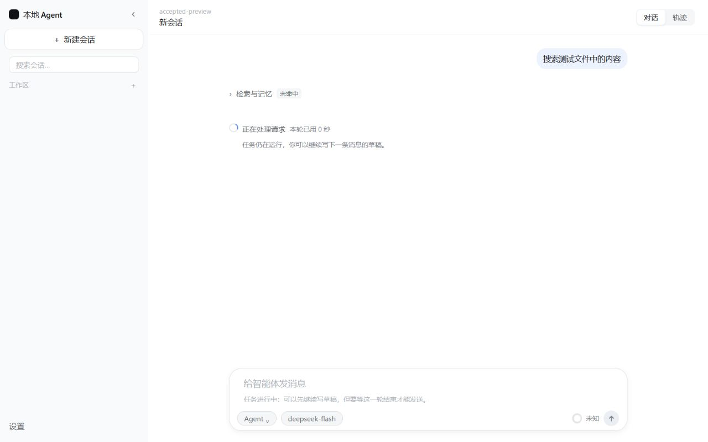

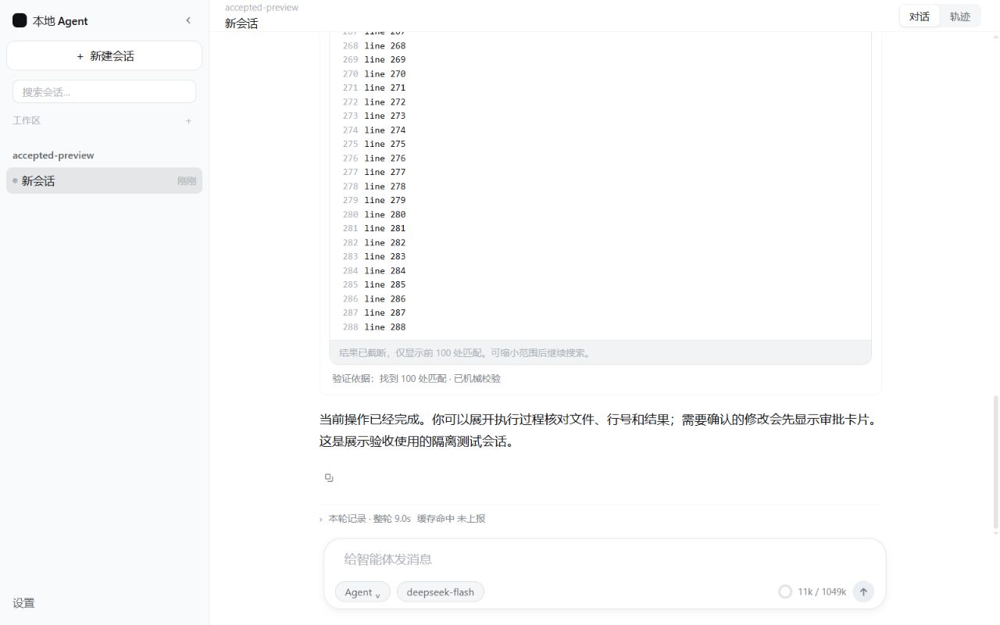

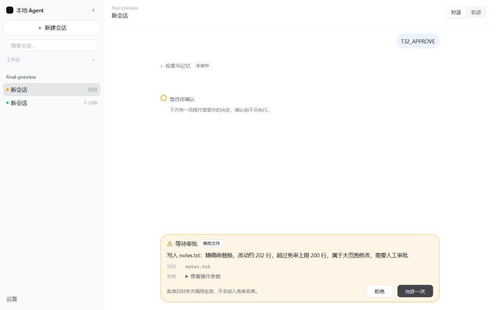

差异、长回答及其他阶段证据保存在 `t39-20261002/`。文件名含 `final` 的截图用于最新展示修正复验；早期截图保留上下文，不冒充最终状态。

## 继续一轮：审批恢复修复

用户“继续”后，本轮单独处理上一轮记录的审批恢复阻断。没有调整前端、提示、工具 Schema、实际执行输入或审批权限。

- **生产改动**：`src/local_agent/application/service.py:1258` 在图运行前读取当前请求台账；对已经绑定原运行的恢复请求，预先绑定回答 sink 和用量记录器。新提交的台账尚未绑定运行，继续沿用初始化节点输出后绑定的原流程，不读取上一轮标识来冒充新运行。
- **为什么信任该标识**：审批恢复的 `_guarded` 在执行前已经通过待审批检查、会话锁和当前 Checkpoint 校验，并将原运行写入此请求的台账。这次消费已有事实，不重新初始化图、不重做工具、不生成另一轮任务。
- **回归**：`tests/test_application.py:614` 增加批准/拒绝 × 同进程/重新打开服务的四种场景。批准场景在改动前复现未绑定异常；修复后验证 SSE 开始、增量和完成帧归属原运行且与持久回答对应。拒绝由机械层直接确认，不要求它调用模型或伪造流式帧。四种场景都验证请求重放不增加模型调用、消息或 Checkpoint/台账行，下一次用户提交获得新的运行标识。
- **最终自动结果**：Python **966 passed / 7 skipped**，162.75 秒，32 条上游弃用警告；Ruff 和 Mypy（95 源文件）通过。前端本轮未改动，沿用上一轮 254 项及构建验证。
- **实际页面**：隔离测试模型、真实文件编辑和审批链路。在 1280×800 中批准 `notes.txt` 大范围修改后，页面正常显示完整回答和已完成状态。刷新后 API 仍为 completed / approved、1 条用户消息、1 条工具行、2 次模型调用；文件为 100 行，刷新前后 SHA-256 均为 `2af0bb0706b9c8d951445ab4b60095eb557b0e996440979202d41eb881a080b2`。批准前参数和阈值均来自实际产品安全判定，没有放宽审批。
- **边界**：本次没有新的真实供应商缓存测量或真实回答质量结论；也不会自动重新执行旧的异常审批请求。T38 人工权限往返、真实连接的模型切换、完整双尺寸组合及 T40/T37 门槛仍按前述待办推进。

本轮额外文件：此文、`E:/pylianxi/chaiai/V0_4_DEVELOPMENT_PLAN.md` 和截图 `resume-pending-1280.jpg`、`resume-completed-1280.jpg`、`resume-reloaded-1280.jpg`。

定向复验（项目根目录，使用工作区外独立临时目录）：

```powershell
.venv/Scripts/python.exe -m pytest -q -p no:cacheprovider tests/test_application.py -k streaming_approval_resume --basetemp "$env:TEMP/chaiai-approval-resume-review"
```

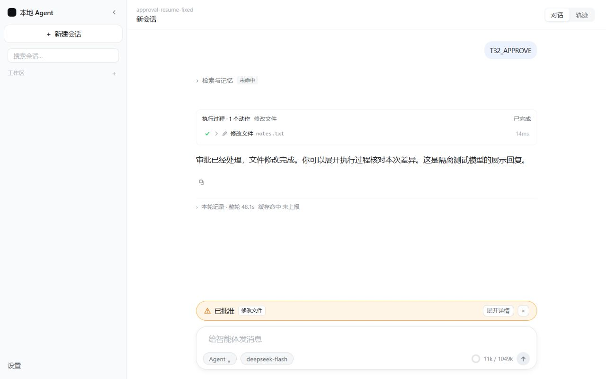


## DSH Think 与实时消息补充（2026-10-02，用户确认开工）

本轮已实现展示功能。用户明确选择 DSH 的 Think 展示后，覆盖此前“不显示供应商思考”的边界：只展示供应商实际返回的 `reasoning_content` 的脱敏、有界副本，没有该字段不生成 Think。没有为了动画增加模型调用，也没有改变系统提示、工具 Schema、任务完成/审批/证据判据或供应商历史回传。

参考已读取的本地 DSH 检出：`D:/ideaTest2/deepseek-harness/packages/client/ui-conversation/src/client/chat/ReasoningRow.tsx:28`（折叠、首行/末行预览）、同目录 `ReasoningRow.module.css`（运行态扫光）、`AssistantMarkdown.tsx:65`（思考展示）。实现同一交互思路，没有引入 DSH 运行依赖。

### 本轮文件与用途

以下相对路径均基于 `E:/pylianxi/chaiai/local-agent-web`：

- `src/local_agent/ui/decision_streaming.py`：Agent 同一次调用实时发布思考和中间正文，完整聚合工具调用；异常只重试模型一次。
- `src/local_agent/ui/streaming.py`：闲聊等既有实时输出补思考通道，保留完整扩展字段与用量。
- `src/local_agent/application/models.py`、`events.py`：思考、通道、截断及增量序号契约；reset 明确清除失败的正文和思考。
- `src/local_agent/application/projection.py`：仅投影实际供应商思考，脱敏后限 16,000 字符并标记；原消息不改。安全分段保护完整敏感值与未结束的私人路径。
- `src/local_agent/application/service.py`：安全 sink 分通道，在途只读展示副本供刷新/订阅；按完整消息 id 接管，离开执行清理副本。审批恢复编号接续历史，避免覆盖审批前带工具调用的消息。
- `frontend/src/features/conversation/ReasoningRow.tsx`、`.module.css`、`.test.tsx`：Think 默认折叠，运行预览末行/结束预览首行、扫光、可展开的有界纯文本区域及减少动态效果支持；读者上滚时不强制跟随。
- `frontend/src/features/conversation/Conversation.tsx`、`.module.css`、`.test.tsx`：正文实时光标；工具各自折叠，保留思考/说明/工具的顺序，移除跨正文搬运整轮工具的外层折叠。
- `frontend/src/features/conversation/streamTail.ts`、`.test.ts`：两个通道独立累积，边界快照恢复，重叠 started/delta 去重，新 reset 清除两个通道。
- `frontend/src/features/conversation/adapters.ts`、`.test.ts`、`frontend/src/fixtures/types.ts`、`frontend/src/app/LiveApp.tsx`、`.test.tsx`：思考及流式状态映射、真实“正在思考”阶段、工具直接展开的测试调整。
- `docs/api/openapi.json`、`frontend/src/api/schema.gen.ts`：从代码重新导出的契约和前端类型。
- `tests/conftest.py`、`test_streaming.py`、`test_projection.py`、`test_application.py`、`test_t43_main_loop.py`：确定性模型思考增量、失败重试、脱敏与上限、在途刷新只读、审批恢复不覆盖历史、既有主循环行为回归。
- 根目录 `E:/pylianxi/chaiai/ARCHITECTURE.md`、`V0_4_DEVELOPMENT_PLAN.md`：同步用户确认的展示边界与实现记录。本文件及 `docs/ui-reference/t39-20261002/think-*.jpg`、`no-think-1440.jpg` 记录页面证据。

隔离预览辅助脚本位于忽略的 `eval/t39-ui-review/launch.py`；仅用于本次确定性页面验证，不作为正式启动入口。

### 验证结果

- 后端全量 **974 passed / 7 skipped**，285.55 秒；32 条上游弃用警告。最终在途只读/审批历史/分段脱敏专项复验 **5 passed**。在途用例监测读取线程不得写 Checkpoint，避免把图的异步写入误判为读取副作用。
- 前端全量 **259 passed / 29 files**；TypeScript、ESLint、生产构建通过。Vite 保留既有大于 500 kB 的包体警告，本轮不拆包。
- Ruff、Mypy（95 源文件）、受控 OpenAPI 与生成类型漂移检查通过；本轮文件的 `git diff --check` 无空白错误。
- 真实图 + 确定性模型验证：Agent/闲聊均在模型结束前收到实际思考；重订阅含已输出前缀与序号、不重跑模型；完成与重新打开服务保留完整思考；审批批准/拒绝及原运行标识回归通过；缓存前缀回归通过。
- 实际浏览器：1280×800 捕获 Think 运行态、工具和思考按序展示；在途刷新后仍收到 Think 增量。1440×900 展开完成的思考与统计。无思考字段的会话 Think 行数为 0。另走过思考→大范围编辑审批→批准→修改→回答，截图为 `think-approval-1280.jpg`；该流程沿用真实审批阈值。
- 另记录一个既有会话选择现象：切到较早会话后刷新，页面回到列表最新会话；本轮未修改会话选择持久化，后续单独验收。
- `T30_ERROR` 双重模型异常显示“执行结果尚不能确认，请刷新核对”，没有自动重提请求；快照仍为 running、运行提示尚在。这个既有恢复待核对态没有改成终态，也不把它记作正常失败闭环通过；完整恢复态视觉收口保留为 T39 待验项。

### 复验步骤与边界

在 `local-agent-web` 重启 `uv run python -m local_agent.api` 并刷新页面（生产前端已经构建）。选择实际返回思考字段且启用流式的模型，发送一个读取文件任务：Think 默认折叠且动态更新，正文逐段出现，工具按序展示；展开 Think，运行期间刷新，再核对最终消息及审批动作。模型未返回思考时只显示实际进度和正文。

本轮没有重新测量真实供应商缓存命中率或真实回答质量；不能把确定性截图中的模拟思考/回复视为真实供应商实测。辅助模型的结构化输出不展示，未增加“解释思考”的模型请求。没有实现 DSH 全部页面，也没有把 T39 全部人工矩阵、T40 打包与 T37 朋友试用标为通过。

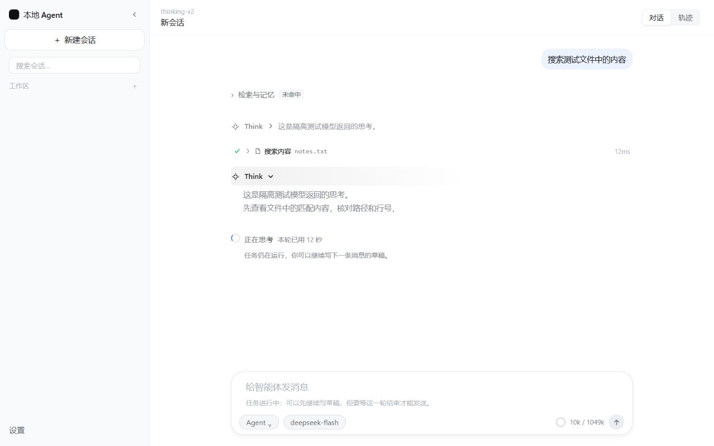

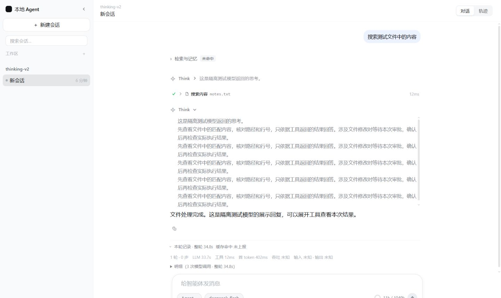

## 会话与工作区管理补全（用户确认“开始做”）

### 原因与参考

- `persistence/session_store.py:163` 的工作区列表现已由独立登记产生；原实现从会话路径去重，前端隐藏无法在刷新后保持。底层原有重命名方法此前没有接口和菜单。
- DSH `packages/workspace/workspace/src/index.ts:191` 的删除契约保留目录与全部日志；`packages/client/ui-workspace/src/client/rows/Rows.tsx:386` 将会话归档解释为隐藏且保留日志，菜单包含改名/归档。Codex `codex-rs/app-server/src/request_processors/thread_processor.rs:625,666,757` 分别提供归档、改名和恢复。采用职责和交互思路，不引入这些项目的依赖或桌面私有源码。

### 文件清单与实现

| 文件（相对 local-agent-web） | 本轮职责 |
| --- | --- |
| `src/local_agent/persistence/migrations.py`、`session_store.py` | 聊天库 v5，工作区登记/别名/移除、会话归档、旧路径迁移、原子活动项切换 |
| `src/local_agent/application/service.py`、`models.py` | 管理用例与归档字段；复用执行锁；运行/审批保护；显式选择持久化；SSE 快照取最新显示名称 |
| `src/local_agent/api/routes.py`、`schemas.py` | 名称 PATCH、归档/恢复/选择 POST、登记 DELETE；名称 1–60 字符与非空白校验 |
| `docs/api/openapi.json`、`frontend/src/api/schema.gen.ts` | 从同一真实接口生成传输文档和前端类型 |
| `frontend/src/api/client.ts`、`queries.ts` | 管理请求、归档列表查询、会话/登记/快照失效刷新 |
| `frontend/src/components/Sidebar.tsx`、`Sidebar.module.css`、`SidebarItemMenu.tsx` | 行菜单、名称表单、移除确认、键盘/焦点处理、失败保留输入、归档恢复入口 |
| `frontend/src/features/sidebar/adapters.ts`、`fixtures/sidebar.ts` | 全部会话分组；移除登记后进入未分组；未分组标题为普通文本 |
| `frontend/src/app/LiveApp.tsx` | 打开/归档/恢复/移除联动；恢复工作区目标；空会话禁用输入并提示；新建失败反馈 |
| `tests/test_api.py`、`test_catalog_persistence.py` | 真实 API、历史/用量保持、运行/审批拒绝、旧库迁移和重启持久性 |
| `frontend/src/components/SidebarItemMenu.test.tsx`、`features/sidebar/adapters.test.ts`、`app/LiveApp.test.tsx` | 失败重试、取消、键盘/外部关闭、未分组历史与工作区目标恢复 |
| 根目录 `ARCHITECTURE.md`、`V0_4_DEVELOPMENT_PLAN.md`、本文与截图 | 同步新的数据边界和验收状态 |

会话归档保留 Checkpoint、模型选择、请求台账、消息和用量；正常列表不显示它，恢复后仍是同一线程。归档当前会话会在事务内激活最近的正常会话，最后一个归档允许无活动项。恢复不自动打开，也不重新登记已移除目录。工作区别名只改变显示名称；移除只更新登记的 removed 标记，全部历史会话仍可从“未分组会话”打开，显式重新添加同一目录会恢复分组和别名。新会话仍沿用已登记的选择，未选择目录时使用启动默认目录并登记它。

运行中或待审批的会话不能归档；移除工作区会取得全部关联正常会话的执行锁并检查状态，失败保持登记。显示名称可以修改；持续 SSE 订阅投影时读取当前显示名称，避免旧捕获对象覆盖新名称。管理操作不执行图、不产生模型调用，不改提示或工具 Schema。

### 验证结果

- Python 全量：**983 passed / 7 skipped**（176.72 秒）；最后显示名称/锁边界改动后，API、应用服务和迁移专项 **105 passed**（53.08 秒）。32 条全量警告为既有依赖弃用提示。
- 前端全量：**264 passed / 30 files**；菜单/适配/应用专项 **31 passed**；最后空输入与工作区恢复改动后，含新增恢复目标用例的应用专项 **17 passed**。
- TypeScript、ESLint、Ruff、Mypy（95 源文件）、OpenAPI 导出一致性和生成类型检查通过；生产前端已构建。既有 Vite >500 kB 包体警告保留。
- 浏览器采用 `http://127.0.0.1:8130`、`eval/t39-ui-review/catalog-v1` 隔离库和确定性模型；未操作真实用户会话。实际操作：新建两会话 → 一条生成消息 → 改名 → 选旧会话并刷新 → 当前归档切换 → 恢复原消息 → 工作区改名 → 确认移除并刷新 → 未分组历史仍可打开 → 归档最后一个 → 空列表和恢复入口 → 恢复旧消息。1280×800 与 1440×900 保存管理/移除/恢复/空态截图，无水平溢出。
- 旧 v4 库升级、移除/归档后关闭重开数据库、恢复不重登记目录、显式添加恢复名称/分组由真实 SQLite 用例验证。运行锁与真实待审批流程由接口用例验证。

### 使用与待验边界

在 `local-agent-web` 重启 `uv run python -m local_agent.api`，刷新页面。行右侧“⋯”打开菜单；会话可重命名/归档，侧栏“已归档会话”可恢复；工作区可重命名/移除，确认说明明确保留文件和历史。选旧会话后刷新，标题和消息应仍对应该会话。

本轮不是永久删除实现；没有重新测真实供应商的缓存命中率或回答质量，不将截图中的测试思考/回复算作供应商实测。完整 T39 的人工矩阵、恢复待核对态视觉、T40 打包与 T37 朋友试用继续待验。另确认空会话时“选择会话模型”入口仍无可用会话选择动作（`LiveApp` 的 modelMenu 依赖快照）；按本轮已确认的侧栏管理范围只记录，后续输入区菜单收口处理。

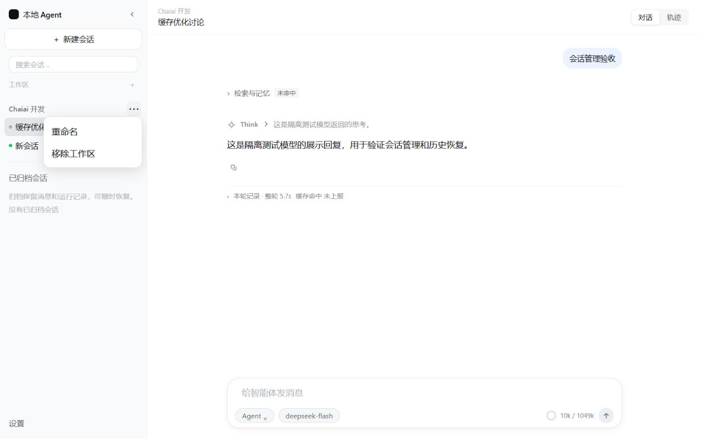

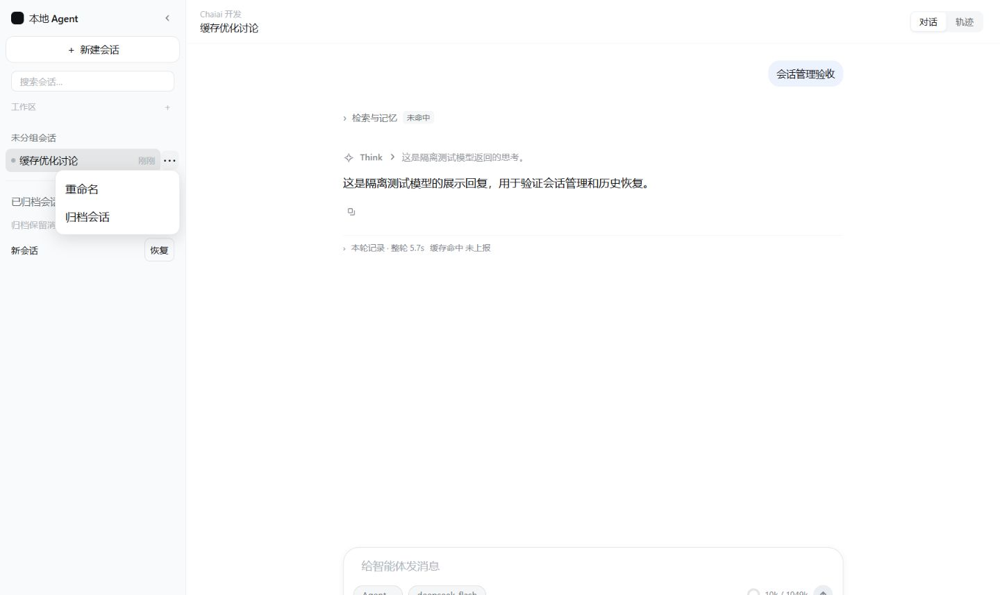

## 设置扩展（用户确认“开始吧”）

参考 DSH 的分组卡片与保存/放弃/恢复操作、Codex 的独立界面偏好与减少动态效果语义。
参考源码已读：`D:/ideaTest2/deepseek-harness/packages/client/ui-settings-plugins/src/client/BashCard.tsx:20`、
`E:/pylianxi/codex/codex-rs/tui/src/local_settings.rs:22`；只借鉴现有能力的设置入口，不移植新运行依赖。

### 改动文件

| 文件（相对 local-agent-web；根文档用 ../） | 职责 |
| --- | --- |
| `src/local_agent/model_settings/preferences.py` | 偏好校验、实际加载配置的初值、白名单概览、独立运行配置覆盖与版本写入 |
| `src/local_agent/model_settings/store.py`、`persistence/migrations.py` | 设置库 v3 与偏好 store 装配；旧连接/权限数据保留 |
| `src/local_agent/application/service.py`、`errors.py`、`graph/state.py` | 保存/冲突文案；每轮 Checkpoint 配置快照；审批恢复固定原值；旧快照回到启动配置 |
| `src/local_agent/api/container.py`、`routes.py` | 配置 store 注入与 `GET/PUT /api/preferences`；无库只读，写入 503 |
| `docs/api/openapi.json`、`frontend/src/api/schema.gen.ts`、`api/client.ts` | 从真实接口生成偏好契约和传输方法 |
| `frontend/src/features/settings/PreferenceSection.tsx`、对应 CSS | 五组表单/只读概览、取消/恢复、错误保留草稿、切页保留草稿、重新读取 |
| `frontend/src/features/settings/preferencesContext.ts`、`PreferencesProvider.tsx`、`frontend/src/main.tsx` | 加载已保存外观、共享偏好、系统主题/减少动画订阅 |
| `frontend/src/features/settings/SettingsDialog.tsx`、对应 CSS、`ModelSettingsDialog.tsx` | 七分区真实入口，粘性导航与窄窗换行 |
| `frontend/src/components/Composer.tsx`、`features/conversation/ReasoningRow.tsx`、对应 CSS | Enter/Ctrl/Command 发送与 IME 防误发；Think 默认展开，单消息手动切换优先 |
| `frontend/src/styles/tokens.css`、`components/Sidebar.module.css` | 深色语义色、文字缩放、减少动画与深色按钮文字对比 |
| `tests/test_preferences.py`、`test_api.py`、`test_model_settings.py`、`frontend/src/features/settings/Preferences.test.tsx` | 迁移/重启/CAS、审批固定配置、无库降级、保存/失败/取消/系统外观/快捷键测试 |
| `README.md`、`../ARCHITECTURE.md`、`../V0_4_DEVELOPMENT_PLAN.md`、本文与截图 | 使用方法、契约、状态及验收证据 |

### 实现与生效时间

- **通用与外观**：浅色/深色/跟随系统、三档字号、界面动画、发送快捷键、默认展开 Think。保存后即刻生效；同时尊重系统减少动态效果。普通 Enter 和 Ctrl/Command+Enter 二选一，Shift+Enter 始终换行，输入法确认不误发送。
- **任务执行**：每轮工具循环上限、每步重试、命令超时/输出字符上限。
- **代码检索**：开关、扫描文件/返回结果上限、检索超时、上下文行数。
- **长期记忆**：开关、召回置信度/有效重要性阈值、老化开关/天数。阈值按实际源码只影响召回过滤，不限制写入；关闭不删除已保存记录。
- **高级配置**：启动时压缩开关/比例、轮数/工具步保留、字符预算/阈值、短期/中期记忆与 AGENTS 状态，只读白名单，无路径/密钥/命令规则。

运行参数初值来自实际加载的 YAML，保存不重写 YAML。每轮提交复制已保存的执行/检索/记忆值与版本进 Checkpoint；在途与待审批恢复（含重启）不改用最新值。旧 Checkpoint 没有快照时保持加载配置的原行为。外观不进入模型 Prompt；本轮没有改压缩、工具协议或独立增加模型调用。用户修改检索/记忆可能改变质量和缓存，未作“任何设置都不影响缓存”的承诺。

### 验证与复验

- Python 全量：**990 passed / 7 skipped**，226.83 秒；最后收紧高级概览为纯数值/开关后，偏好与 OpenAPI 专项 **10 passed**（含新增路径负例）。32 条全量警告来自既有 Starlette/Chroma 弃用提示。
- 前端全量：**271 passed / 31 files**，包含新增 6 条偏好交互测试；TypeScript、ESLint、生产构建、Ruff、Mypy（96 源文件）、OpenAPI 导出与生成类型一致性通过。既有 Vite >500 kB 提示保留。
- 隔离预览：`http://127.0.0.1:8131/`，使用 `eval/t39-ui-review/preferences-v1` 的独立库和确定性假模型，未改真实配置和用户会话。验证五组入口、外观保存立即生效/刷新恢复、执行参数保存提示、检索草稿切页保留/取消、高级只读、Enter 换行/Ctrl+Enter 发送与 Think 默认展开。
- 浏览器视口 640×800、1280×720、1440×900；640 时 `documentElement.scrollWidth=640`，对话框 `clientWidth=scrollWidth=592`；保存截图记录真实深色界面。

用户复验：前端已构建；在 `local-agent-web` 重启 `uv run python -m local_agent.api`，刷新页面后打开“设置”。修改外观并保存，刷新确认保留；执行参数保存后提交新任务；等待审批期间再改参数，恢复旧任务应继续使用原值。高级配置不应出现保存按钮。

本轮未重新测真实供应商缓存率/回答质量；截图中的思考和回复为隔离测试模型。未实现永久清理、数据库路径迁移、关闭强制审批或插件扩展，T39 整体人工矩阵/T40 包/T37 朋友试用仍待验。

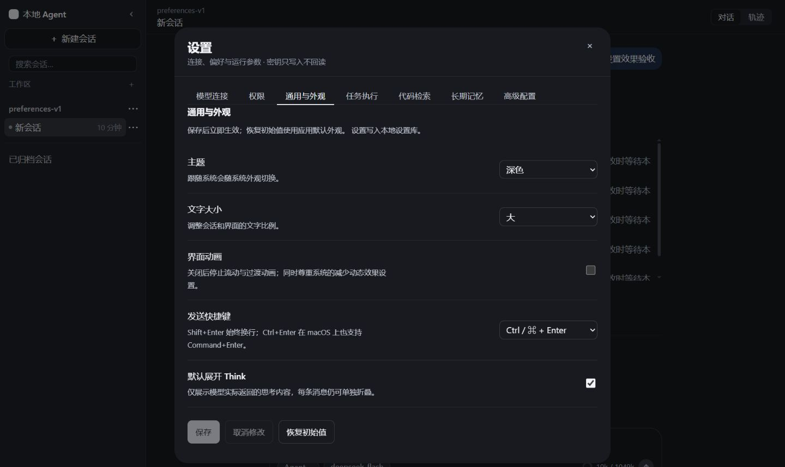

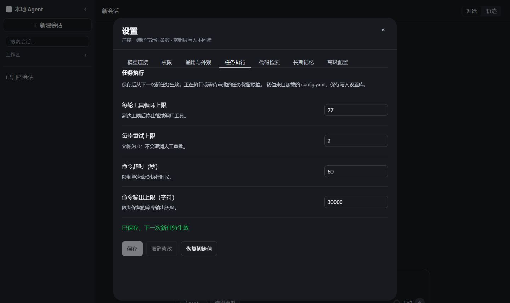

## 设置复审修复（2026-10-03，用户确认“你直接帮我更改”）

根因与处理：设置 v3 的非幂等建表在表创建后、版本记录前退出时不能恢复，改为 `CREATE TABLE IF NOT EXISTS`；记忆阈值的 HTML 步长只接受两位小数，与后端的 0–1 任意小数契约不符，改为 `step="any"` 并保留上下限；偏好查询永久缓存且全局 provider 常驻，设置分区重新挂载时强制读取当前值，已经编辑的草稿仍使用原基准版本。自动代码检索的说明明确只作用于任务前检索，不改变模型主动调用的 grep/glob。

本轮文件（相对 local-agent-web）：

- `src/local_agent/persistence/migrations.py`：中断迁移可重试，保留已有偏好和版本。
- `frontend/src/features/settings/PreferenceSection.tsx`：小数校验、重开读取、检索作用范围。
- `frontend/src/features/settings/SettingsDialog.tsx`：分区名称改为“自动代码检索”。
- `tests/test_preferences.py`：空表/有偏好的中断迁移重启及重复执行测试。
- `frontend/src/features/settings/Preferences.test.tsx`：配置含三位小数时修改其他选项、上下限校验，以及全局 provider 常驻时重开读取和保存当前版本；既有草稿冲突保护测试继续通过。
- `README.md`、`../V0_4_DEVELOPMENT_PLAN.md`、本记录：作用范围、复验步骤与结果。
- `docs/ui-reference/t39-20261002/settings-threshold-fixed-20261003.png`、`settings-refresh-fixed-20261003.png`、`settings-retrieval-scope-20261003.png`：实际隔离页面证据。

验证：新增回归在修复前分别出现建表重复错误、小数 HTML 校验失败和设置不读取失败；修复后 Python 设置/模型连接/API 专项 **136 passed / 1 skipped**，前端全量 **273 passed / 31 files**，TypeScript、ESLint、Ruff、Mypy 与生产构建通过。Starlette 弃用提示和 Vite >500 kB 提示为既有提示。

隔离浏览器仍使用 8131 与 preferences-v1 数据库：0.755/0.503 保存成功，再修改记忆开关成功；B 页把工具循环上限 27 改为 28，A 页关闭并重新打开设置显示 28，继续保存 29 成功，之后恢复 27。记忆开关与阈值也恢复测试前值。没有提交真实模型请求或修改真实用户配置。

用户复验：在 local-agent-web 重启后端并刷新页面；“长期记忆”输入 0.755 后保存；打开两个页面，在 B 保存执行参数，再在 A 关闭/打开设置，确认读取 B 的值并可继续保存。升级中断恢复由真实 SQLite 回归测试覆盖，勿在真实数据库中手工删版本记录。

本轮未重测真实模型缓存命中率和回答质量；没有调整模型主循环、提示、工具 Schema 或检索工具行为。

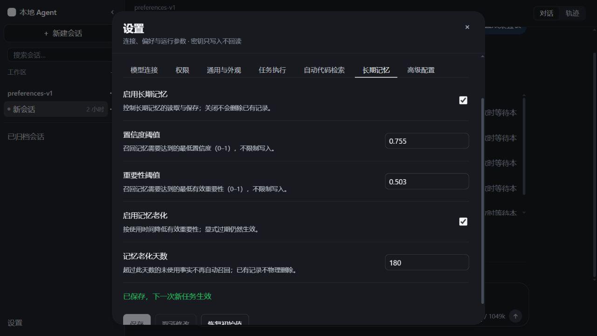

## 中期记忆与向量库设置（2026-10-03，用户确认“开始吧”）

设置页新增“中期记忆”和“向量库与 Embedding”两组，现共九组。中期记忆可保存开关、召回条数、最低相似度和衰减半衰期；Embedding 可选择本地 ONNX 或兼容 OpenAI 的 API，并保存对应模型、缓存目录/仅本地文件、端点/密钥环境变量名与明文 HTTP 确认。API 密钥仍放在环境变量或 `.env`，页面不接收和展示原始密钥。

向量库显示 Chroma、实际目录、集合、依赖安装情况、已有索引及 Embedding 准备状态。向量库目录和集合只读，本轮不提供迁移、重建、清空或记录管理。准备状态只检查配置与依赖；“具备加载条件”不代表已生成过向量。读取和保存设置不发 Embedding 请求，显式点击“测试 Embedding”才用固定文本生成一条向量；测试可能调用 API 或下载本地模型，不保存草稿、不写记忆、不创建集合。

启用中期记忆会检查 Embedding 开关、准备条件和 Chroma 依赖；变更模型时检查已有集合的已知身份。测试和实际运行还检查向量维度与距离空间，防止旧集合混入不兼容向量。API 测试使用 30 秒请求超时、零自动重试，正常任务原有超时/重试默认值保留。API 异常先脱敏再进入运行状态；测试错误也不返回供应商原始报文。

新配置从下一次新任务生效；在途任务和审批恢复使用原快照。旧偏好 JSON、旧客户端未传的新分组均兼容，向量库目录、集合及写入策略保留启动配置。外观等无关设置保存不会触发模型加载或向量库检查。

### 本轮文件

以下路径相对 local-agent-web，根文档用 `../`：

| 文件 | 改动 |
| --- | --- |
| `src/local_agent/model_settings/preferences.py` | 两组偏好、旧数据补齐、运行快照、资源与测试 DTO、端点校验 |
| `src/local_agent/model_settings/memory_settings.py` | 静态准备状态、启用条件、显式向量测试、错误脱敏 |
| `src/local_agent/memory/medium_term.py` | 复用已有集合兼容性检查，不创建或写入集合 |
| `src/local_agent/llm/embedding.py` | 测试专用超时/重试参数、API 错误中的密钥脱敏 |
| `src/local_agent/application/service.py`、`api/routes.py` | 保存依赖检查、版本冲突保护、`POST /api/preferences/memory/test` |
| `frontend/src/api/client.ts`、`docs/api/openapi.json`、`frontend/src/api/schema.gen.ts` | 测试接口与真实生成契约 |
| `frontend/src/features/settings/PreferenceSection.tsx`、对应 CSS | 两组表单、只读资源、草稿测试、状态反馈、窄屏布局 |
| `frontend/src/features/settings/SettingsDialog.tsx`、`ModelSettingsDialog.tsx` | 两个设置入口 |
| `tests/test_preferences.py`、`test_memory_settings.py`、`test_api.py`、`test_memory.py` | 持久化、旧客户端、审批快照、端点/密钥、真实临时 Chroma 兼容性与关闭路径 |
| `frontend/src/features/settings/Preferences.test.tsx` | 依赖失败保留草稿、取消、切换供应商清理字段、测试不保存、版本传递 |
| `README.md`、`../ARCHITECTURE.md`、`../V0_4_DEVELOPMENT_PLAN.md`、本文 | 操作、契约、验收与限制 |
| `docs/ui-reference/t39-20261002/settings-{medium-memory,vector-local,vector-api-test,vector-640}-20261003.png` | 实际隔离浏览器截图 |

### 验证结果

- Python 全量：**1003 passed / 7 skipped**；最后增加运行异常密钥脱敏和关闭路径测试改进后，专项 **151 passed / 2 skipped / 53 deselected**。全量不是末轮专项的替代，本记录分别保留两次结果。既有 32 条 Starlette/Chroma 弃用警告保留。
- 前端全量：**275 passed / 31 files**；最后调整保存/测试忙碌提示后，偏好专项 **10 passed**，生产构建再次通过。
- Ruff、Mypy（97 个源模块）、TypeScript、ESLint、OpenAPI 导出与生成类型一致性通过；既有 Vite >500 kB 提示保留。
- 真实临时 Chroma 集合包含一条记录：同模型/维度测试通过，模型或维度不匹配被拒绝，测试后记录数和元数据保持不变。Embedding 使用确定性测试适配器，没有真实供应商请求。
- 关闭中期记忆的既有测试原来断言 Chroma 从未被整个测试进程加载，遇到先运行向量测试时产生顺序依赖；现直接拦截本次调用的加载入口，并检查模块状态未变化，继续验收“不加载依赖、不创建索引”。

### 实际页面复验

隔离预览为 `http://127.0.0.1:8132/`，使用 `eval/t39-ui-review/memory-v1` 独立配置、数据库、模型缓存目录及假聊天模型，没有改真实用户库或提交真实供应商请求。

1. 中期记忆保存召回条数 11、最低相似度 0.555 成功；未启用 Embedding 时启用中期记忆被拒绝，草稿保留，可取消。
2. ONNX 切换 API 时模型及本地专属字段清理；填写隔离 API 配置后，显式测试报告缺少环境变量密钥，没有向该端点发请求。中期记忆关闭时可先保存该 API 配置，刷新恢复；此时启用中期记忆被准备条件阻止。
3. 测试草稿不保存，编辑后清除旧测试结果；保存与测试各显示对应忙碌提示。完成后恢复测试前的中期记忆与 Embedding 值。
4. 640×800 时页面 `scrollWidth=640`，设置面板 `clientWidth=scrollWidth=534`，未出现水平溢出。

用户复验：在 local-agent-web 重启 `uv run python -m local_agent.api` 并刷新页面，打开新增两组。缺少可选记忆依赖时使用项目已有安装方式 `uv sync --extra memory`。ONNX 填写模型与缓存目录；“仅使用本地文件”开启时需要已有模型文件。API 填写模型、端点、密钥环境变量名，将对应密钥加入环境变量或 `.env` 后重启后端。先显式测试，再保存并启用中期记忆，新任务应使用已保存参数；修改后恢复审批中的旧任务应仍使用原参数。

本轮未测真实供应商缓存命中率、回答质量或实际模型下载；浏览器中的 API 测试覆盖准备条件失败，成功生成与集合兼容性由确定性适配器和真实临时 Chroma 测试覆盖。T39 整体人工矩阵仍待验，不能据此声明整个 T39 完成。

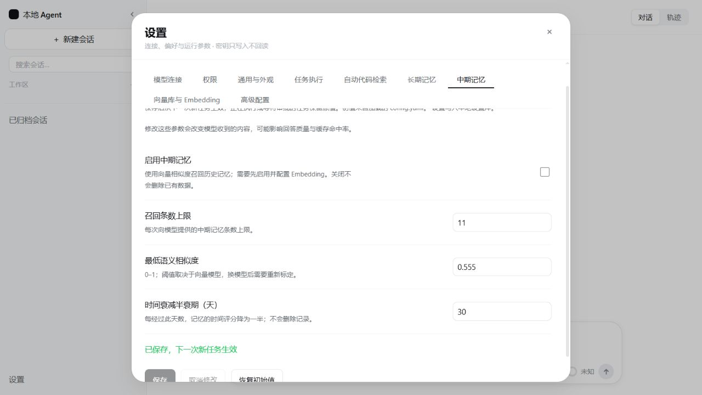

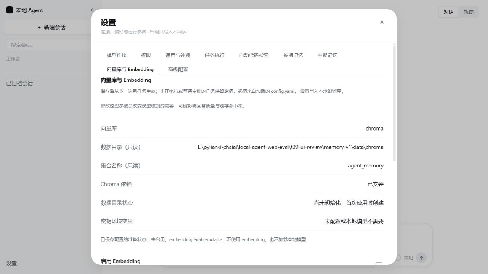
